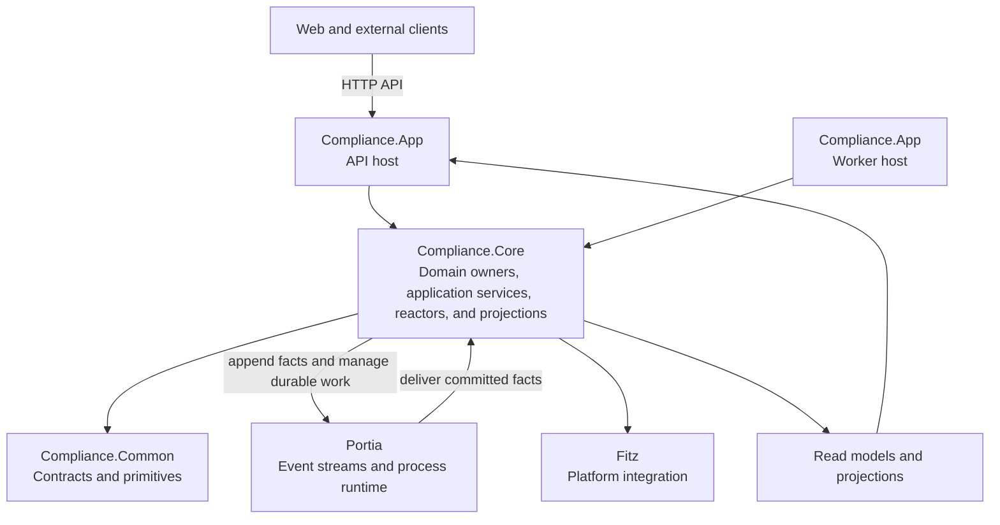

# System architecture

Compliance Core is a .NET backend with an API host and a background worker. Both use the same Core application layer. Core owns domain behavior and integrates with Portia for event-sourced persistence and Fitz for platform capabilities. Common contains contracts and primitives shared across the layers.

App depends on Core, and Core depends on Common. Common does not depend on either host layer. Clients consume the backend API contract; client implementations live in their owning repositories.

The target domain model, including aggregate boundaries, commands, events, and reactor outcomes, is documented in [`docs/proposed`](../proposed/README.md). The architecture decision records below capture system-wide technical choices. Proposed catalog rows describe intended behavior and do not by themselves prove runtime implementation or qualification.

## Architecture decisions

- [Client tenancy and operator provisioning](decisions/0001-client-tenancy-and-operator-provisioning.md)
- [Authorization and tenant isolation](decisions/0002-authorization-and-tenant-isolation.md)
- [Event-sourced history and effective versions](decisions/0003-event-sourced-history-and-effective-versions.md)
- [Immutable snapshots](decisions/0004-immutable-snapshots.md)
- [Import reconciliation and background processing](decisions/0005-import-reconciliation-and-background-processing.md)
- [Artifact content storage](decisions/0006-artifact-content-storage-spike.md)
- [Read models, projections, and as-of calculations](decisions/0007-read-models-projections-and-as-of-calculations.md)
- [Snapshot manifest regeneration](decisions/0008-snapshot-manifest-regeneration.md)
- [Tenant identity federation and context](decisions/0009-tenant-identity-federation-and-context.md)
- [Verified-email identity recovery](decisions/0010-verified-email-identity-recovery.md)
