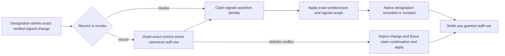
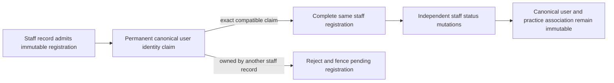
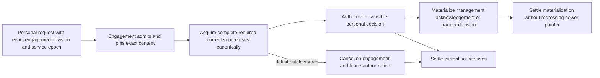
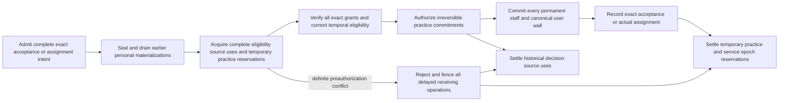
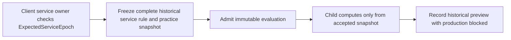
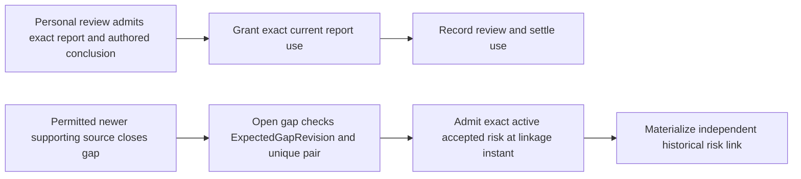
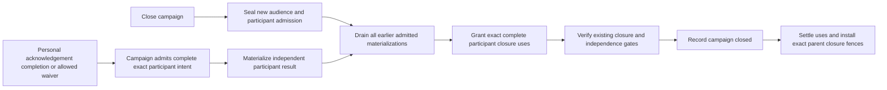

# Additional admission and independence choreography

These diagrams supplement the [20 source/lifecycle flows](choreography-flows.md) with newly explicit admission protocols. They use the exact [receiver catalog](target-reactor-contracts.md), [durable payloads](durable-intent-schemas.md) and [ordered test traces](design-review-traces.json). Content references are complete and verified before admission. A committed source plus durable process recreates every continuation after a crash.

## Professional duty and active staff

Record requires the exact assertion user to match an active staff fact. Revocation keeps its existing independent signed authority. Acquire required staff use before the permanent assertion claim; keep it through native recording. A used assertion identity claim is permanent. Signed validity is checked at the declared frozen decision instant, and a use cannot extend that interval. LOCK-19 defines stale staff, delayed commands and revocation acceptance.

## Permanent canonical staff registration

StaffMemberId is the creation identity; initial expected staff revision is zero. A canonical identity claim never migrates to another staff record because of deactivation. Exact claim proof resumes registration without requiring a newly emitted event.

## Personal engagement decisions

Management acknowledgement does not invent partner-duty prerequisites. Partner evaluation requires its exact current staff/duty/rule/ratification and service facts. All temporal intervals must hold at irreversible DecisionAt. Admission alone cannot materialize the personal decision. Authorized historical work finishes forward. LOCK-05 defines the epoch/cancellation race.

## Engagement acceptance and actual staff assignment

Freeze the whole final reservation set before acquiring it, using canonical stream-key order without upgrades. Every temporary acquire, including practice reservations, derives from the original immutable ServiceEngagementAcceptanceRequested or ServiceEngagementStaffAssignmentRequested, so no acquire requires another grant event first. Process dispatch follows the recorded complete key manifest, not source row order. EngagementPracticeCommitmentsAuthorized requires all exact epoch/source/practice grants and current temporal validity before any permanent wall. LOCK-20 deliberately places a practice key before the epoch key to prove the ordering.  No permanent commitment can be erased after irreversible authorization. Source changes invalidate old eligibility authoritatively; reevaluation cannot reactivate acceptance. Permanent walls survive removal and closure.

## Historical client independence preview

An infrastructure gap is not an empty service history. Preview cannot reserve practice authority or satisfy engagement acceptance. Its own EvaluationId identifies the immutable operation and result.

## Provider review and accepted-risk linkage

Review and gap lifecycle have different owners. Review source uses hold through native decision. A link admitted before later closure still materializes; closure first prevents new linkage. Risk linkage never closes a gap. LOCK-03 fixes this ordering.

## Campaign participant admission and closure

Required ExpectedCampaignRevision belongs to the campaign, not a new participant. Preserve current acknowledgement, training and waiver actor/evidence rules. Existing admitted work cannot disappear because close won a later append. A temporary use release must retain the closed-parent generation fence.
