# Cross-owner choreography definitions

These diagrams describe the target protocols required by the aggregate boundary audit. A reactor receives a committed fact, validates its source identity, and sends typed commands to business owners. [Additional admission/independence flows](admission-choreography.md) cover professional duty, canonical staff, personal decisions, permanent practice commitments, previews, provider links and campaign participants. It does not become a second authority. Each receiver validates its own invariant and exact source proof. Current source reactors are indexed in [`reactor-contract-catalog.md`](reactor-contract-catalog.md); selected future effects and exact receiver commands are in [`target-reactor-contracts.md`](target-reactor-contracts.md); aggregate command, event, guard and test contracts are in [`aggregate-boundary-specification.md`](aggregate-boundary-specification.md).

Every flow that spans owners needs tests for: replay after receiver append but before checkpoint save; unknown append outcome; transient dependency failure preserving the source checkpoint; stale/superseded source; exact retry with no duplicate fact; changed intent under the same key; and concurrent conflicting operations. The flow-specific tests below add the relevant invariant.

## 1. Identity recovery — ACCESS-12 / CHOREO-01

Both proofs authorize an immutable preparation. Protect the exact associations before accepting the swap; acceptance then requires automatic completion.

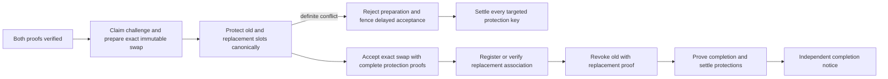

Use the frozen challenge/account/identities/actor/provenance. Never persist bearer tokens. Before acceptance, competing associations may reject preparation; after acceptance complete forward without another personal invocation. Existing same-account association and same-target revocation proofs resume the process even when they emit no new event. Test competing registrations/challenges, delayed acquires after rejection, crashes after each owner append and independent notice failure.

## 2. Tenant administrator withdrawal and restoration — ACCESS-01

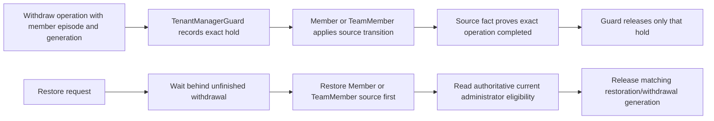

The guard must not clear every reason for a member. Restore cannot release a pending withdrawal before its source command is fenced. Suspend, deprovision and reinstate always enter through the guard; when the episode has no contribution and no pending transition the guard records `TenantManagerSourceMutationAdmitted` and the source applies unchanged, so a concurrent administrator registration for that episode observes the mutation. Team assignment and removal enter through the guard only for the administrators team. Test the restore-between-hold-and-source race, multiple independent reasons, old episode callbacks, and crash recovery at each arrow.

## 3. Membership retirement and relationship cleanup — CHOREO-03/06, ACCESS-08

The current retirement slice uses immutable membership proofs and exact episode-bound receiver commands. The selected public identities and administrator fencing are specified in source-admission-contracts.md; their backend implementation remains pending.

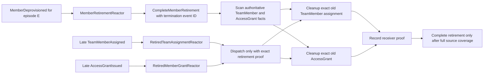

Guards: each effect key includes source event, kind, canonical target owner, episode and exact termination event; active current episode causes no effect; unknown/missing authority is transient; checkpoints never skip undiscovered source tails. Test reverse completion order, late assignments after the scan cut, 1000+ unprojected relationships, retry after E2 registration, and proof mismatch.

## 4. Type II date reservation and period close — CHOREO-04/10

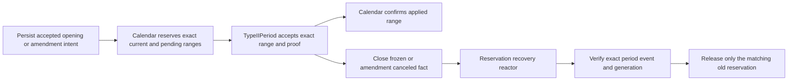

A durable operation ID connects calendar holds and period facts. Amendments hold both date ranges until applied; cancellation fences delayed application before release. Close releases only its exact reservation after authoritative frozen-close proof. Test overlaps under concurrency, unknown calendar/period writes, cancellation racing delayed application, and interrupted close.

## 5. Application import and complete publication — ROOT-01/02, CHOREO-05

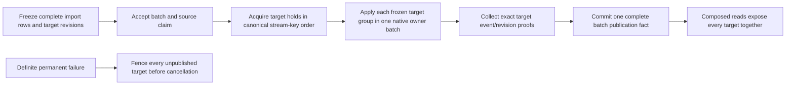

Target replay consumes the complete frozen row group, initial target revision and source identity; it does not query live batch settlement to mutate business state. The batch owner retains the only publication gate for that exact batch. Test two batches acquiring overlapping targets in opposite source order, crash after partial target application, unknown commit outcome, and no partial read visibility.

## 6. Tenant registration and slug lifecycle — CHOREO-08

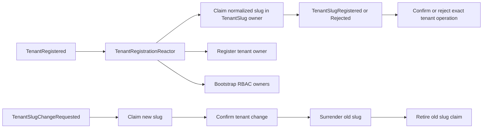

Slug uniqueness is enforced by TenantSlug, not a preflight directory read. Outcome receivers compare the exact source operation and treat a proven old result as no-op; changed intent remains conflict. Test checkpoint replay after later slug changes, rejection replay, simultaneous same-name claims, and old surrender arriving late.

## 7. Invitation acceptance and provisioned authority

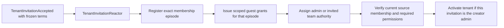

Each target is its own authority: Member owns the episode, AccessGrant owns grant terms, TeamMember/TeamRole own assignments, Tenant owns activation. Test replay after partial provisioning, invitation retry after expiry, new invitation generation after prior acceptance, and episode change before grant/activation.

## 8. Challenge, invitation and recovery notice delivery — CHOREO-07/13

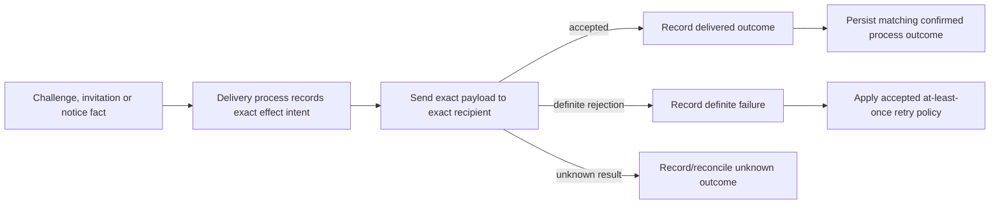

Keep delivery attempts outside domain event streams. Preserve at-least-once challenge/invitation delivery; keep digest’s stricter rule against automatic retry after unknown send. Test crash after SMTP acceptance before outcome append, callback from an old attempt, exact payload on retry, and notice retry independent of recovery completion.

## 9. Source decisions that create findings

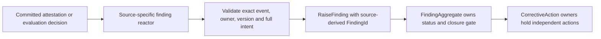

The target ID binds source identity and effect kind. Replayed source facts return the accepted result without a duplicate finding. Test every source fact variant, changed source revision, duplicate replay, and migration/unavailable receiver recovery.

## 10. Risk method and boundary reassessment

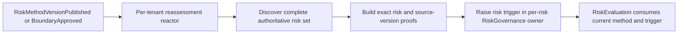

Reassessment cannot erase a permanent independence commitment or accept a risk by itself. The receiver deduplicates on risk, trigger kind and source event. Test checkpoint retention when discovery is incomplete, source changes during discovery, duplicate trigger replay and risks added late.

## 11. Firm staff status and accepted service epochs

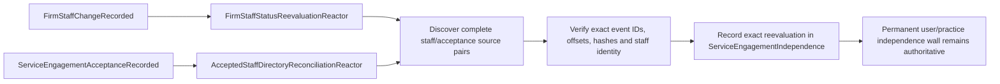

Both trigger directions are required for status-before-acceptance and acceptance-before-status. Use complete source coverage and exact immutable source pairs. Reevaluation cannot reactivate a prior acceptance automatically. Test either event ordering, projection lag, late staff assignment and stale service epoch.

## 12. Significant change impact and description decisions — CHOREO-09

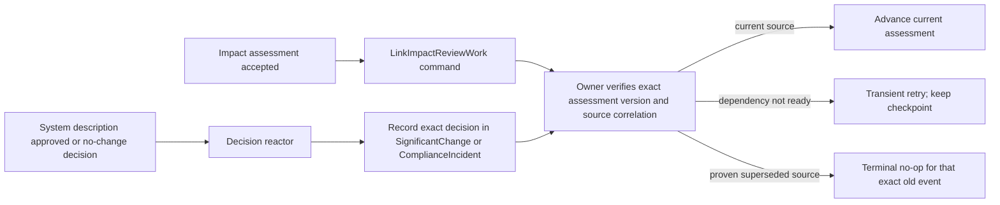

An obsolete source event must not become a permanent conflict that blocks the checkpoint, and it cannot decide a newer assessment. Test the race between impact work and description decision, new assessment superseding old work, dependency lag, and exact terminal replay.

## 13. Type II expected occurrence materialization — CHOREO-10

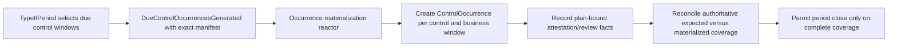

Selected work and materialized work are distinct. All generators use one deterministic identity per control/window. Test partial materialization, replay from the generation event, two generators racing the same window, and close blocked by missing authoritative occurrences.

## 14. Atomic bulk access decisions

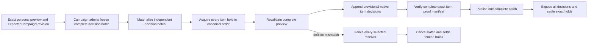

No partial success or smaller item selection is allowed. Tests include single-item edits racing holds, crash after any provisional append, unknown publication and cancellation before an unacquired target's delayed apply.

## 15. Handoff feedback admission and materialization

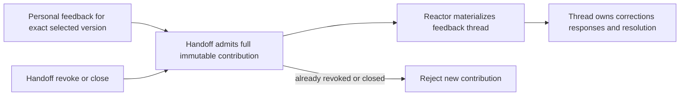

Admission and revocation serialize on Handoff. An admitted contribution still materializes after revocation; the receiver uses its accepted proof and does not require the handoff to remain ready.

## 16. Auditor response admission and request resolution

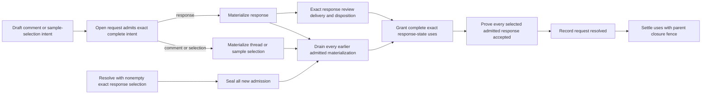

Response selection is nonempty and complete. Comments and sample selections must materialize but have no invented external-disposition requirement. Amendment keeps population identity and advances version. Close cannot discard accepted work. Reopen changes request generation, retaining historical children; old callbacks cannot resolve a new generation.

## 17. Finding action admission and closure

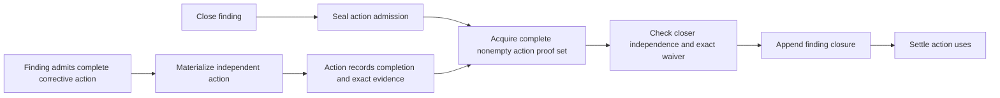

Reopen advances the finding generation. Exact replay of the old close returns its original result and cannot close the reopened finding. A requested-action finding atomically admits its default action with initial creation.

## 18. Readiness latest assessment and gap-plan seal

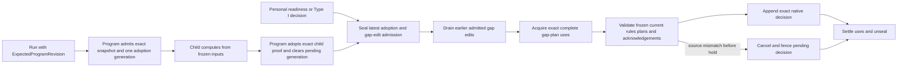

A pending run blocks decisions on the previous latest. Program and child revisions differ. The single approved Type I pointer stays at program scope; no newer assessment/plan may slip between validation and append. Cancellation never substitutes newer inputs.

## 19. Name claim and record change

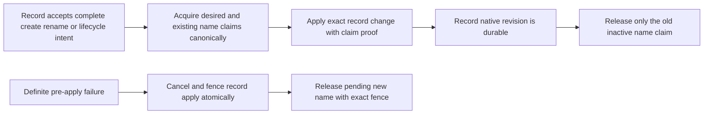

Provider, Location and OperationalProcess use their existing normalization and uniqueness scopes. Unknown target append never releases a claim. A delayed release cannot remove a newer claimant.

## 20. Package build and personal delivery recording

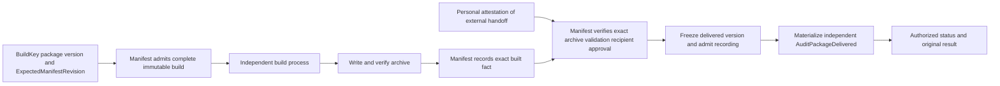

RecordAuditPackageDelivery records a handoff performed by the personal actor. It freezes authored DeliveredAt/reference and server RecordedAt separately. Admission serializes validation/approval/amendment races and preserves version immutability; child replay uses accepted proof and sends nothing. DeliveryId and BuildId retain their existing deterministic algorithms. Test crash after each native append, personal restriction, stale archive/recipient/validation, exact retry after package changes and complete build output verification.
