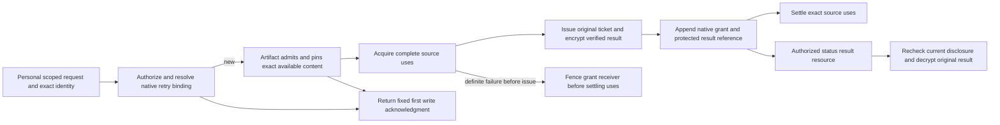

# Protected artifact download responses

IssueArtifactDownload remains personal HTTP; its selected signature is the EvidenceArtifact row in [remaining command identities](remaining-command-identities.md). Required CommandId and ExpectedArtifactRevision join optional ProgramId, AdvisorHandoffId and SelectedSource; all authored fields, including omission/variant meaning, participate in canonical intent. Preserve available inspected artifact and current handling/handoff/source disclosure rules. MCP stays disabled.

EvidenceArtifact first admits EvidenceArtifactDownloadRequested and pins exact available content in EvidenceDownloadIntent. Return the fixed original HTTP 202 OperationAcceptedResponse on every exact write retry. Acquire the complete optional handoff and explicit handling-policy uses; an absent optional source does not fabricate a reservation. Freeze the configured immutable default policy version. IssueProtectedArtifactDownloadGrant creates the independent ArtifactDownloadGrant, using GrantId equal to root CommandId. Source uses remain held until native EvidenceArtifactDownloadIssued or a pre-issue receiving cancellation fence. Unknown append must resolve the same binding before cancellation. Any committed issued grant recovers forward.

The terminal result is the original EvidenceArtifactDownloadLink(Location, ExpiresAt). A ticket URL is capability material. Issue the bounded ticket, write and verify its encrypted result, then append the native issued fact and opaque OperationResult reference. No raw URL in domain facts, intents, queues, diagnostic logs or unprotected immutable objects. Losing/uncommitted candidate tickets stay undisclosed; reconcile unknown native append by the same derived command identity. Ticket issuance performs no package handoff or notification send.

IProtectedResponseContentStore uses AES-256-GCM with a fresh 96-bit nonce, 128-bit tag, and AAD containing realm, affected owner, root operation ID and schema. Store a versioned key ID; configured keys survive restart. Retain decryption keys and protected content for supported operation replay under existing fail-closed disposal. ProtectedResponseContentRef contains ContentId, CiphertextSha256, Bytes, Schema and KeyVersionId; its digest covers header/nonce/ciphertext/tag. WriteVerifiedAsync(scope, schema, plaintext) and ReadVerifiedAsync(scope, reference) verify this scope. ResponseBodyReference is the closed standard/protected union, never a caller-selected runtime type.

GET status exposes only an authorized result descriptor. GET result requires the original personal actor and **current** artifact/handoff/selected-source disclosure authorization before decrypting. Return the original Location and ExpiresAt, even if that original link has expired. New issuance requires a new client operation ID and fresh authorization. A revoked handoff or denied source cannot be bypassed with an old operation UUID.

Required regressions: personal/MCP restriction; changed handoff/source variant under same ID; source revocation racing use; missing optional source; no raw ticket in any durable/logged payload; cross-realm/actor/operation encrypted object swap; key rotation/restart; crash after ticket/encrypted write before append; concurrent equal candidates return one winning original result; unknown append; grant cancellation before delayed issue; fixed 202 replay after completion; expired original result; new ID renewal; current disclosure denial before protected store read.
