# User journeys and flows

Status: product-level flow map, derived from the product brief, accepted
decisions, and backlog. Story contracts and live delivery state remain owned by
their linked product documents and GitHub issues.

This document diagrams the complete product journey and its connected user
flows. **MVP** means the first client can complete the manual readiness
workflow and establish a Type I plan in an isolated organization. **Later**
marks follow-on examination, Type II, firm, commercial, or optional integration
work. A diagram records intended behavior; its presence does not claim that the
flow is implemented or accepted.

Every flow inherits tenant isolation, server-side authorization, attribution,
provenance, history, and human approval rules. Optional imports and integrations
enter the same governed review path as manually entered records. M0 decisions
and EN foundation stories support the flows but are not standalone user
journeys.

## End-to-end compliance journey

The same program and its governed history carry forward across readiness, Type
I, and Type II. The first release ends at the Type I entry plan; examination
flows below are later milestones.

```mermaid
flowchart LR
  A[Create isolated organization] --> B[Invite team and grant scoped access]
  B --> C[Create program, choose criteria, and define boundary]
  C --> D[Author workforce, system, obligation, risk, and provider records]
  D --> E[Define controls, policies, owners, and cadence]
  E --> F[Operate controls, reviews, and evidence workflows]
  F --> G[Run reproducible readiness assessment]
  G --> H[Assign and resolve readiness gaps]
  H --> G
  G --> I[Management records Type I entry decision]
  I -->|Defer or conditional| H
  I -->|Proceed| J[Type I engagement and point-in-time snapshot]
  J --> K[Auditor requests, samples, and observations]
  K --> L[Validate package and record separate management and auditor outcomes]
  L --> M[Start Type II period from approved baseline]
  M --> N[Operate recurring controls and reviews]
  N --> O[Freeze period snapshot and complete Type II examination]
  O --> P[Record outcome and roll program into next period]
```

## MVP: organization, program, and readiness

### 1. Provision an organization and establish team access

**Stories:** R1-04 and R1-04a–e, R1-15, BO-01.

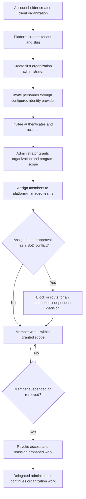

### 2. Set up the SOC 2 program, criteria, and system boundary

**Stories:** R1-01, R1-02, R1-03.

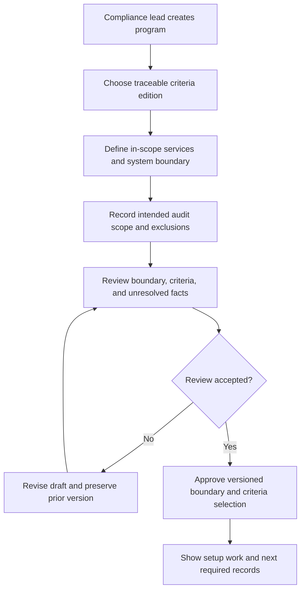

### 3. Build the manual readiness context

**Stories:** R1-07, R1-10, R1-11, R1-12, R1-13, R1-14.

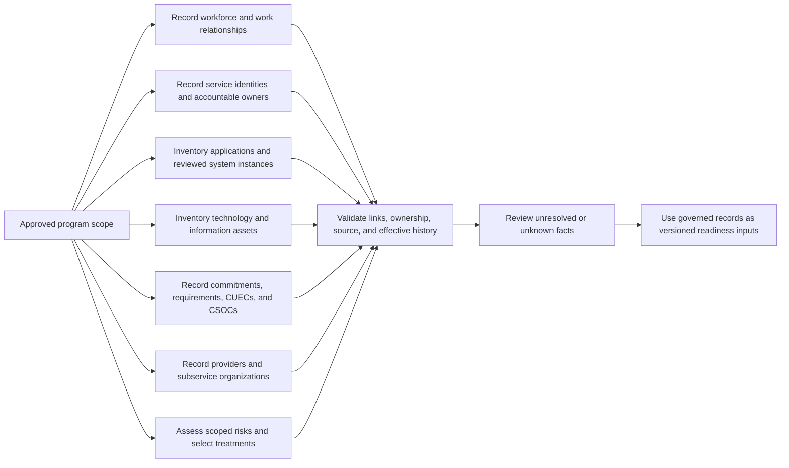

### 4. Define controls and map applicable criteria

**Stories:** R1-05, R1-06; ownership and cadence continue in R2-01.

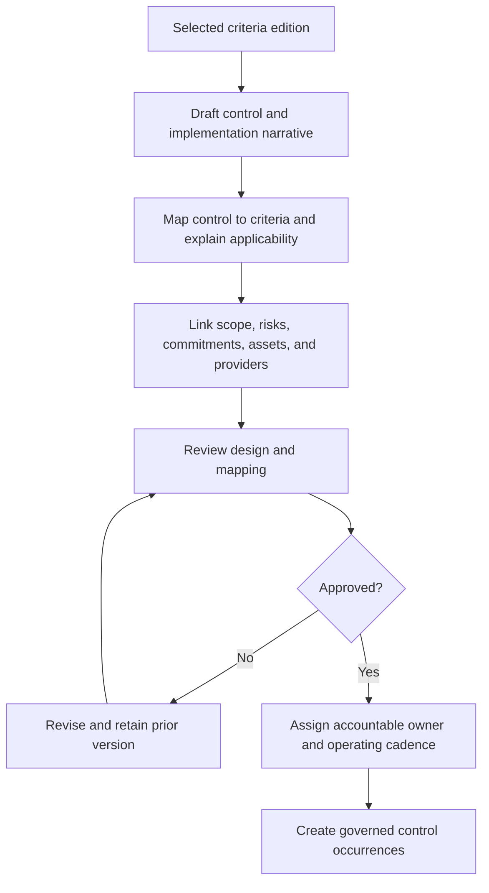

### 5. Complete readiness assessment and own the gap plan

**Stories:** R1-08; owned work is supported by R2-11.

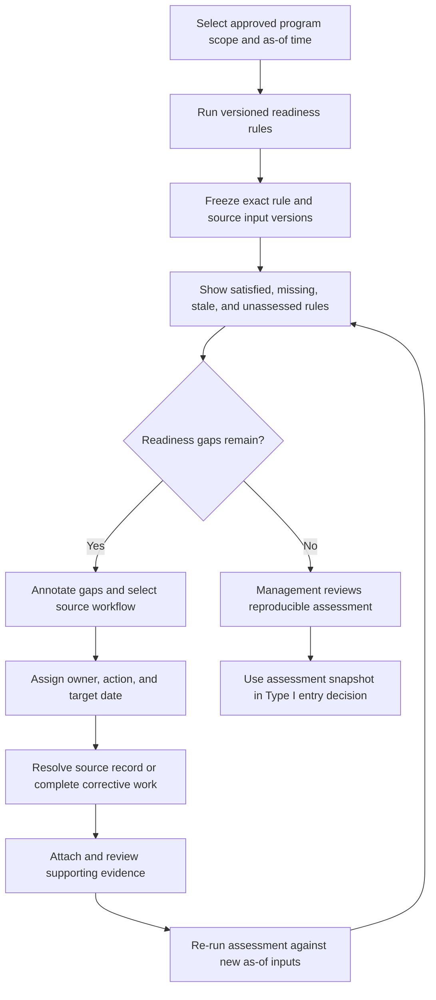

### 6. Record the Type I entry decision

**Stories:** R2-09. This is a management decision, separate from any auditor
conclusion. The diagram shows the intended outcome; routing deferred or
conditional decisions into shared findings, responsibility, and work remains
open under #297.

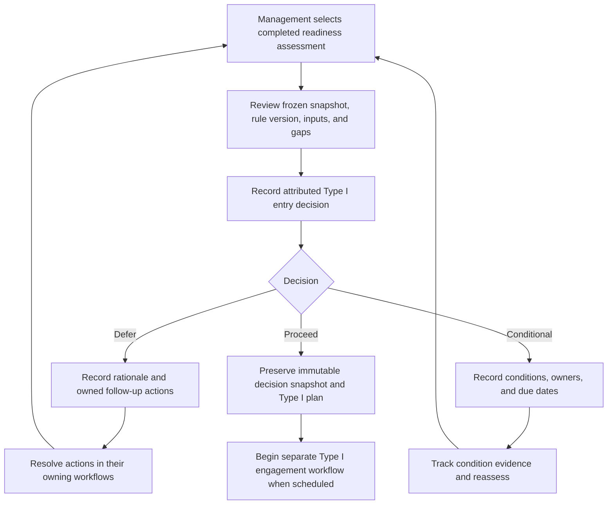

### 7. Bring existing readiness material into the program

**Story:** R1-09. This is an optional path for a later client; it is not needed
for the first client's manual workflow.

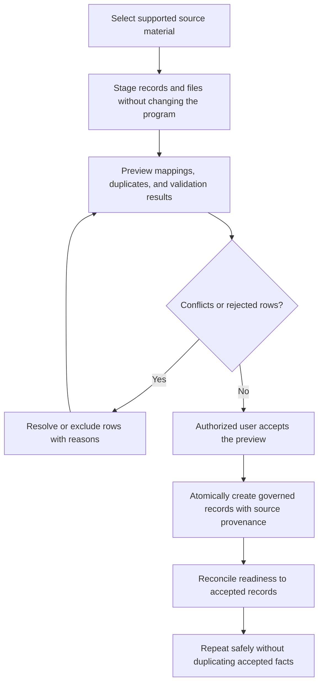

## MVP: operating controls and supporting workflows

### 8. Operate a control, submit evidence, review, and remediate

**Stories:** R2-01, R2-03, R2-04, R2-05a–d, R2-07.

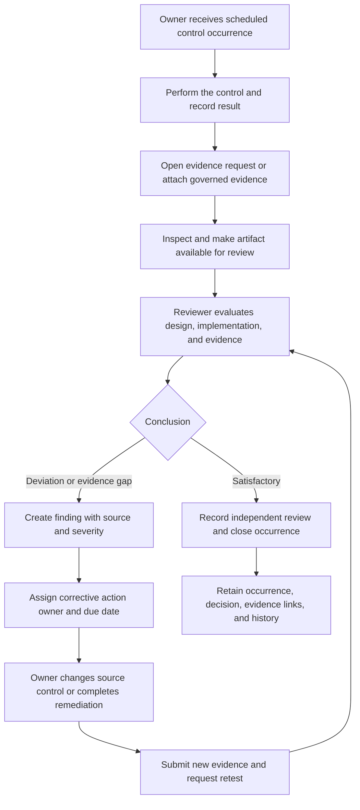

### 9. Govern evidence from request through retention and disclosure

**Stories:** R2-03, R2-12.

Production capture, storage, and inspection still have open acceptance work
(#196, #272); this diagram shows the complete user workflow those slices need
to support.

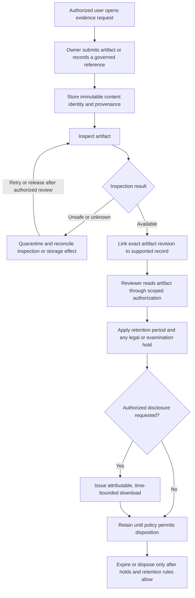

### 10. Maintain, publish, and acknowledge policies

**Stories:** R2-02, R2-10.

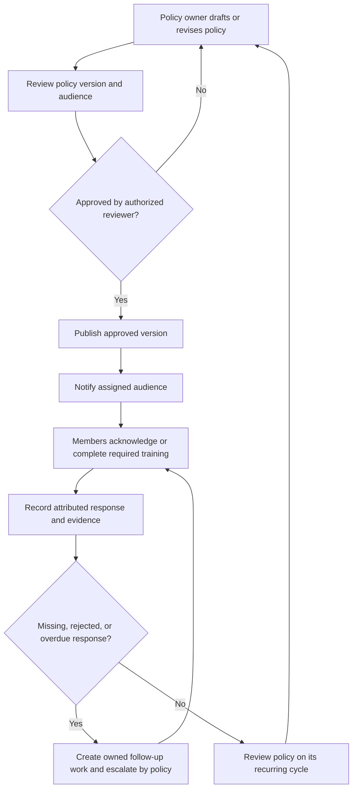

### 11. Reconcile access and complete an access review

**Stories:** R1-10c, R2-06a–e.

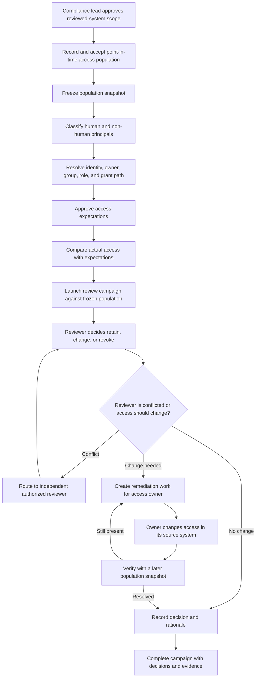

### 12. Collaborate with a readiness advisor

**Story:** R2-08.

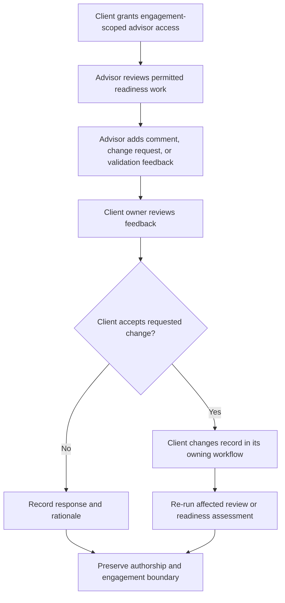

### 13. Manage accountable work and reminders

**Stories:** R2-11a–c. Work remains owned by the source workflow that created
it.

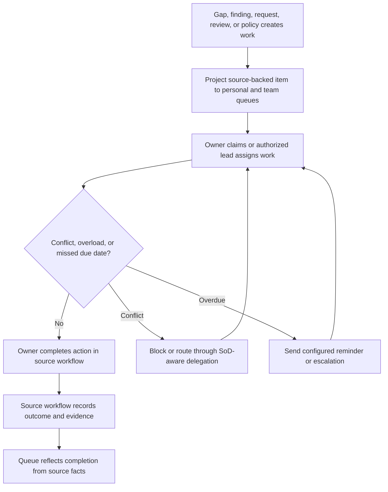

## Later: examination, Type II, firm, and commercial journeys

### 14. Establish and complete a Type I examination

**Stories:** T1-01–07. This follows the MVP Type I entry plan.

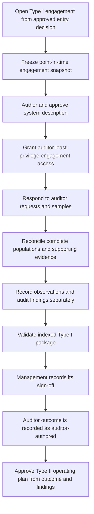

### 15. Operate the Type II observation period

**Stories:** T2-01–09, including T2-08a–b. Source integrations are optional
collection paths and retain manual operation.

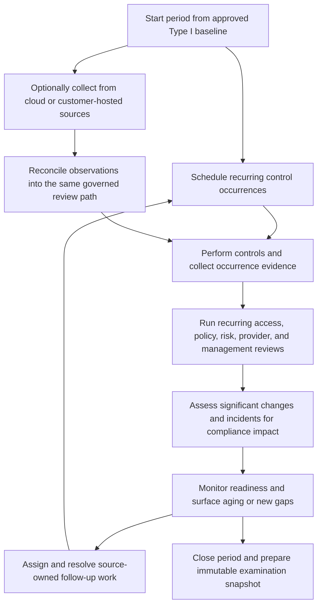

### 16. Close and examine a Type II period, then roll forward

**Stories:** T3-01–07.

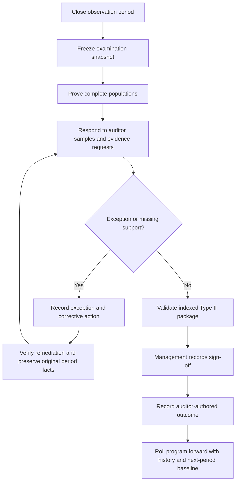

### 17. Serve multiple clients as a firm

**Stories:** F1-01–08. This is later than the first isolated client workflow.

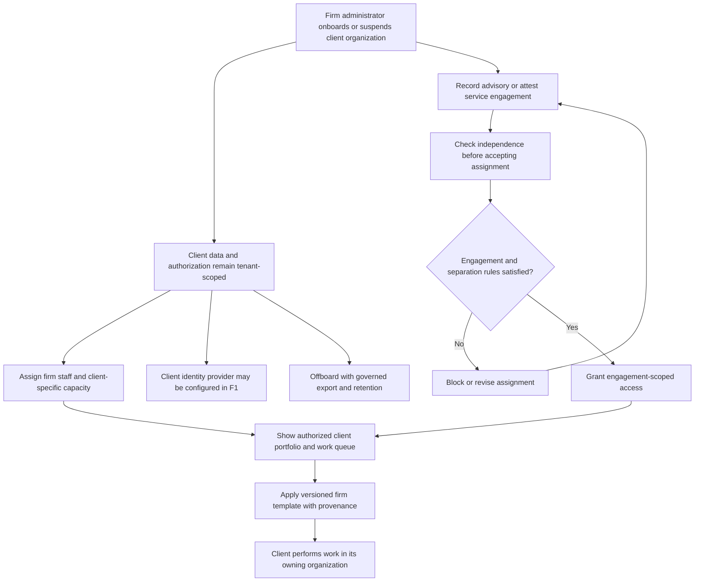

### 18. Administer hosted billing and optional add-ons

**Stories:** BO-02–03. Self-hosted manual use remains free and does not require
this flow.

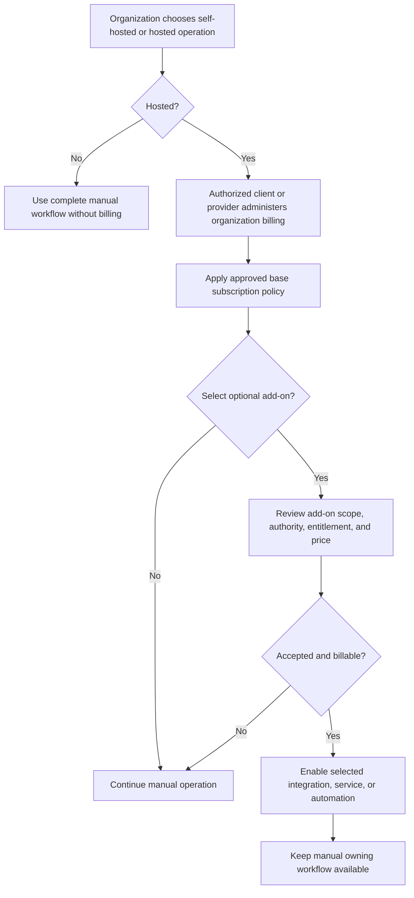

## Story coverage

| Product scope | Diagrams |
| --- | --- |
| R1-01–03 program, criteria, and boundary | 2 |
| R1-04, R1-04a–e, R1-15, BO-01 organization and access | 1 |
| R1-05–07, R1-10–14 readiness source records | 3–4 |
| R1-08 readiness and gap plan; R2-09 Type I entry | 5–6 |
| R1-09 optional import | 7 |
| R2-01, R2-03–05, R2-07 control operation and remediation | 8 |
| R2-03, R2-12 evidence governance | 9 |
| R2-02, R2-10 policies | 10 |
| R1-10c, R2-06 access reviews | 11 |
| R2-08 advisor collaboration | 12 |
| R2-11 accountable work | 13 |
| T1-01–07 Type I examination | 14 |
| T2-01–09 Type II operation and optional collection | 15 |
| T3-01–07 Type II examination and rollover | 16 |
| F1-01–08 firm operations | 17 |
| BO-02–03 hosted commercial operations | 18 |

EN-01–06 authorization, history, snapshots, decisions, imports, and artifact
storage are cross-cutting foundations. They apply within the relevant flows
above rather than forming separate end-user journeys.
