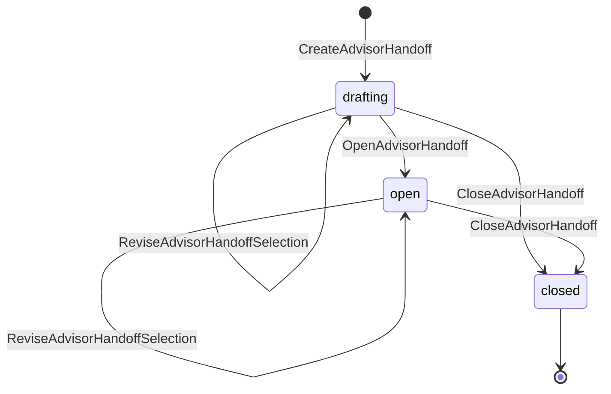
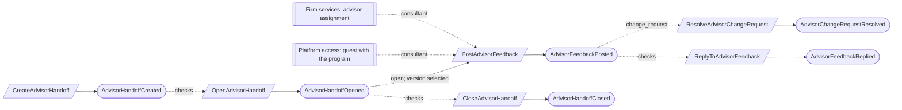

# Advisor collaboration

Status: **locked**, 2026-11-03. Hand-authored source of truth for this context.
It follows the [context conventions](conventions.md).

## Purpose

Advisor collaboration lets readiness consultants review the organization's draft
work and leave attributed feedback, without ever approving anything (M0-D14).
Consultants are our firm's advisors assigned to an accepted engagement, or a
client's own consultant as a time-limited guest member.

**Owns:** advisor handoffs and advisor feedback.

**Does not own:**

| Concern | Owner |
| --- | --- |
| Advisor assignment and engagement acceptance | [Firm services](firm-services.md) (`ServiceEngagement`) |
| Guest membership, its programs and end date | [Platform access](platform-access.md) |
| The records under review, and their approval | Their own contexts; feedback never changes them |
| Disclosure of artifacts downloaded by firm staff | [Evidence](evidence.md) (`ArtifactDisclosure`, EV-03) |
| Findings from a consultant observation | [Assurance work](assurance-work.md) (`RaiseFinding`, source `consultant_observation`) |

## Language

| Term | Meaning |
| --- | --- |
| Consultant | An Advisor assignee of an accepted, open advisory engagement for the tenant, or a guest member whose programs include the handoff's program. |
| Handoff | A bounded selection of exact record versions in one program that the Compliance Lead opens for consultant review. |
| Feedback | One immutable entry by a consultant on one exact record version in an open handoff: `comment`, `change_request` or `validated`. |
| Validated | A consultant's attributed statement that an exact record version looks right. It is never an approval and never satisfies a review or separation-of-duties rule. It lapses when a newer version supersedes that version (computed). |
| Correction | A new feedback entry by the same author that links back to the entry it corrects. |
| Reply | An immutable entry by a team member or the consultant on a feedback entry. |
| Resolution | The team's recorded outcome of a change request: `accepted` or `declined`, with a reason. |

## Aggregates

### AdvisorHandoff

**Identity:** `TenantId` + `HandoffId`, in one program for life.

**Invariant:** one handoff has one selection of exact record versions in its
program. Consultants can see and comment on the selection only while it is open,
and only the Compliance Lead opens it, changes it or closes it. Closing ends
consultant access immediately; history stays (M0-D14).

- The selection can change while the handoff is open; each change is attributed
  (AV-01).
- Closing names a reason, `completed` or `withdrawn` (AV-02).

| Command | Who | Accepts when | Emits |
| --- | --- | --- | --- |
| CreateAdvisorHandoff | Compliance Lead | `HandoffId` is new; program active; every selected version exists in the program | AdvisorHandoffCreated |
| ReviseAdvisorHandoffSelection | Compliance Lead | Not closed; every selected version exists in the program; selection not empty | AdvisorHandoffSelectionRevised |
| OpenAdvisorHandoff | Compliance Lead | Drafting; selection not empty | AdvisorHandoffOpened |
| CloseAdvisorHandoff | Compliance Lead | Not closed; reason given | AdvisorHandoffClosed |

| Event | Carries |
| --- | --- |
| AdvisorHandoffCreated | tenant, handoff, program, title, selection (record kind, ID and version), instructions, created by |
| AdvisorHandoffSelectionRevised | tenant, handoff, added versions, removed versions, revised by |
| AdvisorHandoffOpened | tenant, handoff, opened by |
| AdvisorHandoffClosed | tenant, handoff, reason (`completed` or `withdrawn`), note, closed by |

### AdvisorFeedback

**Identity:** `TenantId` + `FeedbackId`.

**Invariant:** one entry is posted once by one consultant on one exact record
version in one handoff, while the handoff is open and the version is in its
selection, and never changes. Its replies and, for a change request, its single
current resolution are kept with it (AV-03, AV-04).

- A correction is a new entry by the same author linking back; the original stays.
- A change request without a resolution is a visible gap; it never blocks closing
  the handoff (AV-05).
- Revoking a consultant's access never rewrites past attribution.

| Command | Who | Accepts when | Emits |
| --- | --- | --- | --- |
| PostAdvisorFeedback | A consultant | `FeedbackId` is new; handoff open; version in the selection; kind and text given; a correction links an entry by the same author | AdvisorFeedbackPosted |
| ReplyToAdvisorFeedback | A consultant, or a Compliance Lead or Contributor | Handoff open, or the replier is a member of the organization | AdvisorFeedbackReplied |
| ResolveAdvisorChangeRequest | Compliance Lead | Kind `change_request`; outcome and reason given; differs from the current resolution | AdvisorChangeRequestResolved |

| Event | Carries |
| --- | --- |
| AdvisorFeedbackPosted | tenant, feedback, handoff, record kind, ID and version, kind, text, corrects (if any), author, author capacity (`advisor` with engagement, or `guest`) |
| AdvisorFeedbackReplied | tenant, feedback, reply, text, author |
| AdvisorChangeRequestResolved | tenant, feedback, outcome, reason, resulting record version (if any), resolved by |

## Flows

Diagrams follow [CV-01](conventions.md#flow-diagrams).

### Handoff and feedback

## Authorization contract

- A consultant reads only the current selection of an open handoff and records
  that are already approved. Drafts never selected stay invisible (M0-D14).
- A guest's access ends at the end of their end date (UTC), and an advisor's when
  the engagement assignment ends, whatever the handoff's state.
- Work queues, access reviews and work digests are outside a consultant's view.

## Decisions

Jev answers are from `jev-1.14.0`, 2026-11-03. A yes is ≥ 0.8 and a no is ≤ 0.2.
Anything in between is settled by common sense, with the reasoning stated.

| ID | Decision | Evidence |
| --- | --- | --- |
| AV-01 | The Compliance Lead can change the selection while the handoff is open. | 0.59. Common sense: review is iterative, and each change is attributed. Approved versions may be selected too (refusing them: 0.28). |
| AV-02 | Closing and revoking are one action with a reason, `completed` or `withdrawn`. | 0.45. Common sense: both end access and keep history, so the reason is the only difference. |
| AV-03 | Every change request needs a resolution, `accepted` or `declined` with a reason. | 0.73. Common sense: an unanswered change request is the gap a consultant cares about most. |
| AV-04 | Team members and consultants can reply; replies are immutable. | 0.72. |
| AV-05 | Unresolved change requests never block closing the handoff. | Blocking: 0.39. |

## Open questions

None at this time.

## Superseded owners

| Old owner | Becomes |
| --- | --- |
| AdvisorHandoff | AdvisorHandoff (close and revoke merged, AV-02) |
| AdvisorFeedbackThread | AdvisorFeedback |
| `AuthorizeAdvisorArtifactDownload` and its authorization close | Authorization; firm-staff downloads are disclosures (Evidence, EV-03) |
| AdvisorFeedbackMaterializationReactor | Removed: feedback is posted directly |
| PreserveAdvisorFeedbackAfterHandoffReactor | Removed: entries are immutable and stay after closing |
