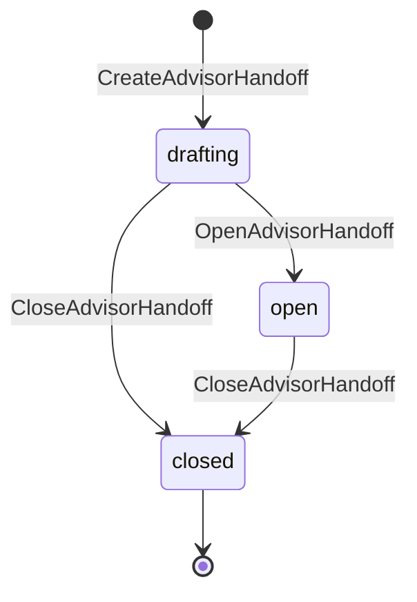
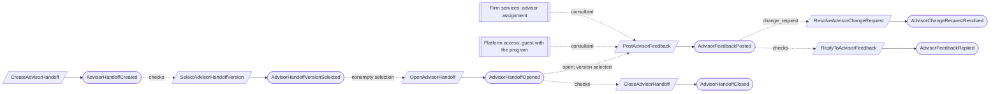

# Advisor collaboration

Status: **refinement in progress**. Independent selections, nonempty admission,
close and revocation require source-level qualification before this design is
locked or implemented. The anchor proposal below is a candidate, not a new
accepted product rule.
It follows the [context conventions](conventions.md).

## Purpose

Advisor collaboration lets readiness consultants review the organization's draft
work and leave attributed feedback, without ever approving anything (M0-D14).
Consultants are our firm's advisors assigned to an accepted engagement, or a
client's own consultant as a time-limited guest member.

**Owns:** advisor handoffs and advisor feedback.

**Does not own:**

| Concern | Owner |
| --- | --- |
| Advisor assignment and engagement acceptance | [Firm services](firm-services.md) (`ServiceEngagement`) |
| Guest membership, its programs and end date | [Platform access](platform-access.md) |
| The records under review, and their approval | Their own contexts; feedback never changes them |
| Disclosure of artifacts downloaded by firm staff | [Evidence](evidence.md) (`ArtifactDisclosure`, EV-03) |
| Findings from a consultant observation | [Assurance work](assurance-work.md) (`RaiseFinding`, source `consultant_observation`) |

## Language

| Term | Meaning |
| --- | --- |
| Consultant | An Advisor assignee of an accepted, open advisory engagement for the tenant, or a guest member whose programs include the handoff's program. |
| Handoff | An independently maintained selection of exact record versions in one program that the Compliance Lead opens for consultant review. |
| Feedback | One immutable entry by a consultant on one exact record version in an open handoff: `comment`, `change_request` or `validated`. |
| Validated | A consultant's attributed statement that an exact record version looks right. It is never an approval and never satisfies a review or separation-of-duties rule. It lapses when a newer version supersedes that version (computed). |
| Correction | A new feedback entry by the same author that links back to the entry it corrects. |
| Reply | An immutable entry by a team member or the consultant on a feedback entry. |
| Resolution | The team's recorded outcome of a change request: `accepted` or `declined`, with a reason. |

## Aggregates

### AdvisorHandoff

**Identity:** `TenantId` + `HandoffId`, in one program for life.

**Invariant:** one handoff has one lifecycle in its program. Consultants can see
and comment on its selected exact versions only while it is open,
and only the Compliance Lead opens it, changes it or closes it. Closing ends
consultant access immediately; history stays (M0-D14).

- Selection changes are independent, attributed `AdvisorHandoffSelection` facts
  (AV-01); the handoff never carries their roster or an event per change.
- Closing names a reason, `completed` or `withdrawn` (AV-02).

| Command | Who | Accepts when | Emits |
| --- | --- | --- | --- |
| CreateAdvisorHandoff | Compliance Lead | `HandoffId` is new; program active | AdvisorHandoffCreated |
| OpenAdvisorHandoff | Compliance Lead | Drafting; authoritative admission proves selection not empty | AdvisorHandoffOpened |
| CloseAdvisorHandoff | Compliance Lead | Not closed; reason given | AdvisorHandoffClosed |

| Event | Carries |
| --- | --- |
| AdvisorHandoffCreated | tenant, handoff, program, title, bounded instructions, created by |
| AdvisorHandoffOpened | tenant, handoff, opened by |
| AdvisorHandoffClosed | tenant, handoff, reason (`completed` or `withdrawn`), note, closed by |

### AdvisorHandoffSelection

**Identity:** `TenantId` + `HandoffId` + source record kind, ID and version.

**Invariant:** this relationship independently selects or removes one exact
version in the handoff's program. Only the Compliance Lead changes it while
the handoff is not closed. The source owner must validate the tenant, program
and exact immutable version. A retry of an identical operation is a no-op;
changed intent conflicts. Selection changes cannot bypass the handoff's
lifecycle fence or remove the last selection when that would violate the
existing nonempty-selection rule.

| Command | Who | Accepts when | Emits |
| --- | --- | --- | --- |
| SelectAdvisorHandoffVersion | Compliance Lead | Handoff admits operation; source owner confirms exact version and scope; relationship is not selected | AdvisorHandoffVersionSelected |
| RemoveAdvisorHandoffVersion | Compliance Lead | Handoff admits operation; relationship is selected; nonempty rule holds | AdvisorHandoffVersionRemoved |

| Event | Carries |
| --- | --- |
| AdvisorHandoffVersionSelected | tenant, handoff, program, source kind, ID, version, operation, selected by |
| AdvisorHandoffVersionRemoved | tenant, handoff, source kind, ID, version, operation, removed by |

#### Selection and access qualification

Opening and the nonempty removal rule cannot be made authoritative by counting
the projected selection, scanning every selection during a write, or maintaining
a parent roster. A candidate is for the handoff to hold **one designated anchor**:
one exact selected record version, valid while the handoff is open. Other
selections remain independently owned. The handoff opens with an exact valid
anchor, fixed for that handoff's lifetime. Removing a non-anchor selection does
not alter the anchor. The anchor is one fixed witness, not a roster; the handoff
never records a fact per additional selection. Given universal enforcement of
this rule and retention of the anchor's exact version, the open handoff is
nonempty by construction.

This candidate changes the selection workflow: users must designate an anchor
and close the handoff before removing that particular selection. Starting a new
handoff requires new independent selections; no bulk copying or implied transfer
is specified. Allowing the handoff to replace the anchor repeatedly appears
convenient, but its stream then gains an event for each replacement and can grow
with selection turnover, recreating the very parent history this review rejects.
It is not the fixed-anchor candidate. If
the source can retire, revoke, delete or otherwise invalidate the exact anchor
independently, the invariant does **not** follow. Selecting a witness from a
stale projection races its removal, and a pre-open source read does not prevent
that removal. Defining whether an anchor is itself the handoff-owned selection
or needs source-owner admission, plus retention, source scope, exact retry,
changed intent and concurrent removal behavior, is still required.
M0-D14's selected exact versions and nonempty behavior are not changed by this
candidate until explicitly decided.

Each selection mutation, feedback post and consultant access decision must be
ordered against handoff close, selection removal and the relevant guest-membership
or engagement-assignment revocation. Each necessary participant must accept the
exact operation, or it fails/retries with no successful fact; projection checks
and an observed handoff status are advisory only. An access decision committed
after close or revocation must refuse. A decision accepted just before revocation
can have an in-flight response: the product and transport contract must define
whether and how undelivered bytes are stopped. Bytes already delivered cannot be
recalled; a close event alone does not enforce cancellation at the transport.

**Qualification gap:** the independent authorities do not yet specify durable
admission, source fencing, recovery, expiry and ordering under concurrent
close/removal/revocation, nor a bounded-state nonempty-selection protocol.
These invariants are requirements, not capabilities established by the
projections or this document. Qualify the actual provider and participant
protocols before implementation. No parent child-roster, parent event per
selection, large manifest, all-selection write scan, or in-memory ordering of all
selections is acceptable. Each selection's own repeated changes may still grow
its own replay history and need a lifecycle strategy.

### AdvisorFeedback

**Identity:** `TenantId` + `FeedbackId`.

**Invariant:** one entry is posted once by one consultant on one exact record
version in one handoff, while the handoff is open and the version is in its
selection, and never changes. For a change request, its single current
resolution is kept with it; replies are separate immutable records (AV-03, AV-04).

- A correction is a new entry by the same author linking back; the original stays.
- A change request without a resolution is a visible gap; it never blocks closing
  the handoff (AV-05).
- Revoking a consultant's access never rewrites past attribution.

| Command | Who | Accepts when | Emits |
| --- | --- | --- | --- |
| PostAdvisorFeedback | A consultant | `FeedbackId` is new; handoff open; version in the selection; kind and text given; a correction links an entry by the same author | AdvisorFeedbackPosted |
| ResolveAdvisorChangeRequest | Compliance Lead | Kind `change_request`; outcome and reason given; differs from the current resolution | AdvisorChangeRequestResolved |

| Event | Carries |
| --- | --- |
| AdvisorFeedbackPosted | tenant, feedback, handoff, record kind, ID and version, kind, text, corrects (if any), author, author capacity (`advisor` with engagement, or `guest`) |
| AdvisorChangeRequestResolved | tenant, feedback, outcome, reason, resulting record version (if any), resolved by |

### AdvisorFeedbackReply

**Identity:** `TenantId` + `FeedbackId` + `ReplyId`.

**Invariant:** one attributed, bounded reply is immutable and refers to one
existing feedback entry. Team members may reply after closure; consultants
require a current source-authorized access decision to the handoff and selected
version. The feedback does not accumulate replies in its stream.

| Command | Who | Accepts when | Emits |
| --- | --- | --- | --- |
| ReplyToAdvisorFeedback | A consultant, or a Compliance Lead or Contributor | Reply is new; exact feedback exists; organization member or source-authorized consultant | AdvisorFeedbackReplied |

| Event | Carries |
| --- | --- |
| AdvisorFeedbackReplied | tenant, feedback, reply, bounded text, author |

## Flows

Diagrams follow [CV-01](conventions.md#flow-diagrams).

### Handoff and feedback

## Authorization contract

- A consultant reads only the current selection of an open handoff and records
  that are already approved. Drafts never selected stay invisible (M0-D14).
- Selection, feedback and reply text must each have a practical per-record
  content bound in the API contract; no single record is a document archive.
- A guest's access ends at the end of their end date (UTC), and an advisor's when
  the engagement assignment ends, whatever the handoff's state.
- Work queues, access reviews and work digests are outside a consultant's view.

## Decisions

Jev answers are from `jev-1.14.0`, 2026-11-03. Historical 0.8/0.2 thresholds
were triage conventions, not proof or measured design-correctness confidence;
inconclusive or conflicting cases remain open for evidence.

| ID | Decision | Evidence |
| --- | --- | --- |
| AV-01 | The Compliance Lead can change the selection while the handoff is open. | 0.59. Common sense: review is iterative, and each change is attributed. Approved versions may be selected too (refusing them: 0.28). |
| AV-02 | Closing and revoking are one action with a reason, `completed` or `withdrawn`. | 0.45. Common sense: both end access and keep history, so the reason is the only difference. |
| AV-03 | Every change request needs a resolution, `accepted` or `declined` with a reason. | 0.73. Common sense: an unanswered change request is the gap a consultant cares about most. |
| AV-04 | Team members and consultants can reply; replies are immutable. | 0.72. |
| AV-05 | Unresolved change requests never block closing the handoff. | Blocking: 0.39. |

## Open questions

The anchor workflow and whether an anchor can be invalidated by its source
require product and authority resolution. Nonempty selection, close/access
ordering, revocation and in-flight response guarantees require qualification
before lock. The Handoff, Feedback and individual selection streams may each
grow through their own real lifecycle; Portia replays each full stream and a
small current state does not bound that history.

## Superseded owners

| Old owner | Becomes |
| --- | --- |
| AdvisorHandoff | AdvisorHandoff (close and revoke merged, AV-02) |
| AdvisorFeedbackThread | AdvisorFeedback |
| `AuthorizeAdvisorArtifactDownload` and its authorization close | Authorization; firm-staff downloads are disclosures (Evidence, EV-03) |
| AdvisorFeedbackMaterializationReactor | Removed: feedback is posted directly |
| PreserveAdvisorFeedbackAfterHandoffReactor | Removed: entries are immutable and stay after closing |
