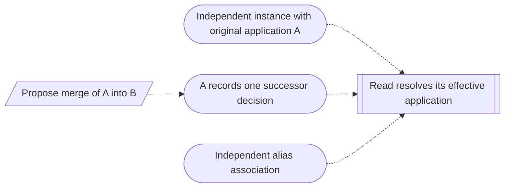

# Application inventory

Status: **product rules locked**, 2026-11-03; merge and retirement coordination **not implementation-ready**. Hand-authored source of truth for this context; see [AI-08](#decisions) and [open questions](#open-questions).

**2026-11-05 boundary correction:** The prior completion protocol required
enumerating every instance and matching every terminal outcome. That is an
all-child write decision even when no event contains a list; it is withdrawn.
AI-01 and AI-02 remain product requirements, but their coordination is unresolved.
The alternatives below are for product and protocol review, not approved changes.

[M0-D05](../decisions/m0-d05-application-inventory.md) also states tenant-wide
alias uniqueness and active instance provider-key uniqueness, while AI-03 below
previously treated both as advisory. The accepted uniqueness requirements remain
in force. Their normalized key, admission, release/reuse and retry authority are
unqualified; a duplicate gap cannot substitute for preventing a concurrent
duplicate.

## Purpose

Application inventory is the organization's governed list of applications and the
system instances behind them, with their owners and their access-review scope
(M0-D05). The inventory in the product is authoritative for scope; any outside
list only corroborates or helps discovery.

**Owns:** applications, system instances, and access-review scope decisions.

**Does not own:**

| Concern | Owner |
| --- | --- |
| Accounts, entitlements, populations and campaigns at a system instance | External access governance; it references an exact instance and never creates one |
| People named as owners | Workforce assurance (`Person`) |
| Inclusion in the program's system boundary | Program and scope |
| Application import and connectors | Deferred: no import or connector is built now (M0-D05) |

## Language

| Term | Meaning |
| --- | --- |
| Application | A governed application with one canonical name, any number of aliases, a kind, a lifecycle, a criticality, a system owner and an access owner. |
| System owner, access owner | Workforce people accountable for the application and for access to it. They need not be platform members. |
| System instance | One concrete access boundary of an application: a cloud account, source-code organization, identity-provider tenant, SaaS tenant, environment, or other. Access is reviewed per instance, never per application. |
| Provider identifier | The provider's ID for an instance, such as an AWS account ID, a GitHub organization login, or a Slack workspace ID. |
| Access-review scope decision | Whether one exact instance version is `included` in or `excluded` from access review, with its reason and approver, effective from a date. |
| Merge | An attributed resolution of duplicate applications: one is retired with `merged_into`, and its names and instances move to the survivor. |

## Aggregates

### Application

**Identity:** `TenantId` + `ApplicationId`.

**Invariant:** one application has one canonical name, a kind, a criticality,
a system owner, an access owner, and a lifecycle: active, optionally closing
for retirement or merging, then retired. A retired application accepts no
further changes. Aliases are separate `ApplicationAlias` records; the
application never stores an alias or instance roster.

- Every active application has all of these fields (M0-D05).
- Duplicate application display names are advisory and repairable (AI-03).
  M0-D05 separately requires normalized aliases to be unique within the tenant;
  a projected duplicate-name gap alone cannot enforce that accepted requirement.
- A classification declared by the tenant is attributed and stays
  `classification_unverified` until the classification vocabulary is approved; a
  missing one is an explicit `classification_unresolved` gap.
- Retirement is effective-dated, needs a reason, and is refused while the
  application has active system instances (AI-02). It never deletes history or a
  snapshot reference.
- AI-01 describes moving the merged application's instances and aliases to the
  survivor. AI-02 refuses retirement while an active instance remains. Their
  race-safe interaction without an all-instance decision is unresolved; do not
  treat a projected zero or an outcome scan as the solution (AI-08).

The commands and event shapes below describe the previous completion candidate,
not a qualified write contract. In particular, the stated guards for
`CompleteApplicationRetirement` and `CompleteApplicationMerge` are incompatible
with the current no-all-child-write direction and must be redesigned.

| Command | Who | Accepts when | Emits |
| --- | --- | --- | --- |
| DeclareApplication | Compliance Lead or Contributor | `ApplicationId` is new; fields complete; duplicate name check is advisory | ApplicationDeclared |
| RenameApplication | Compliance Lead or Contributor | Active; duplicate name check is advisory | ApplicationRenamed |
| ChangeApplicationDetails | Compliance Lead or Contributor | Active | ApplicationDetailsChanged |
| ChangeApplicationOwners | Compliance Lead | Active; owners are people | ApplicationOwnersChanged |
| BeginApplicationRetirement | Compliance Lead | Active; reason given; establish an admission fence | ApplicationRetirementStarted |
| BeginApplicationMerge | Compliance Lead | Source active; survivor differs; establish an admission fence | ApplicationMergeStarted |
| RefuseApplicationRetirement | Reactor | Exact authoritative active-instance outcome | ApplicationRetirementRefused |
| CompleteApplicationRetirement | Reactor | Closed admissions and authoritative proof of no active instances; reason recorded | ApplicationRetired |
| CompleteApplicationMerge | Reactor | Closed admissions; every source instance has a terminal moved-or-retired outcome; survivor validated by the protocol below | ApplicationMerged |

| Event | Carries |
| --- | --- |
| ApplicationDeclared | tenant, application, name, kind, criticality, classification and its status, system owner, access owner, declared by |
| ApplicationRenamed | tenant, application, previous name, new name, renamed by |
| ApplicationDetailsChanged | tenant, application, changed fields (kind, criticality, classification), changed by |
| ApplicationOwnersChanged | tenant, application, system owner, access owner, changed by |
| ApplicationRetirementStarted | tenant, application, operation ID, admission fence, reason, requested by |
| ApplicationRetirementRefused | tenant, application, operation ID, exact active instance and version, reason |
| ApplicationMergeStarted | tenant, application, operation ID, requested survivor, admission fence, reason, requested by |
| ApplicationRetired | tenant, application, operation ID, effective at, reason, retired by |
| ApplicationMerged | tenant, application, operation ID, merged into, effective at, reason, merged by |

### ApplicationAlias

**Identity:** `TenantId` + `ApplicationId` + normalized alias.

**Invariant:** one association has one normalized alias, display form and
attributed active/removed state; at most one association with that identity is
active. This identity alone does **not** enforce M0-D05's tenant-wide alias
uniqueness. Its authoritative claim and transfer lifecycle is unqualified; do
not admit an alias on a projected duplicate check. List and search views are
projections; neither the application nor an event contains the full alias list.
Cross-owner admission and merge fencing remain under qualification below.

| Command | Who | Accepts when | Emits |
| --- | --- | --- | --- |
| AddApplicationAlias | Compliance Lead or Contributor, or merge reactor | Exact association not active; tenant-wide uniqueness authority is required but unqualified | ApplicationAliasAdded |
| RemoveApplicationAlias | Compliance Lead or Contributor, or merge reactor | Exact association active | ApplicationAliasRemoved |

| Event | Carries |
| --- | --- |
| ApplicationAliasAdded | tenant, application, normalized and display alias, actor, merge operation and source alias when applicable |
| ApplicationAliasRemoved | tenant, application, normalized alias, actor, merge operation when applicable |

The former transfer candidate processes each source alias individually and records the exact target
association's acceptance or refusal before releasing the source association. A
refusal is a visible gap. Alias operations racing with closure must be fenced or
captured in the same complete source cut as the transfer; that does not resolve
the all-child completion problem. Exact authority is an open implementation gate,
not an assumed projection property.

### SystemInstance

**Identity:** `TenantId` + `SystemInstanceId`.

**Invariant:** one instance belongs to exactly one application at a time, has one
kind, platform and provider identifier, and is active, then retired.

- Kind is `cloud_account`, `source_code_organization`, `identity_provider_tenant`,
  `saas_tenant`, `environment` or `other`; `other` needs a description. Platform
  is required for every kind except `environment` and `other` (M0-D05).
- Among active instances in the tenant, (kind, platform, provider identifier)
  is unique (M0-D05). Authority for that exact key and its release/reuse is
  unqualified; an advisory lookup or `duplicate_system_instance` gap cannot
  enforce concurrent uniqueness.
- An instance may name its own access owner; otherwise it uses its application's
  (AI-04).
- It moves to another application only through its source application's merge
  (AI-01), and only to an active application. A durable admission by the exact
  target must cover the move until its authoritative terminal outcome; a stale
  active-status read alone cannot enforce this (AI-07, AI-08).

| Command | Who | Accepts when | Emits |
| --- | --- | --- | --- |
| DeclareSystemInstance | Compliance Lead or Contributor | `SystemInstanceId` is new; application admission and active-key uniqueness require unqualified authority | SystemInstanceDeclared |
| ChangeSystemInstanceDetails | Compliance Lead or Contributor | Active; changed provider key requires unqualified uniqueness authority | SystemInstanceDetailsChanged |
| ChangeSystemInstanceAccessOwner | Compliance Lead | Active | SystemInstanceAccessOwnerChanged |
| MoveSystemInstance | Reactor on ApplicationMergeStarted | Active and owned by the closing source; exact merge and target admission valid | SystemInstanceMoved |
| RetireSystemInstance | Compliance Lead | Active; reason given | SystemInstanceRetired |

| Event | Carries |
| --- | --- |
| SystemInstanceDeclared | tenant, instance, application, admission identity and epoch, kind, platform, provider identifier, description, access owner, declared by |
| SystemInstanceDetailsChanged | tenant, instance, changed fields, changed by |
| SystemInstanceAccessOwnerChanged | tenant, instance, access owner (or none), changed by |
| SystemInstanceMoved | tenant, instance, source and target application, merge operation, target admission, prior instance version |
| SystemInstanceRetired | tenant, instance, effective at, reason, retired by |

### AccessReviewScope

**Identity:** `TenantId` + `SystemInstanceId`.

**Invariant:** one instance has a sequence of scope decisions with strictly
increasing effective dates. A new decision supersedes the previous one; none is
ever edited.

- A decision is `included` or `excluded` for an exact instance version. An
  exclusion needs a reason.
- An instance is in scope when it is inside the approved boundary and grants access
  to in-scope data, production infrastructure, source code, or identity
  administration; the reason records that judgment.
- The approver is a Compliance Lead who is not the instance's access owner, unless
  a separation-of-duties waiver covers it (M0-D05, M0-D03).

| Command | Who | Accepts when | Emits |
| --- | --- | --- | --- |
| DecideAccessReviewScope | Compliance Lead, not the access owner | Instance active; later effective date; reason when excluded | AccessReviewScopeDecided |

| Event | Carries |
| --- | --- |
| AccessReviewScopeDecided | tenant, instance, instance version, decision, reason, effective at, approver, waiver (if any) |

## Flows

### Independent instance ownership and effective successor — candidate

One possible product change makes the source's `merged_into` a durable successor
relationship. An instance retains its own exact original application identity;
its **effective** application is the terminal successor resolved at the requested
business time. The merge records one source decision and does not issue or collect
one move per instance. The instance keeps its identity, access-review scope,
history and independent lifecycle. A view can group instances and aliases under
their effective application with paged reads.

This is **not equivalent to the current AI-01 contract**: an instance stream has
not recorded a physical move, and ownership has changed from stored membership to
derived membership. Product review must choose the meaning of historical
application membership, inherited versus overridden access owners, alias display,
merge attribution and whether aliases themselves are physically transferred.
Snapshot consumers must cite the effective identity and the exact source facts
used at that time; a current redirect cannot silently rewrite an old snapshot.

The candidate also does **not** solve survivor and admission races. Concurrent
`A → B` and `B → A` can form a cycle; an active-target read can become stale;
a survivor might later retire without a successor; and an old declaration can
arrive after source closure. Establish an authoritative cycle-safe admission,
survivor lifecycle, late-command fencing and retry/unknown outcomes without a
per-instance ledger. A fixed ordering on application IDs could prevent cycles,
but would restrict which survivor the user may choose; it is not an approved
rule. Successor traversal may grow with the number of merges and needs explicit
latency, retention, cycle and history handling, even when performed incrementally.

For **ordinary retirement**, AI-02's promised refusal while any instance remains
active is itself a collection-wide condition. A proposed status view or
eventually consistent zero cannot authorize it; a source-cut scan and an
Application event for each child are also not acceptable substitutes. A stricter
candidate would permanently permit ordinary retirement only when instance
admissions have never opened, using one source-local one-time marker; this would
refuse retirement even after all instances have retired and therefore changes
AI-02. An admission race still needs the marker and retirement to compete on the
same real owner before the instance commits. A failed first admission could leave
a conservative marker. This does not solve target retirement or approve the
change. Until the product rule and authoritative ordering are resolved, ordinary
retirement and merge completion remain **unqualified**.

## Computed gaps

| Gap | Shown when |
| --- | --- |
| `duplicate_application_name` | Two active applications share a normalized name or alias |
| `duplicate_system_instance` | Two active instances share kind, platform and provider identifier |

## Decisions

Jev answers are from `jev-1.14.0`, 2026-11-03. Earlier reviews used 0.8 and 0.2
as triage thresholds, not as measured probabilities of design correctness.
Inconclusive or conflicting answers need source evidence and remain open.

| ID | Decision | Evidence |
| --- | --- | --- |
| AI-01 | A merge moves the merged application's instances and aliases to the survivor. | Instances move: 0.82. |
| AI-02 | Retiring an application is refused while it has active instances. | 0.72. Common sense: the domain rule that an application never silently leaves review scope. |
| AI-03 | **Corrected against M0-D05:** duplicate display names may be advisory. Tenant alias and active provider-key uniqueness remain required; claim ownership, atomic transfer and release are unqualified. | The older Jev review favored advisory display names, but cannot override M0-D05's explicit uniqueness requirements. |
| AI-04 | An instance may name its own access owner and otherwise uses its application's. | Instances simply use the application's owner: 0.39. Common sense: production and development accounts often have different owners, so an override is allowed. |
| AI-05 | Application-to-application relationships and successor approval are not carried forward. | No product rule asks for them (0.51 that M0-D05 requires them). |
| AI-06 | Import aggregates are deferred with import itself. | M0-D05: no import or connector is built now. |
| AI-07 | A move admits a currently active target and keeps it protected until its exact terminal outcome. A closing target is refused; a successor needs its own admission. | Flow audit B6 identified merge-chain risk; a stale status read cannot enforce it. See AI-08. |
| AI-08 | **Reopened:** the former completion protocol still depended on every instance and is withdrawn. Redirect and one-time-admission-marker directions change product behavior and are not approved; AI-01/02 remain in force pending an explicit decision. | [Boundary review](../reviews/inventory-boundaries.md) and [local-invariant scenarios](../reviews/inventory-local-invariants-jev-response.json). The original retire-then-move sequence is independently contradictory. Jev is advisory, not a proof. |

## Open questions

- **Blocking:** resolve AI-01/02 product semantics and qualify source/target
  authority, cycle prevention, retirement, delayed declaration, recovery and
  ambiguous outcomes. Do not replace the collection-wide guard with a source
  history or one independently stored admission per instance.
- **Blocking:** enforce M0-D05's unique alias and active provider-key
  requirements. Define exact normalized key, independently owned claim,
  release/reuse and retry semantics; a projected lookup cannot exclude races.
- Qualify historical effective-membership reads, stable paged presentation and
  long-stream behavior without inventing business or payload limits.
  Acceptance requires concurrency, delayed delivery, replay, target closure,
  chain, and refusal traces, plus executable regressions when implemented.

## Superseded owners

| Old owner | Becomes |
| --- | --- |
| DeclaredApplication | Application |
| ApplicationNameClaim | Removed (AI-03) |
| DeclaredSystemInstance | SystemInstance |
| SystemInstanceAccessReviewScope | AccessReviewScope |
| ApplicationRelationship | Not carried forward (AI-05) |
| ApplicationImportBatch, ApplicationImportSource, ImportedOwnerResolution | Deferred with import (AI-06) |
