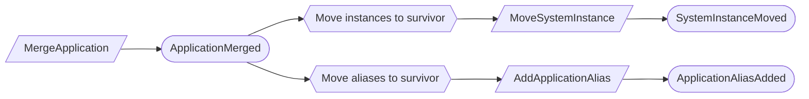
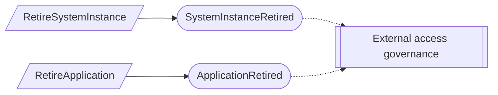

# Application inventory

Status: **locked**, 2026-11-03. Hand-authored source of truth for this context.

## Purpose

Application inventory is the organization's governed list of applications and the
system instances behind them, with their owners and their access-review scope
(M0-D05). The inventory in the product is authoritative for scope; any outside
list only corroborates or helps discovery.

**Owns:** applications, system instances, and access-review scope decisions.

**Does not own:**

| Concern | Owner |
| --- | --- |
| Accounts, entitlements, populations and campaigns at a system instance | External access governance; it references an exact instance and never creates one |
| People named as owners | Workforce assurance (`Person`) |
| Inclusion in the program's system boundary | Program and scope |
| Application import and connectors | Deferred: no import or connector is built now (M0-D05) |

## Language

| Term | Meaning |
| --- | --- |
| Application | A governed application with one canonical name, any number of aliases, a kind, a lifecycle, a criticality, a system owner and an access owner. |
| System owner, access owner | Workforce people accountable for the application and for access to it. They need not be platform members. |
| System instance | One concrete access boundary of an application: a cloud account, source-code organization, identity-provider tenant, SaaS tenant, environment, or other. Access is reviewed per instance, never per application. |
| Provider identifier | The provider's ID for an instance, such as an AWS account ID, a GitHub organization login, or a Slack workspace ID. |
| Access-review scope decision | Whether one exact instance version is `included` in or `excluded` from access review, with its reason and approver, effective from a date. |
| Merge | An attributed resolution of duplicate applications: one is retired with `merged_into`, and its names and instances move to the survivor. |

## Aggregates

### Application

**Identity:** `TenantId` + `ApplicationId`.

**Invariant:** one application has one canonical name, its aliases, a kind, a
criticality, a system owner, an access owner, and a lifecycle: active, then
retired. A retired application accepts no further changes.

- Every active application has all of these fields (M0-D05).
- Names and aliases are normalized and unique within the tenant across all active
  applications. This is checked against the current inventory when a name is set,
  and the rare duplicate from two simultaneous changes is fixed by a merge (AI-03).
- A classification declared by the tenant is attributed and stays
  `classification_unverified` until the classification vocabulary is approved; a
  missing one is an explicit `classification_unresolved` gap.
- Retirement is effective-dated, needs a reason, and is refused while the
  application has active system instances (AI-02). It never deletes history or a
  snapshot reference.
- A merge retires this application with `merged_into` the survivor, and its
  aliases and instances move to the survivor (AI-01).

| Command | Who | Accepts when | Emits |
| --- | --- | --- | --- |
| DeclareApplication | Compliance Lead or Contributor | `ApplicationId` is new; name and aliases unused; fields complete | ApplicationDeclared |
| RenameApplication | Compliance Lead or Contributor | Active; name unused | ApplicationRenamed |
| AddApplicationAlias | Compliance Lead or Contributor | Active; alias unused | ApplicationAliasAdded |
| RemoveApplicationAlias | Compliance Lead or Contributor | Active; alias held | ApplicationAliasRemoved |
| ChangeApplicationDetails | Compliance Lead or Contributor | Active | ApplicationDetailsChanged |
| ChangeApplicationOwners | Compliance Lead | Active; owners are people | ApplicationOwnersChanged |
| RetireApplication | Compliance Lead | Active; no active instances; reason given | ApplicationRetired |
| MergeApplication | Compliance Lead | Both active; survivor differs | ApplicationMerged |

| Event | Carries |
| --- | --- |
| ApplicationDeclared | tenant, application, name, aliases, kind, criticality, classification and its status, system owner, access owner, declared by |
| ApplicationRenamed | tenant, application, previous name, new name, renamed by |
| ApplicationAliasAdded | tenant, application, alias, added by |
| ApplicationAliasRemoved | tenant, application, alias, removed by |
| ApplicationDetailsChanged | tenant, application, changed fields (kind, criticality, classification), changed by |
| ApplicationOwnersChanged | tenant, application, system owner, access owner, changed by |
| ApplicationRetired | tenant, application, effective at, reason, retired by |
| ApplicationMerged | tenant, application, merged into, effective at, reason, aliases moved, merged by |

### SystemInstance

**Identity:** `TenantId` + `SystemInstanceId`.

**Invariant:** one instance belongs to exactly one application at a time, has one
kind, platform and provider identifier, and is active, then retired.

- Kind is `cloud_account`, `source_code_organization`, `identity_provider_tenant`,
  `saas_tenant`, `environment` or `other`; `other` needs a description. Platform
  is required for every kind except `environment` and `other` (M0-D05).
- Among active instances in the tenant, (kind, platform, provider identifier) is
  unique. This is checked against current state when the instance is declared or
  changed.
- An instance may name its own access owner; otherwise it uses its application's
  (AI-04).
- It moves to another application only through that application's merge (AI-01).

| Command | Who | Accepts when | Emits |
| --- | --- | --- | --- |
| DeclareSystemInstance | Compliance Lead or Contributor | `SystemInstanceId` is new; application active; key unused | SystemInstanceDeclared |
| ChangeSystemInstanceDetails | Compliance Lead or Contributor | Active; key unused | SystemInstanceDetailsChanged |
| ChangeSystemInstanceAccessOwner | Compliance Lead | Active | SystemInstanceAccessOwnerChanged |
| MoveSystemInstance | Reactor on ApplicationMerged | Active; owned by the merged application | SystemInstanceMoved |
| RetireSystemInstance | Compliance Lead | Active; reason given | SystemInstanceRetired |

| Event | Carries |
| --- | --- |
| SystemInstanceDeclared | tenant, instance, application, kind, platform, provider identifier, description, access owner, declared by |
| SystemInstanceDetailsChanged | tenant, instance, changed fields, changed by |
| SystemInstanceAccessOwnerChanged | tenant, instance, access owner (or none), changed by |
| SystemInstanceMoved | tenant, instance, from application, to application |
| SystemInstanceRetired | tenant, instance, effective at, reason, retired by |

### AccessReviewScope

**Identity:** `TenantId` + `SystemInstanceId`.

**Invariant:** one instance has a sequence of scope decisions with strictly
increasing effective dates. A new decision supersedes the previous one; none is
ever edited.

- A decision is `included` or `excluded` for an exact instance version. An
  exclusion needs a reason.
- An instance is in scope when it is inside the approved boundary and grants access
  to in-scope data, production infrastructure, source code, or identity
  administration; the reason records that judgment.
- The approver is a Compliance Lead who is not the instance's access owner, unless
  a separation-of-duties waiver covers it (M0-D05, M0-D03).

| Command | Who | Accepts when | Emits |
| --- | --- | --- | --- |
| DecideAccessReviewScope | Compliance Lead, not the access owner | Instance active; later effective date; reason when excluded | AccessReviewScopeDecided |

| Event | Carries |
| --- | --- |
| AccessReviewScopeDecided | tenant, instance, instance version, decision, reason, effective at, approver, waiver (if any) |

## Flows

### Merging duplicate applications

The merged application's aliases are released by the merge itself and then added
to the survivor. Its canonical name is not carried over automatically.

### Retiring an application

Each instance is retired deliberately before its application (AI-02), so nothing
leaves review scope silently.

## Decisions

Jev answers are from `jev-1.14.0`, 2026-11-03. A yes is ≥ 0.8 and a no is ≤ 0.2.
Anything in between is settled by common sense, with the reasoning stated.

| ID | Decision | Evidence |
| --- | --- | --- |
| AI-01 | A merge moves the merged application's instances and aliases to the survivor. | Instances move: 0.82. |
| AI-02 | Retiring an application is refused while it has active instances. | 0.72. Common sense: the domain rule that an application never silently leaves review scope. |
| AI-03 | Name and alias uniqueness is checked against current state when a name is set; there is no name-claim aggregate. | Check good enough: 0.33, not decisive. Settled the same way as the last-Org-Admin rule: small independent aggregates, with a merge to fix a rare duplicate. |
| AI-04 | An instance may name its own access owner and otherwise uses its application's. | Instances simply use the application's owner: 0.39. Common sense: production and development accounts often have different owners, so an override is allowed. |
| AI-05 | Application-to-application relationships and successor approval are not carried forward. | No product rule asks for them (0.51 that M0-D05 requires them). |
| AI-06 | Import aggregates are deferred with import itself. | M0-D05: no import or connector is built now. |

## Open questions

None at this time.

## Superseded owners

| Old owner | Becomes |
| --- | --- |
| DeclaredApplication | Application |
| ApplicationNameClaim | Removed (AI-03) |
| DeclaredSystemInstance | SystemInstance |
| SystemInstanceAccessReviewScope | AccessReviewScope |
| ApplicationRelationship | Not carried forward (AI-05) |
| ApplicationImportBatch, ApplicationImportSource, ImportedOwnerResolution | Deferred with import (AI-06) |
