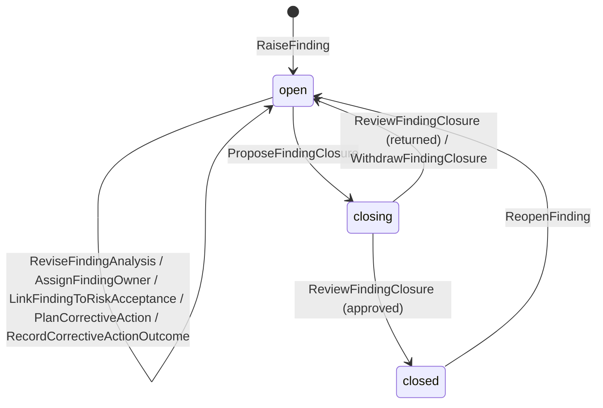
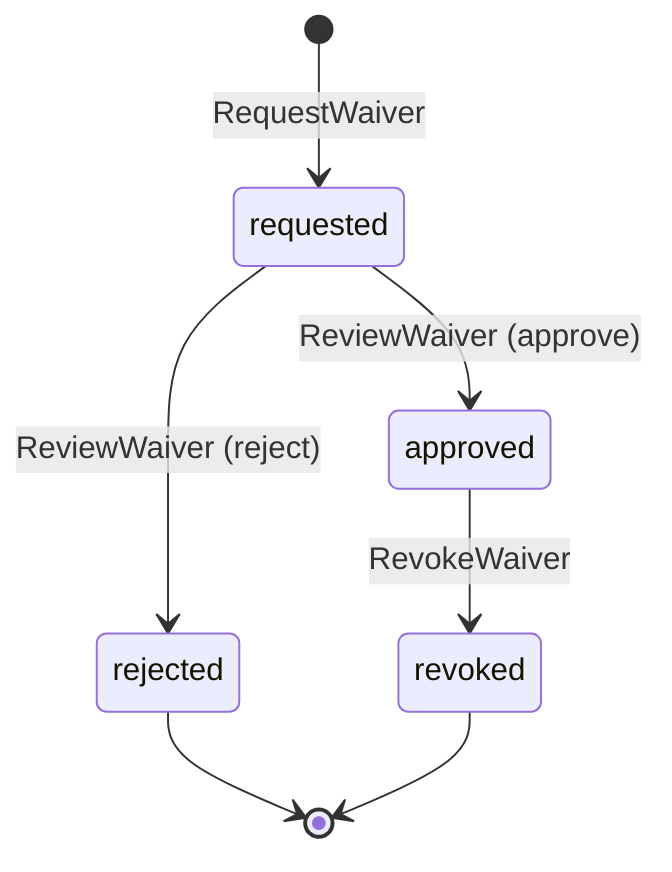
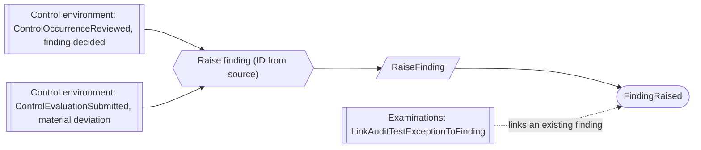
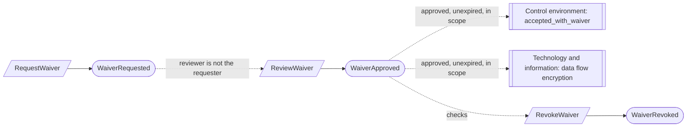

# Assurance work

Status: **locked**, 2026-11-03. Hand-authored source of truth for this context.
It follows the [context conventions](conventions.md).

## Purpose

Assurance work tracks what is wrong and what is being done about it: findings,
the corrective actions that fix them, and the waivers that approve a
time-bounded exception to a product rule (M0-D23).

**Owns:** findings, corrective actions and waivers.

**Does not own:**

| Concern | Owner |
| --- | --- |
| Separation-of-duties waivers | Platform access (`SeparationOfDutiesWaiver`) |
| Readiness gaps | [Readiness](readiness.md); a gap can raise a finding, and neither closes the other |
| Control evaluation deviations | Control environment; a material one raises a finding |
| Auditor-found exceptions | Examinations (`AuditTestException`); it links to a finding and is never a waiver |
| Risk acceptance decisions | Risk and provider oversight; a finding links to one and stays open |
| Provider coverage gaps | Risk and provider oversight |

## Language

| Term | Meaning |
| --- | --- |
| Finding | A governed deficiency and its corrective work. It keeps its source's wording separately from the team's analysis. |
| Source | Where a finding came from: `control_occurrence`, `control_evaluation_deviation`, `readiness_gap`, `audit_test_exception`, `provider_review`, `incident`, `management_review`, `consultant_observation` or `manual`, with the exact source record. |
| Severity | `low`, `moderate` or `high`, set by whoever raises or analyzes the finding until the firm defines a rubric (AW-07). |
| Corrective action | One owned piece of work that fixes part of a finding, with a due date and completion evidence. |
| Closure | A proposal, with resolution evidence and a verification rationale, that the finding is resolved, reviewed by a second person. |
| Waiver | An approved, time-bounded exception to a product rule for an exact scope, with rationale, compensating action and expiry. |

## Aggregates

### Finding

**Identity:** `TenantId` + `FindingId`. A finding raised by a reaction takes an ID
derived from its source ([CV-02](conventions.md#reactors)).

**Invariant:** one finding has one source for life, whose wording never changes,
and an analysis the team can revise. It is open until a closure proposal is
approved by a reviewer who authored no revision of it
([CV-06](conventions.md#guards-and-reviews)). A reopened finding keeps its
earlier closure in history and needs a new reviewed closure (AW-04).

- The finding admits each corrective action itself (`PlanCorrectiveAction`,
  refused unless open) and records each action's outcome as it is reported, so
  a closure proposal is refused, and a review refuses approval, while any
  admitted action is unresolved. This is decided from the finding's own stream
  (AW-02, AW-09, CV-11).
- Linking a risk acceptance or an audit test exception never closes the finding
  (M0-D23).
- No record silently turns into or closes another: a gap, deviation or exception
  that changes state leaves the finding as it is.

| Command | Who | Accepts when | Emits |
| --- | --- | --- | --- |
| RaiseFinding | Compliance Lead or Contributor, or reactor | `FindingId` is new; source given; a repeat by a reactor is a no-op | FindingRaised |
| ReviseFindingAnalysis | Compliance Lead, Contributor or the owner | Open | FindingAnalysisRevised |
| AssignFindingOwner | Compliance Lead | Not closed; owner is a person or an active team | FindingOwnerAssigned |
| LinkFindingToRiskAcceptance | Compliance Lead | Not linked to that acceptance | FindingLinkedToRiskAcceptance |
| PlanCorrectiveAction | Compliance Lead or the finding's owner | Open (not closing or closed); `ActionId` new for the finding; description, owner and due date given | CorrectiveActionPlanned |
| RecordCorrectiveActionOutcome | Reactor on CorrectiveActionCompleted or CorrectiveActionCancelled | The action was planned here; a repeat is a no-op | FindingCorrectiveActionResolved |
| ProposeFindingClosure | The owner or Compliance Lead | Open; every planned action resolved in this finding; resolution evidence and rationale given | FindingClosureProposed |
| WithdrawFindingClosure | Its proposer | Closing | FindingClosureWithdrawn |
| ReviewFindingClosure | Compliance Lead who authored no revision of the proposal, or covered by a waiver | Closing; reviews the current proposal; every planned action still resolved | FindingClosed or FindingClosureReturned |
| ReopenFinding | Compliance Lead | Closed; reason given | FindingReopened |

| Event | Carries |
| --- | --- |
| FindingRaised | tenant, finding, program, source kind and record, source wording, title, severity, owner, raised by |
| FindingAnalysisRevised | tenant, finding, revision, analysis, severity, affected records, revised by |
| FindingOwnerAssigned | tenant, finding, previous owner, new owner, assigned by |
| FindingLinkedToRiskAcceptance | tenant, finding, risk acceptance, linked by |
| CorrectiveActionPlanned | tenant, finding, action, description, owner, due date, planned by |
| FindingCorrectiveActionResolved | tenant, finding, action, outcome (`completed` or `cancelled`) |
| FindingClosureProposed | tenant, finding, closure, resolution evidence (artifact versions), verification rationale, actions relied on, proposed by |
| FindingClosureWithdrawn | tenant, finding, closure, withdrawn by |
| FindingClosed | tenant, finding, closure, reviewer, waiver (if any) |
| FindingClosureReturned | tenant, finding, closure, comments, reviewer |
| FindingReopened | tenant, finding, previous closure, reason, reopened by |

### CorrectiveAction

**Identity:** `TenantId` + `ActionId`, for one finding for life.

**Invariant:** one action has one owner, a description and a due date, and is
open, then completed with evidence or cancelled with a reason (AW-03).

- An action exists only because its finding planned it: it is created by a
  reaction to `CorrectiveActionPlanned`, with the finding's `ActionId`
  ([CV-02](conventions.md#reactors)).
- Past its due date and not completed, an action is overdue: a computed gap.

| Command | Who | Accepts when | Emits |
| --- | --- | --- | --- |
| AddCorrectiveAction | Reactor on CorrectiveActionPlanned | New; a repeat is a no-op | CorrectiveActionAdded |
| ChangeCorrectiveAction | Compliance Lead or the finding's owner | Open | CorrectiveActionChanged |
| CompleteCorrectiveAction | The action's owner or Compliance Lead | Open; completion evidence given | CorrectiveActionCompleted |
| CancelCorrectiveAction | Compliance Lead | Open; reason given | CorrectiveActionCancelled |

| Event | Carries |
| --- | --- |
| CorrectiveActionAdded | tenant, action, finding, description, owner, due date, added by |
| CorrectiveActionChanged | tenant, action, changed fields (description, owner, due date), changed by |
| CorrectiveActionCompleted | tenant, action, evidence (artifact versions), note, completed by |
| CorrectiveActionCancelled | tenant, action, reason, cancelled by |

### Waiver

**Identity:** `TenantId` + `WaiverId`.

**Invariant:** one waiver exempts one exact scope from one product rule until its
expiry, with a rationale and compensating action. It takes effect once approved
by a Compliance Lead or Org Admin who did not request it (AW-05). It stops
covering anything when it expires (computed) or is revoked (AW-06).

- The rule is named from the product's list of waivable rules, such as
  `data_flow_encryption`, `control_evaluation_minor_deviation` or
  `control_occurrence`. Separation of duties is waived in Platform access instead.
- Every waived action is flagged in readiness results and audit exports by the
  context that performed it.

| Command | Who | Accepts when | Emits |
| --- | --- | --- | --- |
| RequestWaiver | Compliance Lead or Contributor | `WaiverId` is new; rule waivable; scope, rationale, compensating action given; expiry after now | WaiverRequested |
| ReviewWaiver | Compliance Lead or Org Admin, not the requester | Requested; unexpired | WaiverApproved or WaiverRejected |
| RevokeWaiver | Compliance Lead or Org Admin | Approved; unexpired; reason given | WaiverRevoked |

| Event | Carries |
| --- | --- |
| WaiverRequested | tenant, waiver, rule, scope (exact records), rationale, compensating action, expires at, requested by |
| WaiverApproved | tenant, waiver, approver, approved at |
| WaiverRejected | tenant, waiver, comments, reviewer |
| WaiverRevoked | tenant, waiver, reason, revoked by |

## Flows

Diagrams follow [CV-01](conventions.md#flow-diagrams).

### Findings raised by other contexts

Readiness gaps, provider reviews and incidents raise findings by a person's
decision, through the same command.

### Fixing and closing a finding

```mermaid
flowchart LR
    C0[/PlanCorrectiveAction/] --> E0([CorrectiveActionPlanned])
    E0 --> R0{{"Create action (ID from finding)"}} --> C1[/AddCorrectiveAction/] --> E1([CorrectiveActionAdded])
    E1 -. checks .-> C2[/CompleteCorrectiveAction/] --> E2([CorrectiveActionCompleted])
    E2 --> R1{{Report outcome}} --> CR[/RecordCorrectiveActionOutcome/] --> ER([FindingCorrectiveActionResolved])
    ER -. "every planned action resolved (own stream)" .-> C3[/ProposeFindingClosure/] --> E3([FindingClosureProposed])
    E3 -. "reviewer authored none" .-> C4[/ReviewFindingClosure/]
    C4 --> E4([FindingClosed])
    C4 --> E5([FindingClosureReturned])
    E4 -. checks .-> C5[/ReopenFinding/] --> E6([FindingReopened])
```

### Waivers

## Disagreement and replay

Cases required by [CV-12](conventions.md#guards-and-reviews).

| Case | Outcome |
| --- | --- |
| An action is planned while closure is being proposed | The finding's stream orders them: planning after the proposal is refused (finding not open); a proposal after planning is refused until the action is resolved |
| An action's completion is reported twice | `RecordCorrectiveActionOutcome` repeat is a no-op |
| `CorrectiveActionPlanned` processed but the action not yet created | The finding shows the action as planned and unresolved; closure stays refused |
| A raise-finding reaction delivered twice | The finding's ID is derived from its source, so the repeat is a no-op |

## Decisions

Jev answers are from `jev-1.14.0`, 2026-11-03. A yes is ≥ 0.8 and a no is ≤ 0.2.
Anything in between is settled by common sense, with the reasoning stated.

| ID | Decision | Evidence |
| --- | --- | --- |
| AW-01 | A finding keeps its source wording unchanged, separate from the team's revisable analysis. | 0.82. M0-D23. |
| AW-02 | Closure is refused until every corrective action is completed or cancelled with a reason, and needs a reviewer who authored no revision of the proposal. | Actions done: 0.89. Second-person review: 0.81. |
| AW-03 | Each corrective action is its own small record tied to one finding. | 0.84. |
| AW-04 | Reopening keeps the earlier closure and needs a new reviewed closure. | 0.90. |
| AW-05 | A waiver is approved by a Compliance Lead or Org Admin who did not request it, and can be revoked with a reason. | Approver: 0.86. Revocable: 0.86. |
| AW-06 | A waiver's expiry is computed from its date. | 0.64. Common sense: same as the separation-of-duties waiver (Platform access) and CV-09. |
| AW-07 | Severity is `low`, `moderate` or `high`, set by whoever raises or analyzes the finding, until the firm defines a rubric. | 0.54. Common sense: triage needs some severity, and M0-D23 names the rubric a delivery limitation. |
| AW-08 | A risk acceptance link never closes a finding. | 0.83. M0-D23. |
| AW-09 | The finding admits each corrective action and records each outcome, so closure is decided from its own stream. | 0.87. Portia guidelines review: adding an action and proposing closure at once could otherwise close a finding with an open action. |

## Open questions

None at this time.

## Superseded owners

| Old owner | Becomes |
| --- | --- |
| FindingAggregate | Finding |
| CorrectiveAction | CorrectiveAction |
| FindingMigrationAggregate, RemediationMigrationFenceAggregate | Removed: technical migration, not domain |
| FindingClosureReactor, FindingClosureProcess | Closure review on Finding (AW-02) |
| CorrectiveActionMaterializationReactor, OpenCorrectiveActionForFindingReactor | `PlanCorrectiveAction` on Finding, then `AddCorrectiveAction` (AW-09) |
| ControlOccurrenceFindingReactor, ControlEvaluationDeviationFindingReactor | "Raise finding" reactions (Control environment) |
