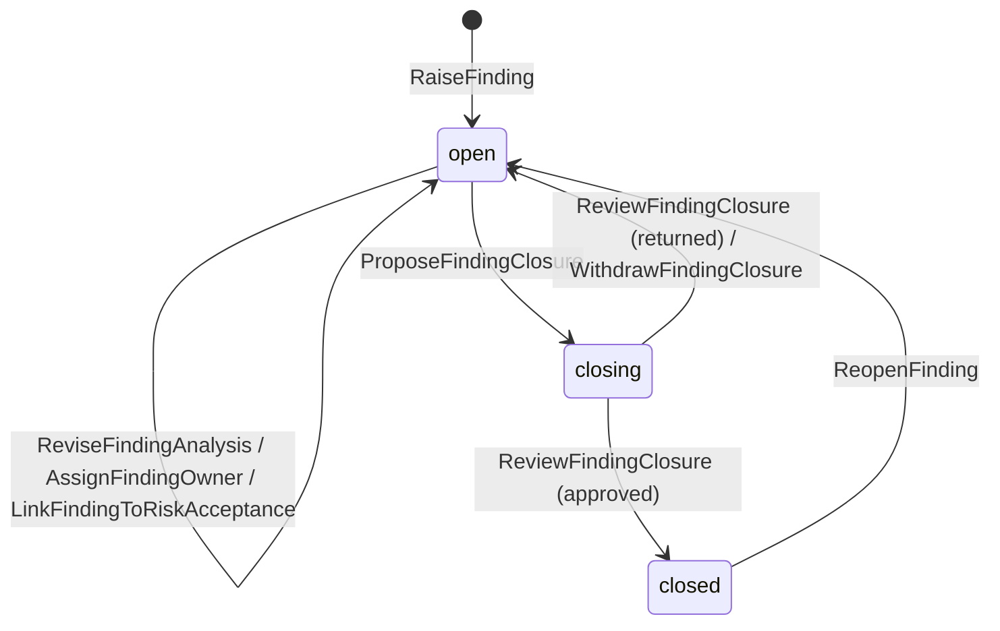
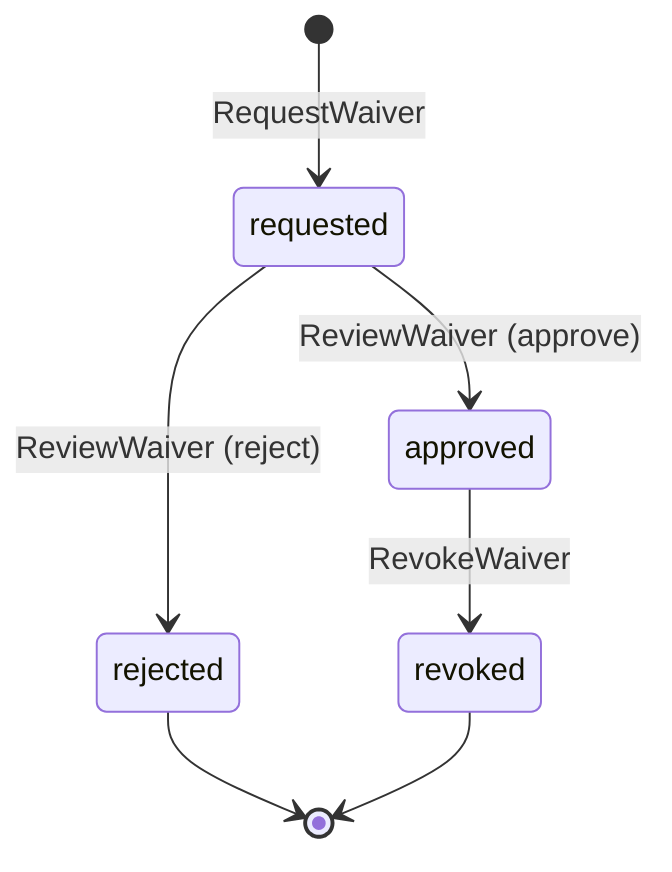
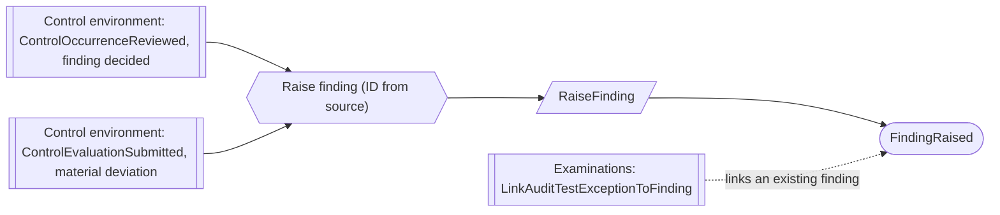
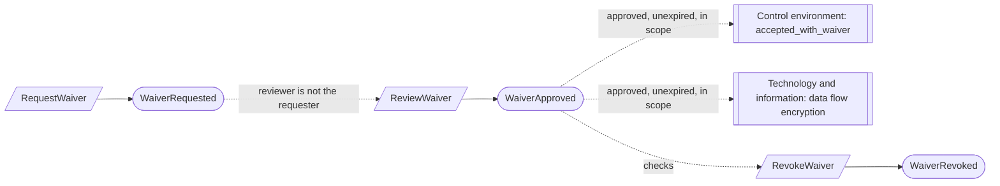

# Assurance work

Status: **partially redesigned**, 2026-11-05. Independent resolution and a
derived all-actions-terminal close are alternatives under review. Neither is
equivalent to the earlier AW-02 contract in every respect; product semantics,
evidence and action-admission authority remain unresolved. The earlier AW-09
parent-owned action roster and aggregate counts are not a fallback. This context
is not implementation-ready. It follows the [context conventions](conventions.md).

## Purpose

Assurance work tracks what is wrong and what is being done about it: findings,
the corrective actions that fix them, and the waivers that approve a
time-bounded exception to a product rule (M0-D23).

**Owns:** findings, corrective actions and waivers.

**Does not own:**

| Concern | Owner |
| --- | --- |
| Separation-of-duties waivers | Platform access (`SeparationOfDutiesWaiver`) |
| Readiness gaps | [Readiness](readiness.md); a gap can raise a finding, and neither closes the other |
| Control evaluation deviations | Control environment; a material one raises a finding |
| Auditor-found exceptions | Examinations (`AuditTestException`); it links to a finding and is never a waiver |
| Risk acceptance decisions | Risk and provider oversight; a finding links to one and stays open |
| Provider coverage gaps | Risk and provider oversight |

## Language

| Term | Meaning |
| --- | --- |
| Finding | A governed deficiency and its corrective work. It keeps its source's wording separately from the team's analysis. |
| Source | Where a finding came from: `control_occurrence`, `control_evaluation_deviation`, `readiness_gap`, `audit_test_exception`, `provider_review`, `incident`, `management_review`, `consultant_observation` or `manual`, with the exact source record. |
| Severity | `low`, `moderate` or `high`, set by whoever raises or analyzes the finding until the firm defines a rubric (AW-07). |
| Corrective action | One owned piece of work intended to address a finding, with a due date and completion evidence. Under the proposed closure policy, it may include preventive follow-up after the deficiency itself is resolved. |
| Closure | A proposal, with resolution evidence and a verification rationale, that the finding is resolved, reviewed by a second person. |
| Waiver | An approved, time-bounded exception to a product rule for an exact scope, with rationale, compensating action and expiry. |

## Aggregates

### Finding

**Identity:** `TenantId` + `FindingId`. A finding raised by a reaction takes an ID
derived from its source ([CV-02](conventions.md#reactors)).

**Invariant:** one finding has one source for life, whose wording never changes,
and an analysis the team can revise. It is open until a closure proposal is
approved by a reviewer who authored no revision of it
([CV-06](conventions.md#guards-and-reviews)). A reopened finding keeps its
earlier closure in history and needs a new reviewed closure (AW-04).

- **Proposed policy change:** closure asserts that the deficiency is resolved,
  based on a specific resolution rationale and evidence reviewed by an authorized
  second person. It does not assert that every associated action is terminal.
  An existing open action remains open, assigned and due until its own owner
  completes or cancels it. It may complete after finding closure. This changes
  AW-02's earlier all-actions-terminal precondition and needs a product decision.
- The finding does not own an action roster, maintain a child count, read all
  actions, or record each action's lifecycle outcome. Action lists are read
  models for navigation, not authority for closure.
- Linking a risk acceptance or an audit test exception never closes the finding
  (M0-D23).
- No record silently turns into or closes another: a gap, deviation or exception
  that changes state leaves the finding as it is.

| Command | Who | Accepts when | Emits |
| --- | --- | --- | --- |
| RaiseFinding | Compliance Lead or Contributor, or reactor | `FindingId` is new; source given; a repeat by a reactor is a no-op | FindingRaised |
| ReviseFindingAnalysis | Compliance Lead, Contributor or the owner | Open | FindingAnalysisRevised |
| AssignFindingOwner | Compliance Lead | Not closed; owner is a person or an active team | FindingOwnerAssigned |
| LinkFindingToRiskAcceptance | Compliance Lead | Not linked to that acceptance | FindingLinkedToRiskAcceptance |
| ProposeFindingClosure | The owner or Compliance Lead | Open; concrete resolution rationale and required exact evidence given; evidence authority unresolved | FindingClosureProposed |
| WithdrawFindingClosure | Its proposer | Closing | FindingClosureWithdrawn |
| ReviewFindingClosure | Compliance Lead who authored no revision of the proposal, or covered by a waiver | Closing; reviews the exact current proposal and its evidence; independently decides whether the deficiency is resolved | FindingClosed or FindingClosureReturned |
| ReopenFinding | Compliance Lead | Closed; reason given | FindingReopened |

| Event | Carries |
| --- | --- |
| FindingRaised | tenant, finding, program, source kind and record, source wording, title, severity, owner, raised by |
| FindingAnalysisRevised | tenant, finding, revision, analysis, severity, revised by; no embedded affected-record collection |
| FindingOwnerAssigned | tenant, finding, previous owner, new owner, assigned by |
| FindingLinkedToRiskAcceptance | tenant, finding, risk acceptance, linked by |
| FindingClosureProposed | tenant, finding, closure, verification rationale and evidence assurance reference, proposed by; evidence assurance is unresolved below |
| FindingClosureWithdrawn | tenant, finding, closure, withdrawn by |
| FindingClosed | tenant, finding, closure, reviewer, waiver (if any) |
| FindingClosureReturned | tenant, finding, closure, comments, reviewer |
| FindingReopened | tenant, finding, previous closure, reason, reopened by |

### CorrectiveAction

**Identity:** `TenantId` + `ActionId`, for one finding for life.

**Invariant:** one action has one owner, a description and a due date, and is
open, then completed with evidence or cancelled with a reason (AW-03).

- An action exists only after authoritative admission for its finding. The
  stable `ActionId` is tenant-wide and permanently binds it to one
  finding and one creation intent. Exact retries are idempotent; a changed
  finding or intent is a conflict. Admission authority is under design.
- Under the proposed closure policy, a finding closing has no effect on an
  existing action: its owner, due date, completion evidence and cancellation
  rules continue to apply. Past its due date and not completed, an action is
  overdue: a computed gap.

| Command | Who | Accepts when | Emits |
| --- | --- | --- | --- |
| AddCorrectiveAction | Admission coordinator (candidate) | Exact authoritative admission; tenant-wide ID is new, or an exact repeat; changed intent or binding is refused | CorrectiveActionAdded |
| ChangeCorrectiveAction | Compliance Lead or the finding's owner | Open | CorrectiveActionChanged |
| CompleteCorrectiveAction | The action's owner or Compliance Lead | Open; completion evidence given | CorrectiveActionCompleted |
| CancelCorrectiveAction | Compliance Lead | Open; reason given | CorrectiveActionCancelled |

| Event | Carries |
| --- | --- |
| CorrectiveActionAdded | tenant, action, finding, description, owner, due date, added by |
| CorrectiveActionChanged | tenant, action, changed fields (description, owner, due date), changed by |
| CorrectiveActionCompleted | tenant, action, evidence assurance reference, note, completed by; evidence assurance is unresolved below |
| CorrectiveActionCancelled | tenant, action, reason, cancelled by |

### Waiver

**Identity:** `TenantId` + `WaiverId`.

**Invariant:** one waiver exempts one exact scope from one product rule until its
expiry, with a rationale and compensating action. It takes effect once approved
by a Compliance Lead or Org Admin who did not request it (AW-05). It stops
covering anything when it expires (computed) or is revoked (AW-06).

- The rule is named from the product's list of waivable rules, such as
  `data_flow_encryption`, `control_evaluation_minor_deviation` or
  `control_occurrence`. Separation of duties is waived in Platform access instead.
- Every waived action is flagged in readiness results and audit exports by the
  context that performed it.

| Command | Who | Accepts when | Emits |
| --- | --- | --- | --- |
| RequestWaiver | Compliance Lead or Contributor | `WaiverId` is new; rule waivable; scope, rationale, compensating action given; expiry after now | WaiverRequested |
| ReviewWaiver | Compliance Lead or Org Admin, not the requester | Requested; unexpired | WaiverApproved or WaiverRejected |
| RevokeWaiver | Compliance Lead or Org Admin | Approved; unexpired; reason given | WaiverRevoked |

| Event | Carries |
| --- | --- |
| WaiverRequested | tenant, waiver, rule, scope (exact records), rationale, compensating action, expires at, requested by |
| WaiverApproved | tenant, waiver, approver, approved at |
| WaiverRejected | tenant, waiver, comments, reviewer |
| WaiverRevoked | tenant, waiver, reason, revoked by |

## Flows

Diagrams follow [CV-01](conventions.md#flow-diagrams).

### Findings raised by other contexts

Readiness gaps, provider reviews and incidents raise findings by a person's
decision, through the same command.

### Fixing and closing a finding

Under the proposed policy, a person submits a resolution rationale and evidence
for an open finding. An independent reviewer approves the exact proposal if the
reviewed material supports resolution, or returns it for more work. If the
reviewer knows an outstanding action is essential to establishing resolution,
they return the proposal; the system does not require them to discover or
adjudicate every action. Closed means the reviewer accepted that the deficiency
was resolved, not that all associated work ended. Actions retain their own
lifecycles and can remain open or finish later. Reopening requires a new reviewed
closure and does not reopen completed or cancelled actions.

The previously accepted restriction on planning a new action while a finding is
closing or closed is separate from closure's evidence-based decision. Its
race-safe admission protocol is not yet specified. An action admitted while
open may still materialize after closure if its creation was delayed; its exact
admission, identity and recovery need explicit authority. This does not make
its status a precondition for closure under the proposed policy.

A user interface must distinguish the closed finding from associated actions,
show open and overdue work through action views, and never label closure as
proof that all actions are finished. Those views may lag; their results do not
authorize closure. This is a substantive change from the previous AW-02 behavior,
not an implementation detail.

### Alternative: independently reviewed resolution and derived closure

This is an alternative to the immediate-close policy above, not a locked
contract. It preserves the meaning that a finding is displayed as closed only
when resolution has been independently approved **and every admitted corrective
action is completed or cancelled**. Approval is a small decision about an exact
resolution proposal and its review evidence; it does not read or decide the
status of all actions. The action owners decide their own outcomes. A read model
incrementally combines those facts and exposes `closed_as_of` a certified source
frontier when the finding's current approval is effective, action admission is
sealed, all admitted actions are terminal and no pre-seal admission is pending.
The read model may maintain per-action rows or an idempotently maintained count;
neither is aggregate state, a parent event, or authority for a finding command.
Lists are paged, and a read need not load an entire action set into memory.

The distinction from the existing contract is material. The earlier command
refused both the closure proposal and its review until every action was terminal
and emitted an authoritative `FindingClosed` event on approval. This alternative
allows an early **resolution review**, delays the derived closed state until the
last action settles, and has no corresponding authoritative close event. The
meaning of closure and time recorded for it, whether early review is acceptable,
and any downstream reliance on a close fact require explicit product and
consumer decisions. It is not an implementation of the earlier transition by
renaming an event. If evidence or material facts change after review, decide
whether to invalidate that approval; automatic carry-forward is not established.

The existing [M0-D15](../decisions/m0-d15-work-queue.md#finding-closure-decision-work)
queue rule is narrower than terminal status: it creates a review item only when
there is at least one action and **every action is completed**. A cancelled
action is terminal for AW-02 but does not satisfy that queue rule. Neither an
early approval nor a zero-action round automatically creates the queue item;
changing the queue's rule also requires a decision. A queue item is a projection
and does not authorize the reviewer or the resolution transition. M0-D15 also
excludes the current finding owner and action owners or completers from ordinary
closure work. Whether that reviewer rule can be enforced without requiring a
write decision over all action histories is unresolved; do not substitute a
lagging projected eligibility list as authorization or silently weaken it.

**Potential admission ordering, not yet qualified:** An action proposal and a
review-round seal could be ordered in a single retained Fitz area or realm. A
proposal before the seal is not silently dropped: its exact `ActionId`, finding,
review round and intent must receive one independently owned accepted or refused
outcome. A proposal after the seal is refused for that round. A raw append,
dispatch, timeout, or empty target read is not an accepted or refused outcome.
Until each pre-seal outcome is known, the read model is pending and must not
report closed. A seal alone says nothing about action completion. This does not
append per-action admission or outcomes to Finding. Exact retry, changed-intent
conflict, no-op, target fencing, gaps and crash recovery must all be specified.
It is not yet proved that every writer uses the same retained scope or that the
configured Fitz/Portia versions provide the necessary ordering and durability.

The projection must bind the exact finding revision, review round and complete
source cursor, apply relevant proposals and outcomes idempotently, and atomically
publish its checkpoint with the derived data. Discovery through the seal is not
the same as settlement: the checkpoint transaction must retain each pre-seal
proposal as pending until its exact outcome is known. The read model must not
treat a projected zero or a checkpoint past unsettled work as proof. A gap,
unknown result, stale source or incomplete rebuild yields `pending` or `unknown`,
never closed. Settlement can progress independently per finding; a delayed
pre-seal action postpones closure of its own finding. On return, withdrawal or
reopen, epoch fencing must prevent an old proposal or approval from applying to
the new round. An action from an earlier round that remains associated with the
finding still blocks the original all-actions-terminal meaning: considering only
the latest round silently weakens it. Completed and cancelled actions do not
reopen under the current lifecycle; changing that requires a new race analysis.

A certified `closed_as_of` value is a qualified read at a source frontier, not
an authoritative current finding fact. It cannot by itself guard an irreversible
cross-owner command against a concurrent reopen or a missing participant. A
consumer that requires the historic `FindingClosed` event, a durable closure
instant, or current atomic closure must retain that requirement as unresolved
until an explicit authority protocol or product change is approved. Do not have
a reactor emit the old event solely because an eventually consistent projection
displays zero outstanding actions.

### Waivers

## Affected records and evidence boundaries

`FindingAnalysisRevised` must not embed an unbounded set of affected records.
Each affected-record association is a separate, independently addressable
finding/revision-to-record link; listings are projections. Whether a link may be
added or removed after a revision, and whether any decision requires an exact
frozen set, still needs a domain decision. A projection alone cannot prove an
exact set used for a decision.

Completion and closure both retain the requirement for resolution evidence;
that requirement is not satisfied merely by saying links are eventually
projected. Evidence associations should be individually addressable, including
the exact artifact version and the action completion or closure proposal they
support. Do not embed an unbounded list of those associations in the parent
or replace it with a giant artifact or manifest. The authoritative way to prove
that required evidence exists and identify precisely what a reviewer relied on,
including retries, changes and late links, is unresolved. In particular, it is
not yet established whether a single exact artifact version suffices for each
business decision or how multiple supporting versions become a stable review
boundary. Until decided, the evidence-assurance references in the tables are
placeholders, not usable event contracts.

## Disagreement and replay obligations

These are required scenarios, not claims that an implementation already passes.

| Case | Required result under the proposed policy |
| --- | --- |
| An accepted action is open when the finding is proposed or approved for closure | The action remains open and assigned. The review decides the deficiency's resolution from the submitted evidence, without a child count or complete action query. |
| An action completes after finding closure | Its own authorized command and evidence decide completion; finding closure and review history do not change. |
| Reviewer identifies an action whose unfinished work is necessary for resolution | Return the proposal; do not treat the mere existence of other work as proof either way. |
| New action planning races proposal or approval | Preserve the previous restriction on admission while closing or closed, with an authoritative race-safe per-action decision; exact choreography remains unresolved. No child collection or all-actions counter may authorize the finding write. |
| An admitted action's creation acknowledgement is lost | Retry the exact operation; never infer refusal from timeout or an empty read. Its later creation must have valid prior admission. |
| Competing findings use the same tenant/action ID | At most one immutable action binding succeeds; a conflicting intent is refused. Exact outcome and recovery semantics remain unresolved. |
| Proposal is returned, withdrawn, approved, or finding reopened | Exact finding facts and current proposal identity govern the transition; stale reviews cannot close a later proposal. Existing action states are untouched. |
| A raise-finding reaction is delivered twice | The finding's ID is derived from its source, so the exact repeat is a no-op. |

## Decisions

Jev answers are from `jev-1.14.0`, 2026-11-03. A yes is ≥ 0.8 and a no is ≤ 0.2.
Earlier decisions include their stated reasoning for intermediate scores; newly
reviewed low-confidence or near-even judgments remain unresolved.

| ID | Decision | Evidence |
| --- | --- | --- |
| AW-01 | A finding keeps its source wording unchanged, separate from the team's revisable analysis. | 0.82. M0-D23. |
| AW-02 | **Previously accepted:** closure proposal and approval each require every action completed or cancelled, followed by an authoritative close fact and independent review. Two unapproved alternatives are immediate independently reviewed closure with open actions, and early resolution review plus derived all-terminal closure. Each changes some prior semantics; the second-person rule remains. Product and authority decisions required. | Historical actions done: 0.89; second-person review: 0.81. Alternatives and limitations: [finding boundaries review](../reviews/finding-boundaries-review.md). |
| AW-03 | Each corrective action is its own small record tied to one finding. | 0.84. |
| AW-04 | Reopening keeps the earlier closure and needs a new reviewed closure. | 0.90. |
| AW-05 | A waiver is approved by a Compliance Lead or Org Admin who did not request it, and can be revoked with a reason. | Approver: 0.86. Revocable: 0.86. |
| AW-06 | A waiver's expiry is computed from its date. | 0.64. Common sense: same as the separation-of-duties waiver (Platform access) and CV-09. |
| AW-07 | Severity is `low`, `moderate` or `high`, set by whoever raises or analyzes the finding, until the firm defines a rubric. | 0.54. Common sense: triage needs some severity, and M0-D23 names the rubric a delivery limitation. |
| AW-08 | A risk acceptance link never closes a finding. | 0.83. M0-D23. |
| AW-09 | **Superseded; action admission unresolved.** The former design made Finding record every action and outcome. Neither that roster nor an all-actions count is acceptable. The existing rule that no new action is planned while closing or closed still needs an authoritative per-action race protocol. | [Finding boundaries review](../reviews/finding-boundaries-review.md). |

## Open questions

1. Product decision: distinguish immediate reviewed closure with independent
   follow-up work from early resolution review and a qualified derived
   all-actions-terminal closed state. Decide whether changing the original order
   of proposal/review and losing a durable close event are acceptable, and
   reconcile M0-D15's stricter completed-only queue rule. If the existing
   event and every original transition must remain authoritative, neither
   candidate is proven equivalent. An advisory list or attestation alone
   cannot prove all actions terminal.
2. Specify race-safe admission that preserves the existing no-new-action rule
   for closing/closed findings, including concurrent proposal, exact retry,
   missing target, lost acknowledgement, competing finding IDs, withdrawal and
   reopen. It must not introduce an all-actions counter or hidden roster.
3. Define the authority, lifecycle and exact review scope for independently
   linked affected records and evidence versions. Prove required evidence and
   stable reviewed intent without an unbounded parent collection or an
   eventually consistent projection as authority.
4. Verify chosen coordination against actual Portia storage and executable
   race and recovery tests. Jev is advisory, not proof. Until these questions
   are resolved, the changed closure policy, action admission and evidence
   assurance are partial and this context is not ready to implement.

## Superseded owners

| Old owner | Becomes |
| --- | --- |
| FindingAggregate | Finding |
| CorrectiveAction | CorrectiveAction |
| FindingMigrationAggregate, RemediationMigrationFenceAggregate | Removed: technical migration, not domain |
| FindingClosureReactor, FindingClosureProcess | Closure review on Finding (AW-02) |
| CorrectiveActionMaterializationReactor, OpenCorrectiveActionForFindingReactor | Replacement admission and creation choreography unresolved (AW-09) |
| ControlOccurrenceFindingReactor, ControlEvaluationDeviationFindingReactor | "Raise finding" reactions (Control environment) |
