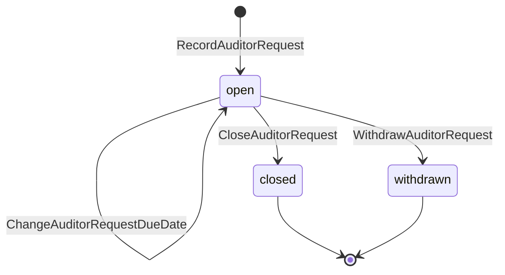
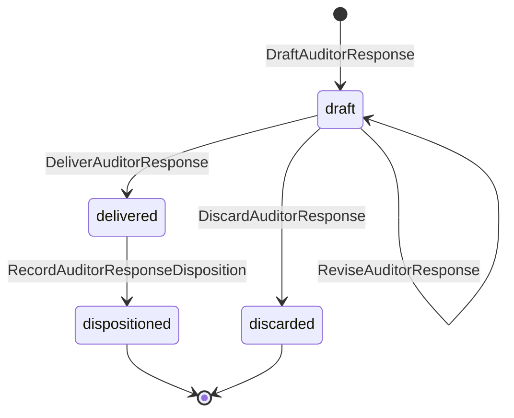
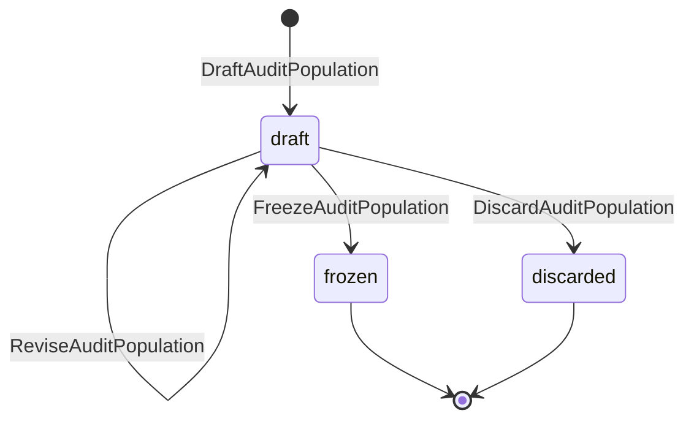
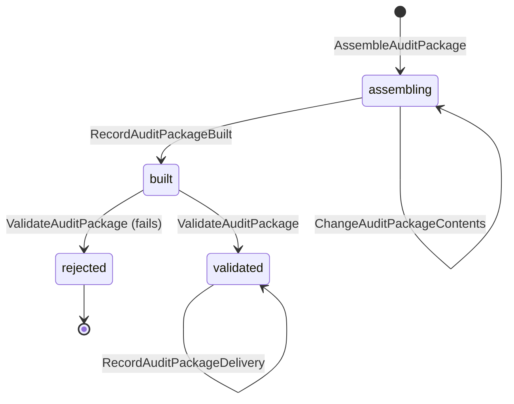
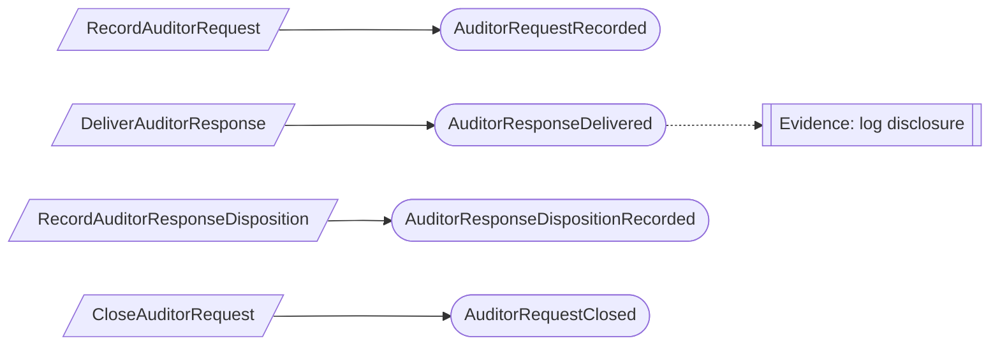
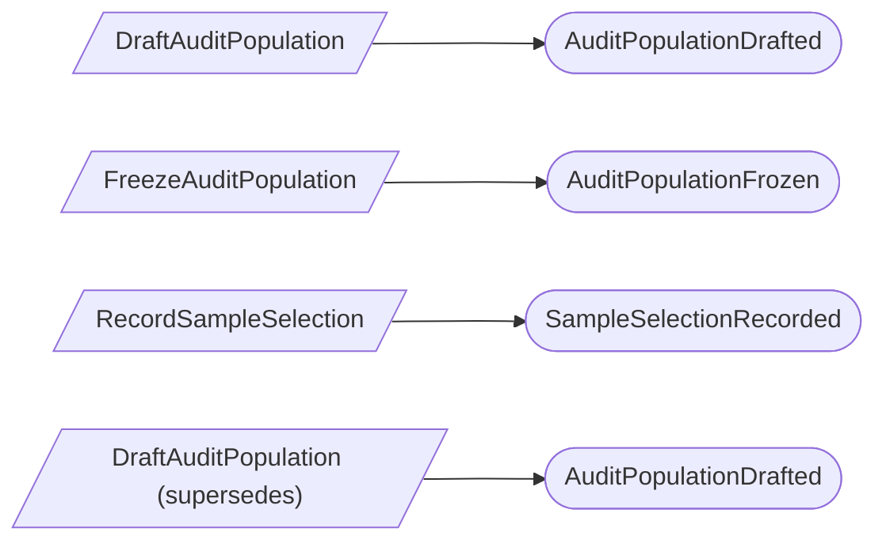
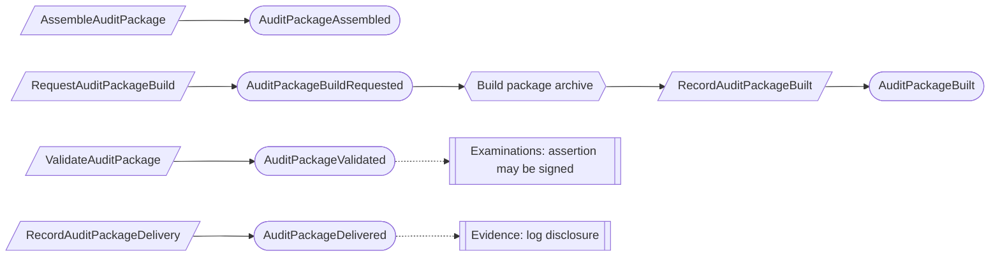

# Auditor collaboration

Status: **locked**, 2026-11-03. Hand-authored source of truth for this context.

## Purpose

Auditor collaboration is the exchange between a client and its auditor during an
examination: requests and their responses, comments, frozen audit populations,
sample selections, and packages delivered to the auditor (M0-D17, M0-D27).

Our firm's attest team works here in-product, as staff assigned to the
engagement. External audit firms have no product accounts; their requests are
recorded by the client and they receive packages (M0-D17).

**Owns:** auditor requests, auditor responses, request comments, audit
populations, sample selections, and audit packages.

**Does not own:**

| Concern | Owner |
| --- | --- |
| The examination, assertion, letter and outcome | Examinations |
| Evidence artifacts, redactions and the disclosure log | Evidence; a response or package references exact artifact versions |
| Who on the attest team may act | Firm services (`EngagementAssignment`, behind the independence wall) |
| The attest engagement record package | Firm services (`AttestEngagementRecordPackage`), built from this context's records |
| Retention and holds on delivered material | Retention (M0-D16) |
| Advisor handoffs and feedback | Advisor collaboration |

## Language

| Term | Meaning |
| --- | --- |
| Auditor request | A request from the auditor for evidence or information, for one examination. |
| Requester | Attest staff assigned to the engagement, or an external firm whose request a Compliance Lead recorded on its behalf (AC-06). |
| Auditor response | The client's answer to a request: text and exact evidence artifact versions. |
| Request comment | A message from either side on a request. A posted comment is never edited. |
| Audit population | A complete list of items, such as all production changes in the period, with stable row identifiers. Frozen once, with a content hash. |
| Sample selection | The auditor's chosen rows from one exact frozen population version. |
| Audit package | A zipped folder with a `manifest.json` listing every file's path, hash, size and source record version, named `{engagement}/{section}/{stable_id}_{version}.{ext}` (M0-D17). |

## Aggregates

### AuditorRequest

**Identity:** `TenantId` + `RequestId`.

**Invariant:** one request belongs to one examination for life, has a requester,
a description and an optional due date, and is open, then closed or withdrawn.
A closed or withdrawn request accepts no new responses.

- Only the requester side closes or withdraws it. For an external firm, the
  Compliance Lead records the firm's decision.
- Closing is refused while a response is still a draft.

| Command | Who | Accepts when | Emits |
| --- | --- | --- | --- |
| RecordAuditorRequest | Attest staff on the engagement, or Compliance Lead for an external firm | `RequestId` is new; examination open | AuditorRequestRecorded |
| ChangeAuditorRequestDueDate | Requester side | Open | AuditorRequestDueDateChanged |
| CloseAuditorRequest | Requester side | Open; no draft responses | AuditorRequestClosed |
| WithdrawAuditorRequest | Requester side | Open; reason given | AuditorRequestWithdrawn |

| Event | Carries |
| --- | --- |
| AuditorRequestRecorded | tenant, request, examination, requester (assignment or external firm), description, due date, recorded by |
| AuditorRequestDueDateChanged | tenant, request, due date, changed by |
| AuditorRequestClosed | tenant, request, closed by, on behalf of |
| AuditorRequestWithdrawn | tenant, request, reason, withdrawn by, on behalf of |

### AuditorResponse

**Identity:** `TenantId` + `ResponseId`, for one request.

**Invariant:** one response is drafted and revised, then delivered once, with
exact evidence artifact versions. A delivered response never changes; a
follow-up is a new response.

- Every selected artifact must be `available` and not quarantined, or be an
  approved redacted derivative, when the response is delivered (M0-D16). The
  drafter can deliver it; no second approval is needed (AC-01).
- The auditor's disposition, `accepted` or `more_needed`, is recorded once on a
  delivered response.

| Command | Who | Accepts when | Emits |
| --- | --- | --- | --- |
| DraftAuditorResponse | Compliance Lead or Contributor | `ResponseId` is new; request open | AuditorResponseDrafted |
| ReviseAuditorResponse | Compliance Lead or Contributor | Draft | AuditorResponseRevised |
| DiscardAuditorResponse | Compliance Lead or Contributor | Draft | AuditorResponseDiscarded |
| DeliverAuditorResponse | Compliance Lead or Contributor | Draft; request open; artifacts shareable | AuditorResponseDelivered |
| RecordAuditorResponseDisposition | Requester side | Delivered; no disposition yet | AuditorResponseDispositionRecorded |

| Event | Carries |
| --- | --- |
| AuditorResponseDrafted | tenant, response, request, text, artifact versions, drafted by |
| AuditorResponseRevised | tenant, response, text, artifact versions, revised by |
| AuditorResponseDiscarded | tenant, response, discarded by |
| AuditorResponseDelivered | tenant, response, request, exact text and artifact versions, delivered by |
| AuditorResponseDispositionRecorded | tenant, response, disposition, note, recorded by, on behalf of |

### AuditorRequestComment

**Identity:** `TenantId` + `CommentId`, for one request.

**Invariant:** one comment keeps its author, side, time and text exactly as
posted. A correction is a new entry on the same comment that links to the
original text; nothing is overwritten (AC-02).

| Command | Who | Accepts when | Emits |
| --- | --- | --- | --- |
| PostAuditorRequestComment | Either side | `CommentId` is new; request exists | AuditorRequestCommentPosted |
| CorrectAuditorRequestComment | Its author | Exists | AuditorRequestCommentCorrected |

### AuditPopulation

**Identity:** `TenantId` + `PopulationId`, for one examination.

**Invariant:** one population is drafted with a definition, a source, an
observation time and its rows, then frozen once with a content hash. A frozen
population never changes. Late or corrected rows make a new population that
supersedes it and lists each superseded row (AC-03).

- Freezing is refused until scope, observation time and completeness are
  declared, including for a manually recorded population.
- Only one unfrozen successor may supersede a given population (checked
  against current state).

| Command | Who | Accepts when | Emits |
| --- | --- | --- | --- |
| DraftAuditPopulation | Compliance Lead or Contributor | `PopulationId` is new; examination open; superseded population (if any) frozen | AuditPopulationDrafted |
| ReviseAuditPopulation | Compliance Lead or Contributor | Draft | AuditPopulationRevised |
| DiscardAuditPopulation | Compliance Lead | Draft | AuditPopulationDiscarded |
| FreezeAuditPopulation | Compliance Lead | Draft; scope, observation time and completeness declared | AuditPopulationFrozen |

| Event | Carries |
| --- | --- |
| AuditPopulationDrafted | tenant, population, examination, definition, source, supersedes (if any), drafted by |
| AuditPopulationRevised | tenant, population, rows, definition changes, revised by |
| AuditPopulationDiscarded | tenant, population, discarded by |
| AuditPopulationFrozen | tenant, population, row count, content hash, observation time, completeness statement, superseded rows, frozen by |

Large row sets are content stored by reference; the event carries the content
hash and reference, not the rows.

### SampleSelection

**Identity:** `TenantId` + `SelectionId`.

**Invariant:** one selection names rows of one exact frozen population version,
by row identifier and the population's content hash. It never changes and never
moves to a later population. Selecting from a superseding population is a new
selection linked to the earlier one.

| Command | Who | Accepts when | Emits |
| --- | --- | --- | --- |
| RecordSampleSelection | Attest staff on the engagement, or Compliance Lead for an external firm | `SelectionId` is new; population frozen; hash matches; every row exists | SampleSelectionRecorded |

| Event | Carries |
| --- | --- |
| SampleSelectionRecorded | tenant, selection, population, content hash, row identifiers, method, previous selection (if any), recorded by, on behalf of |

### AuditPackage

**Identity:** `TenantId` + `PackageId`, for one examination.

**Invariant:** one package lists its exact contents, is built once into a zip and
manifest, and is validated once. A validated package never changes; it can be
delivered any number of times, each delivery recorded as a fact (AC-04). A
changed package is a new package that references the earlier one.

- Validation is refused unless every manifest entry has a path, hash, size and
  source record version, and every evidence artifact is still shareable.
- The build is a technical job; failed attempts are operational logs, not
  business records (AC-05).
- Only a validated package can be delivered, and only a validated package
  version can be signed for in Examinations.

| Command | Who | Accepts when | Emits |
| --- | --- | --- | --- |
| AssembleAuditPackage | Compliance Lead | `PackageId` is new; examination open | AuditPackageAssembled |
| ChangeAuditPackageContents | Compliance Lead | Assembling | AuditPackageContentsChanged |
| RequestAuditPackageBuild | Compliance Lead | Assembling | AuditPackageBuildRequested |
| RecordAuditPackageBuilt | Build job | Assembling; build requested | AuditPackageBuilt |
| ValidateAuditPackage | Compliance Lead | Built | AuditPackageValidated or AuditPackageRejected |
| RecordAuditPackageDelivery | Compliance Lead | Validated | AuditPackageDelivered |

| Event | Carries |
| --- | --- |
| AuditPackageAssembled | tenant, package, examination, contents (exact record and artifact versions), previous package (if any), assembled by |
| AuditPackageContentsChanged | tenant, package, contents, changed by |
| AuditPackageBuildRequested | tenant, package, requested by |
| AuditPackageBuilt | tenant, package, archive reference, manifest and hash |
| AuditPackageValidated | tenant, package, manifest hash, validated by |
| AuditPackageRejected | tenant, package, failed entries, validated by |
| AuditPackageDelivered | tenant, package, recipient, channel, delivered at, recorded by |

## Flows

### Request and response

`more_needed` is answered by a new response on the same open request.

### Population and sample

### Package

## Authorization contract

- Attest staff act only on examinations whose `ServiceEngagement` they are
  assigned to, behind the independence wall (Firm services).
- External firms never sign in. A Compliance Lead records their requests,
  selections and decisions, and each event carries `on_behalf_of` naming the
  firm (AC-06).
- Client members see the requests, comments and responses of their own tenant.

## Decisions

Jev answers are from `jev-1.14.0`, 2026-11-03. A yes is ≥ 0.8 and a no is ≤ 0.2.
Anything in between is settled by common sense, with the reasoning stated.

| ID | Decision | Evidence |
| --- | --- | --- |
| AC-01 | A response's drafter can deliver it; second-person approval applies only to redactions (in Evidence). | Second person always required: 0.19. |
| AC-02 | Each request comment is its own record. | 0.43. Common sense: a comment has its own author and corrections, and keeping it separate leaves the request small (small independent aggregates). |
| AC-03 | Each frozen population is its own record; an amendment is a new population that supersedes it. | 0.62. Common sense: samples reference one exact version, and "changed means a new record" matches ManagementAssertion and AuditOutcome. |
| AC-04 | Deliveries are facts on the validated package, not separate records. | Separate record: 0.60. Common sense: a delivery is a single fact with no lifecycle of its own. |
| AC-05 | Package build attempts are operational logs, not business records; no build process aggregate. | Build attempts are records: 0.32. Common sense: only the validated result is relied on. |
| AC-06 | A Compliance Lead records an external firm's requests, selections and decisions, attributed to the firm. | 0.47. Common sense: M0-D27 keeps requests and responses in the client tenant, and external firms have no accounts (M0-D17). |

## Open questions

None at this time.

## Superseded owners

| Old owner | Becomes |
| --- | --- |
| AuditorRequest | AuditorRequest |
| AuditorResponse | AuditorResponse |
| AuditorFeedbackThread | AuditorRequestComment (AC-02) |
| AuditPopulation | AuditPopulation (one record per frozen version; AC-03) |
| AuditPopulationExportProcess | Removed: the export is the frozen population's content |
| AuditorSampleSelection | SampleSelection |
| AuditPackageManifest | AuditPackage |
| AuditPackageDelivery | Facts on AuditPackage (AC-04) |
| AuditPackageBuildProcess | Removed (AC-05) |
