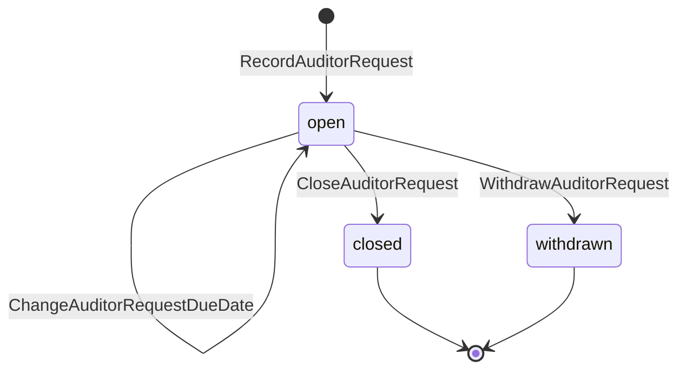
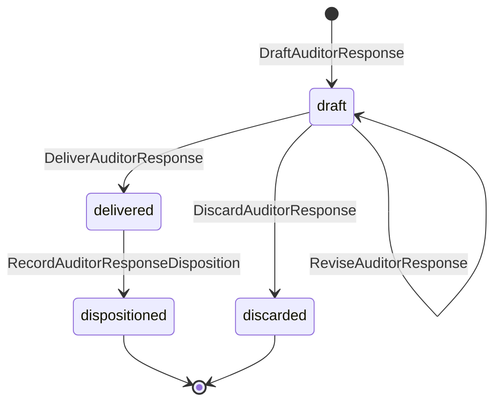
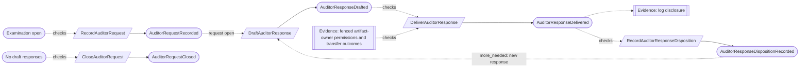
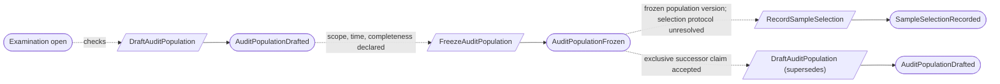

# Auditor collaboration

Status: **reopened for snapshot authority**, 2026-11-05. The boundaries below are a design target; the open authority gaps block implementation of freezing and delivery.

## Purpose

Auditor collaboration is the exchange between a client and its auditor during an
examination: requests and their responses, comments, frozen audit populations,
sample selections, and packages delivered to the auditor (M0-D17, M0-D27).

Our firm's attest team works here in-product, as staff assigned to the
engagement. External audit firms have no product accounts; their requests are
recorded by the client and they receive packages (M0-D17).

**Owns:** auditor requests, auditor responses, request comments, audit
populations and their rows, sample selections and selected rows, package entries,
packages, and individual deliveries.

**Does not own:**

| Concern | Owner |
| --- | --- |
| The examination, assertion, letter and outcome | Examinations |
| Evidence artifacts, redactions and the disclosure log | Evidence; a response or package references exact artifact versions |
| Who on the attest team may act | Firm services (`EngagementAssignment`, behind the independence wall) |
| The attest engagement record package | Firm services (`AttestEngagementRecordPackage`), built from this context's records |
| Retention and holds on delivered material | Retention (M0-D16) |
| Advisor handoffs and feedback | Advisor collaboration |

## Language

| Term | Meaning |
| --- | --- |
| Auditor request | A request from the auditor for evidence or information, for one examination. |
| Requester | Attest staff assigned to the engagement, or an external firm whose request a Compliance Lead recorded on its behalf (AC-06). |
| Auditor response | The client's answer to a request: text and exact evidence artifact versions. |
| Request comment | A message from either side on a request. A posted comment is never edited. |
| Audit population | A defined set of individually recorded rows, such as production changes in a period, frozen against an exact authoritative cut. |
| Sample selection | The auditor's chosen rows from one exact frozen population version. |
| Audit package | A delivery of exact source versions; its streamed zip includes a `manifest.json` with each file's path, hash, size and source version, named `{engagement}/{section}/{stable_id}_{version}.{ext}` (M0-D17). The zip is a deliverable, not an aggregate. |

## Local decisions and immutable delivery views

The command tables below retain the accepted product requirements. Their earlier
whole-cut settlement and all-item guard descriptions are **not a qualified write
model**: merely moving the scan into a coordinator, a receipt, or a chain of
windows does not explain who has authority or establish completeness. The
following candidates avoid an aggregate that decides by loading every child;
each still has the stated proof obligations and is not approved for implementation.

- **Population rows and sample rows:** A row or selected row owns its own
  identity, edit and refusal. A candidate frozen version is an authoritative
  ordered marker defining which valid, individually accepted row versions are
  in scope. A row command may acknowledge acceptance only after its authoritative
  ordering is known: a delayed proposal after the marker must be refused for
  that version or routed to a successor. An immutable CSV and its hash are
  produced by a streaming materializer over the version; they are delivery/read
  artifacts, not a row list on the population. The marker, all writer routes,
  exact membership lookup, history retention and recovery are unproved.
  Concurrent amendments and successor uniqueness still need their own owner
  decision; a marker by itself is not a successor claim.
  A marker event carries only its own stable identity and declared intent. Its
  ordered source position is assigned at commit and can only be discovered
  afterward from a qualified source read; it cannot carry that position or
  claim a count or digest of the rows preceding itself. A later independently
  attributable materialization result may identify the marker, source position,
  generated CSV, count and content hash, subject to proven source coverage.
  The required immutable population version and its M0-D17 hash remain
  unqualified until the relationship between marker and output is established.
  A human completeness attestation must identify exactly what the person saw:
  an edit proposed before the marker can settle after the screen was read and
  become included without having been reviewed. This remains true for delayed
  edits from the same actor. Source order or a marker does not prove human
  consent to that version; the displayed-view, attestation and delayed-edit
  semantics remain a product and authority gap.
- **Request and response:** The existing request-close rule forbids closure
  while any response is draft. Independently delivering responses and displaying
  an advisory derived status would change that guarantee; it is only a product
  alternative, not a replacement. Response attachments are individual facts,
  but reporting the text delivered before an attachment succeeds would also
  change the current whole-response guarantee. Until an authoritative local
  protocol or an explicit policy change is approved, both transitions remain
  unresolved; a projection count or an aggregate scan is not a solution.
- **Package preparation:** A technical builder may stream an already qualified
  immutable selection, make per-source decisions and produce a durable build
  result bound to the exact selection, archive bytes and manifest. A package
  owner can record one verified build result without storing or loading all
  entries. This is only a candidate: a signature or digest proves neither that
  the source selection is complete nor that its decisions were authoritative.
  Prove the selection and builder's coverage, identity, idempotency and recovery
  before a recorded build can support the existing exact-package guarantee.
  A build failure or unknown result is pending/retryable, not a built package.
- **Artifact disclosure:** A shareability read followed by a later send races
  quarantine or disposal. For each exact artifact version and recipient or
  package purpose, the artifact authority must order the actual byte transfer
  against quarantine/disposal, including retries and failure recovery. A prior
  authorization token without a transfer fence does not suffice. A successful
  delivery describes the exact bytes and recipient actually transferred; an
  interrupted transfer is not complete, and bytes already received cannot be
  recalled. For a multi-artifact ZIP, establish how its entry bytes, compressed
  segments and manifest are gated without leaking a revoked item; the Evidence
  source has not yet specified this mechanism.

In all candidates a read-side worklist may display progress; a lagging worklist,
zero count, digest, or build-worker self-attestation cannot prove that a
business-required item was absent. The M0-D17 CSV and ZIP formats and the
single `manifest.json` delivered to an external firm remain unchanged.

## Aggregates

### AuditorRequest

**Identity:** `TenantId` + `RequestId`.

**Invariant:** one request belongs to one examination for life, has a requester,
a description and an optional due date, and is open, then closed or withdrawn.
A closed or withdrawn request accepts no new responses.

- Only the requester side closes or withdraws it. For an external firm, the
  Compliance Lead records the firm's decision.
- Closing is refused while a response is still a draft. A projected zero or
  collection-wide scan does not satisfy the local-decision requirement. The
  authoritative close/admission rule remains unresolved and is not
  implementation-ready; see [local decisions](#local-decisions-and-immutable-delivery-views).

| Command | Who | Accepts when | Emits |
| --- | --- | --- | --- |
| RecordAuditorRequest | Attest staff on the engagement, or Compliance Lead for an external firm | `RequestId` is new; examination open | AuditorRequestRecorded |
| ChangeAuditorRequestDueDate | Requester side | Open | AuditorRequestDueDateChanged |
| CloseAuditorRequest | Requester side | Open; no draft responses | AuditorRequestClosed |
| WithdrawAuditorRequest | Requester side | Open; reason given | AuditorRequestWithdrawn |

| Event | Carries |
| --- | --- |
| AuditorRequestRecorded | tenant, request, examination, requester (assignment or external firm), description, due date, recorded by |
| AuditorRequestDueDateChanged | tenant, request, due date, changed by |
| AuditorRequestClosed | tenant, request, closed by, on behalf of |
| AuditorRequestWithdrawn | tenant, request, reason, withdrawn by, on behalf of |

### AuditorResponse

**Identity:** `TenantId` + `ResponseId`, for one request.

**Invariant:** one response is drafted and revised, then delivered once, with
exact evidence artifact versions. A delivered response never changes; a
follow-up is a new response.

- Every selected artifact must be `available` and not quarantined, or be an
  approved redacted derivative, when the response is delivered (M0-D16). The
  drafter can deliver it; no second approval is needed (AC-01). Every attachment
  is independently identified by tenant, response and artifact identity, with an
  exact artifact version. The response owns no attachment list. How one response
  delivery preserves the complete selected-attachment guarantee without an
  all-children write decision remains unresolved. A shareability read alone
  cannot protect the actual transfer; see the disclosure candidate above.
- The auditor's disposition, `accepted` or `more_needed`, is recorded once on a
  delivered response.

| Command | Who | Accepts when | Emits |
| --- | --- | --- | --- |
| DraftAuditorResponse | Compliance Lead or Contributor | `ResponseId` is new; request open | AuditorResponseDrafted |
| ReviseAuditorResponse | Compliance Lead or Contributor | Draft | AuditorResponseRevised |
| DiscardAuditorResponse | Compliance Lead or Contributor | Draft | AuditorResponseDiscarded |
| DeliverAuditorResponse | Compliance Lead or Contributor | Draft; authoritative request admission; settled attachment cut and fenced artifact-owner permissions | AuditorResponseDelivered |
| RecordAuditorResponseDisposition | Requester side | Delivered; no disposition yet | AuditorResponseDispositionRecorded |

| Event | Carries |
| --- | --- |
| AuditorResponseDrafted | tenant, response, request, bounded text, drafted by |
| AuditorResponseRevised | tenant, response, bounded text, revised by |
| AuditorResponseDiscarded | tenant, response, discarded by |
| AuditorResponseDelivered | tenant, response, request, exact text revision and settled attachment cut, transfer outcome, delivered by |
| AuditorResponseDispositionRecorded | tenant, response, disposition, note, recorded by, on behalf of |

### AuditorRequestComment

**Identity:** `TenantId` + `CommentId`, for one request.

**Invariant:** one comment keeps its author, side, time and text exactly as
posted. A correction is a new entry on the same comment that links to the
original text; nothing is overwritten (AC-02).

| Command | Who | Accepts when | Emits |
| --- | --- | --- | --- |
| PostAuditorRequestComment | Either side | `CommentId` is new; request exists | AuditorRequestCommentPosted |
| CorrectAuditorRequestComment | Its author | Exists | AuditorRequestCommentCorrected |

| Event | Carries |
| --- | --- |
| AuditorRequestCommentPosted | tenant, comment, request, side, text, visibility (`attest_internal` or shared), posted by, on behalf of |
| AuditorRequestCommentCorrected | tenant, comment, correction sequence, corrected text, corrected by |

### AuditPopulation

**Identity:** `TenantId` + `PopulationId`, for one examination.

**Invariant:** a population has a definition, source, observation time and a
human completeness declaration. It freezes one exact set of independently
owned rows. A correction creates a new population linked to its predecessor;
its corrected rows identify the predecessor row they supersede (AC-03). A human
declaration for manual data is a declaration, not proof that undiscovered
external records do not exist.

A predecessor may have only one unfrozen successor. Its own stream must accept
an exclusive successor claim, with an exact claim identity and fenced release on
discard; a projection check is insufficient. The former proposal to settle
every row before freezing is withdrawn as an all-children write decision. An
ordered freeze marker with per-row outcomes is a candidate; its source and
acknowledgement guarantees remain unproved. A complete immutable CSV and its
content hash remain required delivery artifacts (M0-D17).

| Command | Who | Accepts when | Emits |
| --- | --- | --- | --- |
| DraftAuditPopulation | Compliance Lead or Contributor | New identity; examination open; predecessor's exclusive successor claim accepted if applicable | AuditPopulationDrafted |
| ReviseAuditPopulation | Compliance Lead or Contributor | Draft; only bounded definition changes | AuditPopulationRevised |
| DiscardAuditPopulation | Compliance Lead | Draft; closes admission and fences the claim release | AuditPopulationDiscarded |
| FreezeAuditPopulation | Compliance Lead | Draft; scope, observation time and completeness declared; authoritative version protocol still unresolved | AuditPopulationFrozen |

| Event | Carries |
| --- | --- |
| AuditPopulationDrafted | tenant, population, examination, definition, source, predecessor and accepted successor claim if any, drafted by |
| AuditPopulationRevised | tenant, population, bounded definition changes, revised by |
| AuditPopulationDiscarded | tenant, population, discarded by |
| AuditPopulationFrozen | candidate bounded freeze marker: tenant, population, marker/intent identity, observation time, completeness declaration, frozen by; no self-position, row count or digest |

### AuditPopulationRow

**Identity:** `TenantId` + `PopulationId` + stable `RowId`.

**Invariant:** one row owns its bounded content, exact source identity and
version, and optional superseded row identity. Draft revisions and removal affect this row alone. Its accepted
outcome and version must be admitted before the population cut is closed; a
late writer cannot mutate the frozen cut. New or corrected rows after freeze
belong to a successor population. Enumeration is incremental and ordered by a
specified canonical identity; the retained cut must establish membership and
permit each exact row version to be retrieved. Missing source or truncated cut
makes the operation incomplete, never a successful freeze.

### SampleSelection

**Identity:** `TenantId` + `SelectionId`.

**Invariant:** a recorded selection binds one frozen population version and
method, and may link to a previous selection. Each selected row is independently
keyed by tenant, selection and row and validates its exact membership in that
population version. It never moves to a successor population. A version marker
and separately streamed CSV are candidates for fixing the selected rows without
making the selection write inspect all children. The source marker, membership
lookup and delayed-writer behavior still need qualification.

| Command | Who | Accepts when | Emits |
| --- | --- | --- | --- |
| RecordSampleSelection | Attest staff on the engagement, or Compliance Lead for an external firm | New identity; exact frozen population version; selection-freeze protocol unresolved | SampleSelectionRecorded |

| Event | Carries |
| --- | --- |
| SampleSelectionRecorded | candidate bounded selection marker: tenant, selection, exact prior population version, marker/intent identity, method, previous selection if any, recorded by, on behalf of; no self-position, row count or digest |

### AuditPackage

**Identity:** `TenantId` + `PackageId`, for one examination.

**Invariant:** one package is built from one exact settled entry cut and
validated once. A validated package never changes; changed contents after the
build cut closes require a new package. Individual deliveries have their own
identity and outcome (AC-04, revised). Each entry is independently owned by
tenant, package and entry ID and pins one exact source version, path and content
identity. Entry changes use bounded admission and occur only on entry streams; a
build freezes its exact cut before it starts. A successful package build is tied to
that cut (AC-07). The package holds no entry roster, manifest or per-entry
result history.

A build streams the entries and archive, computing canonical per-entry and
archive digests incrementally. A `manifest.json` in the delivered zip is a
streamed presentation of those entries, not an authoritative domain record or a
single stored collection. If retaining the archive for exact repeated delivery,
the storage layer retains independently bounded ordered segments and an exact
terminal reference and digest, rather than one large stored content object.
The builder must prove that every entry in the settled cut was processed exactly
once and its pinned content still matches; incomplete, duplicate, missing or
changed input cannot produce a built fact. Failed attempts are operational (AC-05).

Validation and each delivery need an authoritative shareability outcome from
each artifact owner, with the precise artifact version, package and purpose.
A delivery must not send bytes after quarantine or disposal wins. This requires
an artifact-owner reservation or equivalent fence spanning authorization through
the actual byte transfer and a recorded transfer outcome; a one-time read,
including a projection read, cannot enforce it. The existing Evidence design does
not yet specify such a protocol, including failure, revocation and release; no
claim of safe delivery can be made until it does. Validation, delivery and the
package owner do not keep a result per entry: their final facts reference settled
independent outcomes and their exact cut.

| Command | Who | Accepts when | Emits |
| --- | --- | --- | --- |
| AssembleAuditPackage | Compliance Lead | New identity; examination open | AuditPackageAssembled |
| RequestAuditPackageBuild | Compliance Lead | Assembling; entry-freeze and build ordering unresolved | AuditPackageBuildRequested |
| RecordAuditPackageBuilt | Build job | Same requested version; one qualified build result; coverage and result authority remain unresolved | AuditPackageBuilt |
| ValidateAuditPackage | Compliance Lead | Built; exact validation and artifact-authority protocol unresolved | AuditPackageValidated or AuditPackageRejected |
| RecordAuditPackageDelivery | Compliance Lead | Validated; individual transfer has authoritative shareability and transfer outcomes | AuditPackageDelivered |

| Event | Carries |
| --- | --- |
| AuditPackageAssembled | tenant, package, examination, previous package if any, assembled by |
| AuditPackageBuildRequested | candidate bounded build marker: tenant, package, build-intent identity, requested by; no self-position, item count or digest |
| AuditPackageBuilt | tenant, package, earlier build marker and qualified observed selection reference, one build-result identity, archive terminal reference, archive and manifest digests calculated after streaming; coverage and authority unresolved |
| AuditPackageValidated | tenant, package, exact earlier build-result identity, validated by; complete-validation rule unresolved |
| AuditPackageRejected | tenant, package, exact earlier build-result identity and bounded reason, validated by; rejection authority unresolved |
| AuditPackageDelivered | tenant, delivery identity, package, recipient, channel, transfer outcome, delivered at, recorded by |

### AuditPackageDelivery

**Identity:** `TenantId` + `DeliveryId`.

**Invariant:** one delivery binds one validated package, recipient and transfer
attempt/outcome; duplicate exact commands are idempotent.
Each successful transfer has a separate durable identity and authoritative
participant outcomes. The parent package is not appended once per delivery.

The population and selection CSVs required by M0-D17 are generated by streaming
the exact corresponding cuts. The recipient-facing ZIP and its single
`manifest.json` remain intact output formats; storage segments are an internal
representation only.

## Snapshot and admission requirements

A cut is a retained, authoritative, verifiable reference to an exact set of
individually owned facts, not a list stored inside its parent. Every writer must
participate in its admission protocol. A candidate independently keyed
coordinator may settle one attempted operation with its participant outcome and
a fenced retry; it never owns a list of child
operations. A linked chain of such records still grows and may amount to a
collection ledger, so its boundary, retention and traversal costs require review.
The terminal cut must be traversable in bounded memory, detect gaps,
duplicates and truncation, and pin tenant, identity, source version and canonical
ordering. A hash confirms the bytes actually traversed; it does not prove a
missing source was discovered. These are required properties, not yet verified
storage or framework guarantees. A failed or unprovable cut stays pending.
Small current state is not enough: normal Portia aggregate hydration reads the
whole event stream. Every long-lived mutable owner also needs a qualified bounded
history or replay strategy; incremental cut traversal does not solve aggregate
hydration.

## Flows

Diagrams follow [CV-01](conventions.md#flow-diagrams): dotted edges are the
facts each command checks.

### Request and response

`more_needed` is answered by a new response on the same open request.

### Population and sample

A sample never moves to a superseding population; selecting from it is a new
selection linked to the earlier one.

### Package

```mermaid
flowchart LR
    C1[/AssembleAuditPackage/] --> E1([AuditPackageAssembled])
    E1 -. "build ordering unresolved" .-> C2[/RequestAuditPackageBuild/] --> E2(["AuditPackageBuildRequested (candidate marker)"])
    E2 --> R1{{Build package archive}} --> C3[/RecordAuditPackageBuilt/]
    C3 -->|requested cut verified| E3([AuditPackageBuilt])
    C3 -. "cut incomplete or source changed: refuse" .-> C2
    E3 -. checks .-> C4[/ValidateAuditPackage/] --> E4([AuditPackageValidated])
    E4 -.-> X1[[Examinations: assertion may be signed]]
    A[[Evidence: fenced artifact-owner permissions and transfer outcomes]] -. checks .-> C5
    E4 -. checks .-> C5[/RecordAuditPackageDelivery/] --> E5([AuditPackageDelivered])
    E5 -.-> X2[[Evidence: log disclosure]]
    E5 -.-> X3[[Examinations: outcome may be recorded]]
```

## Authorization contract

- Attest staff act only on examinations whose `ServiceEngagement` they are
  assigned to, behind the independence wall (Firm services).
- External firms never sign in. A Compliance Lead records their requests,
  selections and decisions, and each event carries `on_behalf_of` naming the
  firm (AC-06).
- Client members see the requests, comments and responses of their own tenant.

## Decisions

Jev answers are from `jev-1.14.0`, 2026-11-03. A yes is ≥ 0.8 and a no is ≤ 0.2.
Anything in between is settled by common sense, with the reasoning stated.

| ID | Decision | Evidence |
| --- | --- | --- |
| AC-01 | A response's drafter can deliver it; second-person approval applies only to redactions (in Evidence). | Second person always required: 0.19. |
| AC-02 | Each request comment is its own record. | 0.43. Common sense: a comment has its own author and corrections, and keeping it separate leaves the request small (small independent aggregates). |
| AC-03 | Each frozen population is its own record; an amendment is a new population that supersedes it. | 0.62. Common sense: samples reference one exact version, and "changed means a new record" matches ManagementAssertion and AuditOutcome. |
| AC-04 | Each delivery is independently identified; the package does not append a fact for every delivery. | Revised 2026-11-05: each transfer has its own permission, outcome and retry boundary. |
| AC-05 | Package build attempts are operational logs, not business records; no build process aggregate. | Build attempts are records: 0.32. Common sense: only the validated result is relied on. |
| AC-06 | A Compliance Lead records an external firm's requests, selections and decisions, attributed to the firm. | 0.47. Common sense: M0-D27 keeps requests and responses in the client tenant, and external firms have no accounts (M0-D17). |
| AC-07 | A built archive must correspond to the exact immutable entry version requested. The build-request marker and its later observed source position are a candidate, not a proven source cut. | Flow audit B8: a later contents change must not be signed as if it matched. The ordering and completeness protocol is unresolved. |
| AC-08 | Each delivery requires a fenced artifact-owner permission spanning the transfer. | Flow audit G11: deliveries are unlimited (AC-04), and an artifact can be quarantined after validation. 0.79. |

## Open questions

- Prove a complete, retained, ordered row and entry cut, including writer admission, participant outcomes, source retention and gap detection; no parent may own a growing roster or hide one in a coordination chain. Qualify bounded aggregate replay separately.
- Specify and verify Evidence-owner permission, quarantine/disposal fencing, byte-transfer outcome, failure recovery and release. Until then delivery remains blocked.
- Specify the exclusive successor claim, release and replay protocol, plus bounded archive-segment storage and end-to-end integrity verification.
- Specify request closure versus new or draft response admission, and independent response attachments with fenced artifact transfer; a projected no-drafts or shareability check is not authoritative.

## Superseded owners

| Old owner | Becomes |
| --- | --- |
| AuditorRequest | AuditorRequest |
| AuditorResponse | AuditorResponse |
| AuditorFeedbackThread | AuditorRequestComment (AC-02) |
| AuditPopulation | AuditPopulation (one record per frozen version; AC-03) |
| AuditPopulationExportProcess | Technical streaming of the exact row cut; no monolithic population content |
| AuditorSampleSelection | SampleSelection |
| AuditPackageManifest | Streamed output derived from independently owned entries; never an aggregate roster |
| AuditPackageDelivery | An independently identified delivery and its transfer outcome (AC-04) |
| AuditPackageBuildProcess | Removed (AC-05) |
