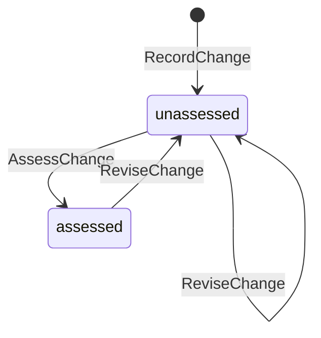
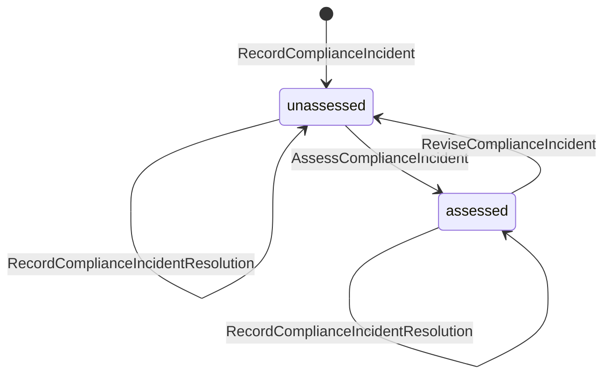
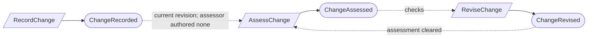
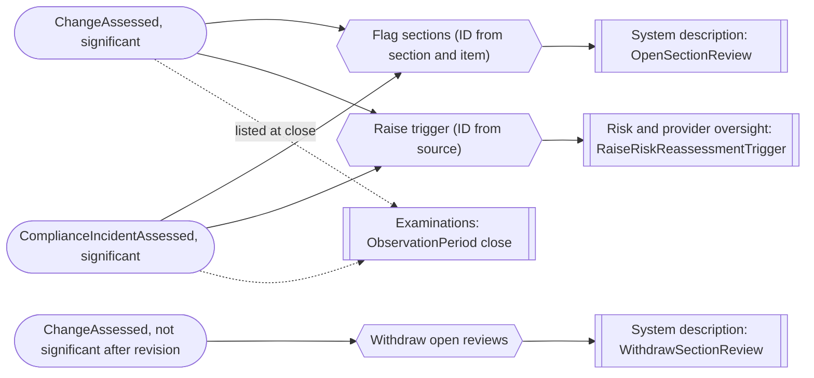

# Change and incident oversight

Status: **locked**, 2026-11-03. Hand-authored source of truth for this context.
It follows the [context conventions](conventions.md).

## Purpose

Change and incident oversight records the compliance-facing facts about changes
and incidents, and a person's assessment of whether each is significant (M0-D21).
It never copies the ticketing or incident tool: source identifiers are optional
provenance, and supporting detail is governed evidence.

**Owns:** changes and compliance incidents.

**Does not own:**

| Concern | Owner |
| --- | --- |
| Flagging and resolving system description sections | [System description](system-description.md) (`SectionReview`) |
| Risk reassessment | [Risk and provider oversight](risk-and-provider-oversight.md) (`RiskReassessmentTrigger`) |
| Listing significant items at period close | [Examinations](examinations.md) (`ObservationPeriod`) |
| Findings and corrective work | [Assurance work](assurance-work.md); a person raises a finding with source `incident` |
| Supporting artifacts | [Evidence](evidence.md) |
| Separation-of-duties waivers | [Platform access](platform-access.md) |

## Language

| Term | Meaning |
| --- | --- |
| Change | A change to the system recorded for compliance: title, when it happened (a date or a range), affected records and optional source provenance. |
| Incident | An event recorded for compliance: title, detected and resolved times, whether customer data or an availability SLA was affected, affected records and optional source provenance. |
| Affected records | Exact references to the boundary, commitments, controls or inventory records the item touches. |
| Provenance | Optional `source_system`, `source_identifier` and `source_url` from an outside tool. Never a required connection. |
| Significance | `significant` or `not_significant`, a person's assessment of the current revision, with a rationale. |
| Significance criteria | For a change: `changes_boundary`, `changes_commitment_or_requirement`, `changes_key_control`, `changes_in_scope_infrastructure`. For an incident: `customer_data_affected`, `availability_sla_affected`. |
| Handling class | The M0-D16 class, `confidential` by default. `restricted` limits who can see the item inside the organization, never what auditors see. |

## Aggregates

### Change

**Identity:** `TenantId` + `ChangeId`, in one program for life.

**Invariant:** one change has one assessment of its current revision, made by a
Compliance Lead who authored no revision of it
([CV-06](conventions.md#guards-and-reviews), CI-01). The assessor marks which
criteria the change meets, and `not_significant` is refused when any is marked
(CI-02). Revising the change clears its assessment (CI-03).

| Command | Who | Accepts when | Emits |
| --- | --- | --- | --- |
| RecordChange | Compliance Lead or Contributor | `ChangeId` is new; program active; title and date or range given; affected records exist in the program | ChangeRecorded |
| ReviseChange | Compliance Lead or Contributor | Names the current revision; affected records exist | ChangeRevised |
| AssessChange | Compliance Lead who authored no revision, or covered by a waiver | Names the current revision; criteria marked; rationale given; `not_significant` only when no criterion is marked | ChangeAssessed |

| Event | Carries |
| --- | --- |
| ChangeRecorded | tenant, change, program, revision, title, occurred at or range, affected records, provenance, handling class, supporting artifacts, recorded by |
| ChangeRevised | tenant, change, revision, changed fields, previous assessment cleared, revised by |
| ChangeAssessed | tenant, change, revision, significance, criteria met, affected records, rationale, assessor, waiver (if any) |

### ComplianceIncident

**Identity:** `TenantId` + `IncidentId`, in one program for life.

**Invariant:** one incident has one assessment of its current revision, made by a
Compliance Lead who authored no revision of it (CI-01). `not_significant` is
refused when customer data or an availability SLA was affected (CI-02). Revising
the incident clears its assessment (CI-03). Its detected time never changes, and
its resolution is a later fact no earlier than detection (CI-04).

| Command | Who | Accepts when | Emits |
| --- | --- | --- | --- |
| RecordComplianceIncident | Compliance Lead or Contributor | `IncidentId` is new; program active; detected at not in the future; affected records exist | ComplianceIncidentRecorded |
| ReviseComplianceIncident | Compliance Lead or Contributor | Names the current revision; detected at unchanged | ComplianceIncidentRevised |
| AssessComplianceIncident | Compliance Lead who authored no revision, or covered by a waiver | Names the current revision; rationale given; `not_significant` only when neither flag is set | ComplianceIncidentAssessed |
| RecordComplianceIncidentResolution | Compliance Lead or Contributor | Not resolved; resolved at not before detected at | ComplianceIncidentResolved |

| Event | Carries |
| --- | --- |
| ComplianceIncidentRecorded | tenant, incident, program, revision, title, detected at, customer data affected, availability SLA affected, affected records, provenance, handling class, supporting artifacts, recorded by |
| ComplianceIncidentRevised | tenant, incident, revision, changed fields, previous assessment cleared, revised by |
| ComplianceIncidentAssessed | tenant, incident, revision, significance, criteria met, affected records, rationale, assessor, waiver (if any) |
| ComplianceIncidentResolved | tenant, incident, resolved at, recorded by |

## Flows

Diagrams follow [CV-01](conventions.md#flow-diagrams).

### Recording and assessing

Incidents follow the same shape, with `RecordComplianceIncidentResolution` as a
separate later fact.

### Effects of a significant item

## Computed gaps

| Gap | Shown when |
| --- | --- |
| Unassessed item | A change or incident has no assessment of its current revision. Period close is refused while one dated in the period is unassessed. |
| Unresolved incident | An incident has no resolution |

## Authorization contract

- An item with handling class `restricted` is visible and editable inside the
  organization only to the Compliance Lead, the Org Admin and its assessor, and
  to engagement auditors.
- Every significant item's reference, dates, significance, rationale and
  affected records are in the auditor-visible set regardless of handling class
  (M0-D17, M0-D27).
- Neither record stores ticket bodies, logs or personal data beyond attribution.

## Disagreement and replay

Cases required by [CV-12](conventions.md#guards-and-reviews).

| Case | Outcome |
| --- | --- |
| A change is revised while its assessment is being made | The assessment names the current revision; one naming an older revision is refused |
| An item dated in a closing period is assessed significant after the close is approved | Examinations records it as a late significant item (`LateSignificantItemRecorded`), and the period requires an amendment |
| `ChangeAssessed` delivered twice | Section reviews and reassessment triggers take IDs from the item, so repeats are no-ops |

## Decisions

Jev answers are from `jev-1.14.0`, 2026-11-03. A yes is ≥ 0.8 and a no is ≤ 0.2.
Anything in between is settled by common sense, with the reasoning stated.

| ID | Decision | Evidence |
| --- | --- | --- |
| CI-01 | Significance is assessed by a Compliance Lead who authored no revision of the item, unless a separation-of-duties waiver covers it. | 0.73. Common sense: the assessment decides what auditors and period close see, so it follows CV-06. |
| CI-02 | The assessor marks the criteria met; `not_significant` is refused when any change criterion is marked or an incident affected customer data or an availability SLA. | Change criteria: 0.73. Incident flags: 0.94. Common sense: M0-D21's rule becomes checkable rather than implied. |
| CI-03 | Revising an item clears its assessment, and it must be assessed again. | 0.90. |
| CI-04 | An incident's resolution is a separate later fact; its detected time never changes. | 0.76. M0-D21. |
| CI-05 | The aggregate is named `Change`: whether it is significant is the assessment's outcome, not part of its name. | `Change` was the top choice at 0.51. Common sense: a not-significant change is still a recorded change, and the short common term reads better. |

## Open questions

None at this time.

## Superseded owners

| Old owner | Becomes |
| --- | --- |
| SignificantChange | Change (CI-05) |
| ComplianceIncident | ComplianceIncident |
| `LinkImpactReviewWork`, LinkImpactReviewWorkReactor, RequestImpactReviewAfterSignificantChangeReactor | Removed: follow-up is a risk reassessment trigger, section reviews, or a finding raised by a person |
| `Record…SystemDescriptionDecision`, UpdateSystemDescriptionAfterSignificantChangeReactor | `SectionReview` in System description |
| IncidentReference (R1-07) | Removed: a compliance incident carries optional provenance instead |
