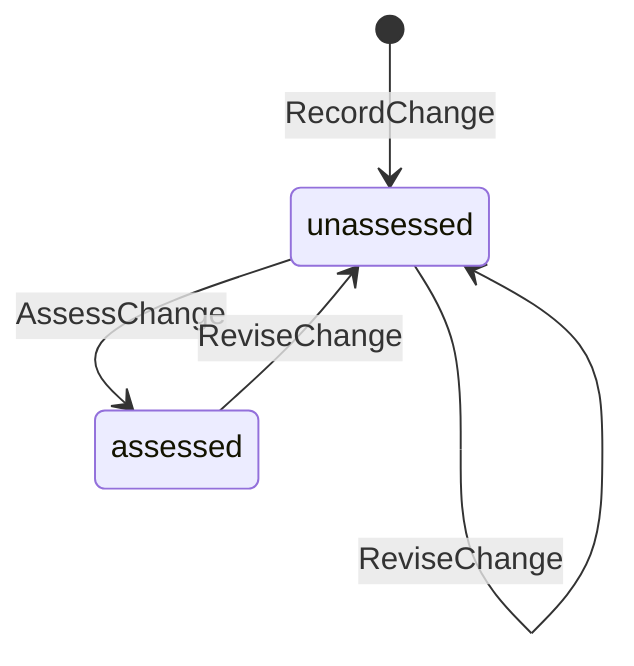
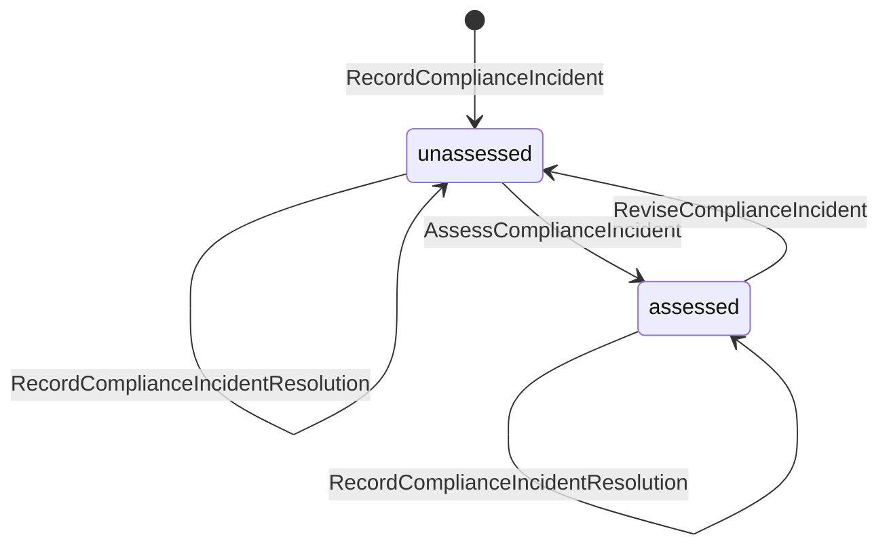
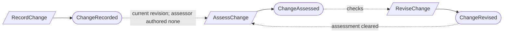
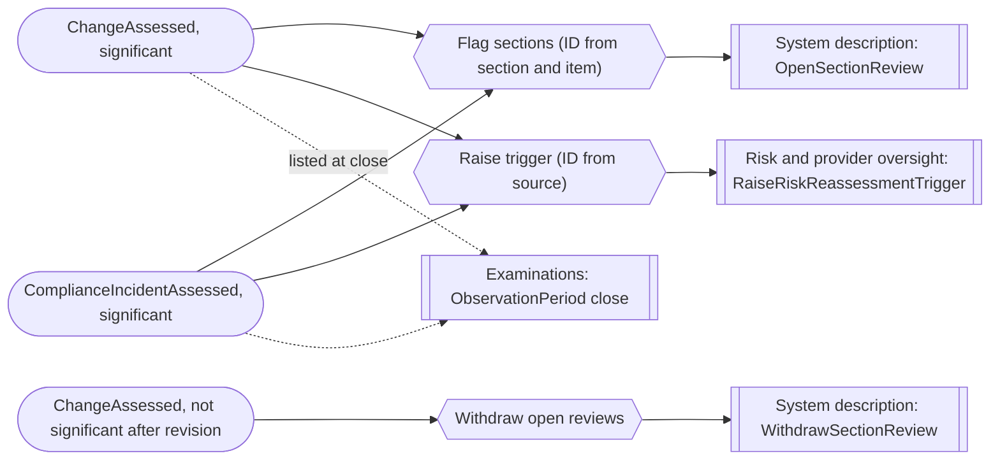

# Change and incident oversight

Status: **provisional boundary revision**, 2026-11-05. The business decisions remain,
but the authoritative revision, assessment and reference-admission protocol below is
not yet qualified. It follows the [context conventions](conventions.md).

## Purpose

Change and incident oversight records the compliance-facing facts about changes
and incidents, and a person's assessment of whether each is significant (M0-D21).
It never copies the ticketing or incident tool: source identifiers are optional
provenance, and supporting detail is governed evidence.

**Owns:** changes, compliance incidents, and individual affected-record and
supporting-artifact relationships.

**Does not own:**

| Concern | Owner |
| --- | --- |
| Flagging and resolving system description sections | [System description](system-description.md) (`SectionReview`) |
| Risk reassessment | [Risk and provider oversight](risk-and-provider-oversight.md) (`RiskReassessmentTrigger`) |
| Listing significant items at period close | [Examinations](examinations.md) (`ObservationPeriod`) |
| Findings and corrective work | [Assurance work](assurance-work.md); a person raises a finding with source `incident` |
| Supporting artifacts | [Evidence](evidence.md) |
| Separation-of-duties waivers | [Platform access](platform-access.md) |

## Language

| Term | Meaning |
| --- | --- |
| Change | A change to the system recorded for compliance: title, when it happened (a date or a range), affected records and optional source provenance. |
| Incident | An event recorded for compliance: title, detected and resolved times, whether customer data or an availability SLA was affected, affected records and optional source provenance. |
| Affected records | Individual exact references to the boundary, commitments, controls or inventory records the item touches. |
| Revision cut | The intended exact authoritative boundary of an item's scalar revisions and independently owned relationship changes. How accepted, pending and late outcomes relate to the assessment remains unresolved. A cut identifies facts, not an embedded collection. |
| Provenance | Optional `source_system`, `source_identifier` and `source_url` from an outside tool. Never a required connection. |
| Significance | `significant` or `not_significant`, a person's assessment of the current revision, with a rationale. |
| Significance criteria | For a change: `changes_boundary`, `changes_commitment_or_requirement`, `changes_key_control`, `changes_in_scope_infrastructure`. For an incident: `customer_data_affected`, `availability_sla_affected`. |
| Handling class | The M0-D16 class, `confidential` by default. `restricted` limits who can see the item inside the organization, never what auditors see. |

## Aggregates

### Change

**Identity:** `TenantId` + `ChangeId`, in one program for life.

**Invariant:** one change has one assessment of its current revision, made by a
Compliance Lead who authored no revision of it
([CV-06](conventions.md#guards-and-reviews), CI-01). The assessor marks which
criteria the change meets, and `not_significant` is refused when any is marked
(CI-02). Revising the change clears its assessment (CI-03).

| Command | Who | Accepts when | Emits |
| --- | --- | --- | --- |
| RecordChange | Compliance Lead or Contributor | `ChangeId` is new; program active; title and date or range given | ChangeRecorded |
| ReviseChange | Compliance Lead or Contributor | Names the current revision; admitted through the revision protocol below | ChangeRevised |
| AssessChange | Compliance Lead who authored no revision, or covered by a waiver | Names the exact current frozen revision cut; source-author proof and waiver, if any, satisfy CI-01; criteria marked; rationale given; `not_significant` only when no criterion is marked | ChangeAssessed |

| Event | Carries |
| --- | --- |
| ChangeRecorded | tenant, change, program, revision, title, occurred at or range, provenance, handling class, recorded by |
| ChangeRevised | tenant, change, revision, bounded scalar changed fields, admission evidence, previous assessment cleared, revised by |
| ChangeAssessed | tenant, change, exact revision cut, significance, the four fixed criteria, rationale, assessor, exact waiver evidence (if any) |

### ComplianceIncident

**Identity:** `TenantId` + `IncidentId`, in one program for life.

**Invariant:** one incident has one assessment of its current revision, made by a
Compliance Lead who authored no revision of it (CI-01). `not_significant` is
refused when customer data or an availability SLA was affected (CI-02). Revising
the incident clears its assessment (CI-03). Its detected time never changes, and
its resolution is a later fact no earlier than detection (CI-04).

| Command | Who | Accepts when | Emits |
| --- | --- | --- | --- |
| RecordComplianceIncident | Compliance Lead or Contributor | `IncidentId` is new; program active; detected at not in the future | ComplianceIncidentRecorded |
| ReviseComplianceIncident | Compliance Lead or Contributor | Names the current revision; detected at unchanged; admitted through the revision protocol below | ComplianceIncidentRevised |
| AssessComplianceIncident | Compliance Lead who authored no revision, or covered by a waiver | Names the exact current frozen revision cut; source-author proof and waiver, if any, satisfy CI-01; rationale given; `not_significant` only when neither flag is set | ComplianceIncidentAssessed |
| RecordComplianceIncidentResolution | Compliance Lead or Contributor | Not resolved; resolved at not before detected at | ComplianceIncidentResolved |

| Event | Carries |
| --- | --- |
| ComplianceIncidentRecorded | tenant, incident, program, revision, title, detected at, customer data affected, availability SLA affected, provenance, handling class, recorded by |
| ComplianceIncidentRevised | tenant, incident, revision, bounded scalar changed fields, admission evidence, previous assessment cleared, revised by |
| ComplianceIncidentAssessed | tenant, incident, exact revision cut, significance, the two fixed flags, rationale, assessor, exact waiver evidence (if any) |
| ComplianceIncidentResolved | tenant, incident, resolved at, recorded by |

## Individual relationships and revision authority

Each affected-record relationship is identified by tenant, item kind and ID,
record kind and ID. Each supporting-artifact relationship is identified by
tenant, item kind and ID, artifact ID and relationship purpose. An owner records
one relationship's addition or removal, actor, exact admission token and target
identity; an exact retry has the original outcome, while a changed intent under
the same operation ID is refused. References to records must be accepted by the
record's authoritative owner as belonging to the same program; an artifact
reference must satisfy Evidence's authoritative rules. A missing or unknown
participant outcome stays pending, and a rejection does not create the link.
Read-model lists are for navigation, never admission or assessment proof.
Neither item, assessment, nor event contains all links or a copied artifact body.
Fixed-size fields have explicit limits to be defined per field; long supporting
content belongs to governed evidence, referenced by exact artifact version.

Changing either relationship is a revision of the compliance item: it clears an
assessment under CI-03 just as a scalar edit does. Every revision author,
including the actor of a relationship change, is covered by CI-01. Resolution is
a later, separate incident fact under CI-04; it does not silently rewrite the
detection time or make an assessment current for a different revision.

The previous proposal serialized all relationship changes through admission
windows, settled each one, and scanned their complete author history before
assessment. Splitting that sequence into small records does not remove the
distributed child ledger or the all-relationship write decision. It is withdrawn.

One candidate is to designate the prospective assessor before the first item or
relationship revision in an assessment episode. Each independent revision
decides its own author restriction against the exact designation: the assessor
may not author it unless an authoritative waiver covers that item, action and
time. The assessment refers to that designation and an exact ordered episode
boundary; it does not enumerate authors or links. Per-item owners retain their own
acceptance and exact-retry outcomes. A read model may list the revisions and
relationships represented at a qualified boundary and must report incomplete
coverage as pending. A source position by itself is not evidence that every
revision was valid or that the assessor actually reviewed its content.

This is **not equivalent to the accepted workflow yet**. It changes when an
assessor must be selected, can exclude an otherwise eligible author, and cannot
retroactively establish that a reviewer did not author an earlier revision.
Assessor replacement, existing histories, waiver expiry or revocation, and the
meaning of an assessment while earlier valid proposals are unsettled require
explicit product and authority decisions. In particular, marking an assessment
accepted before all earlier link outcomes are known can change what the
assessment attests to; a source marker or projection cannot silently preserve
the stronger promise.

The candidate also needs authoritative ordering between designation, each
revision, assessment, and successor episode. A late edit must either belong to
the assessed boundary with its own valid outcome, or make that assessment
non-current; retrying an old token cannot mutate a newer episode. An unknown
commit remains pending until resolved. Exact target eligibility and waiver
evidence need owner authority, not advisory reads. Source ordering, retained
history, target fencing, replay and recovery remain unqualified. No design in
this section yet proves CI-01 or CI-03 across independent owners.

## Flows

Diagrams follow [CV-01](conventions.md#flow-diagrams).

### Recording and assessing

Incidents follow the same shape, with `RecordComplianceIncidentResolution` as a
separate later fact.

### Effects of a significant item

## Computed gaps

| Gap | Shown when |
| --- | --- |
| Unassessed item | A change or incident has no assessment of its current revision. Period close is refused while one dated in the period is unassessed. |
| Unresolved incident | An incident has no resolution |

## Authorization contract

- An item with handling class `restricted` is visible and editable inside the
  organization only to the Compliance Lead, the Org Admin and its assessor, and
  to engagement auditors.
- Every significant item's reference, dates, significance, rationale and
  affected records are in the auditor-visible set regardless of handling class
  (M0-D17, M0-D27).
- Neither record stores ticket bodies, logs or personal data beyond attribution.

## Disagreement and replay

Cases required by [CV-12](conventions.md#guards-and-reviews).

| Case | Outcome |
| --- | --- |
| A scalar or relationship revision races assessment | Freeze and settle the exact source cut; assessment must either win against the revision or be refused/fenced. The concrete protocol is unresolved; an expected root revision alone is insufficient. |
| A relationship command times out while the cut is freezing | Its result remains unknown until target acceptance or a durable token-specific refusal/fence is proven. Whether assessment can proceed without weakening the existing exact-boundary promise remains unresolved; do not hide the outcome or treat timeout as refusal. |
| The reviewer authored a prior revision or a relationship edit | Refuse unless an applicable authoritative waiver covers the action. An early-designation candidate must establish this per revision; the prior complete-history scan is withdrawn as a cross-child write decision. |
| An item dated in a closing period is assessed significant after the close is approved | Examinations records it as a late significant item (`LateSignificantItemRecorded`), and the period requires an amendment |
| `ChangeAssessed` delivered twice | Section reviews and reassessment triggers take IDs from the item, so repeats are no-ops |

## Decisions

Jev answers are from `jev-1.14.0`, 2026-11-03. The historical 0.8 and 0.2
thresholds were triage conventions, not calibrated probabilities of correctness;
conflicting or inconclusive cases remain open until source evidence resolves them.

| ID | Decision | Evidence |
| --- | --- | --- |
| CI-01 | Significance is assessed by a Compliance Lead who authored no revision of the item, unless a separation-of-duties waiver covers it. | 0.73. Common sense: the assessment decides what auditors and period close see, so it follows CV-06. |
| CI-02 | The assessor marks the criteria met; `not_significant` is refused when any change criterion is marked or an incident affected customer data or an availability SLA. | Change criteria: 0.73. Incident flags: 0.94. Common sense: M0-D21's rule becomes checkable rather than implied. |
| CI-03 | Revising an item clears its assessment, and it must be assessed again. | 0.90. |
| CI-04 | An incident's resolution is a separate later fact; its detected time never changes. | 0.76. M0-D21. |
| CI-05 | The aggregate is named `Change`: whether it is significant is the assessment's outcome, not part of its name. | `Change` was the top choice at 0.51. Common sense: a not-significant change is still a recorded change, and the short common term reads better. |

## Open questions

- How are assessor designation, individual revision acceptance, exact assessment boundary and successor episodes ordered without a per-relationship ledger or an all-child write decision?
- What authoritative target-owner proof establishes same-program membership and governed artifact eligibility, and how are concurrent target changes handled?
- How do repeatedly changed relationship owners roll over without losing their unique identity, idempotency, fences or retained historical facts?
- What retention and source enumeration guarantees make every prior author and cut retrievable after rollover or archival?
- What field-level limits keep scalar content and every relationship fact small without discarding required business information?

## Superseded owners

| Old owner | Becomes |
| --- | --- |
| SignificantChange | Change (CI-05) |
| ComplianceIncident | ComplianceIncident |
| `LinkImpactReviewWork`, LinkImpactReviewWorkReactor, RequestImpactReviewAfterSignificantChangeReactor | Removed: follow-up is a risk reassessment trigger, section reviews, or a finding raised by a person |
| `Record…SystemDescriptionDecision`, UpdateSystemDescriptionAfterSignificantChangeReactor | `SectionReview` in System description |
| IncidentReference (R1-07) | Removed: a compliance incident carries optional provenance instead |
