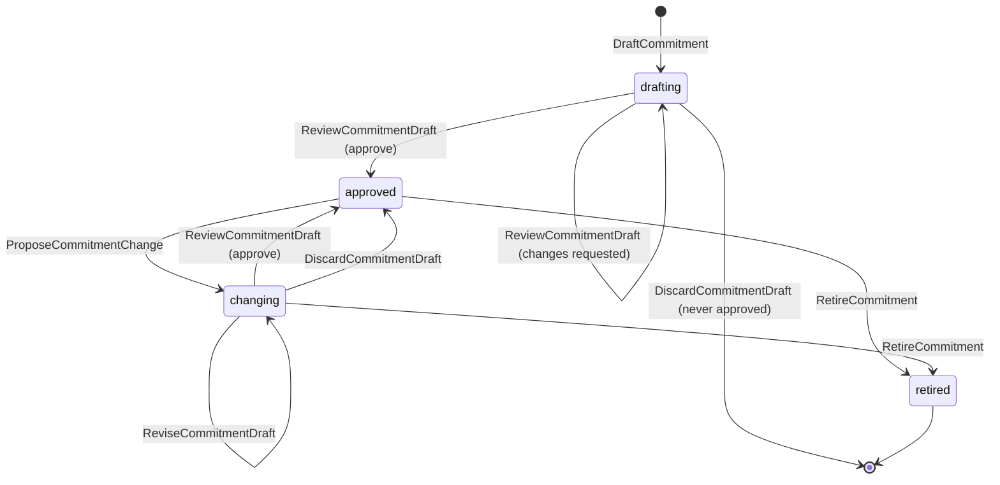
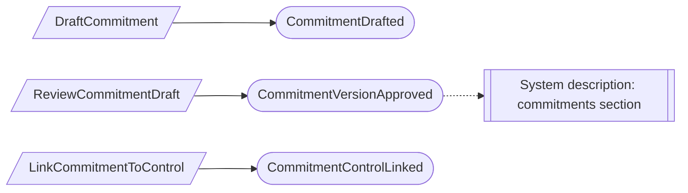
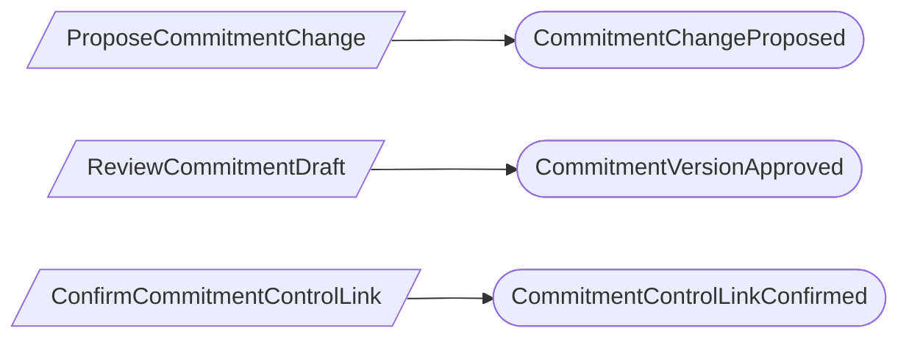

# Commitments

Status: **draft**, 2026-11-03. Hand-authored source of truth for this context.

## Purpose

Commitments records what the organization has promised and relies on: its
service commitments, system requirements, complementary user entity controls
(CUECs) and complementary subservice organization controls (CSOCs), each cited to
its source, and the controls that address each one (M0-D09).

**Owns:** commitments and commitment-to-control links.

**Does not own:**

| Concern | Owner |
| --- | --- |
| Source contract files | Evidence; a citation may reference an artifact |
| The service a commitment is about | Program and scope (`ClientService`) |
| The approved boundary and its categories | Program and scope (`SystemBoundary`) |
| Owners | Workforce assurance (`Person`) |
| The provider that performs a CSOC | Risk and provider oversight (`Provider`) |
| Controls | Control environment |

## Language

| Term | Meaning |
| --- | --- |
| Commitment | One statement of kind `service_commitment`, `system_requirement`, `user_entity_responsibility` (CUEC) or `subservice_responsibility` (CSOC), in one program. |
| Identifier | A short code such as `SC-04`, unique within the program and kind. |
| Source citation | A typed reference: artifact kind (MSA, SLA, security addendum, privacy notice, policy, other contract), title, version or date, section locator, and an optional evidence artifact. Contract text is never pasted. |
| Commitment version | An approved statement of the commitment. Versions are numbered and never change. |
| Management approver | A member whose roles grant the `commitments.approve` permission (CM-02). |
| Category out of scope | A commitment naming a Trust Services category that the current approved boundary no longer includes. It is shown as a gap (CM-04). |
| Link | A record that one control addresses one commitment, with a rationale, confirmed against exact versions of both. |

## Aggregates

### Commitment

**Identity:** `TenantId` + `CommitmentId`, in one program for life.

**Invariant:** one commitment has one kind and identifier for life, and a
sequence of approved versions. At most one draft revision is open at a time. Each
approval publishes the next version from the exact draft revision, and records
the boundary version its categories were checked against. Retirement is final.

- A draft holds the statement, service, source citation, owner and categories. A
  CSOC also needs a provider, and other kinds cannot have one.
- Categories must be in the program's current approved boundary version when the
  draft is created, revised or approved.
- The identifier is unique within the program and kind, including retired
  commitments, so a reported identifier always means one commitment. This is
  checked against current state (CM-05).
- The approver is a management approver other than the draft's author, unless a
  separation-of-duties waiver covers it. Approval is one step (CM-01).
- While a new draft is open, the latest approved version stays in effect (CM-03).
- A CUEC never counts as a control the organization performs.

| Command | Who | Accepts when | Emits |
| --- | --- | --- | --- |
| DraftCommitment | Compliance Lead or Contributor | `CommitmentId` is new; identifier unused; categories in boundary; provider rule holds | CommitmentDrafted |
| ProposeCommitmentChange | Compliance Lead or Contributor | Approved; no open draft | CommitmentChangeProposed |
| ReviseCommitmentDraft | Compliance Lead or Contributor | Draft open; categories in boundary | CommitmentDraftRevised |
| DiscardCommitmentDraft | Compliance Lead or the author | Draft open | CommitmentDraftDiscarded |
| ReviewCommitmentDraft | Management approver, not the author | Draft open; reviews the current revision; categories in boundary | CommitmentChangesRequested or CommitmentVersionApproved |
| RetireCommitment | Management approver | Not retired; reason given | CommitmentRetired |

| Event | Carries |
| --- | --- |
| CommitmentDrafted | tenant, commitment, program, kind, identifier, statement, service, source citation, owner, categories, provider, drafted by |
| CommitmentChangeProposed | tenant, commitment, from version, draft content, proposed by |
| CommitmentDraftRevised | tenant, commitment, revision, changed fields, revised by |
| CommitmentDraftDiscarded | tenant, commitment, revision, discarded by |
| CommitmentChangesRequested | tenant, commitment, revision, note, reviewer |
| CommitmentVersionApproved | tenant, commitment, version, revision, full content, boundary version, approver, waiver (if any) |
| CommitmentRetired | tenant, commitment, effective at, reason, retired by |

### CommitmentControlLink

**Identity:** `TenantId` + `CommitmentId` + `ControlId`.

**Invariant:** one control addresses one commitment, or it does not. A link has a
rationale and the exact commitment and control versions it was last confirmed
against. An unlinked pair can be linked again later, with a new rationale; the
history keeps every link and unlink.

- A link's versions are older than current when either side approves a new
  version; it is then shown as needing confirmation, which is a derived gap
  (CM-06).
- A link to a retired commitment or control no longer counts.
- A CUEC may be linked for traceability, but the link never makes it an internal
  control.

| Command | Who | Accepts when | Emits |
| --- | --- | --- | --- |
| LinkCommitmentToControl | Compliance Lead | Not currently linked; both active and approved; rationale given | CommitmentControlLinked |
| ConfirmCommitmentControlLink | Compliance Lead | Linked; either side has a newer version | CommitmentControlLinkConfirmed |
| UnlinkCommitmentFromControl | Compliance Lead | Linked; reason given | CommitmentControlUnlinked |

| Event | Carries |
| --- | --- |
| CommitmentControlLinked | tenant, commitment, control, commitment version, control version, rationale, linked by |
| CommitmentControlLinkConfirmed | tenant, commitment, control, commitment version, control version, rationale, confirmed by |
| CommitmentControlUnlinked | tenant, commitment, control, reason, unlinked by |

## Flows

### Approving a commitment

### Changing an approved commitment

This context has no reactors. A boundary that drops a category, a newer version
on either side of a link, and a retired control are all shown as gaps from current
state; a person then revises, confirms, unlinks or retires.

## Authorization contract

- `commitments.approve` is a product-defined permission. The built-in Org Admin
  and Compliance Lead roles include it; an Org Admin can add it to a custom role
  (CM-02).
- Self-approval follows the generic separation-of-duties waiver in Platform
  access.

## Decisions

Jev answers are from `jev-1.14.0`, 2026-11-03. A yes is ≥ 0.8 and a no is ≤ 0.2.
Anything in between is settled by common sense, with the reasoning stated.

| ID | Decision | Evidence |
| --- | --- | --- |
| CM-01 | Approval is one step: a management approver other than the author approves the exact revision or requests changes. | 0.72. Common sense: same as the boundary (PS-04). |
| CM-02 | A management approver is anyone whose roles grant `commitments.approve`; programs don't name an approver. | 0.41. Product owner: permissions come from roles held through teams (PA-01). This replaces M0-D09's per-program designation. |
| CM-03 | Changing an approved commitment opens a draft on the same commitment, and approval publishes the next version. The identifier never changes. | 0.57. Common sense: links, reports and citations refer to the identifier; versions keep history exact. |
| CM-04 | `category_out_of_scope` is computed from the commitment's categories and the current approved boundary; nothing is recorded on the commitment and no reactor runs. | Derived: 0.33. Common sense: a recorded flag would copy the boundary fact. The rule "never silently changed" is met because nothing is changed, and the gap is shown (as TI-02). |
| CM-05 | Identifiers stay unique within program and kind even after retirement, checked against current state. | Common sense: a reported `SC-04` must always mean one commitment. |
| CM-06 | Each commitment-to-control pair is its own small link. A Compliance Lead records it with a rationale and it counts at once; when either side gets a new version, the link shows as needing confirmation. | Own record: 0.66. Second-person review: 0.49, settled no: approval of the commitment already has separation of duties, and small teams map controls themselves. |

## Open questions

None at this time.

## Superseded owners

| Old owner | Becomes |
| --- | --- |
| CommitmentDraft | Commitment |
| CommitmentControlLink | CommitmentControlLink (no separate review; CM-06) |
