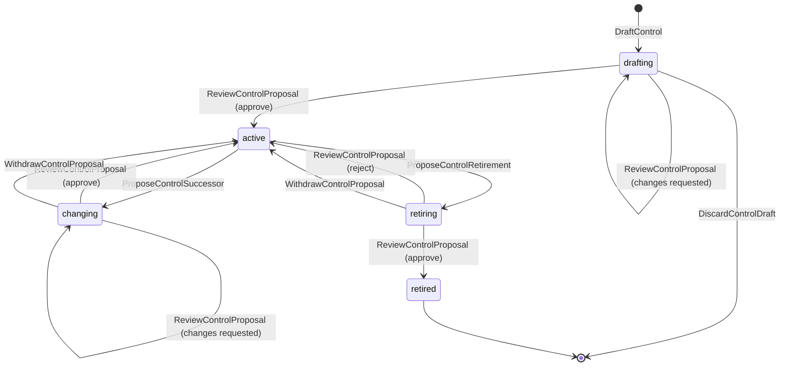
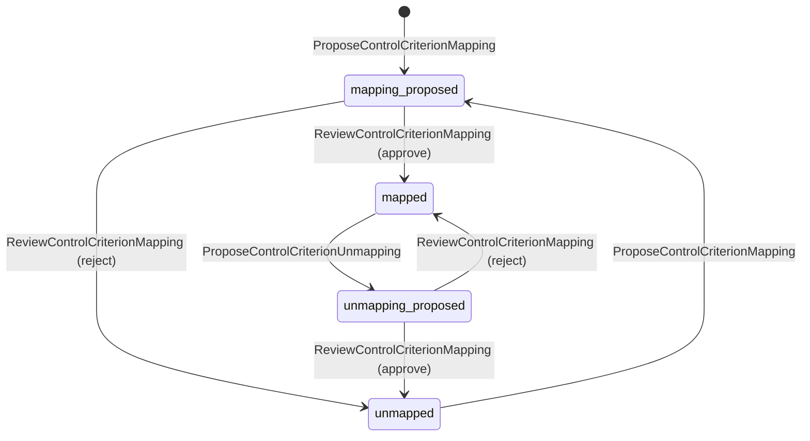
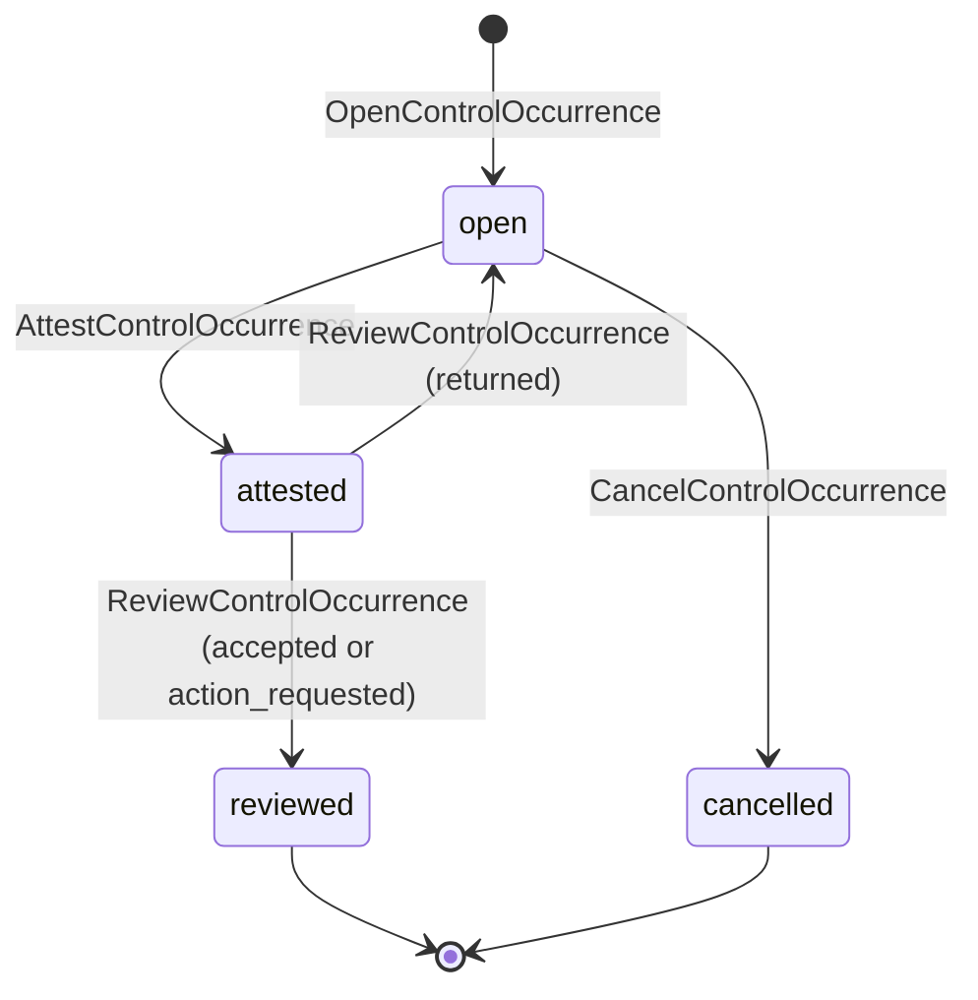
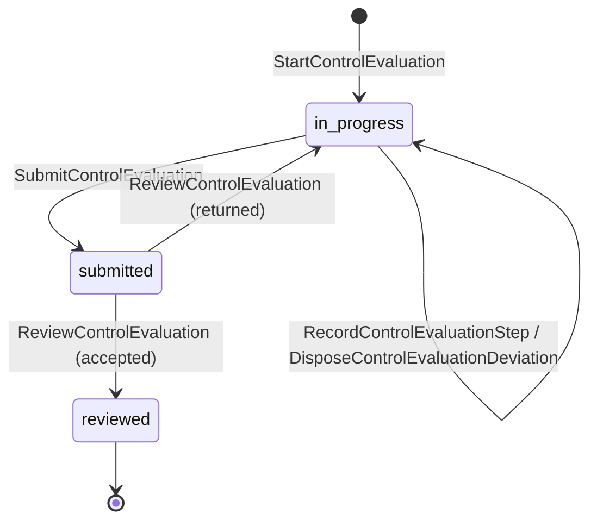
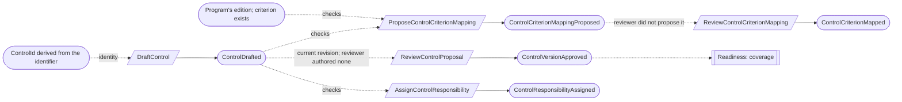
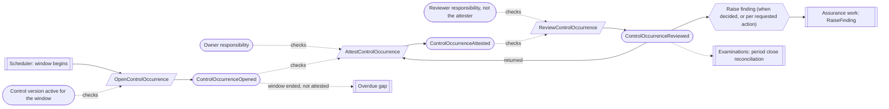
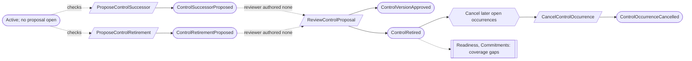
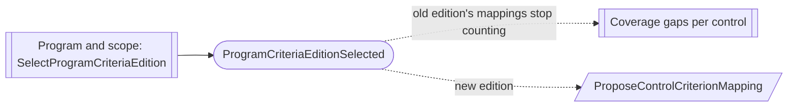

# Control environment

Status: **locked**, 2026-11-03. Hand-authored source of truth for this context.
It follows the [context conventions](conventions.md).

## Purpose

Control environment records the organization's controls: what must happen, why,
by whom, how often and with what evidence; which criteria each control
addresses; every expected and actual performance; and the evaluations that test
whether a control is designed and working (M0-D13, M0-D19).

**Owns:** controls and their versions, control-to-criterion mappings, control
responsibilities, control occurrences, control evaluation plans and control
evaluations.

**Does not own:**

| Concern | Owner |
| --- | --- |
| Criteria editions and not-applicable decisions | Criteria |
| Evidence artifacts and their review in context | Evidence; an attestation references exact artifact versions |
| Findings, corrective actions and waivers | Assurance work; this context asks for a finding and references a waiver |
| Commitment-to-control links | Commitments (`CommitmentControlLink`) |
| Risk-to-control treatment | Risk and provider oversight |
| Whether the program is ready | Readiness, from controls, occurrences, evaluations and gaps |
| The Type II period and its close | Examinations; the close reads occurrences in its window |

## Language

| Term | Meaning |
| --- | --- |
| Control | One defined response of the organization, with a stable identifier such as `AC-01` within its program. |
| Control version | One approved statement of the control, effective from a date: objective, activity, kind (`preventive`, `detective`, `corrective`), nature (`manual`, `automated`, `hybrid`), cadence, occurrence subject and expected evidence. |
| Cadence | How often the control runs: `continuous`, `daily`, `weekly`, `monthly`, `quarterly`, `semiannual`, `annual` or `event_driven`. |
| Occurrence subject | What one occurrence covers when the control runs per item: `none`, `policy` or `material_provider` (M0-D19). |
| Mapping | A reviewed statement that a control addresses one criterion or point of focus of one edition, with a rationale. |
| Responsibility | Who is accountable for a control as its `owner` (performs or oversees each occurrence) or its `reviewer` (reviews each occurrence), from an effective date. A holder is a person or a team. |
| Occurrence | One expected or actual performance of a control for one window (and one subject), attested and then reviewed. |
| Window | The period one occurrence covers, derived from the cadence, such as the month 2026-11. |
| Evaluation plan | The test steps for one exact control version (M0-D13). |
| Evaluation | One run of an evaluation plan, with step results, deviations, a submission and an independent review. |
| Deviation | A `not_met` step, classified `minor` or `material` (M0-D23). |

## Aggregates

### Control

**Identity:** `TenantId` + `ControlId`, where `ControlId` is derived from the program and the normalized identifier, so a second control with the same identifier is refused by the stream itself (CE-09, CV-11).

**Invariant:** one control has one identifier and a line of approved versions
whose effective dates strictly increase. At most one proposal is open at a time:
the first version, a successor, or retirement. Each proposal is reviewed by
someone who authored no revision of it ([CV-06](conventions.md#guards-and-reviews)).
Retirement is final.

- The identifier is unique within the program, including retired controls,
  and never changes; the identity enforces it (CE-09).
- A version states the objective, activity, kind, nature, cadence, occurrence
  subject and expected evidence. Changing any of them is a successor version
  (CE-01).
- While a successor is proposed, the latest approved version stays in effect.
- A never-approved control can be discarded. Every other removal is reviewed
  retirement, effective-dated, which stops future occurrences without touching
  history (CE-05).

| Command | Who | Accepts when | Emits |
| --- | --- | --- | --- |
| DraftControl | Compliance Lead or Contributor | `ControlId` (from program and identifier) is new | ControlDrafted |
| ReviseControlProposal | Compliance Lead or Contributor | A first version or successor is proposed | ControlProposalRevised |
| DiscardControlDraft | Compliance Lead | Never approved | ControlDraftDiscarded |
| ProposeControlSuccessor | Compliance Lead or Contributor | Active; no proposal open | ControlSuccessorProposed |
| ProposeControlRetirement | Compliance Lead | Active; no proposal open; reason and effective date given | ControlRetirementProposed |
| WithdrawControlProposal | Its proposer or Compliance Lead | A successor or retirement is proposed | ControlProposalWithdrawn |
| ReviewControlProposal | Compliance Lead who authored no revision, or covered by a waiver | A proposal is open; reviews the current revision; approval: effective date later than the current version's | ControlChangesRequested, ControlVersionApproved, ControlRetirementRejected or ControlRetired |

| Event | Carries |
| --- | --- |
| ControlDrafted | tenant, control, program, identifier, version content, drafted by |
| ControlProposalRevised | tenant, control, revision, version content, revised by |
| ControlDraftDiscarded | tenant, control, discarded by |
| ControlSuccessorProposed | tenant, control, from version, version content, proposed by |
| ControlRetirementProposed | tenant, control, reason, effective at, proposed by |
| ControlProposalWithdrawn | tenant, control, proposal, withdrawn by |
| ControlChangesRequested | tenant, control, revision, comments, reviewer |
| ControlVersionApproved | tenant, control, version, revision, full content, effective at, approver, waiver (if any) |
| ControlRetirementRejected | tenant, control, comments, reviewer |
| ControlRetired | tenant, control, effective at, reason, approver, waiver (if any) |

### ControlCriterionMapping

**Identity:** `TenantId` + `ControlId` + `EditionId` + criterion identifier.

**Invariant:** one control addresses one criterion entry of one edition, or it
does not. Both mapping and unmapping are proposals with a rationale, reviewed by
someone who authored no revision of them (CE-04). The history keeps every
mapping and unmapping.

- The edition is the program's selected edition and the entry exists in it.
  A mapping to another edition stops counting when the program changes edition
  (as CR-05); the controls are mapped again to the new one.
- A mapping references the criterion by edition and identifier, never by text
  (M0-D02).
- A mapping counts only while the control is active and the criterion is
  applicable to the program.

| Command | Who | Accepts when | Emits |
| --- | --- | --- | --- |
| ProposeControlCriterionMapping | Compliance Lead or Contributor | Not mapped and nothing proposed; edition is the program's; entry exists; rationale given | ControlCriterionMappingProposed |
| ProposeControlCriterionUnmapping | Compliance Lead or Contributor | Mapped; nothing proposed; reason given | ControlCriterionUnmappingProposed |
| ReviewControlCriterionMapping | Compliance Lead who did not propose it, or covered by a waiver | A proposal is open | ControlCriterionMapped, ControlCriterionUnmapped or ControlCriterionMappingProposalRejected |

| Event | Carries |
| --- | --- |
| ControlCriterionMappingProposed | tenant, control, edition, identifier, rationale, proposed by |
| ControlCriterionUnmappingProposed | tenant, control, edition, identifier, reason, proposed by |
| ControlCriterionMapped | tenant, control, edition, identifier, rationale, approver, waiver (if any) |
| ControlCriterionUnmapped | tenant, control, edition, identifier, reason, approver, waiver (if any) |
| ControlCriterionMappingProposalRejected | tenant, control, edition, identifier, comments, reviewer |

### ControlResponsibility

**Identity:** `TenantId` + `ControlId` + responsibility (`owner` or `reviewer`).

**Invariant:** one control has at most one holder of each responsibility at a
time, from an effective date. A new assignment ends the previous one from its
effective date. Earlier holders stay in the history, and the recorded performer
or reviewer of past work never changes (CE-02).

- A holder is a person (who need not sign in) or a team. When the owner is a
  person without an account, a signed-in member records the work on their
  behalf, and both are attributed.
- The reviewer is not the owner, unless a separation-of-duties waiver covers it.
- Changing a holder shows the open occurrences that are now unassigned; it never
  reassigns them silently.

| Command | Who | Accepts when | Emits |
| --- | --- | --- | --- |
| AssignControlResponsibility | Compliance Lead | Control not retired; holder is a person or an active team; reviewer is not the owner unless waived | ControlResponsibilityAssigned |
| EndControlResponsibility | Compliance Lead | Assigned; reason given | ControlResponsibilityEnded |

| Event | Carries |
| --- | --- |
| ControlResponsibilityAssigned | tenant, control, responsibility, holder, effective from, previous holder, waiver (if any), assigned by |
| ControlResponsibilityEnded | tenant, control, responsibility, holder, effective until, reason, ended by |

### ControlOccurrence

**Identity:** `TenantId` + `ControlId` + window + subject (when the control runs
per subject). The ID is derived from these, so opening the same window twice is
a no-op ([CV-02](conventions.md#reactors)).

**Invariant:** one occurrence for one window is opened, attested by the owner
side, then reviewed once by the reviewer side. A returned attestation is
corrected by a new attestation that links to it; nothing is overwritten.

- Occurrences open from the control's cadence on calendar windows, independent
  of any examination period. An observation period reads which occurrences fall
  inside it (CE-03). An `event_driven` control's occurrences are opened by a
  person when the event happens.
- An attestation states the result (`performed`, `failed` or `not_performed`
  with a reason) and binds its support: exact evidence artifact versions and any
  exact record versions it relied on. For a management compliance review, the
  support is the readiness assessment version, the monitoring measure versions
  and the agenda or minutes artifact, frozen once attested (M0-D19).
- The reviewer is a different person from the attester, unless a waiver covers
  it (CE-07). The review outcome is `accepted`, `returned` (needs a corrected
  attestation) or `action_requested`. A `failed` or `not_performed` attestation
  is accepted only with the reviewer's finding decision: raise one, or record why
  none is needed (CE-06).
- An occurrence whose window has ended without an attestation is overdue. That is
  a gap computed from current state, not a recorded fact (CE-08).
- A control's retirement cancels its open occurrences whose windows start after
  the retirement date (CE-05).

| Command | Who | Accepts when | Emits |
| --- | --- | --- | --- |
| OpenControlOccurrence | Scheduler (window begins), or Compliance Lead or owner for `event_driven` | Control active for the window; a repeat is a no-op | ControlOccurrenceOpened |
| AttestControlOccurrence | The owner, or a member on behalf of a person owner | Open; result and support given; reason for `not_performed` | ControlOccurrenceAttested |
| ReviewControlOccurrence | The reviewer, not the attester, or covered by a waiver | Attested; reviews the latest attestation; finding decision given for `failed` or `not_performed`; actions listed for `action_requested` | ControlOccurrenceReviewed |
| CancelControlOccurrence | Reactor on ControlRetired, or Compliance Lead | Open; window starts after the retirement date (reactor) or reason given | ControlOccurrenceCancelled |

| Event | Carries |
| --- | --- |
| ControlOccurrenceOpened | tenant, control, control version, window, subject, opened by |
| ControlOccurrenceAttested | tenant, occurrence, attestation, result, reason, support (artifact and record versions), attested by, on behalf of, corrects (if any) |
| ControlOccurrenceReviewed | tenant, occurrence, attestation, outcome, finding decision (`raise` or `none` with reason), requested actions, reviewer, waiver (if any) |
| ControlOccurrenceCancelled | tenant, occurrence, reason, cancelled by |

### ControlEvaluationPlan

**Identity:** `TenantId` + `PlanId`, for one exact approved control version.

**Invariant:** one plan lists its test steps, each with an assertion (`design`,
`implementation`, `evidence_sufficiency`), a method (`inquiry`, `inspection`,
`observation`, `reperformance`), the exact inspected record versions or artifact
references, and the expected condition (M0-D13). Once an evaluation starts
using it, the plan is frozen. A changed plan is a new plan that supersedes it.

| Command | Who | Accepts when | Emits |
| --- | --- | --- | --- |
| DraftControlEvaluationPlan | Compliance Lead or Contributor | `PlanId` is new; control version approved; superseded plan (if any) frozen | ControlEvaluationPlanDrafted |
| ReviseControlEvaluationPlan | Compliance Lead or Contributor | No evaluation has started on it | ControlEvaluationPlanRevised |

| Event | Carries |
| --- | --- |
| ControlEvaluationPlanDrafted | tenant, plan, control, control version, steps, supersedes (if any), drafted by |
| ControlEvaluationPlanRevised | tenant, plan, revision, steps, revised by |

### ControlEvaluation

**Identity:** `TenantId` + `EvaluationId`.

**Invariant:** one evaluation runs one exact plan revision. It records a result
for every step, classifies every deviation, is submitted once with its overall
result, and is reviewed once by someone other than the evaluator (M0-D13).

- Step results are `met`, `not_met` or `not_tested`, with a rationale. Each
  `not_met` step is a deviation, classified `minor` or `material`.
- The overall result, and each assertion's result, is `effective` only when every
  step is `met`; `effective_with_exceptions` with only minor deviations, each
  disposed `corrected` or `accepted_with_waiver` (naming the waiver); and
  `ineffective` with any material deviation. Submission is refused when the
  result does not follow from the steps.
- A material deviation asks Assurance work for a finding, whose ID is derived
  from the deviation (CV-02), and needs a retest. A retest is a new evaluation
  that names the deviations it retests. A deviation never closes because a later
  evaluation passed; only an explicit retest link closes it.
- The control owner may evaluate their own control. The reviewer is a Compliance
  Lead or Org Admin who is not the evaluator, unless a waiver covers it. Advisor
  feedback is recorded in Advisor collaboration and never counts as the review.

| Command | Who | Accepts when | Emits |
| --- | --- | --- | --- |
| StartControlEvaluation | Compliance Lead, Contributor or the control owner | `EvaluationId` is new; plan exists; retested deviations are material and open | ControlEvaluationStarted |
| RecordControlEvaluationStep | The evaluator | In progress; step in the plan | ControlEvaluationStepRecorded |
| DisposeControlEvaluationDeviation | The evaluator | In progress; minor deviation; waiver named for `accepted_with_waiver` | ControlEvaluationDeviationDisposed |
| SubmitControlEvaluation | The evaluator | In progress; every step has a result; result follows from the steps | ControlEvaluationSubmitted |
| ReviewControlEvaluation | Compliance Lead or Org Admin, not the evaluator, or covered by a waiver | Submitted | ControlEvaluationReviewed |

| Event | Carries |
| --- | --- |
| ControlEvaluationStarted | tenant, evaluation, plan, plan revision, control version, retests (deviations), evaluator |
| ControlEvaluationStepRecorded | tenant, evaluation, step, result, rationale, deviation classification (if `not_met`), recorded by |
| ControlEvaluationDeviationDisposed | tenant, evaluation, deviation, disposition, waiver (if any), disposed by |
| ControlEvaluationSubmitted | tenant, evaluation, assertion results, overall result, deviations, submitted by |
| ControlEvaluationReviewed | tenant, evaluation, outcome (`accepted` or `returned`), comments, reviewer, waiver (if any) |

## Flows

Diagrams follow [CV-01](conventions.md#flow-diagrams): dotted edges are the
facts each command checks.

### Activating a control

A mapping and a responsibility can be recorded on a draft control. They count
once the control has an approved version.

### Occurrences and their review

The finding's ID is derived from the review and the action index, so a repeated
reaction raises it once (CV-02). Raising a finding is the reviewer's decision
(CE-06).

### Changing or retiring a control

Mappings and links to a retired control stop counting (derived); they are not
removed.

### Evaluating a control

```mermaid
flowchart LR
    V([Approved control version]) -. checks .-> C1
    C1[/DraftControlEvaluationPlan/] --> E1([ControlEvaluationPlanDrafted])
    E1 -. checks .-> C2[/StartControlEvaluation/] --> E2([ControlEvaluationStarted])
    E2 -. "plan now frozen" .-> F[[ReviseControlEvaluationPlan refused]]
    E2 -. checks .-> C3[/RecordControlEvaluationStep/] --> E3([ControlEvaluationStepRecorded])
    E3 -. "minor deviation" .-> C4[/DisposeControlEvaluationDeviation/] --> E4([ControlEvaluationDeviationDisposed])
    W[[Assurance work: approved waiver]] -. "accepted_with_waiver" .-> C4
    E3 -. "every step has a result" .-> C5[/SubmitControlEvaluation/] --> E5([ControlEvaluationSubmitted])
    E5 --> R1{{"Raise finding per material deviation (ID from deviation)"}} --> X1[[Assurance work: RaiseFinding]]
    E5 -. "reviewer is not the evaluator" .-> C6[/ReviewControlEvaluation/] --> E6([ControlEvaluationReviewed])
    E5 -. "material deviation open" .-> C7[/"StartControlEvaluation (retest)"/]
```

### Program changes edition

Nothing is copied. Each mapping to the new edition is proposed and reviewed
(M0-D02).

## Authorization contract

- Drafting and proposing need Compliance Lead or Contributor; every approval,
  mapping review and retirement needs a Compliance Lead who authored nothing in
  the proposal (CV-06).
- Attesting needs the owner responsibility (directly, through a team, or on
  behalf of a person owner). Reviewing needs the reviewer responsibility and not
  having attested.
- Firm advisors can comment through Advisor collaboration but cannot attest,
  review or approve.

## Decisions

Jev answers are from `jev-1.14.0`, 2026-11-03. A yes is ≥ 0.8 and a no is ≤ 0.2.
Anything in between is settled by common sense, with the reasoning stated.

| ID | Decision | Evidence |
| --- | --- | --- |
| CE-01 | Cadence, kind, nature, occurrence subject and expected evidence are part of the control version; changing them is a reviewed successor version. No separate operating plan. | 0.83. Replaces `ControlOperatingPlan`. |
| CE-02 | Owner and reviewer are `ControlResponsibility` records, reassignable from an effective date without a new control version. | 0.76. Common sense: people change roles far more often than the control changes, and history keeps who did each piece of work. |
| CE-03 | Occurrences open on calendar windows from the cadence, independent of examination periods; a period reads the occurrences inside it. | 0.72. Common sense: controls run during readiness too, and the period close already reconciles expected against actual (Examinations). |
| CE-04 | Each control-to-criterion mapping is its own small record. Mapping and unmapping are both proposals reviewed by someone who did not propose them. | Mapping without review harms readiness reporting: 0.86. Unmapping needs review: 0.84. Reviewing mappings with the control version scored 0.84 too; kept as separate small records (product owner preference for small aggregates), which meets the same review need. |
| CE-05 | Retiring a control is a reviewed proposal with a reason and effective date. Retirement cancels open occurrences whose windows start after it. | Retiring without review harms coverage: 0.94. Cancel later occurrences: 0.81. |
| CE-06 | For a `failed` or `not_performed` occurrence, the reviewer decides whether to raise a finding or records why none is needed. A management review's requested actions each raise a finding (M0-D19). | Reviewer decides: 0.87. Automatic findings for every failure create noise: 0.85. |
| CE-07 | An occurrence's reviewer is never its attester, unless a waiver covers it. | 0.84. |
| CE-08 | An occurrence whose window ended without an attestation is an overdue gap computed from current state. | 0.64. Common sense: same pattern as TI-02 and CM-04; the gap shows until someone attests late or a finding is raised. |
| CE-09 | Control identifiers stay unique within the program, including retired controls. The ID is derived from program and identifier, so the stream enforces it. | 0.85. Owned identifiers for audit-facing codes: 0.75 (CV-11). |
| CE-10 | An evaluation plan is frozen once an evaluation starts on it; a change is a new plan. | 0.63. M0-D13 decided it. |
| CE-11 | Periodic policy, risk, vendor and management reviews are ordinary controls with an occurrence subject; there is no separate review record. | M0-D19. |

## Open questions

None at this time.

## Superseded owners

| Old owner | Becomes |
| --- | --- |
| ControlDraft | Control (one version line with reviewed proposals) |
| ControlOperatingPlan | Part of the control version (CE-01) |
| ControlCriterionMapping | ControlCriterionMapping (mapping and unmapping both reviewed; CE-04) |
| Responsibilities on `ControlDraft` (`AssignResponsibility`, `RevokeResponsibility`) | ControlResponsibility (CE-02) |
| ControlOccurrence | ControlOccurrence (calendar windows; reviewer's finding decision) |
| ControlEvaluationPlan | ControlEvaluationPlan |
| ControlEvaluation | ControlEvaluation |
| ControlOccurrenceFanOutReactor, OpenDueControlWorkReactor | Scheduler opens occurrences by window (CE-03) |
| ControlOccurrenceFindingReactor | "Raise finding" reaction on `ControlOccurrenceReviewed` (CE-06) |
| ControlEvaluationDeviationFindingReactor | "Raise finding per material deviation" reaction on `ControlEvaluationSubmitted` |
