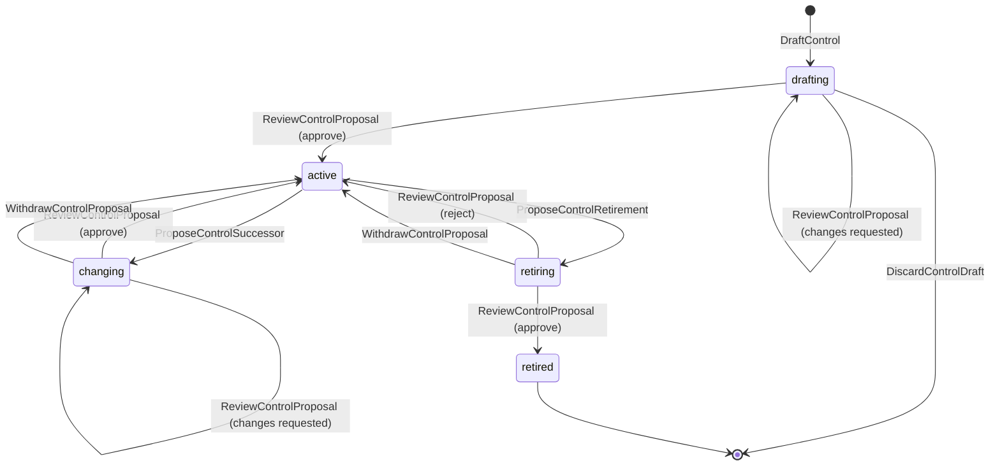
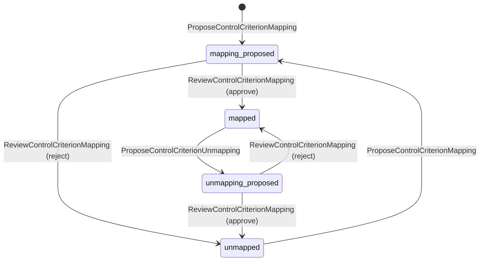
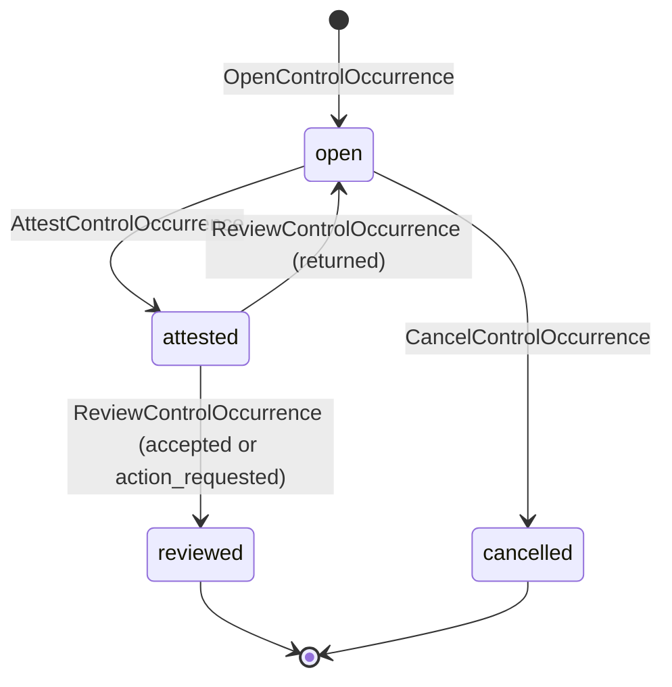
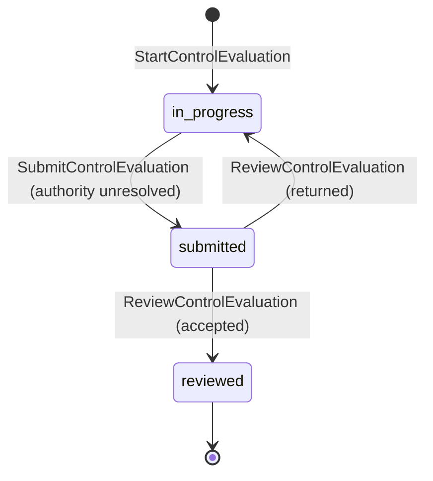
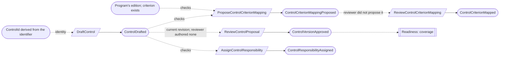
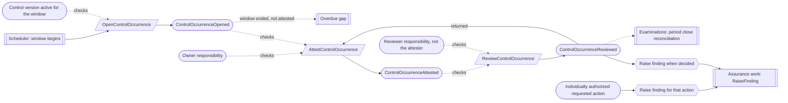
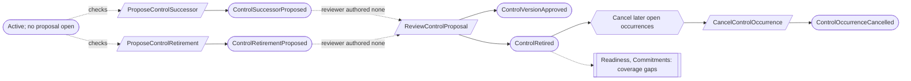
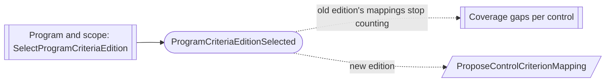

# Control environment

Status: **partial**, revised 2026-11-05. Control evaluation and responsibility authority require the qualifications under Open questions before implementation. Hand-authored source of truth for this context.
It follows the [context conventions](conventions.md).

## Purpose

Control environment records the organization's controls: what must happen, why,
by whom, how often and with what evidence; which criteria each control
addresses; every expected and actual performance; and the evaluations that test
whether a control is designed and working (M0-D13, M0-D19).

**Owns:** controls and their versions, control-to-criterion mappings, control
responsibilities, control occurrences, control evaluation plans and control
evaluations.

**Does not own:**

| Concern | Owner |
| --- | --- |
| Criteria editions and not-applicable decisions | Criteria |
| Evidence artifacts and their review in context | Evidence; an attestation references exact artifact versions |
| Findings, corrective actions and waivers | Assurance work; this context asks for a finding and references a waiver |
| Commitment-to-control links | Commitments (`CommitmentControlLink`) |
| Risk-to-control treatment | Risk and provider oversight |
| Whether the program is ready | Readiness, from controls, occurrences, evaluations and gaps |
| The Type II period and its close | Examinations; the close reads occurrences in its window |

## Language

| Term | Meaning |
| --- | --- |
| Control | One defined response of the organization, with a stable identifier such as `AC-01` within its program. |
| Control version | One approved statement of the control, effective from a date: objective, activity, kind (`preventive`, `detective`, `corrective`), nature (`manual`, `automated`, `hybrid`), cadence, occurrence subject and expected evidence. |
| Cadence | How often the control runs: `continuous`, `daily`, `weekly`, `monthly`, `quarterly`, `semiannual`, `annual` or `event_driven`. |
| Occurrence subject | What one occurrence covers when the control runs per item: `none`, `policy` or `material_provider` (M0-D19). |
| Mapping | A reviewed statement that a control addresses one criterion or point of focus of one edition, with a rationale. |
| Responsibility | Who is accountable for a control as its `owner` (performs or oversees each occurrence) or its `reviewer` (reviews each occurrence), from an effective date. A holder is a person or a team. |
| Occurrence | One expected or actual performance of a control for one window (and one subject), attested and then reviewed. |
| Window | The period one occurrence covers, derived from the cadence, such as the month 2026-11. |
| Evaluation plan | The test steps for one exact control version (M0-D13). |
| Evaluation | One run of an evaluation plan, with step results, deviations, a submission and an independent review. |
| Deviation | A `not_met` step, classified `minor` or `material` (M0-D23). |

## Aggregates

### Control

**Identity:** `TenantId` + `ControlId`, where `ControlId` is derived from the program and the normalized identifier, so a second control with the same identifier is refused by the stream itself (CE-09, CV-11).

**Invariant:** one control has one identifier and a line of approved versions
whose effective dates strictly increase. At most one proposal is open at a time:
the first version, a successor, or retirement. Each proposal is reviewed by
someone who authored no revision of it ([CV-06](conventions.md#guards-and-reviews)).
Retirement is final.

- The identifier is unique within the program, including retired controls,
  and never changes; the identity enforces it (CE-09).
- A version states the objective, activity, kind, nature, cadence, occurrence
  subject and expected evidence. Changing any of them is a successor version
  (CE-01).
- While a successor is proposed, the latest approved version stays in effect.
- A never-approved control can be discarded. Every other removal is reviewed
  retirement, effective-dated, which stops future occurrences without touching
  history (CE-05).

| Command | Who | Accepts when | Emits |
| --- | --- | --- | --- |
| DraftControl | Compliance Lead or Contributor | `ControlId` (from program and identifier) is new | ControlDrafted |
| ReviseControlProposal | Compliance Lead or Contributor | A first version or successor is proposed | ControlProposalRevised |
| DiscardControlDraft | Compliance Lead | Never approved | ControlDraftDiscarded |
| ProposeControlSuccessor | Compliance Lead or Contributor | Active; no proposal open | ControlSuccessorProposed |
| ProposeControlRetirement | Compliance Lead | Active; no proposal open; reason and effective date given | ControlRetirementProposed |
| WithdrawControlProposal | Its proposer or Compliance Lead | A successor or retirement is proposed | ControlProposalWithdrawn |
| ReviewControlProposal | Compliance Lead who authored no revision, or covered by a waiver | A proposal is open; reviews the current revision; approval: effective date later than the current version's | ControlChangesRequested, ControlVersionApproved, ControlRetirementRejected or ControlRetired |

| Event | Carries |
| --- | --- |
| ControlDrafted | tenant, control, program, identifier, version content, drafted by |
| ControlProposalRevised | tenant, control, revision, version content, revised by |
| ControlDraftDiscarded | tenant, control, discarded by |
| ControlSuccessorProposed | tenant, control, from version, version content, proposed by |
| ControlRetirementProposed | tenant, control, reason, effective at, proposed by |
| ControlProposalWithdrawn | tenant, control, proposal, withdrawn by |
| ControlChangesRequested | tenant, control, revision, comments, reviewer |
| ControlVersionApproved | tenant, control, version, revision, full content, effective at, approver, waiver (if any) |
| ControlRetirementRejected | tenant, control, comments, reviewer |
| ControlRetired | tenant, control, effective at, reason, approver, waiver (if any) |

### ControlCriterionMapping

**Identity:** `TenantId` + `ControlId` + `EditionId` + criterion identifier.

**Invariant:** one control addresses one criterion entry of one edition, or it
does not. Both mapping and unmapping are proposals with a rationale, reviewed by
someone who authored no revision of them (CE-04). The history keeps every
mapping and unmapping.

- The edition is the program's selected edition and the entry exists in it.
  A mapping to another edition stops counting when the program changes edition
  (as CR-05); the controls are mapped again to the new one.
- A mapping references the criterion by edition and identifier, never by text
  (M0-D02).
- A mapping counts only while the control is active and the criterion is
  applicable to the program.

| Command | Who | Accepts when | Emits |
| --- | --- | --- | --- |
| ProposeControlCriterionMapping | Compliance Lead or Contributor | Not mapped and nothing proposed; edition is the program's; entry exists; rationale given | ControlCriterionMappingProposed |
| ProposeControlCriterionUnmapping | Compliance Lead or Contributor | Mapped; nothing proposed; reason given | ControlCriterionUnmappingProposed |
| ReviewControlCriterionMapping | Compliance Lead who did not propose it, or covered by a waiver | A proposal is open | ControlCriterionMapped, ControlCriterionUnmapped or ControlCriterionMappingProposalRejected |

| Event | Carries |
| --- | --- |
| ControlCriterionMappingProposed | tenant, control, edition, identifier, rationale, proposed by |
| ControlCriterionUnmappingProposed | tenant, control, edition, identifier, reason, proposed by |
| ControlCriterionMapped | tenant, control, edition, identifier, rationale, approver, waiver (if any) |
| ControlCriterionUnmapped | tenant, control, edition, identifier, reason, approver, waiver (if any) |
| ControlCriterionMappingProposalRejected | tenant, control, edition, identifier, comments, reviewer |

### ControlResponsibility

**Identity:** `TenantId` + `ControlId`. This owner has exactly two fixed role
slots: `owner` and `reviewer`. It contains no list of people or occurrences.

**Invariant:** at most one holder occupies each role at a time, and the two
holder identities differ unless a separation-of-duties waiver covers the
assignment. A holder is a person or a team. Assignment and ending either role
must contend on this one stream; a losing append reloads both slots and rechecks.
Two streams that merely read each other permit the same holder to win both roles
concurrently. Reassignment is effective-dated, retains history, and never changes
the attributed performer or reviewer of past work (CE-02).

- Holder identity equality is a check on the specified person or team, not proof
  that memberships of different teams are disjoint. Each occurrence independently
  forbids the same actual person attesting and reviewing without a waiver (CE-07).
- A person holder need not sign in; a signed-in member may record work on their
  behalf, attributing both. A holder team must be active when assigned.
- Changing a holder shows open occurrences now unassigned; it never reassigns them
  silently. Occurrences remain independently owned and are found by a read model.
- **Qualification required:** the accepted effective-date semantics do not say
  whether backdating, future scheduling, overlapping future changes, or waiver
  validity across a future interval are allowed. Two current slots alone do not
  prove separation over an arbitrary timeline. Until those policies and their
  bounded authoritative timeline owner are decided, do not implement this as a
  complete guarantee or silently restrict existing product behavior. Per-control
  assignment history also grows with its own changes; no lifetime stream bound is
  claimed. Concurrent
  control retirement and team deactivation also need authoritative coordination
  or an explicit policy for pending/reconciliation; source reads alone cannot
  establish those cross-owner conditions atomically.

| Command | Who | Accepts when | Emits |
| --- | --- | --- | --- |
| AssignControlResponsibility | Compliance Lead | Control not retired; holder is a person or an active team; holder differs from the other role for the applicable interval unless waived; coordination and date rules qualified | ControlResponsibilityAssigned |
| EndControlResponsibility | Compliance Lead | Assigned; reason given; applicable date rules qualified | ControlResponsibilityEnded |

| Event | Carries |
| --- | --- |
| ControlResponsibilityAssigned | tenant, control, responsibility, holder, effective from, previous holder, waiver (if any), assigned by |
| ControlResponsibilityEnded | tenant, control, responsibility, holder, effective until, reason, ended by |

### ControlOccurrence

**Identity:** `TenantId` + `ControlId` + window + subject (when the control runs
per subject). The ID is derived from these, so opening the same window twice is
a no-op ([CV-02](conventions.md#reactors)).

**Invariant:** one occurrence for one window is opened, attested by the owner
side, then reviewed once by the reviewer side. A returned attestation is
corrected by a new attestation that links to it; nothing is overwritten.

- Occurrences open from the control's cadence on calendar windows, independent
  of any examination period. An observation period reads which occurrences fall
  inside it (CE-03). An `event_driven` control's occurrences are opened by a
  person when the event happens.
- An attestation states the result (`performed`, `failed` or `not_performed`
  with a reason). Supporting evidence uses individually owned exact artifact or
  record-version references, never a collection in the attestation event or its
  content. M0-D19 requires the management review to bind a frozen evidence set:
  the readiness assessment version, monitoring measure versions, and agenda or
  minutes artifact. Exact per-item versions preserve each reference, but by
  themselves do **not** prove which items were included in that signed-off set.
  See the unresolved evidence-set semantics below.
- The reviewer is a different person from the attester, unless a waiver covers
  it (CE-07). The review outcome is `accepted`, `returned` (needs a corrected
  attestation) or `action_requested`. A `failed` or `not_performed` attestation
  is accepted only with the reviewer's finding decision: raise one, or record why
  none is needed (CE-06).
- An occurrence whose window has ended without an attestation is overdue. That is
  a gap computed from current state, not a recorded fact (CE-08).
- A control's retirement cancels its open occurrences whose windows start after
  the retirement date (CE-05).

| Command | Who | Accepts when | Emits |
| --- | --- | --- | --- |
| OpenControlOccurrence | Scheduler (window begins), or Compliance Lead or owner for `event_driven` | Control active for the window; a repeat is a no-op | ControlOccurrenceOpened |
| AttestControlOccurrence | The owner, or a member on behalf of a person owner | Open; result given; reason for `not_performed`; exact support-binding semantics unresolved | ControlOccurrenceAttested |
| ReviewControlOccurrence | The reviewer, not the attester, or covered by a waiver | Attested; reviews the latest attestation; finding decision given for `failed` or `not_performed`; requested-action authority and management outcomes unresolved | ControlOccurrenceReviewed |
| CancelControlOccurrence | Reactor on ControlRetired, or Compliance Lead | Open; window starts after the retirement date (reactor) or reason given | ControlOccurrenceCancelled |

| Event | Carries |
| --- | --- |
| ControlOccurrenceOpened | tenant, control, control version, window, subject, opened by |
| ControlOccurrenceAttested | tenant, occurrence, attestation, result, reason, attested by, on behalf of, corrects (if any); exact support binding remains unresolved |
| ControlOccurrenceReviewed | tenant, occurrence, attestation, review, outcome, finding decision (`raise` or `none` with reason), reviewer, waiver (if any) |
| ControlOccurrenceCancelled | tenant, occurrence, reason, cancelled by |

### Occurrence support and requested actions: boundary audit

**Identity:** Candidate support identity is tenant + attestation + support ID;
candidate action identity is tenant + review + action ID. Both are provisional.

**Invariant:** Each candidate support identifies one exact source version; each
candidate action identifies one requested action and one exact review. Authority,
membership and lifecycle are unresolved as described below.

An independently identified support fact should hold one attestation identity,
one exact record version or artifact version, and its attribution. An independently
identified requested-action fact should hold one exact review identity, its
requesting actor, and one action. The occurrence and review events do not carry
lists or a large content document. Per-action finding IDs derive from the exact
action ID, so retries target the same finding; an accepted finding outcome, refusal
or unresolved retry must remain visible to the action's process. The finding and
its corrective action are owned by Assurance work. Read models can display
support and action links, but do not establish membership or write authority.

**Not yet a complete design:**

- An immutable reference to version V1 preserves V1 when the source changes to
  V2. It does not prove that the attester included the reference when they
  signed. A link created later and merely citing the attestation can falsely
  claim to belong to the original frozen set. M0-D19 explicitly requires that
  frozen set, and a projection count or page is no proof of its membership.
  The clarified boundary disallows making attestation or review decide by reading
  every support item or by maintaining a child ledger. The existing product rule
  and that boundary therefore require an approved resolution: a different
  individually attributable evidence/sign-off meaning, or another precisely
  specified authority that meets both requirements. Neither a per-item link nor
  a source scan is that resolution. Do not call the set frozen until resolved.
- The old `action_requested` review included an action list. Splitting each
  action into a separately governed decision removes that list, but raises when
  the review authorizes each action, whether actions can be added after sign-off,
  whether an action is required before the outcome, and how to reject forged or
  stale requests. Checking a current review via projection does not settle a
  concurrent return or correction. Specify an authoritative per-action decision,
  its exact review binding, retries and terminal outcomes without requiring the
  occurrence or reviewer to enumerate all actions. Preserve the M0-D19 rule that
  every management-requested action creates a finding with a corrective action.
- M0-D19 names management sign-off outcomes `approved`, `action_requested` and
  `deferred`, whereas the generic review above uses `accepted`, `returned` and
  `action_requested`. Resolve this product-contract discrepancy rather than
  silently treating the vocabularies as equivalent. Also qualify attribution for
  attestation-on-behalf, review, returned/corrected attestation and waiver races.

The occurrence's own lifecycle history may grow with its own repeated decisions;
no hard lifetime stream bound is claimed. No proposed support or action parent
owns, scans, counts, or records one event per child to decide a write.

### ControlEvaluationPlan

**Identity:** `TenantId` + `PlanId`, for one exact approved control version.

**Invariant:** The accepted product requirement is that a plan is editable until
the first evaluation starts,
then its exact step definitions and inspected versions are frozen. A changed
plan is a new plan superseding it (M0-D13). The plan owner stores identity,
control version and lifecycle, not step definitions or a list of steps.

**Authority unresolved:** independently writable step streams and an advisory
plan read do not prevent a late edit racing the first evaluation. Moreover, a
root operation that scans every step, keeps an admission ledger, or verifies
all child outcomes violates the clarified no-all-children write boundary. A
bounded record that logs one admission per step still is a child ledger even if
it rolls over. No qualifying freeze protocol is established here. Preserve the
M0-D13 requirement as open; do not claim a projection or a time cutoff enforces
it, or silently make a new policy decision.

### ControlEvaluationPlanStep and inspected item

**Identity:** `TenantId` + `PlanId` + `StepId`; an inspected item is identified by
the step and an item ID.

**Invariant:** Each candidate owner describes one step or one exact
record-version/artifact reference; lifecycle and freeze authority remain
unresolved. The step states one assertion (`design`, `implementation`,
`evidence_sufficiency`), one method (`inquiry`, `inspection`, `observation`,
`reperformance`), and its expected condition. An inspected item is not a list on
the step. Exact versions cannot be replaced with later versions at evaluation
start. Edit, removal, freeze, identity and correction choreography still need
an authoritative design that respects the boundary above.

### ControlEvaluation

**Identity:** `TenantId` + `EvaluationId`.

**Invariant:** The accepted product requirement is that one evaluation runs an
exact plan revision, records a
result for every step, classifies each deviation, is submitted with assertion and
overall outcomes, and is reviewed by someone other than its evaluator unless a
waiver covers it. The evaluation lifecycle owner holds its own small facts, not
lists of steps, deviations, retests or inspected content.

- Each step result is `met`, `not_met` or `not_tested` with rationale. Each
  `not_met` result is a deviation classified `minor` or `material`. Each minor
  deviation must be `corrected` or `accepted_with_waiver`, naming the waiver.
- M0-D13 requires `effective` only if all applicable steps are met; minor
  deviations require disposition and allow at best `effective_with_exceptions`;
  a material deviation gives `ineffective`. M0-D13 also names `not_tested`; its
  mixed-result precedence and empty-assertion behavior need a product decision.
- A material deviation asks Assurance work for a finding derived from its ID and
  needs a retest. A retest is a new evaluation of the same plan or a successor;
  individual retest links name selected material, open deviations. A later passing
  evaluation never closes a deviation without its explicit retest link.
- The control owner may evaluate their own control. The reviewer is a Compliance
  Lead or Org Admin who is not the evaluator unless a waiver covers it. Advisor
  feedback never counts as the review.
- **Authority unresolved:** recording or submitting an authoritative outcome that
  claims every step has a result and an exact derived aggregate outcome depends
  on the complete step/result set. Asking the lifecycle owner to enumerate all
  steps, trusting projection counts, or using a rollover ledger is not acceptable.
  An independently derived read view can show progress, but cannot by itself
  make a submitted claim authoritative. The product rule or a different exact
  authority needs an explicit resolution. Until then these are requirements, not
  a complete implementation design.

### ControlEvaluationStep, deviation and retest link

**Identity:** `TenantId` + `EvaluationId` + `StepId`; a deviation and a retest
link each have their own identity and owner.

**Invariant:** A result describes one plan step; a deviation governs one
not-met result; a retest link names one deviation. Their cross-owner acceptance
and evaluation-wide submission authority remain unresolved.

A step holds its own current result
and, for `not_met`, the exact deviation identity. The deviation governs its
classification and disposition or material follow-up. Historical deviations
remain independently addressable when a step result changes; neither step nor
evaluation owns a deviation history list. A retest link names one deviation.

A `not_met` result and its deviation need explicit participant acceptance and
recovery; an advisory read cannot prove that a related write committed. A retest
link must also order with closure on that exact deviation owner. Unknown outcomes
stay pending; a no-fact refusal or cancellation cannot safely release an operation
until the target durably fences the exact token, including on an empty stream.
The fence must report any prior acceptance. These are required failure semantics,
not a completed protocol. Returns and corrections must preserve prior individual
results and history without reopening an old command or silently dropping facts.
Neither coordination nor an owner write may enumerate an unbounded population.

## Candidate: individual facts and source-ordered review boundaries

This candidate separates an attributed submission or sign-off from its derived
read-side outcome. It does not require a plan, evaluation, or occurrence write
to load every related record. It is **not a qualified implementation design**:
the required source ordering, attribution and recovery guarantees below must
first be demonstrated. The retained M0-D13 and M0-D19 requirements continue to
apply; any change to synchronous review behavior needs an explicit decision.

### Freeze a plan without an owner of its steps

Each step owner records its own revision and exact inspected references. A
proposed start marker and the individual accepted step-revision facts must be
ordered in the same durable source scope, with a unique plan edition/epoch.
The frozen plan contains only the eligible revisions in that epoch before its
start marker. A later physical append cannot enter that frozen plan; a user
must make a change in a successor plan version. A pre-marker event must also
be valid and attributed to an authorized step editor: a physical append alone
is not proof of semantic acceptance. Each step write decides its own invariant;
starting an evaluation emits its own marker without reading or storing step
IDs, results, or outcome acknowledgements.

The protocol must still establish the exact participant acceptance point,
same-scope routing, source order, handling of proposals and marker commits with
unknown outcomes, and the behavior of abandoned or retried epochs. The event
store's total-order feed is infrastructure, not a parent aggregate; this does
not permit a process to record one admission event per child on a coordinator,
or require a reviewer to scan all steps as a write guard. Ordered interpretation
must not make a projection or asynchronous consumer an unqualified write owner.

### Derive evaluation outcomes separately

An evaluator submits their own attributed claim against one frozen plan and
one submission marker. A result or deviation owner governs each step's facts;
the submission event does not say that all steps are complete, nor assert a
system-verified `effective` outcome. An exact read-side derivation matches the
frozen plan to eligible per-step results through the submission marker and
applies M0-D13's outcome rules. It must remain **pending**, rather than claim
`effective`, while the complete ordered prefix or any required participant
outcome is unknown. A missing applicable step result cannot be inferred to be
`met`; the policy for whether it becomes `not_tested`, and the zero-step and
mixed-assertion cases, remains open. A later correction belongs to a later
submission and never changes the earlier one.

This is a source-backed read calculation, not a parent aggregate's decision.
An incrementally maintained view must identify its exact source scope,
generation, marker and completed frontier; a page, count, hash, or merely
observing the marker does not prove that all earlier source facts were applied.
Nor may a lagging read authorize an irreversible write. M0-D13 requires
`effective` only when every applicable step is met; this approach can preserve
that meaning only if the read derivation and its complete frontier are qualified.
Whether a reviewer may sign an attributed submission while its derived outcome
is pending, or submission must wait for a verified outcome, is a product/API
decision. An all-step write guard would violate the boundary in CV-13.

### Bind management review evidence individually

A management attestation can name the exact readiness assessment and agenda or
minutes artifact as fixed references. Each monitoring-measure reference is an
independent, immutable, attributed support fact for the occurrence and a
specific attestation epoch. One possible sign-off marker in the same ordered
source scope could identify a frozen prefix, but a prefix through the marker
does not by itself define what the signer actually saw. The candidate below
binds a separate reviewed cut. A correction requires an explicit new
attestation/sign-off. The set is enumerated for display or export from a
qualified complete prefix, not inserted into the sign-off event or read as a
collection by its write owner. This is a candidate way to preserve M0-D19's
frozen membership without a manifest or child ledger.

Before adopting it, specify who may propose each support, how the signatory
explicitly consents to facts proposed by another actor, how signing makes the
exact intended epoch clear, and what the minimum required measure evidence is.
Source ordering alone proves neither eligibility nor consent, including for a
fact submitted by the signatory: a delayed same-actor proposal can commit after
the signer viewed the page but before the marker, so a marker-defined prefix can
include content the signer never saw. Capturing an exact submitted epoch alone
does not establish the exact reviewed content.

A candidate for *what was presented for review* is an immutable source cut C,
identified by scope, generation, and position, together with a read-side view
whose entire prefix through C has been verified and whose pages all show that
same cut. Sign-off binds C rather than a later moving marker; a matching support
fact beyond C, including one committed before the sign-off itself, is excluded
from that sign-off. A revised set needs a new explicitly attributed review. The
write contains only C and the sign-off facts; it does not scan the set. This
defines the content offered to the signer, not proof they personally inspected
every item. Exact cut capture, eligibility, signer authority, proof of a
complete view, pagination consistency, and retention remain unqualified. If
the submitted cut is not known to be complete, do not represent the signed set
as verified. A product decision must say whether such a conditional sign-off is
allowed or the user must obtain a verified view first; neither choice turns a
projection into a write guard that enumerates all children.

Exact-version retention, source scope/generation, late or ambiguous operations,
projection frontiers and lag must be qualified. If the product requires the
sign-off write to verify every measure's presence or block until all are
approved, this candidate changes that behavior and needs a product decision. Its
required conditions are not supplied merely by an immutable marker or by a
model score.

Every requested action remains an independent exact-review-bound decision; its
deterministic finding identity supports retries, but a request is not a finding
until the finding owner accepts it. Refused and unknown outcomes remain visible.
Adding these links must not create a per-action history on the occurrence.

The local Fitz source specification describes area/realm commit ordering and
Portia's pattern reader checks contiguous scope offsets. These are promising
substrate contracts, not proof for this deployment, durable retention, `DROP`,
source authorization, ordered participant acceptance or projection transactions.
See the [boundary review](../reviews/control-boundaries-review.md) for the
counterexamples, independent Jev probes and required qualification.

## Flows

Diagrams follow [CV-01](conventions.md#flow-diagrams): dotted edges are the
facts each command checks.

### Activating a control

A mapping and a responsibility can be recorded on a draft control. They count
once the control has an approved version.

### Occurrences and their review

A finding for a reviewer decision derives its ID from that review; one for a
requested action derives its ID from that individual action. Reactions retry the
same target identity (CV-02). Action authorization and terminal finding outcomes
remain to be specified; no action-list index is required (CE-06).

### Changing or retiring a control

Mappings and links to a retired control stop counting (derived); they are not
removed.

### Evaluating a control

### Program changes edition

Nothing is copied. Each mapping to the new edition is proposed and reviewed
(M0-D02).

## Authorization contract

- Drafting and proposing need Compliance Lead or Contributor; every approval,
  mapping review and retirement needs a Compliance Lead who authored nothing in
  the proposal (CV-06).
- Attesting needs the owner responsibility (directly, through a team, or on
  behalf of a person owner). Reviewing needs the reviewer responsibility and not
  having attested.
- Firm advisors can comment through Advisor collaboration but cannot attest,
  review or approve.

## Decisions

Jev answers are from `jev-1.14.0`, 2026-11-03. A yes is ≥ 0.8 and a no is ≤ 0.2.
Anything in between is settled by common sense, with the reasoning stated.

| ID | Decision | Evidence |
| --- | --- | --- |
| CE-01 | Cadence, kind, nature, occurrence subject and expected evidence are part of the control version; changing them is a reviewed successor version. No separate operating plan. | 0.83. Replaces `ControlOperatingPlan`. |
| CE-02 | Owner and reviewer are two fixed slots on one per-control `ControlResponsibility` authority, reassignable from an effective date without a new control version; timeline policy remains open. | 0.76. Common sense: people change roles far more often than the control changes, and history keeps who did each piece of work. |
| CE-03 | Occurrences open on calendar windows from the cadence, independent of examination periods; a period reads the occurrences inside it. | 0.72. Common sense: controls run during readiness too, and the period close already reconciles expected against actual (Examinations). |
| CE-04 | Each control-to-criterion mapping is its own small record. Mapping and unmapping are both proposals reviewed by someone who did not propose them. | Mapping without review harms readiness reporting: 0.86. Unmapping needs review: 0.84. Reviewing mappings with the control version scored 0.84 too; kept as separate small records (product owner preference for small aggregates), which meets the same review need. |
| CE-05 | Retiring a control is a reviewed proposal with a reason and effective date. Retirement cancels open occurrences whose windows start after it. | Retiring without review harms coverage: 0.94. Cancel later occurrences: 0.81. |
| CE-06 | For a `failed` or `not_performed` occurrence, the reviewer decides whether to raise a finding or records why none is needed. A management review's requested actions each raise a finding (M0-D19). | Reviewer decides: 0.87. Automatic findings for every failure create noise: 0.85. |
| CE-07 | An occurrence's reviewer is never its attester, unless a waiver covers it. | 0.84. |
| CE-08 | An occurrence whose window ended without an attestation is an overdue gap computed from current state. | 0.64. Common sense: same pattern as TI-02 and CM-04; the gap shows until someone attests late or a finding is raised. |
| CE-09 | Control identifiers stay unique within the program, including retired controls. The ID is derived from program and identifier, so the stream enforces it. | 0.85. Owned identifiers for audit-facing codes: 0.75 (CV-11). |
| CE-10 | An evaluation plan is frozen once an evaluation starts on it; a change is a new plan. | 0.63. M0-D13 decided it. |
| CE-11 | Periodic policy, risk, vendor and management reviews are ordinary controls with an occurrence subject; there is no separate review record. | M0-D19. |

## Open questions

- Qualify effective-date, future/backdated assignment, waiver interval and holder
  team-membership semantics, plus authoritative coordination with team status and
  control retirement. Fixed slots decide equal holder identity concurrently but
  do not settle arbitrary effective-dated history.
- Specify creation/replacement choreography between the step and its separate
  deviation owner so a participant failure cannot orphan or erase a deviation.
- Specify the deviation owner's token-bound acceptance, refusal/fence and
  closure ordering for retest links, including concurrent competing retests.
- M0-D13 includes `not_tested` as an assertion and overall outcome without
  defining mixed-result precedence or empty assertions. Decide it before accepting
  any evaluation submission.
- Resolve M0-D13 plan freezing and every-step submission authority without
  requiring a write decision to inspect all children or maintain a child ledger.
  Qualify exact-participant fencing, empty-target races, terminal outcomes and
  review-return/retest behavior with concurrent-append, unknown-outcome,
  lost-acknowledgment and replay tests. The split is not a locked design.
- A step's expected condition and a single inspected reference must remain small;
  content limits and access policy need qualification. Resolve occurrence support
  set freezing and individual requested-action authority as described in the
  boundary audit, and reconcile the M0-D19 management sign-off outcomes.

## Superseded owners

| Old owner | Becomes |
| --- | --- |
| ControlDraft | Control (one version line with reviewed proposals) |
| ControlOperatingPlan | Part of the control version (CE-01) |
| ControlCriterionMapping | ControlCriterionMapping (mapping and unmapping both reviewed; CE-04) |
| Responsibilities on `ControlDraft` (`AssignResponsibility`, `RevokeResponsibility`) | ControlResponsibility (CE-02) |
| ControlOccurrence | ControlOccurrence (calendar windows; reviewer's finding decision) |
| ControlEvaluationPlan | Proposed small plan, individual steps and inspected items; freeze authority unresolved |
| ControlEvaluation | Proposed small evaluation and individual steps, deviations and retest links; submission authority unresolved |
| ControlOccurrenceFanOutReactor, OpenDueControlWorkReactor | Scheduler opens occurrences by window (CE-03) |
| ControlOccurrenceFindingReactor | "Raise finding" reaction on `ControlOccurrenceReviewed` (CE-06) |
| ControlEvaluationDeviationFindingReactor | "Raise finding per material deviation" reaction on `ControlEvaluationSubmitted` |
