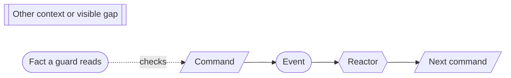

# Context conventions

Hand-authored rules that apply to every bounded-context doc in this folder. A
context doc cites them by ID instead of restating them. They came out of the
[flow audit](../flow-audit-2026-11-03.md) on 2026-11-03.

## Flow diagrams

Every flow is drawn as a Mermaid `flowchart LR` with these shapes:

- **CV-01** A solid edge from an event is a reaction. A dotted edge into a
  command is a fact that the command's guard reads from current state. Draw the
  dotted edges for every flow held together by guards, so the order the guards
  enforce is visible. A flow with no reactor still has a diagram.

## Reactors

- **CV-02** A reactor that creates a record derives the new record's ID from its
  trigger (for example, `RecordId = EngagementId`, or `UserId` from the first
  sign-in identity). Delivery is at least once, so a repeated trigger issues the
  same command, which is then a no-op.
- **CV-03** A reactor retries technical failures (timeouts, write conflicts).
  A business-rule refusal, where a guard went false between the trigger and the
  command, is final and is not retried. Processing failure is never a business
  outcome: a stuck or failing reactor is an operational alert, and the business
  record stays visibly pending.
- **CV-10** When a reaction asks another owner to accept or refuse part of an
  operation, the exact participant outcome is durable and attributable. It lives
  with that participant or a separately scoped decision, not as one accumulating
  outcome per child on a long-lived parent. Pending, accepted and refused are
  distinguishable; missing events and successful dispatch are not outcomes. A
  no-fact refusal, no-op or cancellation does not release admission until an
  exact-token target outcome or fence prevents a delayed write, including on an
  initially empty target. An already committed acceptance must be reported, not
  overwritten by a fence. Unknown results stay pending across retries/restart.

- **CV-04** A reactor decides only from its trigger event and the current state
  of the aggregate it commands. When it needs to know why a fact happened (for
  example, whether a member joined by tenant creation or by invitation), the
  trigger event carries that reason.

- **CV-09** A command that time triggers (a window begins, a review date
  arrives) comes from a scheduler, a technical process with no business state.
  It derives the command's identity from the time window ([CV-02](#reactors)), so a
  repeated tick is a no-op. Passing a deadline with nothing done is a computed
  gap, not a recorded fact.

## Guards and reviews

- **CV-05** A read of another aggregate in a guard is advice: it can be stale
  by the time the command commits. Advisory checks are allowed only for rules
  whose breach is visible and repairable, such as duplicate display names or
  overlapping dates. Each such rule names its computed detection gap and its
  repair. An aggregate never states such a rule as its own invariant.
- **CV-11** A rule whose breach cannot be undone, is a regulatory obligation, or
  is relied on in audit reports has an authoritative owner: one aggregate whose
  own stream decides it. Either the rule's facts live in that aggregate, the
  identity enforces it (an ID derived from the unique key), or the owner admits
  each change before it takes effect ([CV-10](#reactors)).
- **CV-12** When an operation depends on a specific participant's decision, use
  that participant's recorded outcome, never a successful advisory read. Keep
  the operation's participants specific to the business decision; do not expand
  them into every child. Each context lists disagreement and replay cases: an
  advisory pass followed by the owner's refusal, a repeated delivery, and a
  pending outcome.
- **CV-06** When a draft is reviewed by "someone other than the author", the
  reviewer must have authored no revision of that draft, unless an approved
  separation-of-duties waiver covers the reviewer. The approval event records the
  waiver.
- **CV-07** A step that relies on an earlier record names that record's exact ID
  and version in its command and event. It never relies on "the current one".
- **CV-08** When a recorded fact breaks a rule that another record depends on,
  the fact is still recorded. The dependent record shows a gap, and any command
  that the gap blocks says so in its guard. Recording the truth is never refused
  to keep a rule green.

## Stream growth

Portia loads an aggregate by replaying its whole stream; there are no aggregate
snapshots. A stream that grows without bound slows every command on it for the
life of the record, and a wide record (one per tenant, program or platform) puts
every user of that scope behind it.

- **CV-13** Give an aggregate one business invariant and one stable identity.
  A parent is not a roster, inbox or per-child outcome ledger. A stream per run
  or window is not automatically bounded merely because the run can finish, and
  splitting a roster into segments does not itself make its total history or
  traversal bounded. Per-item source facts and per-draft revisions belong to
  their own focused owners. A small fixed set can remain together only when the
  same atomic decision genuinely requires it and its fixed bound is stated.
- **Write decisions must not require every child.** Re-express a proposed rule
  around the individual decision and the few facts it actually needs. A
  collection-wide scan, distributed child ledger, or mandatory settlement of
  every child is not an acceptable write-model decision. Ordinary
  lists, reporting, exports and other read-side enumeration may use paged or
  streamed reads. When an existing product promise appears to require all
  children, treat its semantics and alternative local invariants as an open
  design question; do not silently weaken it or declare a source cut a solution.
- Keep event payloads and persisted business content small. Do not put an
  unbounded audience, inventory, item list, manifest, row set or per-child
  outcomes into one aggregate, fact or content object as a substitute for source
  authority. Real customer files and deliverable archives are external artifacts;
  preserve their exact bytes and provenance through streaming or independently
  verifiable pieces without making their size a parent-aggregate responsibility.
- A parent or process may hold its own small lifecycle and limited in-flight
  decision. For an explicitly qualified cross-owner operation, a participant's
  exact outcome or fence is authoritative; unknown remains pending (CV-10/11/12).
  Do not turn that rule into a requirement to collect every child's outcome.
  A source cut can identify what a read observes, but does not itself authorize a
  collection-wide write decision or prove a business invariant. Never infer
  completeness from an eventually consistent roster, a zero projected count, an
  unverified index, a hash alone or successful dispatch.
- Read source records incrementally in their proven order, with bounded working
  memory; use repeated passes where necessary. A read index can locate candidates
  but cannot prove absence or completeness unless its exact coverage is proven
  against the authoritative cut. Individual records remain independently owned.
  Source history and traversal time can still grow; record operational limits,
  retention and recovery. No framework snapshot, cross-stream atomicity,
  complete global source frontier or safe compaction is assumed without proof.
- A bounded logical state does not by itself guarantee a hard replay bound.
  Histories that grow with one record's own real business changes have focused
  blast radius. A fixed-seat, low-churn owner such as `PrimaryOrgAdmins` may
  retain the decisions needed for its own continuity invariant and retries;
  this is not a reason to split it or invent a lifetime event limit. Assess a
  history's actual churn and invariant, rather than treating all history growth
  as the same design smell. Do not invent arbitrary business limits or a new
  generic execution framework.

## Evidence

| Rule | Jev (`jev-1.14.0`, 2026-11-03) |
| --- | --- |
| CV-02 | Deriving a reaction's record ID from its trigger is a standard, sound way to avoid duplicates: 0.82. |
| CV-03 | Retry technical failures, treat a business-rule refusal as final and visible: 0.90. Never retrying anything was weaker (0.64, harm 0.63), so technical retries are kept. |
| CV-06 | The reviewer must have authored no revision: 0.79. Adopted because it is the strictest rule and the simplest to show an auditor. |
| CV-08 | Record an impairing service and show a gap rather than refuse it: 0.89. |
| CV-10 | Historical 0.90 supported recording an owner's refusal; it did not establish that all child answers belong on one coordinator. 2026-11-05 recheck: independent participants with a proven complete cut/outcomes 0.87; timeout release safe 0.07. See [request](../reviews/domain-boundaries-jev-request.json) and [response](../reviews/domain-boundaries-jev-response.json). |
| CV-05, CV-11 | Advisory uniqueness for display names, owned identifiers for audit-facing codes: 0.75. Advisory last-Org-Admin check: 0.11 (no). Commitment identifiers need an owner: 0.92. Adopted from the Portia domain guidelines review, 2026-11-03. |
| CV-13 | Historical system-description split 0.85; one-open-draft line 0.46. 2026-11-05 recheck: per-child parent history grows with children 0.94; a short-lived run automatically bounds events 0.10; complete source traversal can use bounded working memory 0.77. The last is not established by Jev: source/provider qualification is required. Product direction: no god objects or catalog-sized records/content. |
