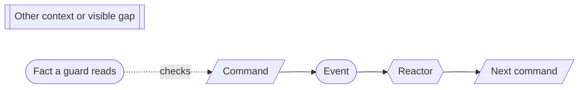

# Context conventions

Hand-authored rules that apply to every bounded-context doc in this folder. A
context doc cites them by ID instead of restating them. They came out of the
[flow audit](../flow-audit-2026-11-03.md) on 2026-11-03.

## Flow diagrams

Every flow is drawn as a Mermaid `flowchart LR` with these shapes:

- **CV-01** A solid edge from an event is a reaction. A dotted edge into a
  command is a fact that the command's guard reads from current state. Draw the
  dotted edges for every flow held together by guards, so the order the guards
  enforce is visible. A flow with no reactor still has a diagram.

## Reactors

- **CV-02** A reactor that creates a record derives the new record's ID from its
  trigger (for example, `RecordId = EngagementId`, or `UserId` from the first
  sign-in identity). Delivery is at least once, so a repeated trigger issues the
  same command, which is then a no-op.
- **CV-03** A reactor retries technical failures (timeouts, write conflicts).
  A business-rule refusal, where a guard went false between the trigger and the
  command, is final and is not retried. Processing failure is never a business
  outcome: a stuck or failing reactor is an operational alert, and the business
  record stays visibly pending.
- **CV-10** When a reaction asks an owner to accept or refuse part of a larger
  operation, the owner records its answer as a fact either way (for example
  `DispositionDecided`, listing what it authorized and refused), and the
  coordinating record records each outcome. Where the owner's command simply
  refuses, the reaction records that refusal on the coordinating record instead.
  Pending, accepted and refused are always distinguishable; a refusal is never
  only a missing event.

- **CV-04** A reactor decides only from its trigger event and the current state
  of the aggregate it commands. When it needs to know why a fact happened (for
  example, whether a member joined by tenant creation or by invitation), the
  trigger event carries that reason.

- **CV-09** A command that time triggers (a window begins, a review date
  arrives) comes from a scheduler, a technical process with no business state.
  It derives the command's identity from the time window ([CV-02](#reactors)), so a
  repeated tick is a no-op. Passing a deadline with nothing done is a computed
  gap, not a recorded fact.

## Guards and reviews

- **CV-05** A read of another aggregate in a guard is advice: it can be stale
  by the time the command commits. Advisory checks are allowed only for rules
  whose breach is visible and repairable, such as duplicate display names or
  overlapping dates. Each such rule names its computed detection gap and its
  repair. An aggregate never states such a rule as its own invariant.
- **CV-11** A rule whose breach cannot be undone, is a regulatory obligation, or
  is relied on in audit reports has an authoritative owner: one aggregate whose
  own stream decides it. Either the rule's facts live in that aggregate, the
  identity enforces it (an ID derived from the unique key), or the owner admits
  each change before it takes effect ([CV-10](#reactors)).
- **CV-12** An operation that depends on several aggregates completes only from
  recorded outcomes of its participants, never from a successful read. Each
  context with such an operation lists its disagreement and replay cases: an
  advisory pass followed by the owner's refusal, a repeated delivery, and a
  pending outcome.
- **CV-06** When a draft is reviewed by "someone other than the author", the
  reviewer must have authored no revision of that draft, unless an approved
  separation-of-duties waiver covers the reviewer. The approval event records the
  waiver.
- **CV-07** A step that relies on an earlier record names that record's exact ID
  and version in its command and event. It never relies on "the current one".
- **CV-08** When a recorded fact breaks a rule that another record depends on,
  the fact is still recorded. The dependent record shows a gap, and any command
  that the gap blocks says so in its guard. Recording the truth is never refused
  to keep a rule green.

## Stream growth

Portia loads an aggregate by replaying its whole stream; there are no aggregate
snapshots. A stream that grows without bound slows every command on it for the
life of the record, and a wide record (one per tenant, program or platform) puts
every user of that scope behind it.

- **CV-13** A stream grows only with the business occasions of the one thing it
  identifies: never per artifact, row, participant, delivery item, member churn
  or sync. Before giving a long-lived or wide record a growing list, find the
  real invariant, keep only that on the record, and move the volume into
  short-lived or per-item streams. The patterns in use:
  - **Protect a seat, not a roster.** Guard the few members the rule needs,
    on their own records ([Platform access](platform-access.md) `PrimaryOrgAdmins`).
  - **Decide a batch in one event.** One decision per disposition or delivery,
    listing its items ([Retention](retention.md) `HoldRegister`).
  - **One stream per draft.** A long-lived line keeps its versions and the
    one-open-draft rule; each draft's revisions and reviews live in a per-draft
    stream ([System description](system-description.md),
    [Firm methodology](firm-methodology.md)).
  - **One stream per run.** Per-item outcomes of one application or campaign
    live on a record for that run, not on the record that lasts for life
    ([Firm methodology](firm-methodology.md) `TemplateVersionApplication`).
  - **Content by hash.** Bulk rows are stored as files; events carry the hash
    and counts ([External access governance](external-access-governance.md)
    `AccessPopulation`).

  A record whose growth is bounded by people revising that one record, such as a
  control or a policy with its proposals, meets the rule. Every wide record
  states its expected growth.

## Evidence

| Rule | Jev (`jev-1.14.0`, 2026-11-03) |
| --- | --- |
| CV-02 | Deriving a reaction's record ID from its trigger is a standard, sound way to avoid duplicates: 0.82. |
| CV-03 | Retry technical failures, treat a business-rule refusal as final and visible: 0.90. Never retrying anything was weaker (0.64, harm 0.63), so technical retries are kept. |
| CV-06 | The reviewer must have authored no revision: 0.79. Adopted because it is the strictest rule and the simplest to show an auditor. |
| CV-08 | Record an impairing service and show a gap rather than refuse it: 0.89. |
| CV-10 | Record an owner's refusal as a fact on the coordinating record: 0.90. |
| CV-05, CV-11 | Advisory uniqueness for display names, owned identifiers for audit-facing codes: 0.75. Advisory last-Org-Admin check: 0.11 (no). Commitment identifiers need an owner: 0.92. Adopted from the Portia domain guidelines review, 2026-11-03. |
| CV-13 | Splitting a per-program system description into a version line plus per-draft streams: 0.85. Splitting a single control's drafts: 0.28 (not needed). A line that starts each draft enforces one open draft: 0.46; common sense: the start is decided in the line's own stream. Adopted from the product owner, 2026-11-03: "anytime we start creating potential for unbounded streams we need to look to minimize the blast radius and protect the real invariant". |
