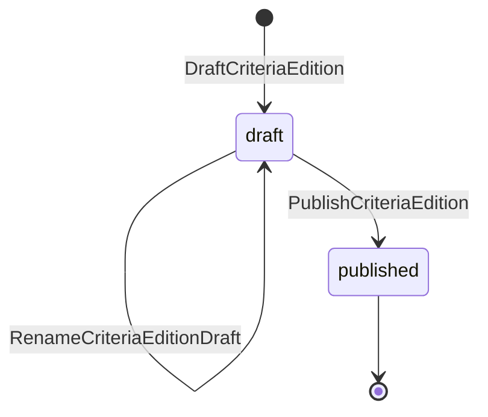
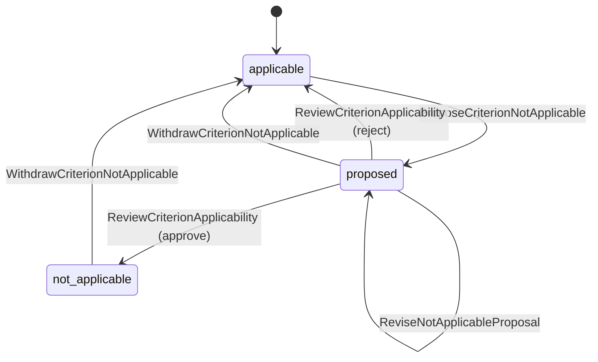
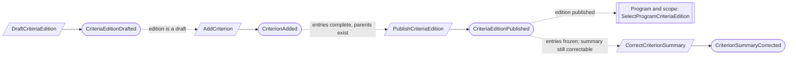
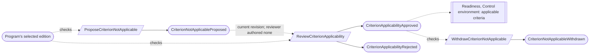
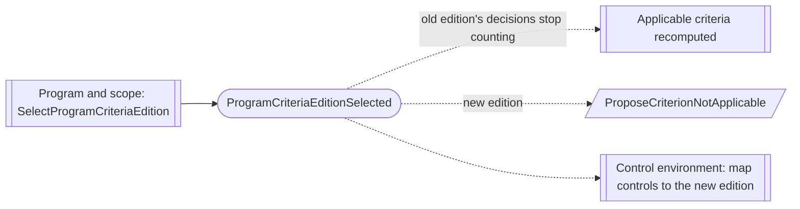
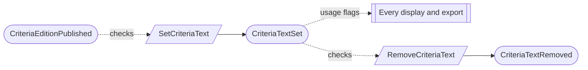

# Criteria

Status: **locked**, 2026-11-03. Hand-authored source of truth for this context.
It follows the [context conventions](conventions.md).

## Purpose

Criteria holds the Trust Services Criteria a program is examined against: the
platform's catalog editions, the licensed text a client may load under its own
license, and each program's decisions that a criterion or point of focus does not
apply (M0-D02).

**Owns:** criteria catalog editions, criteria and points of focus, criteria text
overlays, and criterion applicability decisions.

**Does not own:**

| Concern | Owner |
| --- | --- |
| Which edition and Trust Services categories a program uses | Program and scope (`Program`, `SystemBoundary`) |
| Control-to-criterion mappings | Control environment; a mapping references a criterion by edition and identifier, never by text |
| Firm templates that carry licensed text | Firm methodology |
| Whether a criterion is met | Readiness, from controls, evidence and gaps |

## Language

| Term | Meaning |
| --- | --- |
| Criteria edition | One published version of the catalog, such as `2017_tsc_2022_pof`: the 2017 Trust Services Criteria with the 2022 revised points of focus. |
| Criterion | One entry of an edition, of kind `criterion` (such as `CC6.1`) or `point_of_focus`, with a category and an original, product-written summary. |
| Point of focus | A criterion entry that belongs to exactly one parent criterion of the same edition. It is first-class and mappable. |
| Criteria text overlay | Licensed criterion text that a client loads under its own license, with supplier, license reference and usage flags. Licensed text never lives in platform content or in the repository. |
| Usage flags | The license's restrictions, such as `display` and `export`, that every reader of the overlay obeys. |
| Not applicable | A program's reviewed decision, with rationale, that one criterion or point of focus does not apply. |
| Applicable criteria | For a program, the entries of its selected edition whose category is in its current approved boundary, minus approved not-applicable decisions. This is computed, never recorded. |

## Aggregates

### CriteriaEdition

**Identity:** `EditionId`. Platform-level, outside every tenant.

**Invariant:** one edition has one framework (`tsc`), one label and one
lifecycle: draft, then published. Once published, its set of entries (their
identifiers, kinds, categories and parents) never changes; a change is a new
edition (M0-D02, CR-01).

- Publishing is refused unless the edition has at least one criterion and every
  point of focus names a parent criterion of the same edition (checked against
  current state).
- Editions sit side by side. A program keeps the edition it selected until it
  explicitly selects another.

| Command | Who | Accepts when | Emits |
| --- | --- | --- | --- |
| DraftCriteriaEdition | Operator | `EditionId` is new; label unused | CriteriaEditionDrafted |
| RenameCriteriaEditionDraft | Operator | Draft; label unused | CriteriaEditionDraftRenamed |
| PublishCriteriaEdition | Operator | Draft; entries complete | CriteriaEditionPublished |

| Event | Carries |
| --- | --- |
| CriteriaEditionDrafted | edition, framework, label, drafted by |
| CriteriaEditionDraftRenamed | edition, previous label, new label, renamed by |
| CriteriaEditionPublished | edition, entry count, published at, published by |

### Criterion

**Identity:** `EditionId` + identifier. Platform-level.

**Invariant:** one entry has one kind, one category and, for a point of focus,
one parent criterion, all fixed once its edition is published. Its summary is
original product text and can be corrected at any time (CR-02).

- Entries are added or removed only while the edition is a draft (checked against
  the edition when the command runs).
- A summary never contains licensed AICPA text (M0-D02).

| Command | Who | Accepts when | Emits |
| --- | --- | --- | --- |
| AddCriterion | Operator | Edition is a draft; identifier new in the edition; parent is a criterion of the edition (point of focus) | CriterionAdded |
| RemoveCriterion | Operator | Edition is a draft; no point of focus names it as parent | CriterionRemoved |
| CorrectCriterionSummary | Operator | Exists; summary differs | CriterionSummaryCorrected |

| Event | Carries |
| --- | --- |
| CriterionAdded | edition, identifier, kind, category, parent (point of focus), summary, added by |
| CriterionRemoved | edition, identifier, removed by |
| CriterionSummaryCorrected | edition, identifier, previous summary, new summary, corrected by |

### CriteriaTextOverlay

**Identity:** `TenantId` + `EditionId` + identifier.

**Invariant:** one tenant holds at most one licensed text for one entry of one
edition, with its supplier, license reference and usage flags. Its revisions are
kept in order. Removed text stays in history but is no longer shown or exported
(CR-04).

- The entry must exist in a published edition.
- License restrictions are expressed only as usage flags, and every display and
  export obeys them.
- Removing text does not change exports or packages already produced.

| Command | Who | Accepts when | Emits |
| --- | --- | --- | --- |
| SetCriteriaText | Compliance Lead | Entry exists in a published edition; supplier, license reference and flags given | CriteriaTextSet |
| RemoveCriteriaText | Compliance Lead | Text present; reason given | CriteriaTextRemoved |

| Event | Carries |
| --- | --- |
| CriteriaTextSet | tenant, edition, identifier, revision, text, supplier, license reference, usage flags, set by |
| CriteriaTextRemoved | tenant, edition, identifier, reason, removed by |

### CriterionApplicability

**Identity:** `TenantId` + `ProgramId` + `EditionId` + identifier.

**Invariant:** one entry of one edition is applicable to one program unless an
approved not-applicable decision says otherwise. A proposal states a rationale,
and a reviewer who authored no revision of it approves or rejects it
([CV-06](conventions.md#guards-and-reviews)). An approved decision stays until it
is withdrawn; a withdrawn one can be proposed again.

- The edition must be the program's selected edition when the proposal is made
  and approved. Decisions for another edition stop counting when the program
  changes edition and are made again for the new one (CR-05).
- Common criteria and points of focus can both be proposed not applicable (CR-03).
  When a criterion is not applicable, its points of focus are too, without their
  own decisions.
- A criterion whose category is not in the program's approved boundary is out of
  scope and needs no decision (CR-06).

| Command | Who | Accepts when | Emits |
| --- | --- | --- | --- |
| ProposeCriterionNotApplicable | Compliance Lead or Contributor | Applicable; edition is the program's; rationale given | CriterionNotApplicableProposed |
| ReviseNotApplicableProposal | Compliance Lead or Contributor | Proposed | NotApplicableProposalRevised |
| ReviewCriterionApplicability | Compliance Lead who authored no revision, or covered by a waiver | Proposed; reviews the current revision; edition is still the program's | CriterionApplicabilityApproved or CriterionApplicabilityRejected |
| WithdrawCriterionNotApplicable | Compliance Lead | Proposed or not applicable; reason given | CriterionNotApplicableWithdrawn |

| Event | Carries |
| --- | --- |
| CriterionNotApplicableProposed | tenant, program, edition, identifier, rationale, proposed by |
| NotApplicableProposalRevised | tenant, program, edition, identifier, revision, rationale, revised by |
| CriterionApplicabilityApproved | tenant, program, edition, identifier, revision, rationale, approver, waiver (if any) |
| CriterionApplicabilityRejected | tenant, program, edition, identifier, revision, comments, reviewer |
| CriterionNotApplicableWithdrawn | tenant, program, edition, identifier, reason, withdrawn by |

## Flows

This context has no reactors. Each command checks the facts it needs against
current state.

### Publishing an edition

### Deciding a criterion is not applicable

### Program changes edition

Nothing is copied from the old edition. Not-applicable decisions and control
mappings are made again for the new edition, each attributed (M0-D02).

### Loading licensed text

## Authorization contract

- Platform operators manage editions and criteria. Clients read published
  editions; no client edits platform content.
- Overlay text is shown or exported only where its usage flags allow, and only
  within the tenant that loaded it.

## Decisions

Jev answers are from `jev-1.14.0`, 2026-11-03. A yes is ≥ 0.8 and a no is ≤ 0.2.
Anything in between is settled by common sense, with the reasoning stated.

| ID | Decision | Evidence |
| --- | --- | --- |
| CR-01 | A published edition's entries (identifiers, kinds, categories, parents) are frozen; a change is a new edition. | Entries frozen once relied on: 0.87. One frozen record for the whole catalog: 0.31, so the edition and its entries are separate records. M0-D02. |
| CR-02 | Each criterion and point of focus is its own small record in an edition. Its product-written summary can be corrected after publication. | Own record: 0.86. Summary correctable: 0.84. |
| CR-03 | Common criteria and points of focus can both be decided not applicable, with rationale and review. | Common criteria: 0.78; points of focus: 0.86. Common sense: SOC 2 reports do carry not-applicable criteria, and the review and rationale make each one defensible. |
| CR-04 | Licensed text is one small overlay record per entry per edition. It can be removed when the license ends; past exports stay unchanged. | Per entry: 0.75; removable: 0.83. Common sense: suppliers license per criterion text, and the small record matches the rest of the model. |
| CR-05 | Not-applicable decisions are tied to an edition and do not carry over when the program changes edition. | 0.85. |
| CR-06 | Criteria in a category outside the approved boundary are out of scope, with no decision. | 0.80. |
| CR-07 | A not-applicable decision needs a reviewer who authored no revision (CV-06). | 0.78. Same rule as every other reviewed draft. |
| CR-08 | Platform operators draft and publish editions. | Firm methodology team instead: 0.57; restricted to a small platform-level group: 0.77. Common sense: operators are the only platform-level authority (PA-14). |

## Open questions

None at this time.

## Superseded owners

| Old owner | Becomes |
| --- | --- |
| CriteriaCatalogEdition (M0-D02 data shape) | CriteriaEdition and Criterion (CR-01, CR-02) |
| CriteriaTextOverlay | CriteriaTextOverlay (tenant-owned; template overlays move to Firm methodology) |
| CriterionApplicability | CriterionApplicability (reviewed, tied to an edition) |
| ControlCriterionMapping | Moves to Control environment |
