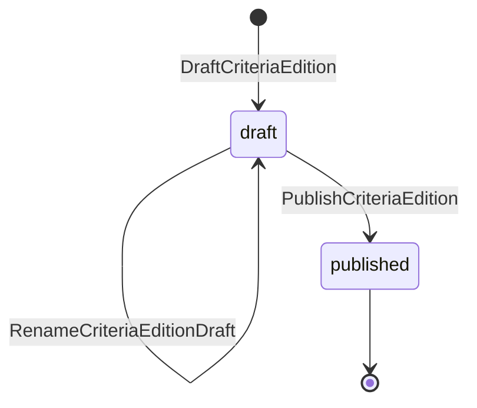
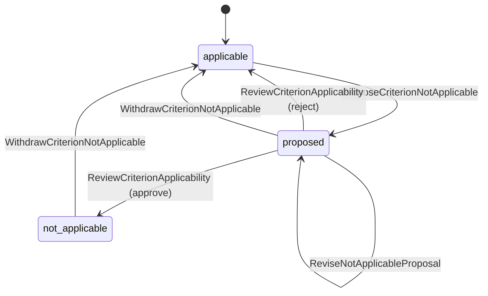

# Criteria

Status: **locked**, revised 2026-11-05 (CR-09/10). Hand-authored source of truth for this context.
It follows the [context conventions](conventions.md).

## Purpose

Criteria holds the Trust Services Criteria a program is examined against: the
platform's catalog editions, the licensed text a client may load under its own
license, and each program's decisions that a criterion or point of focus does not
apply (M0-D02).

**Owns:** criteria catalog editions, criteria and points of focus, criteria text
overlays, and criterion applicability decisions.

**Does not own:**

| Concern | Owner |
| --- | --- |
| Which edition and Trust Services categories a program uses | Program and scope (`Program`, `SystemBoundary`) |
| Control-to-criterion mappings | Control environment; a mapping references a criterion by edition and identifier, never by text |
| Firm templates that carry licensed text | Firm methodology |
| Whether a criterion is met | Readiness, from controls, evidence and gaps |

## Language

| Term | Meaning |
| --- | --- |
| Criteria edition | One published version of the catalog, such as `2017_tsc_2022_pof`: the 2017 Trust Services Criteria with the 2022 revised points of focus. |
| Criterion | One entry of an edition, of kind `criterion` (such as `CC6.1`) or `point_of_focus`, with a category and an original, product-written summary. |
| Point of focus | A criterion entry that belongs to exactly one parent criterion of the same edition. It is first-class and mappable. |
| Criteria text overlay | Licensed criterion text that a client loads under its own license, with supplier, license reference and usage flags. Licensed text never lives in platform content or in the repository. |
| Usage flags | The license's restrictions, such as `display` and `export`, that every reader of the overlay obeys. |
| Not applicable | A program's reviewed decision, with rationale, that one criterion or point of focus does not apply. |
| Applicable criteria | For a program, the entries of its selected edition whose category is in its current approved boundary, minus approved not-applicable decisions. This is computed, never recorded. |

## Aggregates

### CriteriaEdition

**Identity:** `EditionId`. Platform-level, outside every tenant.

**Invariant:** one edition has one framework (`tsc`), one label and one
lifecycle: draft, then published. Once published, its set of entries (their
identifiers, kinds, categories and parents) never changes; a change is a new
edition (M0-D02, CR-01).

- Publishing is refused unless the edition has at least one criterion and every
  point of focus names a parent criterion of the same edition (checked against
  current state).
- Editions sit side by side. A program keeps the edition it selected until it
  explicitly selects another. Publication is irreversible.
- Each criterion retains its own owner. The edition does **not** own a roster of
  its children. Structural additions, removals and parent relationships, including
  seed imports, are ordered through the bounded draft admission windows below (CR-09).
- Publication freezes admission, waits for every admitted change's recorded
  outcome, and validates an authoritative complete source cut. It pins the exact
  immutable, hash-verified manifest of accepted entry identities, kinds, categories
  and parents. The manifest is a publication proof and read source, not a new
  owner of the criterion records. No child may structurally change afterwards.
- The current seed is 61 numbered criteria and six selected points of focus, with
  partial points-of-focus coverage and unsupported Privacy lifecycle. Publication
  must retain these support disclosures in the publication fact or its immutable
  manifest and expose them in published-edition and Program reads. Coverage and
  readiness must report omitted/unsupported inputs as unknown or incomplete.
- An edition manifest must contain at most 4,096 entries and fit in 16 MiB of
  canonical serialized content. Reject oversized input explicitly, never truncate.
  This is an initial capacity limit, not proof the partial seed represents a full
  future edition. Qualify a complete intended catalog against it before publishing;
  increasing the limit needs an explicit compatible decision and storage qualification.

| Command | Who | Accepts when | Emits |
| --- | --- | --- | --- |
| DraftCriteriaEdition | Operator via label-claim process | `EditionId` is new; exact unused label reservation held | CriteriaEditionDrafted |
| RenameCriteriaEditionDraft | Operator via label-claim process | Draft; exact replacement label reservation held | CriteriaEditionDraftRenamed |
| PublishCriteriaEdition | Operator via draft process | Draft; label transition complete and confirmed; exact committed CriteriaPublicationRequested fact proves the frozen current window, operation, complete verified cut, manifest hash and current edition/label revision | CriteriaEditionPublished |

| Event | Carries |
| --- | --- |
| CriteriaEditionDrafted | edition, framework, label, exact label claim token/generation, drafted by |
| CriteriaEditionDraftRenamed | edition, previous label/claim, new label/claim, renamed by |
| CriteriaEditionPublished | edition, exact edition revision and confirmed label claim, sealed window and source cut, immutable manifest reference/hash, entry count, support disclosures, published at, published by |

### Draft admission window

**Identity:** `EditionId` + window generation. **Invariant:** at most one
structural change is admitted at a time for this edition. An admission identifies
the exact command, child, child episode/generation, intended change and actor.
Only the criterion owner decides that change; admission is not child acceptance.

- An admitted add, remove or parent-reference change gets a durable accepted or
  refused outcome. A refusal that emits no child fact is terminal only after the
  child durably fences that exact token, including on an empty target stream. The
  fence must atomically detect and report prior acceptance, never override it. An
  exact retry of an accepted token cites the original child fact. A new no-op
  without a token-specific accepted fact needs a durable token-specific no-effect
  outcome or exact target fence before release; a naked no-op response can become
  effective after later state changes. The window records the exact outcome before
  admitting another change. The user-facing operation is pending until the
  participant's outcome is recorded. An unknown append or lost acknowledgement remains pending and is
  resolved by re-reading/retrying the same operation; timeouts do not release it.
- Before cancelling or abandoning an admission, the target must durably fence the
  exact token—even when its stream is empty—so a delayed command cannot land
  after the reservation is released. A committed child outcome is never undone
  merely because its acknowledgement was lost.
- One window admits at most **128** operations, each with at most one admission
  fact and one outcome fact. Exact retries append no duplicates. At most five
  additional facts cover opening and a single terminal rollover or publication
  attempt, so one window contains at most **261 application event records**. Audit
  records count against the same budget. Before admitting a command, reserve room
  for its terminal outcome and all five possible control records; if additional
  audit records are required, admit fewer operations or roll over first. Qualify
  provider-generated record behavior before claiming a physical record bound. A
  failed seal or publication attempt is terminal for that window; a successor handles a retry.
  This application-record bound includes application audit records; provider
  framing and any additional provider-generated records remain unqualified.
- A settled window closes once and names its deterministic successor. The
  successor accepts admission only with the exact predecessor closure proof. A
  stale sender cannot append to the closed window; an old token cannot mutate a
  child under the new window. The first window is deterministically located from
  the edition ID and may open only from its exact committed draft fact and finalized
  initial label claim; a nonexistent or unaccepted edition cannot admit changes. Find the current window from that source chain; a projection may
  be a hint only and must be verified and followed to the terminal current window.
  Rollover never drops an in-flight operation or treats an uncertain result as
  refusal. The window holds one admission and a scalar active-entry count, never
  a criterion roster. Update the count only from exact accepted add/remove outcomes;
  no-op/refusal does not change it. Carry the count in the predecessor closure and
  successor proof. Refuse a new add at 4,096 after resolving exact retries; this
  bounds the active draft as well as the final manifest. Verify the count against
  the complete source fold before publication.
- For publication, freeze the current window only when no admission is pending.
  Build and verify the exact manifest from the complete authoritative chain, not
  an eventually consistent projection: traverse exact window addresses from
  genesis through the frozen window, fold accepted structural outcomes in order,
  and verify each pinned child address, event ID, stream position and payload
  binding or its durable negative fence. The manifest binds the frozen generation,
  terminal position and chain/cut identity and hash. Retain the exact window-chain
  facts and cited child facts/fences for the published edition's life, or use a
  separately qualified audit-equivalent archive. A hash proves byte identity,
  not completeness. Missing/corrupt source evidence after publication is surfaced
  as an integrity/availability failure; never silently substitute another cut. If any source is incomplete,
  unavailable or cannot be proven current, remain pending; never publish an empty
  or partial guess. Validate the cut while no structural writer can enter. A structural
  writer without current admission is refused; retire superseded bypass writers.
- Invalid content before publication dispatch closes the frozen window as refused
  and opens its successor. After dispatch, the exact publication request remains
  pending until `CriteriaEdition` durably accepts or refuses it. The edition accepts
  only that exact committed `CriteriaPublicationRequested` source event, binding
  edition ID/revision, current frozen window, token, cut, manifest hash and
  confirmed label claim. A frozen-window read plus caller-supplied manifest is
  insufficient. Reopening needs a recorded terminal refusal and a fence against
  delayed publication. An exact retry replays an accepted publication even after
  window closure and never appends another publication. If it was
  accepted, the published manifest remains authoritative and no successor accepts
  structural changes. Never infer failure from a timeout or a missing event.

| Command | Who | Accepts when | Emits |
| --- | --- | --- | --- |
| OpenCriteriaDraftWindow | Edition draft process | First window has exact committed CriteriaEditionDrafted and finalized initial label claim; otherwise exact predecessor terminal closure proves this successor | CriteriaDraftWindowOpened |
| AdmitCriterionChange | Edition draft process | Window open, no pending change, operation budget available | CriterionChangeAdmitted |
| RecordCriterionChangeOutcome | Reactor | Exact token-bound accepted fact, terminal refusal/no-effect fact, or target fence; naked refusal/no-op is insufficient | CriterionChangeOutcomeRecorded |
| CloseCriteriaDraftWindow | Edition draft process | No pending change; rollover, invalid sealed cut or terminal publication outcome is known | CriteriaDraftWindowClosed |
| FreezeCriteriaDraftWindow | Edition draft process | Window open and no pending change | CriteriaDraftWindowFrozen |
| RequestCriteriaPublication | Edition draft process | Exact frozen source cut verified, durable content and validation pass | CriteriaPublicationRequested |
| RecordCriteriaPublicationOutcome | Reactor | Exact edition publication accepted or durably refused/fenced | CriteriaPublicationOutcomeRecorded |

| Event | Carries |
| --- | --- |
| CriteriaDraftWindowOpened | edition, generation, exact predecessor closure proof, initial active-entry count |
| CriterionChangeAdmitted | edition, window generation, operation token, exact child stream/episode and revision, immutable verified intent reference/digest, actor and exact admission/source-cut proof |
| CriterionChangeOutcomeRecorded | edition, window generation, operation token, accepted/refused/fenced outcome and exact child evidence |
| CriteriaDraftWindowClosed | edition, generation, terminal reason, active-entry count and deterministic successor, if any |
| CriteriaDraftWindowFrozen | edition, generation, exact settled admission boundary, deterministic publication operation and cut identity |
| CriteriaPublicationRequested | edition, frozen window, publication operation, exact source cut, immutable manifest reference/hash, count and disclosures |
| CriteriaPublicationOutcomeRecorded | edition, frozen window, publication operation, accepted/refused/fenced outcome and exact source evidence |

Every serialized application event or audit record in the window is at most
8 KiB; oversized identifiers, actor references, intent and diagnostics use bounded
references or are refused before admission. Bulk content is never in these facts.
The 261-record cap includes separately emitted application audit records, not just
business facts. Provider framing/metadata bytes and any provider-generated records
must be measured and qualified separately; do not claim a physical byte bound from
this application payload limit alone. With no additional audit records, the
serialized application payload bound is 261 × 8 KiB.

The opening fact is one of the five control facts. A
window has at most one freeze, one publication request, one publication outcome,
and one close; its admitted operations have at most one admission and one
terminal outcome each. Fixed control slots cannot be spent by retries, alerts or transient failures.
Additional application audit records count toward the same 261-record budget and
reduce the number of admissions; never consume space reserved for an in-flight
outcome or terminal control facts. Thus a window with no separate audit records
admits at most 256 operation facts plus five control facts. A child fence belongs to the child stream and is not a
window fact; it is cited by that operation's one recorded outcome. A seal without a publication request can close with fewer.

**Scope of bounds:** this bounds each admission-window stream and active state,
not the total number of windows, chain traversal, storage, or every aggregate's
lifetime history. `CriteriaEdition` lifecycle/rename history and each `Criterion`
summary/structural history grow with that record's own business changes. Program
history likewise grows with program changes. Portia has no aggregate snapshots;
no hard lifetime bound or generic stream compaction is claimed. Operational
visibility of long histories is required. A future hard lifetime limit or archival
protocol needs a separately qualified product and framework decision (CV-13).

### Edition label claim

**Identity:** normalized edition label. **Invariant:** at most one edition holds
or reserves that code. Labels are structured edition codes, not merely display
names. Normalization is deterministic, versioned and platform-wide; blank or
invalid codes are refused, and existing claims are never silently renormalized. Draft creation and draft rename require a claim; a concurrent claimant is
refused. The edition keeps its old label until the replacement claim and edition
rename are durably complete. A new reservation is released only after an exact
durable token-specific target refusal that fences replay, or a target fence proving
that operation never accepted. A naked refusal response is not proof: a delayed
retry might become valid later.
The fence atomically detects and reports prior acceptance, including on an empty
edition stream; it cannot override acceptance. Unknown outcomes stay pending. The
old claim is released only after the exact committed rename proves the switch away
from its old token/generation. Release is idempotent and checks the full current
holder, operation and generation; an old release cannot clear a later reservation. Published edition codes remain fixed.

| Command | Who | Accepts when | Emits |
| --- | --- | --- | --- |
| ReserveEditionLabel | Edition creation/rename process | No current holder or reservation | EditionLabelReserved |
| RecordEditionLabelClaimOutcome | Reactor | Exact token-specific accepted fact, token-specific terminal refusal, or durable target fence | EditionLabelClaimOutcomeRecorded |
| ReleaseEditionLabel | Edition creation/rename process | Exact reservation is refused/fenced, or a replacement claim and rename are durably complete | EditionLabelReleased |

| Event | Carries |
| --- | --- |
| EditionLabelReserved | normalized label, edition, operation token and actor |
| EditionLabelClaimOutcomeRecorded | normalized label, edition, token, accepted/refused/fenced outcome and source evidence |
| EditionLabelReleased | normalized label, edition, token, release reason and source evidence |

The exact order is: reserve the new code; the edition commits creation or rename
referencing that exact still-held reservation; record the accepted target outcome
and confirm the new claim; then release the old claim using the exact committed
rename as proof. Confirmation cannot precede the target acceptance it proves.
During an accepted rename awaiting confirmation, the new label is the source
value, both claims remain held, and reads/final success must expose pending or
wait; publication waits for the completed claim. On refusal the old label remains.

Creation accepts only its exact reserved holder/token. Publication and rename
order on the edition owner: if publication wins, rename refuses and its new
reservation remains until durable refusal/fence; if rename wins, publication uses
the committed label and confirmed claim. The publication request binds the edition
revision, exact frozen window, immutable manifest and confirmed label-claim
token/generation; a stale request records a terminal refusal/fence before any
reopening. A lost acknowledgement leaves the exact operation pending. A late
acceptance after a timeout is reconciled, not compensated by releasing its claim.
An exact retry of a released reservation returns its original terminal status and
never reacquires the label; a new reservation needs a new operation identity.

Label normalization v1 trims ASCII spaces at either end, lowercases ASCII A–Z,
then accepts only 1–128 ASCII bytes matching `[a-z0-9]+(?:_[a-z0-9]+)*`.
Other whitespace, non-ASCII and invalid codes are refused. This is a new 2026-11-05
constraint; the existing `2017_tsc_2022_pof` seed is valid and retains its fixed
edition ID. A later normalization change needs an explicit collision audit and
migration; existing claims are never silently re-keyed.

The claim is per code, not a global label roster. Reuse can grow one code's
history across editions, so it is **not** claimed hard-bounded. A bounded claim
rollover requires the same closed-generation and exact-owner fencing proof before
it can be implemented; never silently recycle a code or add an unqualified
compaction mechanism. The existing seed's fixed edition ID remains unchanged.

### Criterion

**Identity:** `EditionId` + identifier. Platform-level.

**Invariant:** one entry has one kind, one category and, for a point of focus,
one parent criterion, all fixed once its edition is published. Its summary is
original product text and can be corrected at any time (CR-02).

- Entries are added or removed only by the exact current draft-window admission.
  A child refuses an unadmitted, stale, cancelled or fenced token. The window
  serializes parent removal and point-of-focus admission. The window authorizes
  removal or parent admission from its complete settled source-chain fold while
  holding the exclusive admission, and sends the exact cut/proof to the child;
  the child decides its own lifecycle. A parent cannot be removed while an
  accepted point of focus refers to it. No projection, partial child scan or plain
  edition read can establish that proof. An old accepted token retried after
  remove/re-add replays its original outcome and never reapplies.
- Initial summaries come from the individual criterion facts. A published entry's
  summary can be corrected on that same entry owner without changing the frozen
  structural manifest. A draft summary correction and removal order on the same
  criterion stream; an OCC loser reloads and rechecks entry existence. Summary
  corrections do not admit structural changes. Audit consumers that freeze exact
  summary text retain its exact criterion fact/revision, not just the manifest.
- A summary never contains licensed AICPA text (M0-D02).

| Command | Who | Accepts when | Emits |
| --- | --- | --- | --- |
| AddCriterion | Operator via draft process | Exact current admission; identifier new; point-of-focus parent is a criterion of the same edition and category | CriterionAdded |
| RemoveCriterion | Operator via draft process | Exact current admission; no point of focus names it as parent | CriterionRemoved |
| CorrectCriterionSummary | Operator | Exists; summary differs | CriterionSummaryCorrected |
| FenceCriterionChange | Draft process | Exact cancelled, no-fact-refused or unrecorded-no-op token has not already been accepted; target identity may be empty | CriterionChangeFenced |

| Event | Carries |
| --- | --- |
| CriterionAdded | edition, identifier, kind, category, parent (point of focus), summary, admission token/window, added by |
| CriterionRemoved | edition, identifier, admission token/window, removed by |
| CriterionSummaryCorrected | edition, identifier, previous summary, new summary, corrected by |
| CriterionChangeFenced | edition, identifier, window generation and exact cancelled admission token |

### CriteriaTextOverlay

**Identity:** `TenantId` + `EditionId` + identifier.

**Invariant:** one tenant holds at most one licensed text for one entry of one
edition, with its supplier, license reference and usage flags. Its revisions are
kept in order. Removed text stays in history but is no longer shown or exported
(CR-04).

- The entry must exist in a published edition.
- License restrictions are expressed only as usage flags, and every display and
  export obeys them.
- Removing text does not change exports or packages already produced.

| Command | Who | Accepts when | Emits |
| --- | --- | --- | --- |
| SetCriteriaText | Compliance Lead | Entry exists in a published edition; supplier, license reference and flags given | CriteriaTextSet |
| RemoveCriteriaText | Compliance Lead | Text present; reason given | CriteriaTextRemoved |

| Event | Carries |
| --- | --- |
| CriteriaTextSet | tenant, edition, identifier, revision, text, supplier, license reference, usage flags, set by |
| CriteriaTextRemoved | tenant, edition, identifier, reason, removed by |

### CriterionApplicability

**Identity:** `TenantId` + `ProgramId` + `EditionId` + identifier.

**Invariant:** one entry of one edition is applicable to one program unless an
approved not-applicable decision says otherwise. A proposal states a rationale,
and a reviewer who authored no revision of it approves or rejects it
([CV-06](conventions.md#guards-and-reviews)). An approved decision stays until it
is withdrawn; a withdrawn one can be proposed again.

- The edition must be the program's selected edition when the proposal is made
  and approved. Decisions for another edition stop counting when the program
  changes edition and are made again for the new one (CR-05).
- Common criteria and points of focus can both be proposed not applicable (CR-03).
  When a criterion is not applicable, its points of focus are too, without their
  own decisions.
- A criterion whose category is not in the program's approved boundary is out of
  scope and needs no decision (CR-06).

| Command | Who | Accepts when | Emits |
| --- | --- | --- | --- |
| ProposeCriterionNotApplicable | Compliance Lead or Contributor | Applicable; edition is the program's; rationale given | CriterionNotApplicableProposed |
| ReviseNotApplicableProposal | Compliance Lead or Contributor | Proposed | NotApplicableProposalRevised |
| ReviewCriterionApplicability | Compliance Lead who authored no revision, or covered by a waiver | Proposed; reviews the current revision; edition is still the program's | CriterionApplicabilityApproved or CriterionApplicabilityRejected |
| WithdrawCriterionNotApplicable | Compliance Lead | Proposed or not applicable; reason given | CriterionNotApplicableWithdrawn |

| Event | Carries |
| --- | --- |
| CriterionNotApplicableProposed | tenant, program, edition, identifier, rationale, proposed by |
| NotApplicableProposalRevised | tenant, program, edition, identifier, revision, rationale, revised by |
| CriterionApplicabilityApproved | tenant, program, edition, identifier, revision, rationale, approver, waiver (if any) |
| CriterionApplicabilityRejected | tenant, program, edition, identifier, revision, comments, reviewer |
| CriterionNotApplicableWithdrawn | tenant, program, edition, identifier, reason, withdrawn by |

## Flows

Structural admissions, label claims and publication use explicit participant
outcomes and retryable reactions (CV-10/12). A successful dispatch, projection or
cross-owner read alone is not completion. The exact command identities derive
from their committed source facts (CV-02).

### Publishing an edition

```mermaid
flowchart LR
    C1[/DraftCriteriaEdition/] --> E1([CriteriaEditionDrafted])
    E1 -. "exact draft source" .-> C0[/OpenCriteriaDraftWindow/]
    EC([EditionLabelClaimOutcomeRecorded]) -. "initial claim confirmed" .-> C0
    C0 --> EW([CriteriaDraftWindowOpened])
    EW -. "window open" .-> C2[/AdmitCriterionChange/]
    C2 --> E2([CriterionChangeAdmitted]) --> R1{{Ask criterion owner}}
    R1 --> C3[/AddCriterion or RemoveCriterion/] --> E3([CriterionAdded or CriterionRemoved])
    E3 --> R2{{Record exact outcome}} --> C4[/RecordCriterionChangeOutcome/]
    C4 --> E4([CriterionChangeOutcomeRecorded])
    E4 -. "no pending changes; verified source cut" .-> C5[/PublishCriteriaEdition/]
    C5 --> E5([CriteriaEditionPublished])
    E5 -. "edition published" .-> X1[[Program creation or edition selection]]
    E5 -. "structure frozen; summary remains correctable" .-> C6[/CorrectCriterionSummary/]
    C6 --> E6([CriterionSummaryCorrected])
```

A refused child is recorded as an outcome even when it emits no criterion fact;
transport failure is pending. Rollover and cancellation follow the exact-token
fencing rules above. The manifest proves the accepted cut, and never substitutes
for admitted child outcomes.

### Deciding a criterion is not applicable

### Program changes edition

Nothing is copied from the old edition. Not-applicable decisions and control
mappings are made again for the new edition, each attributed (M0-D02).

### Loading licensed text

## Authorization contract

- Platform operators manage editions and criteria. Clients read published
  editions; no client edits platform content.
- Overlay text is shown or exported only where its usage flags allow, and only
  within the tenant that loaded it.

## Decisions

Jev answers are from `jev-1.14.0`, 2026-11-03. A yes is ≥ 0.8 and a no is ≤ 0.2.
Anything in between is settled by common sense, with the reasoning stated.

| ID | Decision | Evidence |
| --- | --- | --- |
| CR-01 | A published edition's entry identities, kinds, categories and parents are frozen; a structural change is a new edition. | Original entry freeze: 0.87. CR-09 adds admitted participant outcomes and a verified manifest; this does not move child ownership into the edition. |
| CR-02 | Each criterion and point of focus is its own small owner in an edition. Its product-written summary can be corrected after publication. | Original own record: 0.86; summary correctable: 0.84. 2026-11-05 independent-owner question: 0.90; independent published-summary question: 0.91. |
| CR-03 | Common criteria and points of focus can both be decided not applicable, with rationale and review. | Common criteria: 0.78; points of focus: 0.86. Common sense: SOC 2 reports do carry not-applicable criteria, and the review and rationale make each one defensible. |
| CR-04 | Licensed text is one small overlay record per entry per edition. It can be removed when the license ends; past exports stay unchanged. | Per entry: 0.75; removable: 0.83. Common sense: suppliers license per criterion text, and the small record matches the rest of the model. |
| CR-05 | Not-applicable decisions are tied to an edition and do not carry over when the program changes edition. | 0.85. |
| CR-06 | Criteria in a category outside the approved boundary are out of scope, with no decision. | 0.80. |
| CR-07 | A not-applicable decision needs a reviewer who authored no revision (CV-06). | 0.78. Same rule as every other reviewed draft. |
| CR-08 | Platform operators draft and publish editions. | Firm methodology team instead: 0.57; restricted to a small platform-level group: 0.77. Common sense: operators are the only platform-level authority (PA-14). |
| CR-09 | Separate criterion owners; serialized admitted changes, participant outcomes and fences; a sealed source-cut manifest proves publication. Draft windows contain at most 128 operations and 261 application event records each, including audit records. | Product direction 2026-11-05: aggregates need not own their children. Jev: independent owners 0.90; empty-target fence 0.83; bounded-window question 0.84. Concrete race follow-up: late child 0.72, empty-target race 0.33, must wait 0.80, arithmetic-bound question 0.19. The lower and conflicting results are not clearance; the explicit race trace establishes the safety rule, subject to executable qualification. The follow-up asked about four fixed facts (260); the final design counts five fixed facts, so its conditional maximum is 128 × 2 + 5 = 261, established by arithmetic, not Jev. Final recheck: independent criterion owners 0.82; possible late no-op 0.65; record limit 0.29; a per-window cap bounds all history 0.04. The low record-limit score is retained as a disagreement, not a reason to disregard the explicit budget or claim runtime proof. |
| CR-10 | Keep unique structured edition labels through per-code authoritative claims; preserve the existing seed ID and current draft rename/reuse semantics. | Jev claim owner: 0.86. Final recheck on duplicate claim after a lost acknowledgement: 0.17; the safe policy nevertheless keeps the reservation pending until target acceptance is reconciled or rejection is durably fenced. The score is not clearance. A concrete recheck gave 0.92 that accepted edition A and edition B's later reservation can coexist after premature release, and 0.08 that confirmation can precede target acceptance. Reuse makes claim history unbounded; bounded rollover is not claimed until its closure/fencing protocol is implemented and tested. |

## Open questions

No business-model choice remains open for CR-09/10. Implementation must prove a
complete authoritative source cut, content durability, participant fencing and
bounded window arithmetic with real framework semantics before claiming delivery.
The exact implementation of per-code claim rollover and a hard lifetime bound for
ordinary per-record history are not specified or claimed by this decision.

## Superseded owners

| Old owner | Becomes |
| --- | --- |
| CriteriaCatalogEdition (M0-D02 data shape) | CriteriaEdition and Criterion (CR-01, CR-02) |
| CriteriaTextOverlay | CriteriaTextOverlay (tenant-owned; template overlays move to Firm methodology) |
| CriterionApplicability | CriterionApplicability (reviewed, tied to an edition) |
| ControlCriterionMapping | Moves to Control environment |
