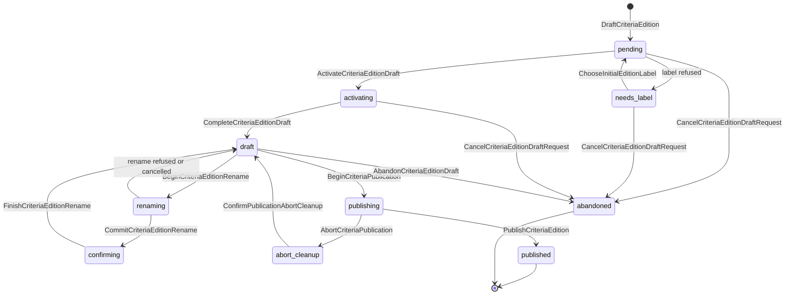
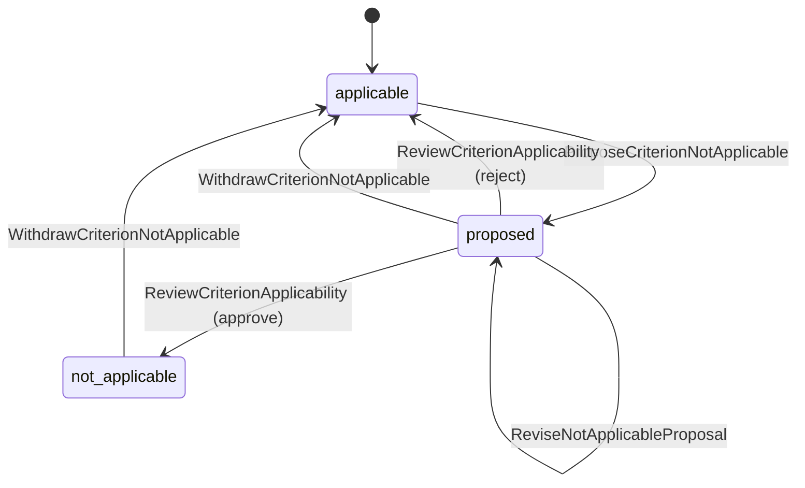
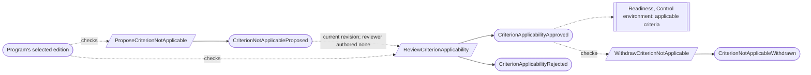
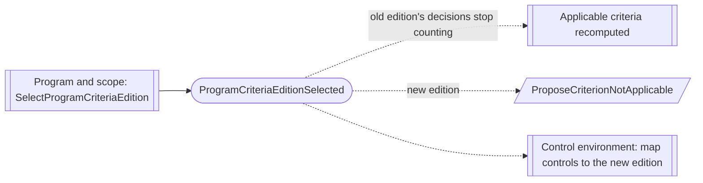
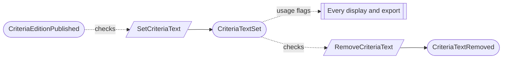

# Criteria

Status: **product behavior selected; publication and authorization authority require qualification**, revised 2026-11-05. Hand-authored source of truth for this context.
It follows the [context conventions](conventions.md).

## Purpose

Criteria holds the Trust Services Criteria a program is examined against: the
platform's catalog editions, the licensed text a client may load under its own
license, and each program's decisions that a criterion or point of focus does not
apply (M0-D02).

**Owns:** criteria catalog editions, criteria and points of focus, criteria text
overlays, and criterion applicability decisions.

**Does not own:**

| Concern | Owner |
| --- | --- |
| Which edition and Trust Services categories a program uses | Program and scope (`Program`, `SystemBoundary`) |
| Control-to-criterion mappings | Control environment; a mapping references a criterion by edition and identifier, never by text |
| Firm templates that carry licensed text | Firm methodology |
| Whether a criterion is met | Readiness, from controls, evidence and gaps |

## Language

| Term | Meaning |
| --- | --- |
| Criteria edition | One published version of the catalog, such as `2017_tsc_2022_pof`: the 2017 Trust Services Criteria with the 2022 revised points of focus. |
| Criterion | One entry of an edition, of kind `criterion` (such as `CC6.1`) or `point_of_focus`, with a category and an original, product-written summary. |
| Point of focus | A criterion entry that belongs to exactly one parent criterion of the same edition. It is first-class and mappable. |
| Criteria text overlay | Licensed criterion text that a client loads under its own license, with supplier, license reference and usage flags. Licensed text never lives in platform content or in the repository. |
| Usage flags | The license's restrictions, such as `display` and `export`, that every reader of the overlay obeys. |
| Not applicable | A program's reviewed decision, with rationale, that one criterion or point of focus does not apply. |
| Applicable criteria | For a program, the entries of its selected edition whose category is in its current approved boundary, minus approved not-applicable decisions. This is computed, never recorded. |

## Aggregates

### CriteriaEdition

**Identity:** `EditionId`. Platform-level, outside every tenant.

**Invariant:** one edition has one framework (`tsc`), one current label and one
lifecycle: pending creation, draft, then published or abandoned. An active draft
or published edition has a confirmed current label; both old and new claims may
be held temporarily during a rename. Once
published, its effective entries and their identities, kinds, categories and
parents never change; a structural change requires a new edition (M0-D02, CR-01).

- Publication requires at least one accepted criterion. Every effective published
  point of focus references an accepted same-edition, same-category parent at the
  same cut. A draft point whose parent was removed remains recorded but is
  ineffective. No write decision may require reading all children.
- Editions sit side by side. A program keeps the edition it selected until it
  explicitly selects another. Publication is irreversible.
- Each criterion retains its own owner. The edition does **not** own a roster of
  its children. Structural changes and parent relationships, including seed
  imports, require the authoritative publication protocol (CR-09).
- Publication must establish a stable source boundary and require one exact
  accepted criterion as its nonempty witness. Valid parent references follow
  from the point's exact parent incarnation at the same cut; no publication
  decision scans all children. Source ordering and its implementation remain
  qualification gates. No edition-wide manifest, catalog-sized record or child
  roster is needed.
- The current seed is 61 numbered criteria and six selected points of focus, with
  partial points-of-focus coverage and unsupported Privacy lifecycle. Retain and
  expose these disclosures as separately scoped small source facts, rather than
  embedding a growing list in the edition. An absent disclosure is unknown; neither
  publication nor an absent entry proves completeness. Coverage and readiness
  report omitted or unsupported inputs as unknown or incomplete.
- There is no product limit of 4,096 criteria and no 16 MiB edition object. Every
  criterion, admission, outcome and publication fact remains individually small.
  No one record or content object contains the complete edition.

| Command | Who | Accepts when | Emits |
| --- | --- | --- | --- |
| DraftCriteriaEdition | Platform operator | No draft exists; exact client operation, normalized intent and authorized execution generation; prior unknown attempt is settled or fenced | CriteriaEditionDraftRequested |
| FenceCriteriaEditionOperationAttempt | Criteria recovery | Original expected position; no accepted winner; bind the authorized recovering intent without inventing lost prior intent | CriteriaEditionOperationAttemptFenced |
| ChooseInitialEditionLabel | Platform operator | Initial label attempt durably refused or fenced; new operation ID | CriteriaInitialLabelRequested |
| RecordInitialEditionLabelRefusal | Edition label process | Exact initial attempt was durably refused or fenced | CriteriaInitialLabelRefused |
| ActivateCriteriaEditionDraft | Edition label process | Exact pending initial intent and reserved claim still held | CriteriaEditionDraftActivated |
| CompleteCriteriaEditionDraft | Edition label process | Exact activation and initial claim confirmation are committed | CriteriaEditionDrafted |
| CancelCriteriaEditionDraftRequest | Platform operator | Initial request is pending, needs a label or is activating; exact completion has not won | CriteriaEditionDraftRequestCancelled |
| BeginCriteriaEditionRename | Platform operator | Active draft; no unresolved label transition or publication attempt | CriteriaEditionRenameRequested |
| CommitCriteriaEditionRename | Edition label process | Exact pending rename and new reservation held; no terminal fence | CriteriaEditionDraftRenamed |
| FinishCriteriaEditionRename | Edition label process | Exact edition change and new claim confirmation are committed | CriteriaEditionRenameCompleted |
| RefuseCriteriaEditionRename | Edition label process | Exact pending rename definitively refused or fenced | CriteriaEditionRenameRefused |
| CancelCriteriaEditionRename | Platform operator | Exact rename pending and edition change not committed | CriteriaEditionRenameCancelled |
| BeginCriteriaPublication | Platform operator | Active draft; confirmed label; no competing terminal attempt; exact operation and witness identifier/incarnation | CriteriaPublicationStarted |
| AbortCriteriaPublication | Publication process | Exact live attempt; edition expected revision wins against publication | CriteriaPublicationAborted |
| ConfirmPublicationAbortCleanup | Publication process | Exact witness owner has durably fenced the aborted attempt, including an absent pin | CriteriaPublicationAbortCleanupCompleted |
| PublishCriteriaEdition | Publication process | Exact live attempt, confirmed label and one source-verified pinned criterion witness | CriteriaEditionPublished |
| AbandonCriteriaEditionDraft | Platform operator | Draft; no unresolved label transition or publication attempt; exact terminal fence | CriteriaEditionDraftAbandoned |

| Event | Carries |
| --- | --- |
| CriteriaEditionDraftRequested | edition, framework, normalized requested label, operation identity, admitted actor and grant evidence |
| CriteriaEditionOperationAttemptFenced | edition, authorized recovering-operation and intent binding, execution generation, original expected position and recovery evidence; a fence alone does not create a draft or assert an unknown prior intent |
| CriteriaInitialLabelRequested | edition, normalized replacement label, new operation identity, previous terminal attempt evidence, actor and grant admission evidence |
| CriteriaInitialLabelRefused | edition, exact initial operation, reason and definitive claim/refusal or fence evidence |
| CriteriaEditionDraftActivated | edition, framework, exact initial operation, reserved label and claim generation |
| CriteriaEditionDrafted | edition, framework, label, exact label claim token/generation, drafted by |
| CriteriaEditionDraftRequestCancelled | edition, exact initial operation, cancellation operation identity, actor, grant admission evidence and terminal fence |
| CriteriaEditionRenameRequested | edition, operation identity, old and proposed normalized labels and claim generations, actor and grant admission evidence |
| CriteriaEditionDraftRenamed | edition, exact rename operation, previous label/claim generation, new label/claim generation, renamed by |
| CriteriaEditionRenameCompleted | edition, exact rename operation, committed change and new claim confirmation |
| CriteriaEditionRenameRefused | edition, exact rename operation, reason and definitive refusal or fence evidence |
| CriteriaEditionRenameCancelled | edition, exact rename operation, cancellation operation identity, actor, grant admission evidence and terminal fence |
| CriteriaPublicationStarted | edition, draft generation, expected edition revision, exact attempt ID and monotonic attempt ordinal, witness identifier and incarnation, confirmed label generation, actor and admitted authority evidence |
| CriteriaPublicationAborted | edition, draft generation, exact attempt, reason and terminal edition decision |
| CriteriaPublicationAbortCleanupCompleted | edition, exact attempt, witness identifier/incarnation and durable target-fence evidence |
| CriteriaEditionDraftAbandoned | edition, draft generation, operation identity, terminal boundary proof, actor and grant admission evidence |
| CriteriaEditionPublished | edition, draft generation, exact edition revision, confirmed label claim, exact attempt and pinned nonempty witness, published at, published by; source-order cursor is discovered after commit, not guessed inside the event |

#### Draft correction and publication (CR-09)

The selected product behavior uses one entry owner per `(EditionId, identifier)`,
shared by both kinds and every incarnation. A criterion operation identity is
`(EditionId, identifier, operationId)`; a publication attempt identity is
`(EditionId, attemptId)`. The same raw operation ID on another entry is a
different operation, not a reason to introduce a global deduplication owner.
The edition assigns each publication attempt a monotonic ordinal so participant
fences can reject delayed older attempts. Draft structural revisions create
immutable incarnations. A point-of-focus incarnation names one exact parent
criterion incarnation in the same edition and category. Removing a parent
changes that parent only: the points of focus bound to the removed incarnation
become ineffective, without fan-out or a child scan. Re-adding the identifier
creates a new incarnation and does not silently reactivate old references. The
operator can repair each affected point individually in the same draft; the UI
explains the consequence and offers paged discovery. An ineffective point is
retained for history but is not included or mappable in the published edition.
A point's own accepted draft edit does not promise that its parent remains
included at publication.

Publication names one exact accepted criterion incarnation as its nonempty
witness. A publication attempt and its witness pin carry one exact operation
identity and generation. The witness owner orders pin against removal or
replacement on its own stream. If removal wins, the pin is refused; if the pin
wins, that incarnation cannot be removed while publication or a fenced abort is
unresolved. The edition orders publication and abort on its stream. A lost reply
or unknown commit is pending, never permission to release a pin or choose another
witness. The exact edition abort commits first, competing with `Published` at the
expected edition revision. It enters **abort cleanup pending**: the witness owner
then records a real token-specific fence whether the pin exists or not. Both the
abort fact and any later pin acceptance trigger idempotent reconciliation. The
edition records the exact target-fence outcome before admitting another
publication attempt or abandonment; unrelated draft edits may proceed where their
own owners allow them. A stale publisher never retries the aborted attempt at a
newer edition revision. After successful publication the
witness remains protected for that published generation; a delayed duplicate
must not reacquire a new pin or make a stale post-publication removal succeed.

The single committed `CriteriaEditionPublished` fact is the edition's structural
cut `C`. Its position in the shared source is discovered after commit, not
encoded as its own future cursor. Publication decides the edition and one
witness; it does not wait for every other entry, a complete catalog projection,
or a shared checkpoint through all child edits. Per-entry intents ordered before
`C` are resolved according to their own deterministic authority and intent;
those after `C` cannot become accepted members of that edition. An accepted
pre-cut intent may settle after publication. It must not be presented as accepted,
absent, or refused until its individual outcome and exact cut membership are
established. Exact retries return their original result; changed-intent reuse
conflicts. Competing edits for the same identifier have one owner and one
in-flight operation, with expected-position conflict and explicit recovery.

Read-side materialization evaluates each point and its exact parent incarnation
at the same `C`, including when the parent later changes. It reconciles later
outcomes for all pre-cut intents and reports coverage incomplete until both
source discovery and those outcomes are accounted for. Source-offset coverage
alone is not that proof. Catalog pages and cursors bind the exact edition cut;
indexed keyset pagination and streamed exports must not first load or sort the
whole catalog in application memory. A missing or lagging projection cannot
prove a particular entry absent or authorize an entry-dependent write.

The read index consumes the edition's single Fitz area through a durable Stream
pattern reader. It records individual source facts and an internal ordered
position, stores Portia's opaque resume cursor unchanged, and atomically commits
indexed updates with the checkpoint or uses an equivalent crash-safe protocol.
It maps the exact published event to its internal cut position. A pre-cut intent
whose accepted or refused outcome arrives after the cut remains pending until
resolved; an accepted revision takes effect at its intent's position, while a
refusal leaves the prior incarnation in effect. Parent removal follows the same
rule. Each page is bound to the exact cut and index generation and either includes
pending identities in a stable key order or uses a qualified immutable snapshot.
Rebuilds remap the marker by event identity and invalidate unavailable generation
cursors. Source retention, ordered routing, atomic checkpoint and stable-page
behavior must be proved on the configured provider; a projection name, a caught-up
checkpoint, or a hash is not proof of authority. Before issuing a stable
paginated cursor, prove discovery of every relevant source identity through `C`,
or bind the cursor to an immutable materialization and invalidate it if its key
set changes. Merely including already-known pending identities is insufficient:
an undiscovered pre-cut identity can otherwise appear behind an issued cursor.
Ordering must use a stable identity, and each page walk binds a consistent
materialization generation. Category and other filters are evaluated at that
generation; an unresolved change that could match a filter is exposed as pending,
not silently excluded. Settled changes appear in a later refreshed generation.
This read-side gate does not delay publication.

These product choices replace the earlier proposed rule refusing parent removal
while referenced and permit publication before unrelated outcomes settle. The
[publication protocol](../reviews/criteria-publication-protocol-design.md),
[draft lifecycle review](../reviews/criteria-draft-lifecycle-design.md), and
[program-creation design](../reviews/program-creation-criteria-design.md) specify
races and acceptance cases. Single-stream compare-and-append and ordered Stream
pattern reads are real source primitives; they do not themselves prove the
required source routing, per-entry decision order, exact as-of lookup, actor
authority, durable fences, recovery, or index coverage. These remain technical
qualification gates, not product choices delegated to a timeout or projection.

### Edition label claim

**Identity:** one normalized edition label. **Invariant:** at most one edition
holds or reserves that label. This is a low-churn owner of its own claim, not an
edition roster. Label normalization v1 trims outer ASCII spaces, lowercases
ASCII letters and accepts 1–128 ASCII bytes matching
`[a-z0-9]+(?:_[a-z0-9]+)*`; invalid labels are refused. Existing claims are
never silently renormalized. Published labels are immutable.

The client supplies `EditionId` and an operation ID; operation identity is
`(EditionId, operation ID)`. The edition first durably records draft intent,
then an individual label owner reserves and confirms the exact edition,
operation and claim generation. Draft creation remains pending until activation
and claim confirmation are both durable. If the initial label is unavailable,
the edition remains `needs_label`; the operator can choose another label under a
new operation ID after the first attempt is definitively refused or fenced. The
original create retry retains its original result, and changed intent conflicts.
No structural edits or publication are admitted until the initial label is held.

A draft may have one rename in flight. Reserve the destination before changing
the edition's label, confirm the new claim against the committed change, then
release the exact old generation. Until confirmation, status is pending and
publication cannot start. Cancellation competes with the edition change on the
edition stream; a committed acceptance wins. If a delayed reservation arrives
after cancellation or refusal, reconciliation triggered by the reservation
itself verifies the exact terminal target fact and releases only that generation.
An initial claim confirmation arriving after cancellation also triggers this
reconciliation; a delayed completion must lose to the edition's committed
cancellation and cannot activate the cancelled draft.
If an old label is being released when the same edition requests it again, report
cleanup pending and finish the old release before acquiring a new generation.
No timeout, empty append or missing callback proves a target refusal or fence.

Publication, abandonment and rename serialize on the edition's own state. A
pending publication attempt is not a successful publication and holds a label
transition until its exact terminal outcome; a refused attempt leaves the draft
open. Exact retries return their original outcome, while changed intent under the
same operation identity conflicts. A published label is never released. A
completed abandonment releases the exact claim after the authoritative terminal
fact. The full transitions, stale-message races and seed migration are in the
[label design](../reviews/criteria-label-claim-design.md).

| Command | Who | Accepts when | Emits |
| --- | --- | --- | --- |
| ReserveEditionLabel | Edition label process | Exact intended generation; no current holder or reservation | EditionLabelReserved |
| ConfirmEditionLabel | Edition label process | Exact current reservation and committed edition activation or rename | EditionLabelConfirmed |
| ReleaseEditionLabel | Edition label process | Exact current generation and source-backed terminal release or fence | EditionLabelReleased |

| Event | Carries |
| --- | --- |
| EditionLabelReserved | normalized label, edition, operation identity, generation, actor |
| EditionLabelConfirmed | normalized label, edition, operation identity, generation, exact edition fact |
| EditionLabelReleased | normalized label, edition, operation identity, generation, exact terminal fact and reason |

### Criterion

**Identity:** `(EditionId, identifier)`, shared by criterion and point-of-focus
kinds and all incarnations. Platform-level.

Identifier equality and ordering use the existing catalog's ordinal,
case-sensitive identity; do not silently lowercase or use locale-specific
matching. Seed IDs retain their exact spelling, and validation preserves the
existing distinction between source criteria and locally assigned point-of-focus
IDs. Any future normalization or identifier-format change requires an explicit
collision and migration decision.

**Invariant:** one identifier has at most one current structural incarnation.
Each incarnation has one kind and category; a point of focus also names one
exact parent criterion incarnation. Published structural membership is determined
at the edition's exact cut; an original product-written summary may be corrected
without changing that structural cut (CR-02). The entry owns only its own
lifecycle and its own single witness pin, never its parent's other children.

A draft structural edit records exact actor, intent, operation ID and source
identity. Only one structural operation for that entry is in flight. The entry's
expected-position append and durable per-operation outcome distinguish accepted,
refused and unknown; an ambiguous commit remains pending. A competing intent
cannot silently win later because its worker ran first. Successful retries return
the original result, while changed intent under the same ID conflicts.

When the parent of a point of focus is removed, its reference becomes ineffective
by the selected incarnation rule; no child mutation occurs. A point can be
explicitly repaired to a new valid parent incarnation. Evaluation of a published
point uses both exact incarnations at the same edition cut, including when a
pre-cut proposal has an outcome recorded after publication. Unknown parent or
entry state is pending, not an authoritative absence.

A publication witness pin binds the exact criterion incarnation and publication
attempt. It orders against removal or replacement on this owner. A durable
abort/fence and idempotent late-message reconciliation are necessary before
releasing it; successful publication keeps that generation structurally fenced.
Neither a timeout nor an empty append is a fence. The
[draft lifecycle review](../reviews/criteria-draft-lifecycle-design.md) contains
identity, race, retry and recovery cases.

| Command | Who | Accepts when | Emits |
| --- | --- | --- | --- |
| ProposeCriterionChange | Platform operator | Authorized admission; exact entry and intent; no different unresolved operation | CriterionChangeProposed |
| FenceCriterionOperationAttempt | Criterion recovery | Original expected position; no accepted winner; bind the authorized recovering intent without inventing lost prior intent | CriterionOperationAttemptFenced |
| DecideCriterionChange | Criterion process | Exact proposal and deterministic entry authority; records the original outcome | CriterionChanged or CriterionChangeRefused |
| PinCriterionPublicationWitness | Publication process | Exact included criterion incarnation, live publication attempt and no conflicting pin or edit | CriterionWitnessPinned |
| FenceCriterionWitnessPin | Publication process | Exact terminal abort, or durable fence for an attempt not accepted | CriterionWitnessPinFenced |
| CorrectCriterionSummary | Platform operator | Entry exists; original product summary differs | CriterionSummaryCorrected |

| Event | Carries |
| --- | --- |
| CriterionChangeProposed | edition, identifier, exact operation, expected entry revision, action (create, replace or remove), proposed incarnation, kind/category/parent and initial original-product summary where applicable, actor and grant admission evidence |
| CriterionOperationAttemptFenced | edition, identifier, authorized recovering-operation and intent binding, execution generation, original expected position and recovery evidence; a fence alone does not create an entry or assert an unknown prior intent |
| CriterionChanged | edition, identifier, exact proposed operation, resulting structural incarnation or removal, original-summary source, decision and source evidence |
| CriterionChangeRefused | edition, identifier, exact operation, reason and authoritative refusal/fence evidence |
| CriterionWitnessPinned | edition, identifier, criterion incarnation, exact publication attempt and ordinal, pin generation |
| CriterionWitnessPinFenced | edition, identifier, exact attempt and ordinal, pin generation and terminal source evidence |
| CriterionSummaryCorrected | edition, identifier, operation identity, previous summary, new original-product summary, actor and grant admission evidence |

### CriteriaTextOverlay

**Identity:** `TenantId` + `EditionId` + identifier.

**Invariant:** one tenant holds at most one licensed text for one entry of one
edition, with its supplier, license reference and usage flags. Its revisions are
kept in order. Removed text stays in history but is no longer shown or exported
(CR-04).

- The entry must have a durable accepted outcome and proven membership in the
  exact published edition cut. For a point of focus, its exact accepted parent
  incarnation must also be effective at that cut. Unknown or pending evidence
  is not an absent or accepted entry. Since published membership is immutable,
  an exact source-backed positive proof remains valid after it is established.
- License restrictions are expressed only as usage flags, and every display and
  export obeys them.
- Removing text does not change exports or packages already produced.

| Command | Who | Accepts when | Emits |
| --- | --- | --- | --- |
| SetCriteriaText | Compliance Lead | Exact accepted entry, published-cut membership and same-cut effective parent proven; supplier, license reference and flags given | CriteriaTextSet |
| RemoveCriteriaText | Compliance Lead | Text present; reason given | CriteriaTextRemoved |

| Event | Carries |
| --- | --- |
| CriteriaTextSet | tenant, edition, identifier, exact accepted entry and published-cut/parent evidence, revision, text, supplier, license reference, usage flags, set by |
| CriteriaTextRemoved | tenant, edition, identifier, reason, removed by |

### CriterionApplicability

**Identity:** `TenantId` + `ProgramId` + `EditionId` + identifier.

**Invariant:** one entry of one edition is applicable to one program unless an
approved not-applicable decision says otherwise. A proposal states a rationale,
and a reviewer who authored no revision of it approves or rejects it
([CV-06](conventions.md#guards-and-reviews)). An approved decision stays until it
is withdrawn; a withdrawn one can be proposed again.

- The edition must be the program's selected edition when the proposal is made
  and approved. Decisions for another edition stop counting when the program
  changes edition and are made again for the new one (CR-05).
- Each proposal and approval also needs the exact accepted entry and its
  published-cut membership; a point of focus needs its exact effective parent at
  the same cut. Pending or ineffective entries cannot be treated as accepted.
  The cross-owner protocol that orders a proposal or approval against a concurrent
  program edition change is still unqualified: a prior current-edition read is
  advisory, and the operation stays pending or refuses until authoritative
  admission or equivalent ordering is established. This is a later applicability
  workflow, not a condition for creating the program.
- Common criteria and points of focus can both be proposed not applicable (CR-03).
  When a criterion is not applicable, its points of focus are too, without their
  own decisions.
- A criterion whose category is not in the program's approved boundary is out of
  scope and needs no decision (CR-06).

| Command | Who | Accepts when | Emits |
| --- | --- | --- | --- |
| ProposeCriterionNotApplicable | Compliance Lead or Contributor | Exact accepted entry/cut proof; authoritative admission that edition is selected; applicable; rationale given | CriterionNotApplicableProposed |
| ReviseNotApplicableProposal | Compliance Lead or Contributor | Proposed | NotApplicableProposalRevised |
| ReviewCriterionApplicability | Compliance Lead who authored no revision, or covered by a waiver | Proposed; reviews current revision; exact entry/cut proof and authoritative edition-selection admission | CriterionApplicabilityApproved or CriterionApplicabilityRejected |
| WithdrawCriterionNotApplicable | Compliance Lead | Proposed or not applicable; reason given | CriterionNotApplicableWithdrawn |

| Event | Carries |
| --- | --- |
| CriterionNotApplicableProposed | tenant, program, edition, identifier, exact entry/cut evidence, program-selection admission, rationale, proposed by |
| NotApplicableProposalRevised | tenant, program, edition, identifier, revision, rationale, revised by |
| CriterionApplicabilityApproved | tenant, program, edition, identifier, exact entry/cut evidence, program-selection admission, revision, rationale, approver, waiver (if any) |
| CriterionApplicabilityRejected | tenant, program, edition, identifier, revision, comments, reviewer |
| CriterionNotApplicableWithdrawn | tenant, program, edition, identifier, reason, withdrawn by |

## Flows

Structural admissions, label claims and publication use explicit participant
outcomes and retryable reactions (CV-10/12). A successful dispatch, projection or
cross-owner read alone is not completion. The exact command identities derive
from their committed source facts (CV-02).

### Publishing an edition

```mermaid
flowchart LR
    C1[/BeginCriteriaPublication/] --> E1([CriteriaPublicationStarted])
    E1 --> R1{{Pin the exact witness}} --> C2[/PinCriterionPublicationWitness/]
    C2 --> E2([CriterionWitnessPinned])
    E2 --> R2{{Publish the edition}} --> C3[/PublishCriteriaEdition/]
    C3 --> E3([CriteriaEditionPublished])
    E3 -. "one committed cut; independent outcomes may settle later" .-> R3[[Paged catalog and coverage]]
```

The edition decides publication after its one witness is durably pinned. The
published fact is the structural cut; no source-index catch-up or all-child
settlement is a publication guard. A refused or unknown witness, publication,
abort, or individual entry stays visible until its own exact outcome is resolved.

### Deciding a criterion is not applicable

### Program changes edition

Nothing is copied from the old edition. Not-applicable decisions and control
mappings are made again for the new edition, each attributed (M0-D02).

### Loading licensed text

## Authorization contract

- Platform operators manage editions and criteria. Clients read published
  editions; no client edits platform content.
- A new human operation is admitted at a fresh source-authoritative decision for
  the exact authenticated actor, active operator grant, identity/session
  revocation state, current policy generation and applicable vetoes. For multiple
  source owners, use the fixed-participant two-pass version check specified for
  [program creation](program-and-scope.md#program): all fresh first reads precede
  a trusted instant `T`, all second reads follow it, and matching non-resetting
  physical positions prove their state overlapped at `T`. The authority service
  checks the credential's issuer/subject and, when using a session JWT, resolves
  its identity ID to the exact provider identity and user instead of conflating
  session issuer/subject with provider issuer/subject. It verifies the exact grant
  and policy generation,
  raw expiry and all required vetoes at `T`; a stale signed token alone is not
  current authority. `T` is provisional until all second reads match. A
  revocation ordered before the certified instant denies the operation; one
  ordered afterward prevents new admissions but does not cancel that already
  admitted exact intent. Trusted admission binds the actor, grant and source
  versions, `T`, operation ID, target and normalized intent; internal recovery
  verifies its committed source. A crash before the intent
  commits requires fresh authorization; an unknown append is reconciled first.
  A source read that sees no event is not definitive while the old append could
  still commit. Require definitive provider settlement or a real same-stream
  fence competing at the original expected position, including position zero.
  Bind the exact attempt when known; otherwise the position fence blocks all
  stale appends at that position. If the original append wins, recover it; if the fence wins, the
  old execution generation must never rebase, and a fresh authorized execution
  generation may retry the same client identity and intent. If an unrelated
  append already advanced the stream, reconcile the actual winner, prohibit the
  stale generation from rebasing, and commit its targeted fence at the current
  position before treating it as settled. If no prior intent was durable and it
  is no longer known, bind the authorized recovering request; do not claim it
  proves the lost intent. Current authorization is required
  before disclosing a retry result. The
  [authorization design](../reviews/criteria-authorization-design.md) specifies
  these rules and the required linearizable-read and trusted-binding qualification.
- Overlay text is shown or exported only where its usage flags allow, and only
  within the tenant that loaded it.

## Decisions

Historical Jev answers are from `jev-1.14.0`, 2026-11-03 unless otherwise stated.
The original triage treated ≥ 0.8 as yes and ≤ 0.2 as no.
Those were historical triage thresholds, not proof or a calibrated guarantee
for these design choices. Intermediate, conflicting or unverified judgments
remain open where noted; source evidence, explicit reasoning and executable
qualification are needed to settle them.

| ID | Decision | Evidence |
| --- | --- | --- |
| CR-01 | A published edition's effective entry identities, kinds, categories and parents are frozen; a structural change is a new edition. | Original entry freeze: 0.87. Source-order and participant recovery require implementation qualification; see CR-09. |
| CR-02 | Each criterion and point of focus is its own small owner in an edition. Its product-written summary can be corrected after publication. | Original own record: 0.86; summary correctable: 0.84. 2026-11-05 independent-owner question: 0.90; independent published-summary question: 0.91. |
| CR-03 | Common criteria and points of focus can both be decided not applicable, with rationale and review. | Common criteria: 0.78; points of focus: 0.86. Common sense: SOC 2 reports do carry not-applicable criteria, and the review and rationale make each one defensible. |
| CR-04 | Licensed text is one small overlay record per entry per edition. It can be removed when the license ends; past exports stay unchanged. | Per entry: 0.75; removable: 0.83. Common sense: suppliers license per criterion text, and the small record matches the rest of the model. |
| CR-05 | Not-applicable decisions are tied to an edition and do not carry over when the program changes edition. | 0.85. |
| CR-06 | Criteria in a category outside the approved boundary are out of scope, with no decision. | 0.80. |
| CR-07 | A not-applicable decision needs a reviewer who authored no revision (CV-06). | 0.78. Same rule as every other reviewed draft. |
| CR-08 | Platform operators draft and publish editions. | Firm methodology team instead: 0.57; restricted to a small platform-level group: 0.77. Common sense: operators are the only platform-level authority (PA-14). |
| CR-09 | One independently owned entry per identifier and incarnation; parent removal makes old point references ineffective without fan-out, and re-addition does not restore them. Publication uses one pinned witness and its own committed event as the cut; unrelated entry outcomes can settle later. | Product owner selected the recommendation. [Draft lifecycle](../reviews/criteria-draft-lifecycle-design.md), [publication protocol](../reviews/criteria-publication-protocol-design.md) and their Jev traces record the rationale and required authority qualification. |
| CR-10 | Keep unique structured edition labels through low-churn per-code authoritative claims. Create the edition intent first; a refused initial label can be changed on the same edition under a new operation ID. Rename reserves the new label before releasing the old. Preserve the existing seed ID. | [Label design](../reviews/criteria-label-claim-design.md) and its Jev race cases. Exact retries, generations, target fencing, delayed-reservation recovery and seed migration require implementation qualification. |

## Open questions

The draft-correction, pending-entry, label and authorization product behaviors
above are selected. Before implementation acceptance, qualify the exact-source
operator admission read, common-scope ordered routing, deterministic per-entry
decisions, witness and abort fences, retained source, as-of index, stable paging,
crash/unknown-commit recovery, and source-compatible seed/legacy migration. A
model answer or this design does not establish those properties. See the linked
reviews and [program creation](../reviews/program-creation-criteria-design.md).

## Superseded owners

| Old owner | Becomes |
| --- | --- |
| CriteriaCatalogEdition (M0-D02 data shape) | CriteriaEdition and Criterion (CR-01, CR-02) |
| CriteriaTextOverlay | CriteriaTextOverlay (tenant-owned; template overlays move to Firm methodology) |
| CriterionApplicability | CriterionApplicability (reviewed, tied to an edition) |
| ControlCriterionMapping | Moves to Control environment |
