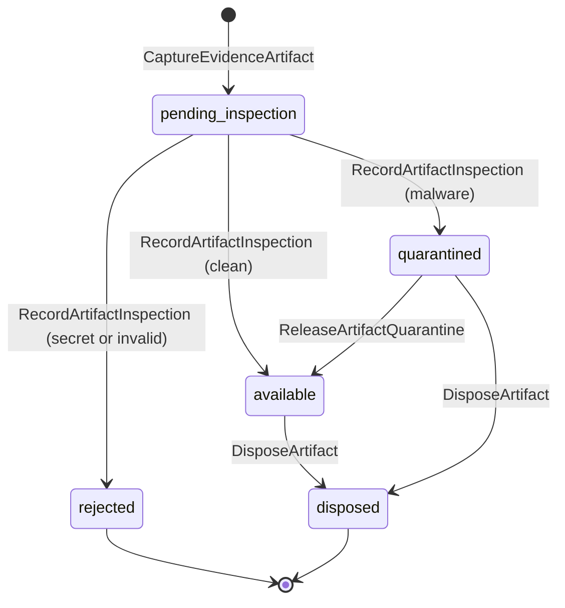
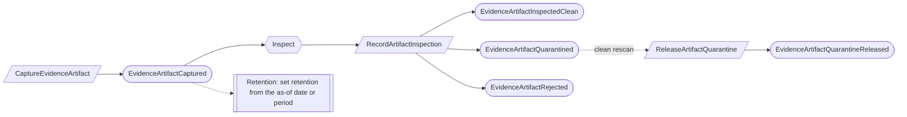
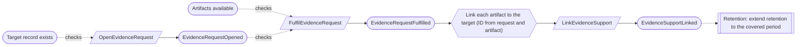
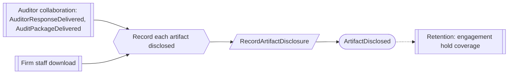

# Evidence

Status: **locked**, 2026-11-03. Hand-authored source of truth for this context.
It follows the [context conventions](conventions.md).

## Purpose

Evidence holds the files and captured records that show the organization did
what it says: their exact content, inspection, handling class, redacted copies,
the requests that ask for them, the links that say what each one supports, and
the log of every disclosure outside the organization (M0-D16).

**Owns:** evidence artifacts, redactions, evidence requests, evidence support
links and artifact disclosures.

**Does not own:**

| Concern | Owner |
| --- | --- |
| Retention, holds and disposition decisions | [Retention](retention.md); it disposes of an artifact through this context |
| Whether evidence is sufficient for a piece of work | The context that reviews that work (for example, `ReviewControlOccurrence`) |
| Auditor requests and packages | Auditor collaboration |
| Collection connectors | Deferred (M0-D20); a connector captures through the same command as an upload |

## Language

| Term | Meaning |
| --- | --- |
| Evidence artifact | One file or captured record with an immutable content identity (hash, size, media type), its provenance, capture time, the date or period it shows, and one handling class. |
| Handling class | `public`, `internal`, `confidential` or `restricted`, the same vocabulary as information assets (M0-D08). |
| Inspection | The scan for malware and secrets that every artifact passes before it can be used. |
| Available | Inspected clean, or released from quarantine. Only an available artifact, or an approved redacted derivative, can be shared. |
| Redaction | A derived artifact with its own content identity, linked to its original, approved for disclosure. The original never changes. |
| Evidence request | An internal ask for evidence about one record, addressed to a person or team. Auditor requests are a different record. |
| Support link | A statement that one exact artifact supports one exact record version for a period, with a rationale. Reuse is another link, never a copy. |
| Disclosure | One artifact given to someone outside the organization's members: in an auditor response, a package, or a download by firm staff. |

## Aggregates

### EvidenceArtifact

**Identity:** `TenantId` + `ArtifactId`.

**Invariant:** one artifact has one immutable content identity and one
inspection lifecycle. It is unusable until inspected clean. A secret makes it
rejected for good, with its content purged and only a tombstone kept. Malware
quarantines it until an Org Admin releases a false positive after a clean
rescan. Disposal is final and keeps a tombstone (M0-D16).

- Credentials, secrets, private keys, access tokens and session cookies are never
  stored. A secret-bearing upload is replaced by a redacted upload, never
  released.
- The handling class is a property of the artifact. A Compliance Lead changes it
  with a rationale (EV-02).
- A redacted derivative names its original; the original keeps its own retention
  and access rules.
- Disposal is decided by Retention's hold register (RT-06). This context removes
  the content only for an artifact a `DispositionDecided` authorizes, and does not
  re-read holds or dates.
- Downloads by the organization's members are audit-log entries checked by
  authorization. A download by anyone else is a disclosure (EV-03).

| Command | Who | Accepts when | Emits |
| --- | --- | --- | --- |
| CaptureEvidenceArtifact | Compliance Lead, Contributor, a responsibility holder, or a collection integration | `ArtifactId` is new; handling class given; original available (derivative) | EvidenceArtifactCaptured |
| RecordArtifactInspection | Inspection service | Pending inspection | EvidenceArtifactInspectedClean, EvidenceArtifactQuarantined or EvidenceArtifactRejected |
| ReleaseArtifactQuarantine | Org Admin | Quarantined; clean rescan referenced; reason given | EvidenceArtifactQuarantineReleased |
| ChangeArtifactHandlingClass | Compliance Lead | Not rejected or disposed; class differs; rationale given | ArtifactHandlingClassChanged |
| DisposeArtifact | Reactor on DispositionDecided (Retention hold register), for each authorized artifact | Available or quarantined; names the decision; a repeat is a no-op | EvidenceArtifactDisposed |

| Event | Carries |
| --- | --- |
| EvidenceArtifactCaptured | tenant, artifact, content hash, size, media type, provenance, captured at, as-of date or covered period, handling class, derived from (if any), captured by |
| EvidenceArtifactInspectedClean | tenant, artifact, inspection reference |
| EvidenceArtifactQuarantined | tenant, artifact, reason (`malware`), inspection reference |
| EvidenceArtifactRejected | tenant, artifact, reason (`secret_detected` or `invalid`), tombstone (hash, size, uploader, time) |
| EvidenceArtifactQuarantineReleased | tenant, artifact, rescan reference, reason, released by |
| ArtifactHandlingClassChanged | tenant, artifact, previous class, new class, rationale, changed by |
| EvidenceArtifactDisposed | tenant, artifact, disposition, tombstone (hash, size, retention basis) |

### EvidenceRedaction

**Identity:** `TenantId` + `RedactionId`.

**Invariant:** one redaction links one original artifact to one derived artifact
and is approved for disclosure once, by a Compliance Lead who did not prepare it,
unless a waiver covers it (M0-D16, EV-04).

| Command | Who | Accepts when | Emits |
| --- | --- | --- | --- |
| PrepareEvidenceRedaction | Contributor or Compliance Lead | `RedactionId` is new; derived artifact names the original | EvidenceRedactionPrepared |
| ReviewEvidenceRedaction | Compliance Lead who did not prepare it, or covered by a waiver | Prepared; derived artifact available | EvidenceRedactionApproved or EvidenceRedactionRejected |

| Event | Carries |
| --- | --- |
| EvidenceRedactionPrepared | tenant, redaction, original, derived artifact, what was redacted, prepared by |
| EvidenceRedactionApproved | tenant, redaction, approver, waiver (if any) |
| EvidenceRedactionRejected | tenant, redaction, comments, reviewer |

### EvidenceRequest

**Identity:** `TenantId` + `RequestId`.

**Invariant:** one request asks one person or team for evidence about one record,
with an optional due date, and is open, then fulfilled or cancelled.

| Command | Who | Accepts when | Emits |
| --- | --- | --- | --- |
| OpenEvidenceRequest | Compliance Lead or Contributor | `RequestId` is new; target record exists | EvidenceRequestOpened |
| FulfilEvidenceRequest | The person asked, a member of the team asked, or Compliance Lead | Open; at least one available artifact | EvidenceRequestFulfilled |
| CancelEvidenceRequest | Its opener or Compliance Lead | Open; reason given | EvidenceRequestCancelled |

| Event | Carries |
| --- | --- |
| EvidenceRequestOpened | tenant, request, target record, asked of, description, due date, opened by |
| EvidenceRequestFulfilled | tenant, request, artifacts, note, fulfilled by |
| EvidenceRequestCancelled | tenant, request, reason, cancelled by |

### EvidenceSupport

**Identity:** `TenantId` + `SupportId`.

**Invariant:** one link binds one exact artifact to one exact target record
version for one covered period, with a rationale. It never changes. A mistaken
link is withdrawn with a reason and stays in the history (EV-05). A newer target
version does not move the link; it stays bound to the version it named.

| Command | Who | Accepts when | Emits |
| --- | --- | --- | --- |
| LinkEvidenceSupport | Compliance Lead, Contributor, or reactor | `SupportId` is new; artifact available; target version exists | EvidenceSupportLinked |
| WithdrawEvidenceSupport | Compliance Lead | Linked; reason given | EvidenceSupportWithdrawn |

| Event | Carries |
| --- | --- |
| EvidenceSupportLinked | tenant, support, artifact, content hash, target record and version, covered period, rationale, linked by |
| EvidenceSupportWithdrawn | tenant, support, reason, withdrawn by |

### ArtifactDisclosure

**Identity:** `TenantId` + `DisclosureId`, derived from the delivery or download
and the artifact (CV-02).

**Invariant:** one disclosure records that one exact artifact, under its handling
class at that moment, went to one recipient for one purpose. It never changes.

- Only an available artifact, or an approved redacted derivative, can be
  disclosed (M0-D16). The sharing check happens at delivery, so the disclosure is
  recorded without a separate approval (EV-06).
- Each disclosure names the examination it served, when there is one. Retention
  uses that to decide what an engagement hold covers.

| Command | Who | Accepts when | Emits |
| --- | --- | --- | --- |
| RecordArtifactDisclosure | Reactor on AuditorResponseDelivered, AuditPackageDelivered or a firm-staff download | Artifact available or an approved derivative; a repeat is a no-op | ArtifactDisclosed |

| Event | Carries |
| --- | --- |
| ArtifactDisclosed | tenant, disclosure, artifact, content hash, handling class, recipient, purpose, channel, examination (if any), disclosed at |

## Flows

Diagrams follow [CV-01](conventions.md#flow-diagrams).

### Capturing and inspecting

Inspection is a technical scan; its outcome is the business fact.

### Requesting and linking evidence

### Redacting for disclosure

```mermaid
flowchart LR
    O([Original artifact]) -. checks .-> C1
    C1[/"CaptureEvidenceArtifact (derived)"/] --> E1([EvidenceArtifactCaptured])
    E1 -. "inspected clean" .-> C2[/PrepareEvidenceRedaction/] --> E2([EvidenceRedactionPrepared])
    E2 -. "reviewer did not prepare it" .-> C3[/ReviewEvidenceRedaction/] --> E3([EvidenceRedactionApproved])
    E3 -.-> X1[[Auditor collaboration: derivative is shareable]]
```

### Disclosing

## Authorization contract

- A download needs read permission on the artifact's record and an available
  artifact (or approved derivative). A `restricted` artifact also needs the
  explicit restricted-evidence permission, granted by default to Org Admin and
  Compliance Lead.
- Firm staff downloads follow the Firm services compartments and are disclosures.

## Decisions

Jev answers are from `jev-1.14.0`, 2026-11-03. A yes is ≥ 0.8 and a no is ≤ 0.2.
Anything in between is settled by common sense, with the reasoning stated.

| ID | Decision | Evidence |
| --- | --- | --- |
| EV-01 | Inspection outcomes are business facts on the artifact: clean, quarantined (malware) or rejected (secret or invalid, content purged, tombstone kept). Only an Org Admin releases a quarantine, after a clean rescan. | M0-D16. |
| EV-02 | The handling class is a property of the artifact, changed by a Compliance Lead with a rationale. | 0.64. Common sense: nothing else governs it independently, and the change is a named fact. Replaces `EvidenceHandlingPolicy`. |
| EV-03 | Members' downloads are audit-log entries checked by authorization; downloads by anyone outside the organization's members are disclosures. | Downloads as audit log only: 0.39. External downloads as disclosures: 0.68. Harm from members' downloads in the audit log only: 0.58. Common sense: the disclosure log covers everything that leaves the organization, and PA-08 treats sign-in activity the same way. Replaces `ArtifactDownloadGrant`. |
| EV-04 | A redaction is approved by a Compliance Lead who did not prepare it. | 0.65. M0-D16 and CV-06. |
| EV-05 | A mistaken support link is withdrawn with a reason and kept in history. | 0.84. |
| EV-06 | Disclosures are recorded automatically from deliveries and firm-staff downloads; sharing is checked at delivery, so there is no approval step. | Automatic: 0.48; harm without approval: 0.37. Common sense: AC-01 already decided deliveries need no second approval. |
| EV-07 | Internal evidence requests are separate from auditor requests. | 0.79. |
| EV-08 | A quarantined artifact follows the normal disposal rules: it is disposed only on an authorization from Retention's hold register ([RT-06](retention.md#decisions)). | 0.70. |

## Open questions

None at this time.

## Superseded owners

| Old owner | Becomes |
| --- | --- |
| EvidenceArtifact | EvidenceArtifact |
| EvidenceHandlingPolicy | Handling class on EvidenceArtifact (EV-02) |
| EvidenceRedaction | EvidenceRedaction |
| EvidenceRequest | EvidenceRequest |
| EvidenceSupport | EvidenceSupport (withdrawable; EV-05) |
| ArtifactDisclosure | ArtifactDisclosure (recorded from deliveries; EV-06) |
| ArtifactDownloadGrant, ArtifactDownloadProcess | Authorization and audit log; external downloads are disclosures (EV-03) |
| ApplyArtifactInspectionOutcomeReactor, EvidenceArtifactInspectionEffectsReactor | Inspection outcome events on EvidenceArtifact |
| FulfillAuthorizedArtifactDownloadRequestReactor | Removed (EV-03) |
