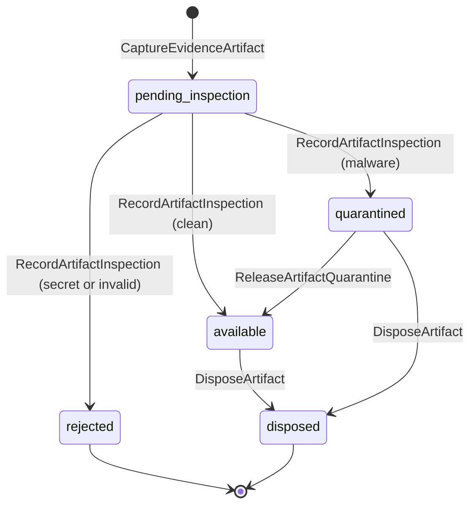
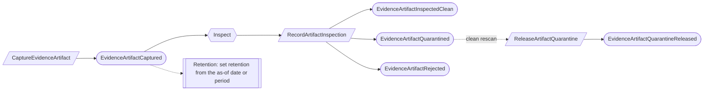
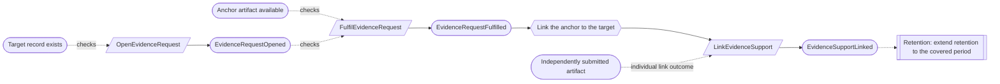
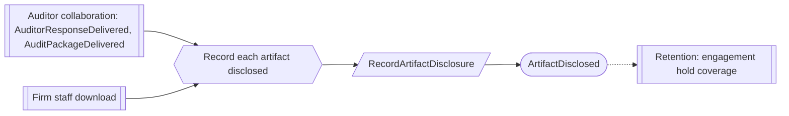

# Evidence

Status: **under boundary revision**, 2026-11-05. The 2026-11-03 product
baseline remains; candidates and unresolved ordering requirements here are not
implementation-ready. See the [boundary review](../reviews/platform-evidence-boundaries-review.md)
and the [local-invariant review](../reviews/evidence-local-invariants.md).

## Purpose

Evidence holds the files and captured records that show the organization did
what it says: their exact content, inspection, handling class, redacted copies,
the requests that ask for them, the links that say what each one supports, and
the log of every disclosure outside the organization (M0-D16).

**Owns:** evidence artifacts, redactions, evidence requests, evidence support
links and artifact disclosures.

**Does not own:**

| Concern | Owner |
| --- | --- |
| Retention, holds and disposition decisions | [Retention](retention.md); it disposes of an artifact through this context |
| Whether evidence is sufficient for a piece of work | The context that reviews that work (for example, `ReviewControlOccurrence`) |
| Auditor requests and packages | Auditor collaboration |
| Collection connectors | Deferred (M0-D20); a connector captures through the same command as an upload |

## Language

| Term | Meaning |
| --- | --- |
| Evidence artifact | One file or captured record with an immutable content identity (hash, size, media type), its provenance, capture time, the date or period it shows, and one handling class. |
| Handling class | `public`, `internal`, `confidential` or `restricted`, the same vocabulary as information assets (M0-D08). |
| Inspection | The scan for malware and secrets that every artifact passes before it can be used. |
| Available | Inspected clean, or released from quarantine. Only an available artifact, or an approved redacted derivative, can be shared. |
| Redaction | A derived artifact with its own content identity, linked to its original, approved for disclosure. The original never changes. |
| Evidence request | An internal ask for evidence about one record, addressed to a person or team. Auditor requests are a different record. |
| Support link | A statement that one exact artifact supports one exact record version for a period, with a rationale. Reuse is another link, never a copy. |
| Disclosure | One artifact given to someone outside the organization's members: in an auditor response, a package, or a download by firm staff. |

## Aggregates

### EvidenceArtifact

**Identity:** `TenantId` + `ArtifactId`.

**Invariant:** one artifact has one immutable content identity and one
inspection lifecycle. It is unusable until inspected clean. A secret makes it
rejected for good, with its content purged and only a tombstone kept. Malware
quarantines it until an Org Admin releases a false positive after a clean
rescan. Disposal is final and keeps a tombstone (M0-D16).

- Credentials, secrets, private keys, access tokens and session cookies are never
  stored. A secret-bearing upload is replaced by a redacted upload, never
  released.
- The handling class is a property of the artifact. A Compliance Lead changes it
  with a rationale (EV-02).
- A redacted derivative names its original; the original keeps its own retention
  and access rules.
- Retention owns the disposition authorization, but a prior
  `DispositionDecided` does not by itself prove that physical deletion remains
  allowed if a hold or retention extension takes effect later. M0-D16 prohibits
  disposing of held evidence; the previous RT-06 interpretation that the
  authorization alone permits later physical deletion is unresolved. Until a
  proven source-authoritative ordering or fence covers both hold activation and
  irreversible byte deletion, keep deletion pending. A fresh advisory read is
  not that fence. See [Retention](retention.md) for the still-unqualified
  coordination and the distinction between hold and retention-extension rules.
- Downloads by the organization's members are audit-log entries checked by
  authorization. A download by anyone else is a disclosure (EV-03).

| Command | Who | Accepts when | Emits |
| --- | --- | --- | --- |
| CaptureEvidenceArtifact | Compliance Lead, Contributor, a responsibility holder, or a collection integration | `ArtifactId` is new; handling class given; original available (derivative) | EvidenceArtifactCaptured |
| RecordArtifactInspection | Inspection service | Pending inspection | EvidenceArtifactInspectedClean, EvidenceArtifactQuarantined or EvidenceArtifactRejected |
| ReleaseArtifactQuarantine | Org Admin | Quarantined; clean rescan referenced; reason given | EvidenceArtifactQuarantineReleased |
| ChangeArtifactHandlingClass | Compliance Lead | Not rejected or disposed; class differs; rationale given | ArtifactHandlingClassChanged |
| DisposeArtifact | Reactor on a per-artifact Retention disposition decision | Available or quarantined; names the decision; a qualified hold/deletion ordering protects the physical byte deletion; exact repeat is a no-op. Until that ordering is proven, remain pending. | EvidenceArtifactDisposed |

| Event | Carries |
| --- | --- |
| EvidenceArtifactCaptured | tenant, artifact, content hash, size, media type, provenance, captured at, as-of date or covered period, handling class, derived from (if any), captured by |
| EvidenceArtifactInspectedClean | tenant, artifact, inspection reference |
| EvidenceArtifactQuarantined | tenant, artifact, reason (`malware`), inspection reference |
| EvidenceArtifactRejected | tenant, artifact, reason (`secret_detected` or `invalid`), tombstone (hash, size, uploader, time) |
| EvidenceArtifactQuarantineReleased | tenant, artifact, rescan reference, reason, released by |
| ArtifactHandlingClassChanged | tenant, artifact, previous class, new class, rationale, changed by |
| EvidenceArtifactDisposed | tenant, artifact, disposition, tombstone (hash, size, retention basis) |

### EvidenceRedaction

**Identity:** `TenantId` + `RedactionId`.

**Invariant:** one redaction links one original artifact to one derived artifact
and is approved for disclosure once, by a Compliance Lead who did not prepare it,
unless a waiver covers it (M0-D16, EV-04).

| Command | Who | Accepts when | Emits |
| --- | --- | --- | --- |
| PrepareEvidenceRedaction | Contributor or Compliance Lead | `RedactionId` is new; derived artifact names the original | EvidenceRedactionPrepared |
| ReviewEvidenceRedaction | Compliance Lead who did not prepare it, or covered by a waiver | Prepared; derived artifact available | EvidenceRedactionApproved or EvidenceRedactionRejected |

| Event | Carries |
| --- | --- |
| EvidenceRedactionPrepared | tenant, redaction, original, derived artifact, what was redacted, prepared by |
| EvidenceRedactionApproved | tenant, redaction, approver, waiver (if any) |
| EvidenceRedactionRejected | tenant, redaction, comments, reviewer |

### EvidenceRequest

**Identity:** `TenantId` + `RequestId`.

**Invariant:** one request asks one person or team for evidence about one record,
with an optional due date, and is open, then fulfilled or cancelled. A candidate
fulfilment names one available anchor artifact. Additional submitted artifacts
are independent request-artifact links; the request does not own their roster.

| Command | Who | Accepts when | Emits |
| --- | --- | --- | --- |
| OpenEvidenceRequest | Compliance Lead or Contributor | `RequestId` is new; target record exists | EvidenceRequestOpened |
| FulfilEvidenceRequest | The person asked, a member of the team asked, or Compliance Lead | Open; exact anchor artifact availability is established at the required decision point | EvidenceRequestFulfilled |
| CancelEvidenceRequest | Its opener or Compliance Lead | Open; reason given | EvidenceRequestCancelled |

| Event | Carries |
| --- | --- |
| EvidenceRequestOpened | tenant, request, target record, asked of, description, due date, opened by |
| EvidenceRequestFulfilled | tenant, request, one anchor artifact, note, fulfilled by |
| EvidenceRequestCancelled | tenant, request, reason, cancelled by |

Additional artifacts can be linked individually by one request-artifact
association per request and artifact; the existing support link owns one
artifact-to-exact-target-version relation. A fulfilment cannot be recorded from
a stale availability read if disposal or quarantine wins before the decision.
The cross-owner guard/fence, exact retry and delayed submission semantics remain
unqualified. Fulfilment of the one anchor does not assert that every other
artifact submitted at the same time was accepted, linked or made available. Each
additional link has an independently visible accepted, refused or pending
outcome. A projected list is a view, not proof that a submission is complete.
The prior multi-artifact fulfilment shape may have implied an all-or-none user
operation; whether to retain that guarantee is an open product question. An
all-child completion write or distributed per-artifact coordinator ledger is not
an approved solution.

### EvidenceRequestArtifact (candidate)

**Identity:** `TenantId` + `RequestId` + `ArtifactId` for one request and one
submitted artifact. A new request or artifact has a different identity.

**Invariant:** one link records one artifact's association with one request and
its own admission outcome. It does not prove that the artifact supports the
target; `EvidenceSupport` owns that distinct relationship. This owner and its
event contract are provisional until source authority and retry semantics are
qualified.

The request actor submits one link with a stable operation identity. An exact
retry returns the established result; changed intent is not an exact retry.
Pending, unknown and refused links are distinguishable; an asynchronous
request-to-support reaction is not proof that support was accepted. Each
artifact's availability and request's authorization must be established at the
decision point by an authoritative protocol, including the race with request
cancellation. Neither owner appends an event for every other association.

### EvidenceSupport

**Identity:** `TenantId` + `SupportId`.

**Invariant:** one link binds one exact artifact to one exact target record
version for one covered period, with a rationale. It never changes. A mistaken
link is withdrawn with a reason and stays in the history (EV-05). A newer target
version does not move the link; it stays bound to the version it named.

| Command | Who | Accepts when | Emits |
| --- | --- | --- | --- |
| LinkEvidenceSupport | Compliance Lead, Contributor, or reactor | `SupportId` is new; artifact available; target version exists | EvidenceSupportLinked |
| WithdrawEvidenceSupport | Compliance Lead | Linked; reason given | EvidenceSupportWithdrawn |

| Event | Carries |
| --- | --- |
| EvidenceSupportLinked | tenant, support, artifact, content hash, target record and version, covered period, rationale, linked by |
| EvidenceSupportWithdrawn | tenant, support, reason, withdrawn by |

### ArtifactDisclosure

**Identity:** `TenantId` + `DisclosureId`, derived from the delivery or download
and the artifact (CV-02).

**Invariant:** one disclosure records that one exact artifact, under its handling
class at that moment, went to one recipient for one purpose. It never changes.

- Only an available artifact, or an approved redacted derivative, can be
  disclosed (M0-D16). There is no separate human approval for each disclosure
  (EV-06); an earlier read alone is not a delivery-time fence against disposal,
  reclassification or redaction changes. Delivery authorization and actual
  release need an exact authoritative ordering protocol, still unresolved.
- Disclosure is a fact about an actual external release, not a prospective
  permission. Once bytes have left the system, a failed or delayed log write
  cannot undo the release. The delivery must preserve enough durable identity
  and evidence to recover and record every release, even after an ambiguous
  outcome; unknown is pending, not proof that no bytes were sent. Exact retries
  must not invent duplicate disclosure facts. Whether retransmitting bytes is a
  distinct disclosure occurrence needs an explicit business definition; a shared
  request ID cannot simply collapse potentially separate external releases.
- The decision must identify the artifact and exact content, recipient, purpose,
  applicable handling class and permission at the authoritative release point.
  Whether a permission or handling change after a stream has begun must halt the
  remaining bytes is also unqualified. A proposed per-artifact release fence must
  order against quarantine, disposal, relevant classification and permission
  changes; no cross-stream transaction, lease or revocation guarantee is assumed.
- Each disclosure names the examination it served, when there is one. Retention
  uses that to decide what an engagement hold covers.

| Command | Who | Accepts when | Emits |
| --- | --- | --- | --- |
| RecordArtifactDisclosure | Reactor on AuditorResponseDelivered, AuditPackageDelivered or a firm-staff download | Artifact available or an approved derivative; a repeat is a no-op | ArtifactDisclosed |

| Event | Carries |
| --- | --- |
| ArtifactDisclosed | tenant, disclosure, artifact, content hash, handling class, recipient, purpose, channel, examination (if any), disclosed at |

## Flows

Diagrams follow [CV-01](conventions.md#flow-diagrams).

### Capturing and inspecting

Inspection is a technical scan; its outcome is the business fact.

### Requesting and linking evidence

### Redacting for disclosure

```mermaid
flowchart LR
    O([Original artifact]) -. checks .-> C1
    C1[/"CaptureEvidenceArtifact (derived)"/] --> E1([EvidenceArtifactCaptured])
    E1 -. "inspected clean" .-> C2[/PrepareEvidenceRedaction/] --> E2([EvidenceRedactionPrepared])
    E2 -. "reviewer did not prepare it" .-> C3[/ReviewEvidenceRedaction/] --> E3([EvidenceRedactionApproved])
    E3 -.-> X1[[Auditor collaboration: derivative is shareable]]
```

### Disclosing

## Authorization contract

- A download needs read permission on the artifact's record and an available
  artifact (or approved derivative). A `restricted` artifact also needs the
  explicit restricted-evidence permission, granted by default to Org Admin and
  Compliance Lead.
- Firm staff downloads follow the Firm services compartments and are disclosures.

## Decisions

Jev answers are from `jev-1.14.0`, 2026-11-03. Earlier 0.8 and 0.2 thresholds
were triage conventions, not measured confidence that a design is correct. The
[local-invariant review](../reviews/evidence-local-invariants.md) records newer
conditional cases and unresolved authority.

| ID | Decision | Evidence |
| --- | --- | --- |
| EV-01 | Inspection outcomes are business facts on the artifact: clean, quarantined (malware) or rejected (secret or invalid, content purged, tombstone kept). Only an Org Admin releases a quarantine, after a clean rescan. | M0-D16. |
| EV-02 | The handling class is a property of the artifact, changed by a Compliance Lead with a rationale. | 0.64. Common sense: nothing else governs it independently, and the change is a named fact. Replaces `EvidenceHandlingPolicy`. |
| EV-03 | Members' downloads are audit-log entries checked by authorization; downloads by anyone outside the organization's members are disclosures. | Downloads as audit log only: 0.39. External downloads as disclosures: 0.68. Harm from members' downloads in the audit log only: 0.58. Common sense: the disclosure log covers everything that leaves the organization, and PA-08 treats sign-in activity the same way. Replaces `ArtifactDownloadGrant`. |
| EV-04 | A redaction is approved by a Compliance Lead who did not prepare it. | 0.65. M0-D16 and CV-06. |
| EV-05 | A mistaken support link is withdrawn with a reason and kept in history. | 0.84. |
| EV-06 | Disclosures are recorded automatically from deliveries and firm-staff downloads; there is no separate human approval. The authority and ordering of the sharing check at delivery remain open. | Automatic: 0.48; harm without approval: 0.37. AC-01 already decided deliveries need no second human approval. |
| EV-07 | Internal evidence requests are separate from auditor requests. | 0.79. |
| EV-08 | A quarantined artifact follows the normal disposal rules. Retention authorization is necessary, but the effect of a later hold on physical deletion and the authoritative fence are unresolved ([RT-06](retention.md#decisions)). | 0.70; this score does not establish the cross-owner ordering. |

## Open questions

- Qualify anchor-availability ordering against quarantine and disposal and
  distinguish absent, refused, pending and accepted link outcomes.
- Confirm whether a submission with multiple artifacts requires atomic all-or-none
  semantics; define authoritative completion if it does.
- Establish the actual disclosure-versus-disposal/reclassification ordering and
  preservation of the class at the moment of disclosure. See also Retention and
  Auditor collaboration; an asynchronously recorded disclosure is not a fence.
- Resolve hold placement after an accepted disposition but before physical byte
  deletion. Qualify an authoritative hold/deletion fence and crash recovery; do
  not treat a historical disposition or current advisory no-hold read as proof
  that deletion may proceed.
- Establish release identity and recovery when a timeout follows partial or
  completed delivery, including whether a retransmission is a separate disclosure
  and what happens if permission changes during streaming.
- Qualify independently submitted request-artifact admission, cancellation races,
  exact retries and support-link refusal, including the UX of partial outcomes.

## Superseded owners

| Old owner | Becomes |
| --- | --- |
| EvidenceArtifact | EvidenceArtifact |
| EvidenceHandlingPolicy | Handling class on EvidenceArtifact (EV-02) |
| EvidenceRedaction | EvidenceRedaction |
| EvidenceRequest | EvidenceRequest |
| EvidenceSupport | EvidenceSupport (withdrawable; EV-05) |
| ArtifactDisclosure | ArtifactDisclosure (recorded from deliveries; EV-06) |
| ArtifactDownloadGrant, ArtifactDownloadProcess | Authorization and audit log; external downloads are disclosures (EV-03) |
| ApplyArtifactInspectionOutcomeReactor, EvidenceArtifactInspectionEffectsReactor | Inspection outcome events on EvidenceArtifact |
| FulfillAuthorizedArtifactDownloadRequestReactor | Removed (EV-03) |
