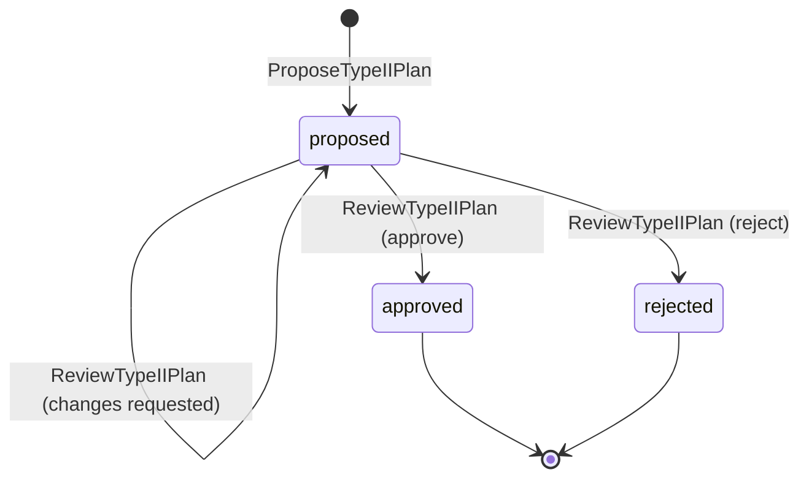
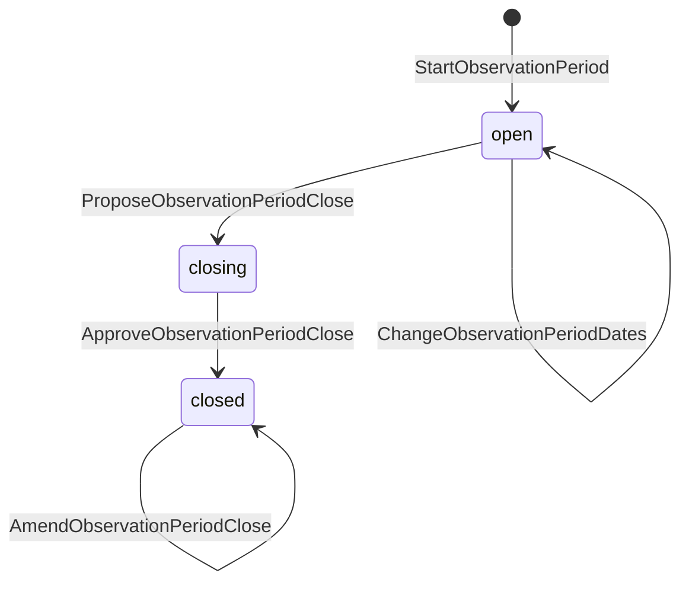
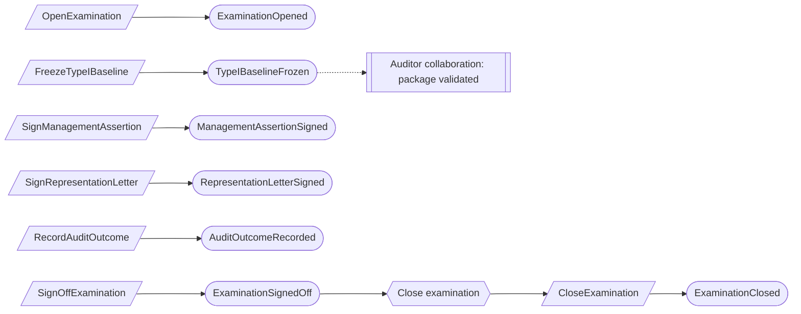
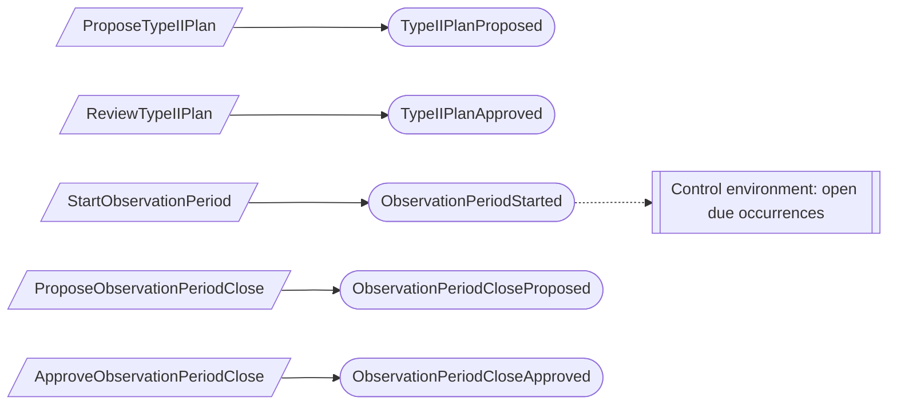

# Examinations

Status: **locked**, 2026-11-03. Hand-authored source of truth for this context.

## Purpose

Examinations records a program's SOC 2 examinations: the Type I baseline, the
Type II plan and observation period, management's assertion, representation
letter and sign-off, and the auditor's outcome and exceptions exactly as
received. The product never authors, edits or recalculates the auditor's opinion,
and holds no attest workpapers (M0-D27).

This is the examination half of the original "Engagements and handoffs" context.
Requests, responses, populations, samples and packages are in
[Auditor collaboration](auditor-collaboration.md).

**Owns:** examinations, Type I baselines, Type II plans, observation periods,
management assertions, representation letters, audit outcomes, audit test
exceptions, and examination sign-offs.

**Does not own:**

| Concern | Owner |
| --- | --- |
| Packages, populations, samples, auditor requests | Auditor collaboration |
| The firm's `ServiceEngagement` | Firm services; an examination may reference one when the auditor is our attest team |
| Control occurrences during the period | Control environment; it reacts to `ObservationPeriodStarted` |
| Findings | Assurance work; an exception may link to one |
| System description | System description; period close checks it |
| Readiness and the Type I entry decision | Readiness |

## Language

| Term | Meaning |
| --- | --- |
| Examination | One SOC 2 examination of a program: `type_i` or `type_ii`. |
| Auditor | Our firm's attest team (through a `ServiceEngagement`), an external audit firm, or unknown. |
| Target date, confirmed date | A target is a plan. A confirmed date needs an evidence reference and is never promoted from a target (M0-D01). |
| Type I baseline | The frozen, point-in-time set of exact source versions a Type I examination covers. |
| Type II plan | The approved plan for one observation period: dates, controls in scope, expected occurrences, and items carried forward. |
| Observation period | The Type II period run under an approved plan, and its close. |
| Signer | A person named on the examination as CEO or CISO, who may sign the assertion and the letter (M0-D17). |
| Audit outcome | The auditor's report conclusion, recorded exactly as received. |
| Audit test exception | An auditor-identified exception to an examination test, in the auditor's wording (M0-D23). It is not a waiver. |
| Sign-off | Management's final decision on an examination, binding the exact package, assertion, letter and outcome. |

## Aggregates

### Examination

**Identity:** `TenantId` + `ExaminationId`.

**Invariant:** one examination belongs to one program for life, has one type, an
auditor, target and confirmed dates, and named signers. It is open, then closed.

- A missing auditor or date is recorded as unknown, never as a placeholder.
- Confirming dates needs an evidence reference (EX-05).
- Only signers named here can sign the assertion, the letter and the sign-off
  (EX-04).

| Command | Who | Accepts when | Emits |
| --- | --- | --- | --- |
| OpenExamination | Compliance Lead | `ExaminationId` is new; program exists | ExaminationOpened |
| ChangeExaminationAuditor | Compliance Lead | Open | ExaminationAuditorChanged |
| SetExaminationTargetDates | Compliance Lead | Open | ExaminationTargetDatesSet |
| ConfirmExaminationDates | Compliance Lead | Open; evidence reference given | ExaminationDatesConfirmed |
| NameExaminationSigners | Org Admin | Open; signers are members | ExaminationSignersNamed |
| CloseExamination | Reactor on ExaminationSignedOff | Open | ExaminationClosed |

| Event | Carries |
| --- | --- |
| ExaminationOpened | tenant, examination, program, type, auditor, opened by |
| ExaminationAuditorChanged | tenant, examination, auditor (engagement, firm name, or unknown), changed by |
| ExaminationTargetDatesSet | tenant, examination, Type I as-of or period start and end, set by |
| ExaminationDatesConfirmed | tenant, examination, confirmed dates, evidence reference, confirmed by |
| ExaminationSignersNamed | tenant, examination, CEO signer, CISO signer, named by |
| ExaminationClosed | tenant, examination, sign-off |

### TypeIBaseline

**Identity:** `TenantId` + `ExaminationId` (Type I only).

**Invariant:** a baseline is frozen once, against the examination's as-of date,
an approved boundary version and a complete manifest of exact source versions.
Each amendment is a new baseline version that references the previous one and
lists every changed source; no version ever changes.

- Freezing is refused while any in-scope source has no approved version.

| Command | Who | Accepts when | Emits |
| --- | --- | --- | --- |
| FreezeTypeIBaseline | Compliance Lead | Not frozen; sources complete | TypeIBaselineFrozen |
| AmendTypeIBaseline | Compliance Lead | Frozen; changed sources and reason given | TypeIBaselineAmended |

| Event | Carries |
| --- | --- |
| TypeIBaselineFrozen | tenant, examination, version, as-of date, boundary version, source manifest and hash, frozen by |
| TypeIBaselineAmended | tenant, examination, version, previous version, changed sources, reason, manifest and hash, amended by |

### TypeIIPlan

**Identity:** `TenantId` + `PlanId`, for one Type II examination.

**Invariant:** one plan is proposed and revised, then reviewed by someone other
than its proposer, who approves it, requests changes, or rejects it. An approved
plan never changes (EX-02).

- The plan states the period dates, the controls in scope with their expected
  occurrences, and every unresolved item carried forward from the previous
  examination, each with its disposition. This replaces a separate rollover
  record (EX-01).

| Command | Who | Accepts when | Emits |
| --- | --- | --- | --- |
| ProposeTypeIIPlan | Compliance Lead | `PlanId` is new; examination is Type II and open | TypeIIPlanProposed |
| ReviseTypeIIPlan | Compliance Lead | Proposed | TypeIIPlanRevised |
| ReviewTypeIIPlan | Compliance Lead, not the proposer | Proposed; reviews the current revision | TypeIIPlanChangesRequested, TypeIIPlanApproved or TypeIIPlanRejected |

### ObservationPeriod

**Identity:** `TenantId` + `PeriodId`, for one Type II examination.

**Invariant:** one period runs under one approved plan, between dates that
overlap no other period of the same program (checked against current state). Its
close is proposed as a frozen statement, approved once, and amended only by new
close versions that reference the original.

- The proposed close reconciles expected occurrences against actual ones, lists
  every significant item in the period, and lists unresolved material items.
- Approving the close needs management to acknowledge each unresolved material
  item, and is refused while any flagged system description section is
  unresolved.
- Period dates can change only while the period is open and not closing.

| Command | Who | Accepts when | Emits |
| --- | --- | --- | --- |
| StartObservationPeriod | Compliance Lead | Plan approved; dates do not overlap | ObservationPeriodStarted |
| ChangeObservationPeriodDates | Compliance Lead | Open; no overlap; reason given | ObservationPeriodDatesChanged |
| ProposeObservationPeriodClose | Compliance Lead | Open; period end reached | ObservationPeriodCloseProposed |
| ApproveObservationPeriodClose | A signer | Closing; every unresolved material item acknowledged; description resolved | ObservationPeriodCloseApproved |
| AmendObservationPeriodClose | Compliance Lead | Closed; changed sources and reason given | ObservationPeriodCloseAmended |

### ManagementAssertion

**Identity:** `TenantId` + `AssertionId`, for one examination.

**Invariant:** one assertion has authored revisions and is signed once by a named
signer, on its current revision and an exact validated package version. A
signed assertion never changes; a changed one is a new assertion.

| Command | Who | Accepts when | Emits |
| --- | --- | --- | --- |
| DraftManagementAssertion | Compliance Lead | `AssertionId` is new | ManagementAssertionDrafted |
| ReviseManagementAssertion | Compliance Lead | Not signed | ManagementAssertionRevised |
| SignManagementAssertion | A named signer | Not signed; package version validated | ManagementAssertionSigned |

### RepresentationLetter

**Identity:** `TenantId` + `LetterId`, for one examination.

**Invariant:** one letter lists its required signers, taken from the
examination's named signers. It is signed when every required signer has signed
it once; no one else can sign.

- Signing is refused until the examination's assertion is signed (M0-D17 order).

| Command | Who | Accepts when | Emits |
| --- | --- | --- | --- |
| RecordRepresentationLetter | Compliance Lead | `LetterId` is new; signers listed | RepresentationLetterRecorded |
| SignRepresentationLetter | A required signer | Not yet signed by them; assertion signed | RepresentationLetterSignedBy, then RepresentationLetterSigned when complete |

### AuditOutcome

**Identity:** `TenantId` + `OutcomeId`.

**Invariant:** one outcome records one auditor report conclusion exactly as
received, for one examination and an exact delivered package version. It never
changes. A reissued report is a new outcome that supersedes the earlier one.

- Recording is refused until the representation letter is signed (M0-D17 order).
- Management's evaluations and sign-offs stay separate records.

| Command | Who | Accepts when | Emits |
| --- | --- | --- | --- |
| RecordAuditOutcome | Compliance Lead, or attest staff on the engagement | `OutcomeId` is new; letter signed | AuditOutcomeRecorded |

### AuditTestException

**Identity:** `TenantId` + `ExceptionId`.

**Invariant:** one exception keeps the auditor's wording exactly as received, its
corrections as received in order, management's responses, and its links to
findings. Nothing is ever overwritten.

| Command | Who | Accepts when | Emits |
| --- | --- | --- | --- |
| RecordAuditTestException | Compliance Lead, or attest staff on the engagement | `ExceptionId` is new | AuditTestExceptionRecorded |
| RecordAuditTestExceptionCorrection | Same | Exists | AuditTestExceptionCorrected |
| RespondToAuditTestException | Compliance Lead | Exists | AuditTestExceptionResponded |
| LinkAuditTestExceptionToFinding | Compliance Lead | Not linked to that finding | AuditTestExceptionLinkedToFinding |

### ExaminationSignOff

**Identity:** `TenantId` + `ExaminationId`.

**Invariant:** one examination receives one sign-off by a named signer, binding the
exact package, assertion, letter and outcome versions and acknowledging every
unresolved material item (EX-03).

| Command | Who | Accepts when | Emits |
| --- | --- | --- | --- |
| SignOffExamination | A named signer | Outcome recorded; every unresolved material item acknowledged | ExaminationSignedOff |

Every event carries the tenant, the record ID, its content or changed values, and
the actor.

## Flows

### Type I examination

Each signing step checks the one before it, in the M0-D17 order: package
validated, assertion signed, letter signed, outcome recorded.

### Type II examination

After the close is approved, the signing chain is the same as for Type I.

### Next period

Moving on needs no reactor and no rollover record. A person opens the next
examination and proposes its Type II plan, listing every unresolved item carried
forward (EX-01).

## Decisions

Jev answers are from `jev-1.14.0`, 2026-11-03. A yes is ≥ 0.8 and a no is ≤ 0.2.
Anything in between is settled by common sense, with the reasoning stated.

| ID | Decision | Evidence |
| --- | --- | --- |
| EX-01 | No rollover record: the next examination's Type II plan lists the carried-forward items. Replaces `ProgramRollover` and its 9-stage execution process. | Separate record needed: 0.25. Common sense: the plan already carries the items, and PS-02 moved rollover here. |
| EX-02 | A Type II plan needs a reviewer other than the proposer, who may also approve; waivers cover very small teams. | Three distinct people: 0.15. Same as PS-04. |
| EX-03 | Management's sign-off is its own record; closing the examination follows it. | Sign-off is just the close: 0.09. |
| EX-04 | Each examination names its CEO and CISO signers, and only they sign. | 0.56. Common sense: a signing gate needs a recorded fact (as FS-07). |
| EX-05 | Confirmed dates are separate from targets and need an evidence reference. | M0-D01. |
| EX-06 | Period overlap is checked against current state; no observation calendar aggregate. | Small independent aggregates. |
| EX-07 | Auditor-found exceptions are `AuditTestException`, the M0-D23 name, replacing `AuditObservation`. | M0-D23 vocabulary. |

## Open questions

None at this time.

## Superseded owners

| Old owner | Becomes |
| --- | --- |
| ExaminationEngagement | Examination and TypeIBaseline |
| ImmutableSnapshot, ProgramScopeSnapshotProcess | TypeIBaseline (the baseline is the snapshot) |
| TypeIIPlan | TypeIIPlan |
| TypeIIPeriod | ObservationPeriod |
| TypeIIObservationCalendar | Removed (EX-06) |
| ManagementAssertion | ManagementAssertion |
| ManagementRepresentationLetter | RepresentationLetter |
| AuditOutcome | AuditOutcome |
| AuditObservation | AuditTestException (EX-07) |
| ExaminationSignOff | ExaminationSignOff |
| ProgramRolloverExecutionProcess | Removed (EX-01) |
