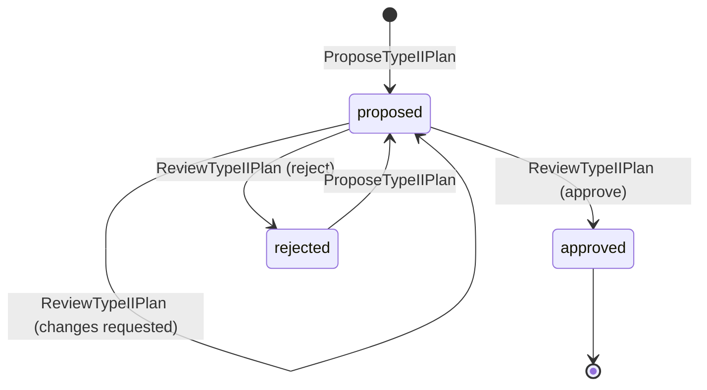
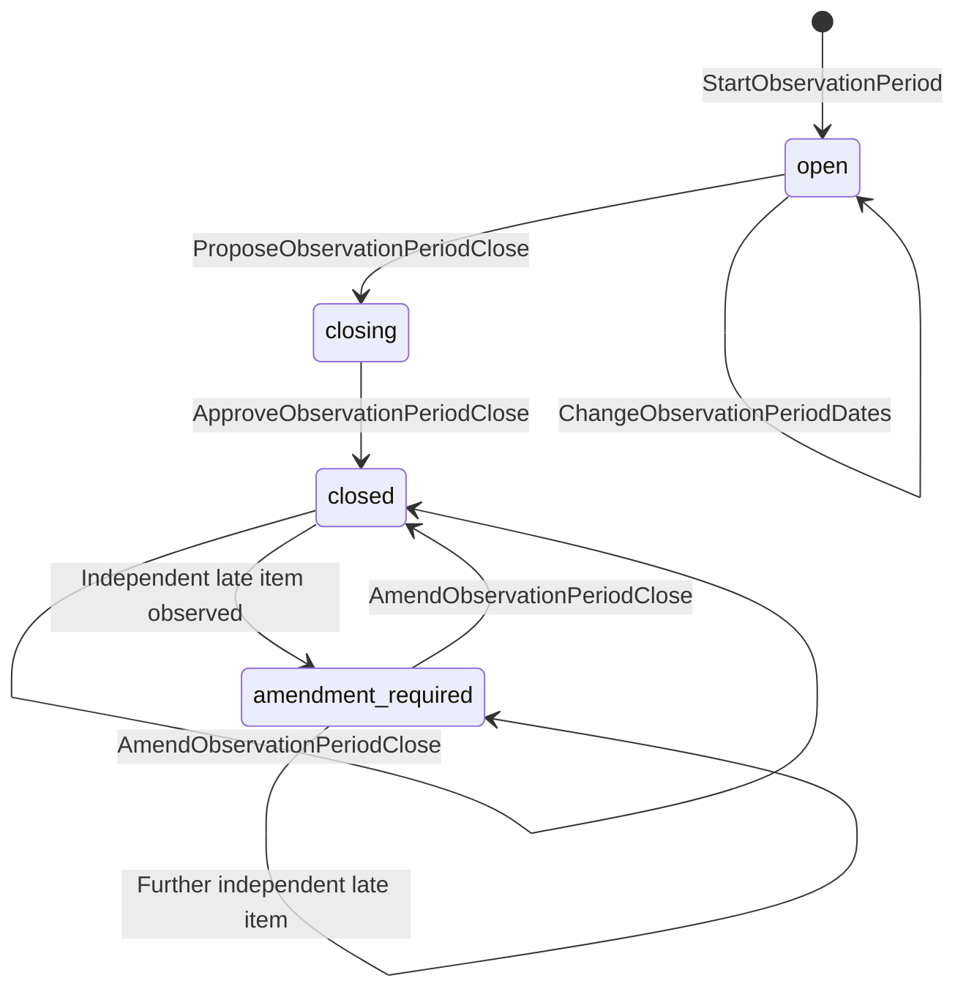
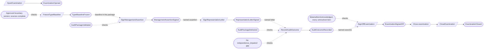
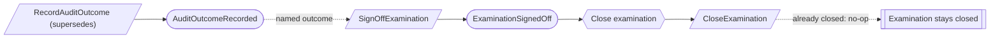
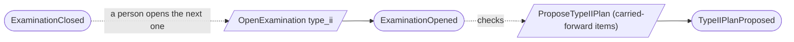

# Examinations

Status: **reopened for boundary and snapshot authority**, 2026-11-05. The
existing product rules and historical command/event tables remain evidence of
intent, not implementation-ready contracts. Type I freeze, Type II plan
approval, close, amendment and sign-off still include all-item write guards that
conflict with the local-decision rule in CV-13. Their replacement semantics and
authority are unresolved; do not implement the old guards through a scan,
coordinator ledger, projected count, or a source-cut reference.

## Purpose

Examinations records a program's SOC 2 examinations: the Type I baseline, the
Type II plan and observation period, management's assertion, representation
letter and sign-off, and the auditor's outcome and exceptions exactly as
received. The product never authors, edits or recalculates the auditor's opinion,
and holds no attest workpapers (M0-D27).

This is the examination half of the original "Engagements and handoffs" context.
Requests, responses, populations, samples and packages are in
[Auditor collaboration](auditor-collaboration.md).

## Independent decisions and completion

The period, baseline, plan and sign-off do not own their source records, plan
items, assessments, acknowledgements or exceptions. Each `BaselineSource`, plan
item, assessment/review outcome, `MaterialItemAcknowledgement`, and late item
has an independently addressed business owner and an exact source version. A
read can present them together in pages or generate a customer-facing artifact
by streaming. No parent event, hidden manifest or distributed turn ledger
collects the children or one result per child. In particular, admitting one
acknowledgement is a decision about that item; it is not an approval of every
item in the examination.

An attractive alternative is for a signer to attest to one explicitly identified
statement or artifact version, while a read model separately displays individual
acknowledgements and outstanding issues. This makes the write a local decision,
but **does not prove that every required item was included or acknowledged**. It
would change the meaning of the current EX-10 close and sign-off guards if it
were sufficient to close or sign off. It is a candidate for product review, not
an approved replacement. Likewise, a signer-designated reviewer excluded locally
from authoring each plan item may simplify reviewer independence, but changes
when the reviewer is selected and does not by itself freeze all plan items.

A projected `ready`, `complete`, `amendment_required`, or absence of a gap may
be shown as an advisory observation, with the exact source frontier and lag or
unknown state where available. It cannot authorize a close, signature, package
validation or audit outcome that promises all required participants have
completed. A partial or lagging projection can never report authoritative
success. The business meaning of “all” and the authority to establish it remain
open. The product must not silently substitute an attestation or eventual
worklist for the existing guarantees.

The frozen as-of business date differs from the source commit position, and a
digest is only an integrity check of bytes already selected. Proving a coherent,
retained, exact read across producers, backdated facts, and a lagging projection
remains an open source and delivery qualification. Even a proven complete read
is not by itself permission to make a write decision that depends on every
child. The unresolved cases below stay blocked rather than implying that the
period's accepted lifecycle can be achieved by completing a broad scan.

**Owns:** examinations, Type I baselines, Type II plans, observation periods,
management assertions, representation letters, audit outcomes, audit test
exceptions, material item acknowledgements, and examination sign-offs.

**Does not own:**

| Concern | Owner |
| --- | --- |
| Packages, populations, samples, auditor requests | Auditor collaboration |
| The firm's `ServiceEngagement` | Firm services; an examination may reference one when the auditor is our attest team |
| Control occurrences during the period | Control environment; occurrences open on calendar windows, and the period close reads those inside the period (CE-03) |
| Findings | Assurance work; an exception may link to one |
| System description | System description; period close checks it |
| Readiness and the Type I entry decision | Readiness |

## Language

| Term | Meaning |
| --- | --- |
| Examination | One SOC 2 examination of a program: `type_i` or `type_ii`. |
| Auditor | Our firm's attest team (through a `ServiceEngagement`), an external audit firm, or unknown. |
| Target date, confirmed date | A target is a plan. A confirmed date needs an evidence reference and is never promoted from a target (M0-D01). |
| Type I baseline | The frozen, point-in-time set of exact source versions a Type I examination covers. |
| Type II plan | The approved plan for one observation period: dates, controls in scope, expected occurrences, and items carried forward. |
| Observation period | The Type II period run under an approved plan, and its close. |
| Signer | A person named on the examination as CEO or CISO, who may sign the assertion and the letter (M0-D17). |
| Audit outcome | The auditor's report conclusion, recorded exactly as received. |
| Audit test exception | An auditor-identified exception to an examination test, in the auditor's wording (M0-D23). It is not a waiver. |
| Sign-off | Management's final decision on an examination, binding the exact package, assertion, letter and outcome. |

## Aggregates

### Examination

**Identity:** `TenantId` + `ExaminationId`.

**Invariant:** one examination belongs to one program for life, has one type, an
auditor, target and confirmed dates, and named signers. It is open, then closed.

- A missing auditor or date is recorded as unknown, never as a placeholder.
- Confirming dates needs an evidence reference (EX-05).
- Only signers named here can sign the assertion, the letter and the sign-off
  (EX-04).
- When the auditor is our attest team, the examination names a `ServiceEngagement`
  that is an accepted, open attest engagement in the same tenant. That reference
  is what lets assigned attest staff act on the examination (EX-13).
- Target and confirmed dates are the examination's plan. Once a Type II
  observation period starts, the period's dates are authoritative for it (EX-08).

| Command | Who | Accepts when | Emits |
| --- | --- | --- | --- |
| OpenExamination | Compliance Lead | `ExaminationId` is new; program exists; a named engagement passes EX-13 | ExaminationOpened |
| ChangeExaminationAuditor | Compliance Lead | Open; a named engagement passes EX-13 | ExaminationAuditorChanged |
| SetExaminationTargetDates | Compliance Lead | Open | ExaminationTargetDatesSet |
| ConfirmExaminationDates | Compliance Lead | Open; evidence reference given | ExaminationDatesConfirmed |
| NameExaminationSigners | Org Admin | Open; signers are members | ExaminationSignersNamed |
| CloseExamination | Reactor on ExaminationSignedOff | Open; a repeat on a closed examination is a no-op | ExaminationClosed |

| Event | Carries |
| --- | --- |
| ExaminationOpened | tenant, examination, program, type, auditor, opened by |
| ExaminationAuditorChanged | tenant, examination, auditor (engagement, firm name, or unknown), changed by |
| ExaminationTargetDatesSet | tenant, examination, Type I as-of or period start and end, set by |
| ExaminationDatesConfirmed | tenant, examination, confirmed dates, evidence reference, confirmed by |
| ExaminationSignersNamed | tenant, examination, CEO signer, CISO signer, named by |
| ExaminationClosed | tenant, examination, sign-off |

### TypeIBaseline

**Identity:** `TenantId` + `ExaminationId` (Type I only).

**Invariant:** one version freezes the examination's as-of date, an approved
boundary version and an exact complete set of in-scope source versions. An
amendment creates a new version linked to the preceding version; each changed
source is independently identified and its earlier version remains accessible.
No baseline version owns a list of sources or a manifest content object.

Each `BaselineSource` outcome is keyed by tenant, examination, baseline version
and source identity; it pins one exact approved source version or a refusal.
Freezing is refused while an in-scope source lacks an approved version. An
independently verifiable source cut and all participant outcomes are required;
missing or unapproved sources leave the baseline pending. The accepted baseline
fact records only the cut, incremental digest and bounded metadata. This is the
existing business guarantee, **not a qualified write protocol**: checking all
source outcomes still makes freeze an all-child decision, even when source facts
are independent or read incrementally. The independent-statement alternative
above does not satisfy the complete-baseline guarantee without a product change.

An as-of business date and a source commit cut are different: the cut must
include the eligible committed facts, while facts committed later but effective
on or before the as-of date require an explicit amendment/correction workflow.
A complete cross-context producer cut, historical version retention, and the
late-fact rule are not yet qualified; neither a projection nor a digest proves
that undiscovered source owners were included. A proposed freeze marker can
carry its own identity and intent, but cannot carry its commit-assigned source
position or a digest/count requiring later enumeration. Those can only be
established after commit by an independently qualified read/materialization
result. Such a marker is not, on its own, an accepted complete baseline.

| Command | Who | Accepts when | Emits |
| --- | --- | --- | --- |
| FreezeTypeIBaseline | Compliance Lead | Not frozen; authoritative source cut complete; every source has an accepted approved version | TypeIBaselineFrozen |
| AmendTypeIBaseline | Compliance Lead | Frozen; reason given; new source cut and changed-source outcomes complete | TypeIBaselineAmended |

| Event | Carries |
| --- | --- |
| TypeIBaselineFrozen | candidate bounded freeze marker: tenant, examination, baseline and marker/intent identity, as-of date, boundary version, frozen by; complete-baseline guarantee and payload remain unresolved |
| TypeIBaselineAmended | candidate bounded amendment marker: tenant, examination, amendment identity, previous baseline version, reason, amended by; complete-amendment guarantee and payload remain unresolved |

### BaselineSource

**Identity:** `TenantId` + `ExaminationId` + baseline version + source identity.

**Invariant:** one identified source decision binds one exact source version or
records a refusal for that baseline attempt; exact retries do not add another
decision. A changed source version or retry with changed intent is explicit.
This owner cannot assert that every source has been discovered. Its admission,
refusal fencing and authoritative current-version rules remain unqualified.

### TypeIIPlan

**Identity:** `TenantId` + `ExaminationId`: one plan per Type II examination, so
the identity itself allows only one (EX-09).

**Invariant:** the plan is proposed and revised, then reviewed by someone who
authored no revision of it ([CV-06](conventions.md#guards-and-reviews)), who
approves it, requests changes, or rejects it. A rejected plan can be proposed
again as a new revision. An approved plan never changes (EX-02).

- The plan states the period dates. Each control and its expected occurrences,
  and each carried-forward unresolved item and disposition, is an independently
  identified plan item. Approval references an exact settled plan-item cut;
  revisions and review never carry the whole plan in one event (EX-01). The
  reviewer-independence check traverses retained plan revision authors with
  bounded memory, or uses an equivalent authoritative decision; the plan does
  not retain an unbounded author roster. Even so, an exact all-item approval
  guard or an admission chain across every item is an all-child decision and
  does not meet CV-13. Plan scope, approval semantics and a race-safe way to
  bind any named reviewer's exact material need refinement. The plan's own
  revision history also grows and is replayed by Portia; it needs an explicit
  lifetime/revision strategy instead of claiming a bounded stream.

| Command | Who | Accepts when | Emits |
| --- | --- | --- | --- |
| ProposeTypeIIPlan | Compliance Lead | No plan yet, or rejected; examination is Type II and open | TypeIIPlanProposed |
| ReviseTypeIIPlan | Compliance Lead | Proposed | TypeIIPlanRevised |
| ReviewTypeIIPlan | Compliance Lead who authored no revision, or covered by a waiver | Proposed; reviews the current revision | TypeIIPlanChangesRequested, TypeIIPlanApproved or TypeIIPlanRejected |

| Event | Carries |
| --- | --- |
| TypeIIPlanProposed | tenant, plan, examination, period dates, proposal intent identity, proposed by; plan-item membership unresolved |
| TypeIIPlanRevised | tenant, plan, revision identity, bounded changed plan facts, revised by; plan-item membership unresolved |
| TypeIIPlanChangesRequested | tenant, plan, revision, comments, reviewer |
| TypeIIPlanApproved | tenant, plan, exact earlier reviewed plan/version identity, approver, waiver (if any); exact item binding and approval guarantee unresolved |
| TypeIIPlanRejected | tenant, plan, revision, reason, reviewer |

### ObservationPeriod

**Identity:** `TenantId` + `ExaminationId`: one period per Type II examination,
enforced by the identity (EX-09).

**Invariant:** the period runs under the examination's approved plan. Its close
is proposed as a frozen statement, approved once, and amended only by new close
versions that reference the original. A significant item or open section review
that reaches the period after its close is approved has its own independently
identified late-item outcome and requires an amendment (EX-14).

- Overlap with another period of the same program is checked as advice
  ([CV-05](conventions.md#guards-and-reviews)); an overlap shows as the
  `overlapping_periods` gap and is repaired by changing dates (EX-06).

- The accepted product rule says the proposed close reconciles expected occurrences against actual ones, lists
  every significant item in the period, and identifies unresolved material items
  through independent outcomes and an exact cut.
- The existing unqualified approval rule needs management to acknowledge each unresolved material
  item, and is refused while any system description section review is open or any
  change or incident dated in the period is unassessed. Every unresolved material
  item listed in the proposed close needs a `MaterialItemAcknowledgement` before
  approval (EX-10). The following frontier and outcome language is historical
  analysis of that rule, not an accepted write protocol: the close would have
  to verify an authoritative retained cut and
  individual acknowledgement, review and assessment outcomes; projections are
  discovery aids only. The close must establish an exact source-authoritative
  assessment frontier and account for every committed in-scope significance
  assessment through it, including assessments whose `SectionReview` has not yet
  opened. Each required review-creation outcome must be settled against the exact
  description version, and every resulting open review blocks approval. A scan
  of existing reviews cannot prove this. The frontier is a commit position,
  separate from the period dates. An assessment committed after that frontier,
  including one arriving before approval completes, must be captured by durable
  catch-up and the late-item rule (EX-14). The frontier, citation lookup,
  reassessment handling, catch-up and approval/amendment fence are unqualified;
  approval stays pending until their protocol is proven. Checking all such
  outcomes is itself an all-child write decision, even with a valid frontier;
  that is a separate unresolved conflict with CV-13. Replacing the guard with
  independent acknowledgements plus an advisory read changes what approval
  guarantees and requires product review.
- The period starts with the approved plan's dates. Dates can change only while
  the period is open and not closing. The close reads the control occurrences
  whose windows fall inside the period's dates at the time of the close (EX-08,
  CE-03).

| Command | Who | Accepts when | Emits |
| --- | --- | --- | --- |
| StartObservationPeriod | Compliance Lead | Plan approved; no period yet; dates do not overlap (advice) | ObservationPeriodStarted |
| ChangeObservationPeriodDates | Compliance Lead | Open; no overlap (advice); reason given | ObservationPeriodDatesChanged |
| ProposeObservationPeriodClose | Compliance Lead | Open; period end reached | ObservationPeriodCloseProposed |
| ApproveObservationPeriodClose | A signer | Closing; every unresolved material item acknowledged; authoritative assessment frontier covers every committed in-scope assessment; all required review-creation outcomes settled against the exact description version; no resulting review open; no change or incident in the period unassessed | ObservationPeriodCloseApproved |
| AmendObservationPeriodClose | Compliance Lead | Closed or amendment required; changed sources and reason given; covers every late item recorded | ObservationPeriodCloseAmended |

| Event | Carries |
| --- | --- |
| ObservationPeriodStarted | tenant, period, examination, program, plan, start, end, started by |
| ObservationPeriodDatesChanged | tenant, period, previous dates, new dates, reason, changed by |
| ObservationPeriodCloseProposed | candidate bounded close marker: tenant, period, close intent identity, proposed by; no self-position, outcome count or digest; proposal semantics unresolved |
| ObservationPeriodCloseApproved | tenant, period, exact earlier close/statement identity, signer; complete-assessment and acknowledgement guarantees unresolved |
| ObservationPeriodCloseAmended | candidate bounded amendment marker: tenant, period, amendment intent identity, previous close version, reason, amended by; complete late-item coverage and amendment semantics unresolved |

Individual close entries pin source identity, source version, reconciliation or
disposition, and acknowledgement where required; they are independently owned,
not a collection on the period. The accepted rule that all participant outcomes
settle before approval conflicts with CV-13 and has no approved replacement.
Each late item is a separate fact keyed to period and source identity, not an
event appended once per item to the period; do not append one period amendment
for each late item as a disguised child ledger. Existing rules require amendments
to cover a complete late-item cut. Whether a single explicit amendment can attest
to a reviewed statement while independently addressed late items remain visible
would change that guarantee and is unresolved. Another arrival must remain
visible; an advisory status cannot itself establish that amendment is complete.
Source enumeration, reliable late-item delivery and approval/amendment fencing
remain unqualified. Until both semantics and protocol are resolved, do not mark
close or amendment authoritative and complete.
See [snapshot and admission requirements](auditor-collaboration.md#snapshot-and-admission-requirements)
for retained cuts and bounded-memory traversal.

### LateSignificantItem

**Identity:** `TenantId` + `ExaminationId` + exact source identity and source
version. Different source versions remain distinguishable.

**Invariant:** one assessment or section-review fact is recorded once for this
period and source version; an exact retry is a no-op. This record does not make
any claim about other late items. It is independently owned and projected into
period views rather than appending one item event to the period stream. Its
authoritative classification relative to the close frontier, reliable delivery,
and interactions with amendments remain unqualified.

| Command | Who | Accepts when | Emits |
| --- | --- | --- | --- |
| RecordLateSignificantItem | Reactor on an eligible significant assessment or section review | Independent item identity and exact source version; exact retry is a no-op | LateSignificantItemRecorded |

| Event | Carries |
| --- | --- |
| LateSignificantItemRecorded | tenant, period, independently identified item and exact source version, recorded at |

### ManagementAssertion

**Identity:** `TenantId` + `AssertionId`, for one examination.

**Invariant:** one assertion has authored revisions and is signed once by a named
signer, on its current revision and an exact validated package version. A
signed assertion never changes; a changed one is a new assertion.

- The package must contain what the examination rests on: for Type I, a frozen
  baseline version; for Type II, the approved period close version. Signing is
  refused otherwise, and the signed event names that version (EX-11).

| Command | Who | Accepts when | Emits |
| --- | --- | --- | --- |
| DraftManagementAssertion | Compliance Lead | `AssertionId` is new; examination open | ManagementAssertionDrafted |
| ReviseManagementAssertion | Compliance Lead | Not signed | ManagementAssertionRevised |
| SignManagementAssertion | A named signer | Not signed; names a validated package of this examination that contains the baseline (Type I) or approved close (Type II) | ManagementAssertionSigned |

| Event | Carries |
| --- | --- |
| ManagementAssertionDrafted | tenant, assertion, examination, text, drafted by |
| ManagementAssertionRevised | tenant, assertion, revision, text, revised by |
| ManagementAssertionSigned | tenant, assertion, revision, package and manifest hash, baseline version or close version, signer |

### RepresentationLetter

**Identity:** `TenantId` + `LetterId`, for one examination.

**Invariant:** one letter lists its required signers, taken from the
examination's named signers. It is signed when every required signer has signed
it once; no one else can sign. The set is limited to the examination's two
named CEO/CISO signer slots, with one signature per distinct person; it is not
an independently growing child collection. A proposal to allow a larger signer
population needs a separate bounded design.

- The letter names the exact signed assertion it follows, and signing is refused
  until that assertion is signed (M0-D17 order, [CV-07](conventions.md#guards-and-reviews)).

| Command | Who | Accepts when | Emits |
| --- | --- | --- | --- |
| RecordRepresentationLetter | Compliance Lead | `LetterId` is new; signers listed; names an assertion of this examination | RepresentationLetterRecorded |
| SignRepresentationLetter | A required signer | Not yet signed by them; the named assertion is signed | RepresentationLetterSignedBy, then RepresentationLetterSigned when complete |

| Event | Carries |
| --- | --- |
| RepresentationLetterRecorded | tenant, letter, examination, assertion, text, required signers, recorded by |
| RepresentationLetterSignedBy | tenant, letter, signer, signed at |
| RepresentationLetterSigned | tenant, letter, assertion, signers |

### AuditOutcome

**Identity:** `TenantId` + `OutcomeId`.

**Invariant:** one outcome records one auditor report conclusion exactly as
received, for one examination and an exact delivered package version. It never
changes. A reissued report is a new outcome that supersedes the earlier one.

- The outcome names the signed representation letter and the delivered package
  version it rests on. Recording is refused until that letter is signed and that
  package has a recorded delivery (M0-D17 order, CV-07).
- Recording is refused while the examination's attest engagement shows
  `independence_impaired` (FS-11). The firm engagement owner must authoritatively
  admit the outcome against impairment and fence concurrent changes; a projected
  gap is advisory and cannot enforce this refusal. The protocol is unresolved.
- Management's evaluations and sign-offs stay separate records.

| Command | Who | Accepts when | Emits |
| --- | --- | --- | --- |
| RecordAuditOutcome | Compliance Lead, or attest staff on the engagement | `OutcomeId` is new; named letter signed; named package delivered; firm engagement owner admitted the outcome against impairment | AuditOutcomeRecorded |

| Event | Carries |
| --- | --- |
| AuditOutcomeRecorded | tenant, outcome, examination, letter, package and manifest hash, opinion as received, report reference, supersedes (if reissued), recorded by |

### AuditTestException

**Identity:** `TenantId` + `ExceptionId`.

**Invariant:** one exception keeps the auditor's wording exactly as received, its
corrections as received in order, and management's responses. Nothing is ever
overwritten. Its own correction and response stream can grow and needs a replay
strategy; it does not own an event per linked finding.

| Command | Who | Accepts when | Emits |
| --- | --- | --- | --- |
| RecordAuditTestException | Compliance Lead, or attest staff on the engagement | `ExceptionId` is new | AuditTestExceptionRecorded |
| RecordAuditTestExceptionCorrection | Same | Exists | AuditTestExceptionCorrected |
| RespondToAuditTestException | Compliance Lead | Exists | AuditTestExceptionResponded |

| Event | Carries |
| --- | --- |
| AuditTestExceptionRecorded | tenant, exception, examination, test reference, auditor wording, recorded by, on behalf of |
| AuditTestExceptionCorrected | tenant, exception, correction sequence, corrected wording, recorded by, on behalf of |
| AuditTestExceptionResponded | tenant, exception, response, responded by |

### AuditTestExceptionFindingLink

**Identity:** `TenantId` + `ExceptionId` + `FindingId`.

**Invariant:** one exact exception/finding association is admitted once; an
exact retry is a no-op, and a later unlink or correction retains attribution.
The exception's links are a projection over independent association records,
not a roster on the exception. The authoritative admission and lifecycle checks
for both endpoints and their races remain unqualified.

| Command | Who | Accepts when | Emits |
| --- | --- | --- | --- |
| LinkAuditTestExceptionToFinding | Compliance Lead | The named endpoint versions are admissible; the association is absent | AuditTestExceptionLinkedToFinding |

| Event | Carries |
| --- | --- |
| AuditTestExceptionLinkedToFinding | tenant, exception, finding, endpoint versions, linked by |

### MaterialItemAcknowledgement

**Identity:** `TenantId` + `ExaminationId` + item. An item is an unresolved
material item listed in a proposed period close, or an audit test exception
without a resolved finding.

**Invariant:** one unresolved material item is acknowledged once by a named
signer, with a note. It never changes. Different signers may acknowledge
different items at different times (EX-10). The fact must identify the item
version and the examination/close context actually acknowledged; whether that
acknowledgement carries over to an amended item or a different close is an
open product rule. Acknowledging an old version must not be represented as
acknowledging an unseen changed version.

| Command | Who | Accepts when | Emits |
| --- | --- | --- | --- |
| AcknowledgeMaterialItem | A named signer | Item is listed as unresolved for this examination; not yet acknowledged; note given | MaterialItemAcknowledged |

| Event | Carries |
| --- | --- |
| MaterialItemAcknowledged | tenant, examination, item and exact version, acknowledged context, note, signer, acknowledged at |

### ExaminationSignOff

**Identity:** `TenantId` + `ExaminationId` + `OutcomeId`.

**Invariant:** one outcome receives one sign-off by a named signer, binding the
exact package, assertion, letter and outcome versions, after every unresolved
material item has a `MaterialItemAcknowledgement` (EX-03, EX-10). A reissued
outcome gets its own sign-off; the examination closes on the first one and stays
closed (EX-12). The acknowledgement cut identifies independent participant
outcomes; a projection or a count does not prove every required acknowledgement
was accepted. Its source enumeration and outcome cut are subject to the same
unresolved proof requirements as period close. The requirement to check every
item also conflicts with CV-13 even if completeness is proven; the independent
statement alternative above is not equivalent and requires a product decision.

| Command | Who | Accepts when | Emits |
| --- | --- | --- | --- |
| SignOffExamination | A named signer | Names the outcome, which is recorded and not superseded; every unresolved material item is acknowledged | ExaminationSignedOff |

| Event | Carries |
| --- | --- |
| ExaminationSignedOff | tenant, examination, outcome, letter, assertion, package and prior manifest hash, signer; complete-acknowledgement guarantee unresolved |

Every event carries the tenant, the record ID, its content or changed values, and
the actor.

## Flows

Diagrams follow [CV-01](conventions.md#flow-diagrams): dotted edges are the
facts each command checks. They illustrate the existing product rules; all-item
checks shown on the diagrams are **unresolved historical guards**, not an
approved write protocol under CV-13. A fact read on a dotted edge is advisory
unless an actual authority protocol is established.

### Type I examination

Each signing step names the exact record before it, in the M0-D17 order: package
validated (holding the baseline), assertion signed, letter signed, package
delivered and outcome recorded (EX-11, CV-07).

### Type II examination

```mermaid
flowchart LR
    C1[/ProposeTypeIIPlan/] --> E1([TypeIIPlanProposed])
    E1 -. "current revision; reviewer authored none" .-> C2[/ReviewTypeIIPlan/] --> E2([TypeIIPlanApproved])
    E2 -. "one approved plan, one period per examination" .-> C3[/StartObservationPeriod/] --> E3([ObservationPeriodStarted])
    C4[/ChangeObservationPeriodDates/] --> E4([ObservationPeriodDatesChanged])
    OC[[Control environment: occurrences in the period's windows]] -. "reconciled" .-> C5
    E3 -. "period end reached" .-> C5[/ProposeObservationPeriodClose/] --> E5([ObservationPeriodCloseProposed])
    SD[[Authoritative assessment frontier; all required review-creation outcomes settled; no open review or unassessed change or incident]] -. checks .-> C6
    E5 -. "items listed" .-> CA[/AcknowledgeMaterialItem/] --> EA([MaterialItemAcknowledged])
    EA -. "every listed item" .-> C6
    E5 -. checks .-> C6[/ApproveObservationPeriodClose/] --> E6([ObservationPeriodCloseApproved])
    E6 -. "close in the package" .-> C7[/SignManagementAssertion/] --> X2[[Signing chain as for Type I]]
```

After the close is approved, the signing chain is the same as for Type I, with
the approved close version in place of the baseline.

### Reissued report

### Next period

Moving on needs no reactor and no rollover record. A person opens the next
examination and proposes its Type II plan, listing every unresolved item carried
forward (EX-01).

## Disagreement and replay

Cases required by [CV-12](conventions.md#guards-and-reviews).

| Case | Outcome |
| --- | --- |
| A section review opens just as the close is approved | If its significance assessment was committed inside the frontier, approval waits for its review-creation outcome and the review must be resolved; an assessment beyond the frontier follows durable late-item catch-up and amendment. The frontier and fence remain unproven |
| A change dated in the period is recorded and assessed significant after close | Same: independent `LateSignificantItemRecorded`, then a fenced amendment that covers it |
| The late-item reaction is delivered twice | The exact repeat is a no-op on that item |
| Two periods of a program are started with overlapping dates at the same moment | Both start; the `overlapping_periods` gap shows until dates are changed |

## Decisions

Jev answers are from `jev-1.14.0`, 2026-11-03. The former 0.8/0.2 values were
triage thresholds, not measurements of correctness; conflicting or inconclusive
answers need source evidence and remain open where no authority is established.

| ID | Decision | Evidence |
| --- | --- | --- |
| EX-01 | No rollover record: the next examination's Type II plan lists the carried-forward items. Replaces `ProgramRollover` and its 9-stage execution process. | Separate record needed: 0.25. Common sense: the plan already carries the items, and PS-02 moved rollover here. |
| EX-02 | A Type II plan needs a reviewer other than the proposer, who may also approve; waivers cover very small teams. | Three distinct people: 0.15. Same as PS-04. |
| EX-03 | Management's sign-off is its own record; closing the examination follows it. | Sign-off is just the close: 0.09. |
| EX-04 | Each examination names its CEO and CISO signers, and only they sign. | 0.56. Common sense: a signing gate needs a recorded fact (as FS-07). |
| EX-05 | Confirmed dates are separate from targets and need an evidence reference. | M0-D01. |
| EX-06 | Period overlap is advice with an `overlapping_periods` gap; no observation calendar aggregate. | Small independent aggregates. Overlap is visible and repaired by changing dates (CV-05). |
| EX-07 | Auditor-found exceptions are `AuditTestException`, the M0-D23 name, replacing `AuditObservation`. | M0-D23 vocabulary. |
| EX-08 | Examination target and confirmed dates are the plan; once a period starts, its dates are authoritative. The period starts with the approved plan's dates, and the close reads the occurrences inside the period's dates; Control environment opens occurrences on calendar windows regardless (CE-03). | Flow audit G4. |
| EX-09 | An examination has one Type II plan and one observation period, enforced by keying both by `ExaminationId`. | Flow audit G3. 0.66. Common sense: a Type II examination covers one period; a new period is a new examination. Identity replaces the earlier current-state check (CV-11). |
| EX-10 | Each unresolved material item is acknowledged as its own `MaterialItemAcknowledgement` by a named signer, with a note. `ApproveObservationPeriodClose` and `SignOffExamination` check that every listed item is acknowledged. | Flow audit B5: the guard otherwise had no fact to read. Separate facts, one per item: 0.80. Acknowledging all of them inside the approval: 0.40. |
| EX-11 | `SignManagementAssertion` needs a validated package that contains the frozen Type I baseline or the approved Type II close version, and records which. | Flow audit B4. 0.84. |
| EX-12 | Each outcome gets its own sign-off (`ExaminationSignOff` is keyed by examination and outcome). The examination closes on the first sign-off; a reissued report is recorded and signed off on the closed examination. | Flow audit G2. Reissue without a new sign-off: 0.33; skipping it harms: 0.71. A fresh sign-off itself was 0.46, so this rests on the harm answer. |
| EX-13 | An examination names a `ServiceEngagement` only when it is an accepted, open attest engagement in the same tenant. | Flow audit: that reference grants attest staff access to the examination. 0.81. |
| EX-14 | A significant item or section review that reaches a period after its close is approved is recorded independently and requires an amendment that covers it. | Portia guidelines review: the close's checks are advice, so a late fact must be recorded rather than lost (CV-08, CV-12). |

## Open questions

- Reconcile EX-10's all-item close and sign-off guards, Type I freeze, plan
  approval and complete amendments with CV-13. A signer attesting to an exact
  statement with an advisory item-by-item worklist is a different guarantee;
  retain the existing product rule until an explicit replacement is accepted.
- Specify an exact statement/artifact identity and immutable version, the
  projection's source frontier and lag, and how a late item is represented
  independently without forcing an event per child onto the period stream.
  Do not equate projected readiness with authorization.
- Qualify complete, retained source enumeration and a consistent cut across all relevant producers, including backdated facts; prove each approval and acknowledgement outcome and reject missing source history.
- Specify the source-authoritative assessment frontier, exact description-version citation lookup, settled review-creation outcomes and reassessment races; a committed assessment cannot be treated as absent while its review reactor is delayed. Specify durable catch-up for arrivals after that frontier, independent item ownership, and the race-safe fence between close approval and amendment; a projection cannot enforce coverage.
- Specify plan-item admission and the complete revision cut before plan approval; keep each plan item and each source outcome individually bounded.

## Superseded owners

| Old owner | Becomes |
| --- | --- |
| ExaminationEngagement | Examination and TypeIBaseline |
| ImmutableSnapshot, ProgramScopeSnapshotProcess | TypeIBaseline with independent source outcomes and an exact source cut; no manifest owner |
| TypeIIPlan | TypeIIPlan |
| TypeIIPeriod | ObservationPeriod |
| TypeIIObservationCalendar | Removed (EX-06) |
| ManagementAssertion | ManagementAssertion |
| ManagementRepresentationLetter | RepresentationLetter |
| AuditOutcome | AuditOutcome |
| AuditObservation | AuditTestException (EX-07) |
| Exception-to-finding collection | Independent `AuditTestExceptionFindingLink` records; endpoint admission unresolved |
| ExaminationSignOff | ExaminationSignOff |
| ProgramRolloverExecutionProcess | Removed (EX-01) |
