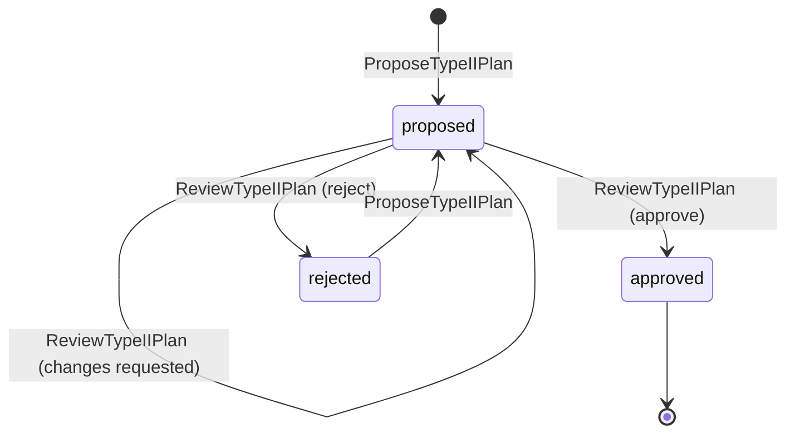
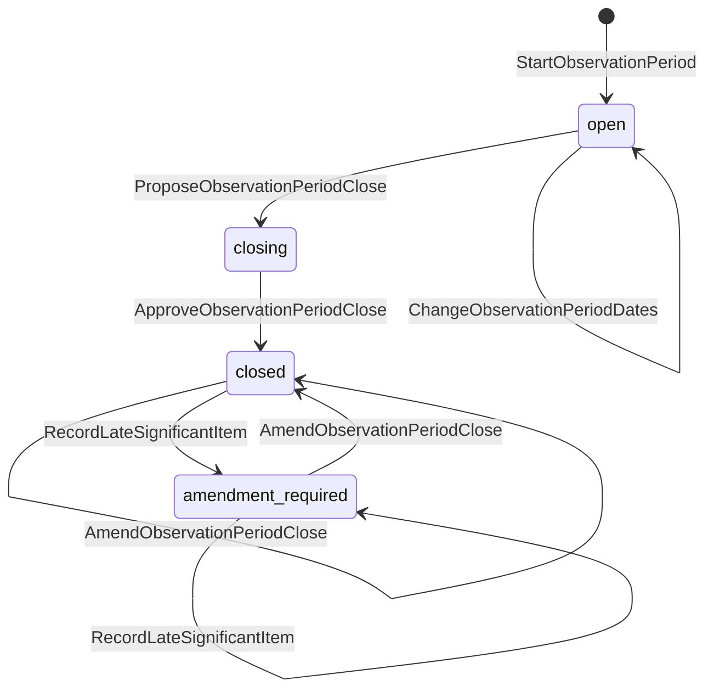
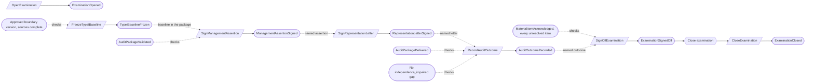
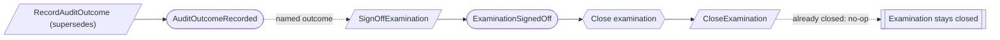
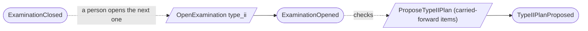

# Examinations

Status: **locked**, 2026-11-03. Hand-authored source of truth for this context.

## Purpose

Examinations records a program's SOC 2 examinations: the Type I baseline, the
Type II plan and observation period, management's assertion, representation
letter and sign-off, and the auditor's outcome and exceptions exactly as
received. The product never authors, edits or recalculates the auditor's opinion,
and holds no attest workpapers (M0-D27).

This is the examination half of the original "Engagements and handoffs" context.
Requests, responses, populations, samples and packages are in
[Auditor collaboration](auditor-collaboration.md).

**Owns:** examinations, Type I baselines, Type II plans, observation periods,
management assertions, representation letters, audit outcomes, audit test
exceptions, material item acknowledgements, and examination sign-offs.

**Does not own:**

| Concern | Owner |
| --- | --- |
| Packages, populations, samples, auditor requests | Auditor collaboration |
| The firm's `ServiceEngagement` | Firm services; an examination may reference one when the auditor is our attest team |
| Control occurrences during the period | Control environment; occurrences open on calendar windows, and the period close reads those inside the period (CE-03) |
| Findings | Assurance work; an exception may link to one |
| System description | System description; period close checks it |
| Readiness and the Type I entry decision | Readiness |

## Language

| Term | Meaning |
| --- | --- |
| Examination | One SOC 2 examination of a program: `type_i` or `type_ii`. |
| Auditor | Our firm's attest team (through a `ServiceEngagement`), an external audit firm, or unknown. |
| Target date, confirmed date | A target is a plan. A confirmed date needs an evidence reference and is never promoted from a target (M0-D01). |
| Type I baseline | The frozen, point-in-time set of exact source versions a Type I examination covers. |
| Type II plan | The approved plan for one observation period: dates, controls in scope, expected occurrences, and items carried forward. |
| Observation period | The Type II period run under an approved plan, and its close. |
| Signer | A person named on the examination as CEO or CISO, who may sign the assertion and the letter (M0-D17). |
| Audit outcome | The auditor's report conclusion, recorded exactly as received. |
| Audit test exception | An auditor-identified exception to an examination test, in the auditor's wording (M0-D23). It is not a waiver. |
| Sign-off | Management's final decision on an examination, binding the exact package, assertion, letter and outcome. |

## Aggregates

### Examination

**Identity:** `TenantId` + `ExaminationId`.

**Invariant:** one examination belongs to one program for life, has one type, an
auditor, target and confirmed dates, and named signers. It is open, then closed.

- A missing auditor or date is recorded as unknown, never as a placeholder.
- Confirming dates needs an evidence reference (EX-05).
- Only signers named here can sign the assertion, the letter and the sign-off
  (EX-04).
- When the auditor is our attest team, the examination names a `ServiceEngagement`
  that is an accepted, open attest engagement in the same tenant. That reference
  is what lets assigned attest staff act on the examination (EX-13).
- Target and confirmed dates are the examination's plan. Once a Type II
  observation period starts, the period's dates are authoritative for it (EX-08).

| Command | Who | Accepts when | Emits |
| --- | --- | --- | --- |
| OpenExamination | Compliance Lead | `ExaminationId` is new; program exists; a named engagement passes EX-13 | ExaminationOpened |
| ChangeExaminationAuditor | Compliance Lead | Open; a named engagement passes EX-13 | ExaminationAuditorChanged |
| SetExaminationTargetDates | Compliance Lead | Open | ExaminationTargetDatesSet |
| ConfirmExaminationDates | Compliance Lead | Open; evidence reference given | ExaminationDatesConfirmed |
| NameExaminationSigners | Org Admin | Open; signers are members | ExaminationSignersNamed |
| CloseExamination | Reactor on ExaminationSignedOff | Open; a repeat on a closed examination is a no-op | ExaminationClosed |

| Event | Carries |
| --- | --- |
| ExaminationOpened | tenant, examination, program, type, auditor, opened by |
| ExaminationAuditorChanged | tenant, examination, auditor (engagement, firm name, or unknown), changed by |
| ExaminationTargetDatesSet | tenant, examination, Type I as-of or period start and end, set by |
| ExaminationDatesConfirmed | tenant, examination, confirmed dates, evidence reference, confirmed by |
| ExaminationSignersNamed | tenant, examination, CEO signer, CISO signer, named by |
| ExaminationClosed | tenant, examination, sign-off |

### TypeIBaseline

**Identity:** `TenantId` + `ExaminationId` (Type I only).

**Invariant:** a baseline is frozen once, against the examination's as-of date,
an approved boundary version and a complete manifest of exact source versions.
Each amendment is a new baseline version that references the previous one and
lists every changed source; no version ever changes.

- Freezing is refused while any in-scope source has no approved version.

| Command | Who | Accepts when | Emits |
| --- | --- | --- | --- |
| FreezeTypeIBaseline | Compliance Lead | Not frozen; sources complete | TypeIBaselineFrozen |
| AmendTypeIBaseline | Compliance Lead | Frozen; changed sources and reason given | TypeIBaselineAmended |

| Event | Carries |
| --- | --- |
| TypeIBaselineFrozen | tenant, examination, version, as-of date, boundary version, source manifest and hash, frozen by |
| TypeIBaselineAmended | tenant, examination, version, previous version, changed sources, reason, manifest and hash, amended by |

### TypeIIPlan

**Identity:** `TenantId` + `ExaminationId`: one plan per Type II examination, so
the identity itself allows only one (EX-09).

**Invariant:** the plan is proposed and revised, then reviewed by someone who
authored no revision of it ([CV-06](conventions.md#guards-and-reviews)), who
approves it, requests changes, or rejects it. A rejected plan can be proposed
again as a new revision. An approved plan never changes (EX-02).

- The plan states the period dates, the controls in scope with their expected
  occurrences, and every unresolved item carried forward from the previous
  examination, each with its disposition. This replaces a separate rollover
  record (EX-01).

| Command | Who | Accepts when | Emits |
| --- | --- | --- | --- |
| ProposeTypeIIPlan | Compliance Lead | No plan yet, or rejected; examination is Type II and open | TypeIIPlanProposed |
| ReviseTypeIIPlan | Compliance Lead | Proposed | TypeIIPlanRevised |
| ReviewTypeIIPlan | Compliance Lead who authored no revision, or covered by a waiver | Proposed; reviews the current revision | TypeIIPlanChangesRequested, TypeIIPlanApproved or TypeIIPlanRejected |

| Event | Carries |
| --- | --- |
| TypeIIPlanProposed | tenant, plan, examination, period dates, controls and expected occurrences, carried-forward items and dispositions, proposed by |
| TypeIIPlanRevised | tenant, plan, revision, full plan content, revised by |
| TypeIIPlanChangesRequested | tenant, plan, revision, comments, reviewer |
| TypeIIPlanApproved | tenant, plan, revision, full plan content, approver, waiver (if any) |
| TypeIIPlanRejected | tenant, plan, revision, reason, reviewer |

### ObservationPeriod

**Identity:** `TenantId` + `ExaminationId`: one period per Type II examination,
enforced by the identity (EX-09).

**Invariant:** the period runs under the examination's approved plan. Its close
is proposed as a frozen statement, approved once, and amended only by new close
versions that reference the original. A significant item or open section review
that reaches the period after its close is approved is recorded on the period
and requires an amendment (EX-14).

- Overlap with another period of the same program is checked as advice
  ([CV-05](conventions.md#guards-and-reviews)); an overlap shows as the
  `overlapping_periods` gap and is repaired by changing dates (EX-06).

- The proposed close reconciles expected occurrences against actual ones, lists
  every significant item in the period, and lists unresolved material items.
- Approving the close needs management to acknowledge each unresolved material
  item, and is refused while any system description section review is open or any
  change or incident dated in the period is unassessed. Every unresolved material
  item listed in the proposed close needs a `MaterialItemAcknowledgement` before
  approval (EX-10). These checks are advice; the approved close records the
  section reviews and assessments it relied on, and anything later is handled by
  the late-item rule (EX-14).
- The period starts with the approved plan's dates. Dates can change only while
  the period is open and not closing. The close reads the control occurrences
  whose windows fall inside the period's dates at the time of the close (EX-08,
  CE-03).

| Command | Who | Accepts when | Emits |
| --- | --- | --- | --- |
| StartObservationPeriod | Compliance Lead | Plan approved; no period yet; dates do not overlap (advice) | ObservationPeriodStarted |
| ChangeObservationPeriodDates | Compliance Lead | Open; no overlap (advice); reason given | ObservationPeriodDatesChanged |
| ProposeObservationPeriodClose | Compliance Lead | Open; period end reached | ObservationPeriodCloseProposed |
| ApproveObservationPeriodClose | A signer | Closing; every unresolved material item in the close is acknowledged; no open section review; no unassessed change or incident in the period | ObservationPeriodCloseApproved |
| RecordLateSignificantItem | Reactor on a significant assessment dated in the period, or SectionReviewOpened, after the close was approved | Closed or amendment required; a repeat is a no-op | LateSignificantItemRecorded |
| AmendObservationPeriodClose | Compliance Lead | Closed or amendment required; changed sources and reason given; covers every late item recorded | ObservationPeriodCloseAmended |

| Event | Carries |
| --- | --- |
| ObservationPeriodStarted | tenant, period, examination, program, plan, start, end, started by |
| ObservationPeriodDatesChanged | tenant, period, previous dates, new dates, reason, changed by |
| ObservationPeriodCloseProposed | tenant, period, close version, occurrence reconciliation, significant items, unresolved material items, manifest and hash, proposed by |
| ObservationPeriodCloseApproved | tenant, period, close version, acknowledgements relied on, section reviews and assessments relied on, signer |
| LateSignificantItemRecorded | tenant, period, item (change, incident or section review), recorded at |
| ObservationPeriodCloseAmended | tenant, period, close version, previous close version, changed sources, reason, manifest and hash, amended by |

### ManagementAssertion

**Identity:** `TenantId` + `AssertionId`, for one examination.

**Invariant:** one assertion has authored revisions and is signed once by a named
signer, on its current revision and an exact validated package version. A
signed assertion never changes; a changed one is a new assertion.

- The package must contain what the examination rests on: for Type I, a frozen
  baseline version; for Type II, the approved period close version. Signing is
  refused otherwise, and the signed event names that version (EX-11).

| Command | Who | Accepts when | Emits |
| --- | --- | --- | --- |
| DraftManagementAssertion | Compliance Lead | `AssertionId` is new; examination open | ManagementAssertionDrafted |
| ReviseManagementAssertion | Compliance Lead | Not signed | ManagementAssertionRevised |
| SignManagementAssertion | A named signer | Not signed; names a validated package of this examination that contains the baseline (Type I) or approved close (Type II) | ManagementAssertionSigned |

| Event | Carries |
| --- | --- |
| ManagementAssertionDrafted | tenant, assertion, examination, text, drafted by |
| ManagementAssertionRevised | tenant, assertion, revision, text, revised by |
| ManagementAssertionSigned | tenant, assertion, revision, package and manifest hash, baseline version or close version, signer |

### RepresentationLetter

**Identity:** `TenantId` + `LetterId`, for one examination.

**Invariant:** one letter lists its required signers, taken from the
examination's named signers. It is signed when every required signer has signed
it once; no one else can sign.

- The letter names the exact signed assertion it follows, and signing is refused
  until that assertion is signed (M0-D17 order, [CV-07](conventions.md#guards-and-reviews)).

| Command | Who | Accepts when | Emits |
| --- | --- | --- | --- |
| RecordRepresentationLetter | Compliance Lead | `LetterId` is new; signers listed; names an assertion of this examination | RepresentationLetterRecorded |
| SignRepresentationLetter | A required signer | Not yet signed by them; the named assertion is signed | RepresentationLetterSignedBy, then RepresentationLetterSigned when complete |

| Event | Carries |
| --- | --- |
| RepresentationLetterRecorded | tenant, letter, examination, assertion, text, required signers, recorded by |
| RepresentationLetterSignedBy | tenant, letter, signer, signed at |
| RepresentationLetterSigned | tenant, letter, assertion, signers |

### AuditOutcome

**Identity:** `TenantId` + `OutcomeId`.

**Invariant:** one outcome records one auditor report conclusion exactly as
received, for one examination and an exact delivered package version. It never
changes. A reissued report is a new outcome that supersedes the earlier one.

- The outcome names the signed representation letter and the delivered package
  version it rests on. Recording is refused until that letter is signed and that
  package has a recorded delivery (M0-D17 order, CV-07).
- Recording is refused while the examination's attest engagement shows
  `independence_impaired` (FS-11).
- Management's evaluations and sign-offs stay separate records.

| Command | Who | Accepts when | Emits |
| --- | --- | --- | --- |
| RecordAuditOutcome | Compliance Lead, or attest staff on the engagement | `OutcomeId` is new; named letter signed; named package delivered; no `independence_impaired` gap | AuditOutcomeRecorded |

| Event | Carries |
| --- | --- |
| AuditOutcomeRecorded | tenant, outcome, examination, letter, package and manifest hash, opinion as received, report reference, supersedes (if reissued), recorded by |

### AuditTestException

**Identity:** `TenantId` + `ExceptionId`.

**Invariant:** one exception keeps the auditor's wording exactly as received, its
corrections as received in order, management's responses, and its links to
findings. Nothing is ever overwritten.

| Command | Who | Accepts when | Emits |
| --- | --- | --- | --- |
| RecordAuditTestException | Compliance Lead, or attest staff on the engagement | `ExceptionId` is new | AuditTestExceptionRecorded |
| RecordAuditTestExceptionCorrection | Same | Exists | AuditTestExceptionCorrected |
| RespondToAuditTestException | Compliance Lead | Exists | AuditTestExceptionResponded |
| LinkAuditTestExceptionToFinding | Compliance Lead | Not linked to that finding | AuditTestExceptionLinkedToFinding |

| Event | Carries |
| --- | --- |
| AuditTestExceptionRecorded | tenant, exception, examination, test reference, auditor wording, recorded by, on behalf of |
| AuditTestExceptionCorrected | tenant, exception, correction sequence, corrected wording, recorded by, on behalf of |
| AuditTestExceptionResponded | tenant, exception, response, responded by |
| AuditTestExceptionLinkedToFinding | tenant, exception, finding, linked by |

### MaterialItemAcknowledgement

**Identity:** `TenantId` + `ExaminationId` + item. An item is an unresolved
material item listed in a proposed period close, or an audit test exception
without a resolved finding.

**Invariant:** one unresolved material item is acknowledged once by a named
signer, with a note. It never changes. Different signers may acknowledge
different items at different times (EX-10).

| Command | Who | Accepts when | Emits |
| --- | --- | --- | --- |
| AcknowledgeMaterialItem | A named signer | Item is listed as unresolved for this examination; not yet acknowledged; note given | MaterialItemAcknowledged |

| Event | Carries |
| --- | --- |
| MaterialItemAcknowledged | tenant, examination, item, note, signer, acknowledged at |

### ExaminationSignOff

**Identity:** `TenantId` + `ExaminationId` + `OutcomeId`.

**Invariant:** one outcome receives one sign-off by a named signer, binding the
exact package, assertion, letter and outcome versions, after every unresolved
material item has a `MaterialItemAcknowledgement` (EX-03, EX-10). A reissued
outcome gets its own sign-off; the examination closes on the first one and stays
closed (EX-12).

| Command | Who | Accepts when | Emits |
| --- | --- | --- | --- |
| SignOffExamination | A named signer | Names the outcome, which is recorded and not superseded; every unresolved material item is acknowledged | ExaminationSignedOff |

| Event | Carries |
| --- | --- |
| ExaminationSignedOff | tenant, examination, outcome, letter, assertion, package and manifest hash, acknowledgements relied on, signer |

Every event carries the tenant, the record ID, its content or changed values, and
the actor.

## Flows

Diagrams follow [CV-01](conventions.md#flow-diagrams): dotted edges are the
facts each command checks.

### Type I examination

Each signing step names the exact record before it, in the M0-D17 order: package
validated (holding the baseline), assertion signed, letter signed, package
delivered and outcome recorded (EX-11, CV-07).

### Type II examination

```mermaid
flowchart LR
    C1[/ProposeTypeIIPlan/] --> E1([TypeIIPlanProposed])
    E1 -. "current revision; reviewer authored none" .-> C2[/ReviewTypeIIPlan/] --> E2([TypeIIPlanApproved])
    E2 -. "one approved plan, one period per examination" .-> C3[/StartObservationPeriod/] --> E3([ObservationPeriodStarted])
    C4[/ChangeObservationPeriodDates/] --> E4([ObservationPeriodDatesChanged])
    OC[[Control environment: occurrences in the period's windows]] -. "reconciled" .-> C5
    E3 -. "period end reached" .-> C5[/ProposeObservationPeriodClose/] --> E5([ObservationPeriodCloseProposed])
    SD[[System description: no open SectionReview; Change and incident: none unassessed]] -. checks .-> C6
    E5 -. "items listed" .-> CA[/AcknowledgeMaterialItem/] --> EA([MaterialItemAcknowledged])
    EA -. "every listed item" .-> C6
    E5 -. checks .-> C6[/ApproveObservationPeriodClose/] --> E6([ObservationPeriodCloseApproved])
    E6 -. "close in the package" .-> C7[/SignManagementAssertion/] --> X2[[Signing chain as for Type I]]
```

After the close is approved, the signing chain is the same as for Type I, with
the approved close version in place of the baseline.

### Reissued report

### Next period

Moving on needs no reactor and no rollover record. A person opens the next
examination and proposes its Type II plan, listing every unresolved item carried
forward (EX-01).

## Disagreement and replay

Cases required by [CV-12](conventions.md#guards-and-reviews).

| Case | Outcome |
| --- | --- |
| A section review opens just as the close is approved | The close records what it relied on; the review arriving after is recorded as a late item and the period requires an amendment |
| A change dated in the period is recorded and assessed significant after close | Same: `LateSignificantItemRecorded`, then `AmendObservationPeriodClose` |
| The late-item reaction is delivered twice | The repeat is a no-op |
| Two periods of a program are started with overlapping dates at the same moment | Both start; the `overlapping_periods` gap shows until dates are changed |

## Decisions

Jev answers are from `jev-1.14.0`, 2026-11-03. A yes is ≥ 0.8 and a no is ≤ 0.2.
Anything in between is settled by common sense, with the reasoning stated.

| ID | Decision | Evidence |
| --- | --- | --- |
| EX-01 | No rollover record: the next examination's Type II plan lists the carried-forward items. Replaces `ProgramRollover` and its 9-stage execution process. | Separate record needed: 0.25. Common sense: the plan already carries the items, and PS-02 moved rollover here. |
| EX-02 | A Type II plan needs a reviewer other than the proposer, who may also approve; waivers cover very small teams. | Three distinct people: 0.15. Same as PS-04. |
| EX-03 | Management's sign-off is its own record; closing the examination follows it. | Sign-off is just the close: 0.09. |
| EX-04 | Each examination names its CEO and CISO signers, and only they sign. | 0.56. Common sense: a signing gate needs a recorded fact (as FS-07). |
| EX-05 | Confirmed dates are separate from targets and need an evidence reference. | M0-D01. |
| EX-06 | Period overlap is advice with an `overlapping_periods` gap; no observation calendar aggregate. | Small independent aggregates. Overlap is visible and repaired by changing dates (CV-05). |
| EX-07 | Auditor-found exceptions are `AuditTestException`, the M0-D23 name, replacing `AuditObservation`. | M0-D23 vocabulary. |
| EX-08 | Examination target and confirmed dates are the plan; once a period starts, its dates are authoritative. The period starts with the approved plan's dates, and the close reads the occurrences inside the period's dates; Control environment opens occurrences on calendar windows regardless (CE-03). | Flow audit G4. |
| EX-09 | An examination has one Type II plan and one observation period, enforced by keying both by `ExaminationId`. | Flow audit G3. 0.66. Common sense: a Type II examination covers one period; a new period is a new examination. Identity replaces the earlier current-state check (CV-11). |
| EX-10 | Each unresolved material item is acknowledged as its own `MaterialItemAcknowledgement` by a named signer, with a note. `ApproveObservationPeriodClose` and `SignOffExamination` check that every listed item is acknowledged. | Flow audit B5: the guard otherwise had no fact to read. Separate facts, one per item: 0.80. Acknowledging all of them inside the approval: 0.40. |
| EX-11 | `SignManagementAssertion` needs a validated package that contains the frozen Type I baseline or the approved Type II close version, and records which. | Flow audit B4. 0.84. |
| EX-12 | Each outcome gets its own sign-off (`ExaminationSignOff` is keyed by examination and outcome). The examination closes on the first sign-off; a reissued report is recorded and signed off on the closed examination. | Flow audit G2. Reissue without a new sign-off: 0.33; skipping it harms: 0.71. A fresh sign-off itself was 0.46, so this rests on the harm answer. |
| EX-13 | An examination names a `ServiceEngagement` only when it is an accepted, open attest engagement in the same tenant. | Flow audit: that reference grants attest staff access to the examination. 0.81. |
| EX-14 | A significant item or section review that reaches a period after its close is approved is recorded on the period, which then requires an amendment that covers it. | Portia guidelines review: the close's checks are advice, so a late fact must be recorded rather than lost (CV-08, CV-12). |

## Open questions

None at this time.

## Superseded owners

| Old owner | Becomes |
| --- | --- |
| ExaminationEngagement | Examination and TypeIBaseline |
| ImmutableSnapshot, ProgramScopeSnapshotProcess | TypeIBaseline (the baseline is the snapshot) |
| TypeIIPlan | TypeIIPlan |
| TypeIIPeriod | ObservationPeriod |
| TypeIIObservationCalendar | Removed (EX-06) |
| ManagementAssertion | ManagementAssertion |
| ManagementRepresentationLetter | RepresentationLetter |
| AuditOutcome | AuditOutcome |
| AuditObservation | AuditTestException (EX-07) |
| ExaminationSignOff | ExaminationSignOff |
| ProgramRolloverExecutionProcess | Removed (EX-01) |
