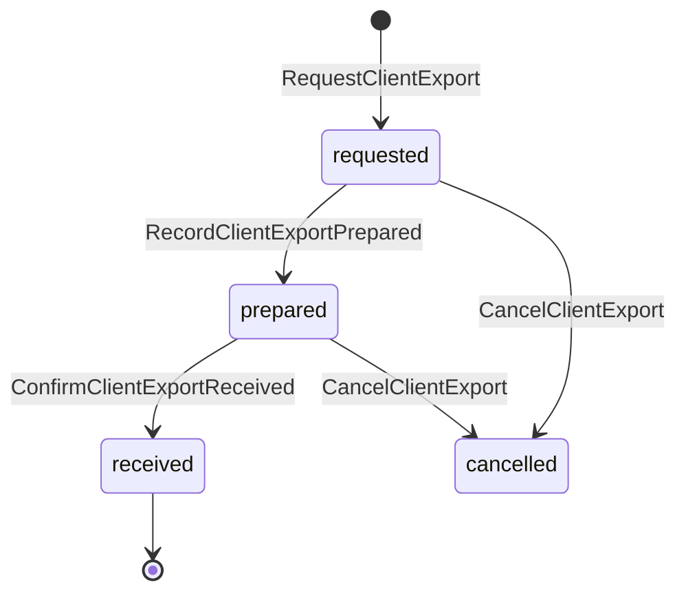

# Exports

Status: **reopened for snapshot authority**, 2026-11-05. Preparation is a design target pending the authority guarantees in Open questions.
It follows the [context conventions](conventions.md).

## Purpose

Exports gives an organization a complete copy of its own records and evidence,
at any time and as the required step before offboarding (M0-D16, M0-D25).

**Owns:** client exports.

**Does not own:**

| Concern | Owner |
| --- | --- |
| Offboarding | [Platform access](platform-access.md); completion waits on `ClientExportReceived` |
| The attest record package delivered to the firm's audit software | [Firm services](firm-services.md) (M0-D27) |
| Audit packages for auditors | [Auditor collaboration](auditor-collaboration.md) |
| Evidence retention after the export | [Retention](retention.md) |
| Building the archive files | Technical; a failed build is retried ([CV-03](conventions.md#reactors)) |

## Language

| Term | Meaning |
| --- | --- |
| Client export | One complete copy of the tenant's records and evidence as of a time, for a named recipient. |
| Inventory | A streamed view of individually recorded included and withheld outcomes from the export's exact source cut; each withheld outcome has its reason. |
| Withheld | A record left out on purpose: `quarantined` (an artifact that failed inspection), `disposed` (only its tombstone is included) or `firm_workpaper` (attest workpapers belong to the firm). |
| Recipient | An Org Admin named on the request who confirms receipt. |

## Local preparation decision and streamed export

M0-D25 and the offboarding policy still require the organization's complete
copy, including an explicit inventory of permitted exclusions. The previous
proposal made `RecordClientExportPrepared` depend on collecting all item
outcomes. That is not a qualified write-model decision; dividing the outcomes
into windows or replacing them with an unverified digest does not fix it.

Candidate: the export owns its request, one exact build intent and lifecycle.
Each eligible source version and its included/withheld decision has an
independent authority and idempotency boundary. A technical builder streams a
**qualified** immutable source selection, consults each applicable owner and
writes bounded archive segments and a streamed inventory. It emits one durable
build result bound to the exact tenant, selection, archive bytes, export intent
and recipient. The export owner can record that one result and later one
recipient confirmation without loading or owning every item.

This is not yet an authoritative completion protocol. A signed builder result
or valid archive hash proves only the reported bytes; it does not prove an
unknown producer, withheld item, delayed participant or failed source was not
omitted. No complete cross-context source selection, source-retention contract,
result authority, or recovery protocol has been established. The candidate
therefore must not call an export complete or allow offboarding until those
obligations are specified and qualified. A projection-based progress indicator
may be shown as advisory and cannot satisfy this product requirement.

An organization export is not an auditor package. It must still respect
artifact-owner quarantine, disposition, and handling-class restrictions for
each item. A source-level authorization checked before streaming can race
quarantine or disposal; the artifact owner must order the actual transfer with
those changes, including interrupted transfers, exact retries and release. The
scope of previously sent bytes and any failure to provide the promised complete
copy must be visible. This per-item delivery authority and the policy for already
prepared archives remain unresolved; see [auditor disclosure candidates](auditor-collaboration.md#local-decisions-and-immutable-delivery-views).

## Aggregates

### ClientExport

**Identity:** `TenantId` + `ExportId`.

**Invariant:** one export is requested for one recipient, references one
qualified prepared result, and counts as delivered only when that recipient
confirms receipt (XP-02). A prepared export never changes; a newer copy is a
new export. The required complete-copy guarantee and the authority to certify
the single result remain unqualified, as described above.

| Command | Who | Accepts when | Emits |
| --- | --- | --- | --- |
| RequestClientExport | Org Admin; platform operator while offboarding | `ExportId` is new; tenant active or offboarding; recipient is an active Org Admin | ClientExportRequested |
| RecordClientExportPrepared | Export builder (reactor) | Requested; one qualified build result for the exact intent; result authority and complete-source guarantee unresolved; exact retry is a no-op | ClientExportPrepared |
| ConfirmClientExportReceived | The recipient; or a platform operator recording the recipient's written confirmation | Prepared; confirmation evidence given when recorded by an operator | ClientExportReceived |
| CancelClientExport | Its requester or a platform operator | Not received; reason given | ClientExportCancelled |

| Event | Carries |
| --- | --- |
| ClientExportRequested | tenant, export, recipient, as of, offboarding (yes or no), requested by |
| ClientExportPrepared | tenant, export, exact source and outcome cuts, incremental archive and inventory digests, bounded counts, archive terminal reference, prepared at |
| ClientExportReceived | tenant, export, recipient, confirmation (in product, or the operator's evidence), received at |
| ClientExportCancelled | tenant, export, reason, cancelled by |

### ClientExportItem

**Identity:** `TenantId` + `ExportId` + canonical source identity.

**Invariant:** one item records its exact source version, content identity, and
one accepted outcome:
included, or withheld with its reason. For a disposed artifact its one outcome
records that the content is withheld and identifies the separate tombstone
representation that is included; it does not claim the unavailable content was
included. A retry with the same intent returns the same outcome; conflicting
intent is refused or starts a new export. Outcome records are independent; the
export aggregate has no inventory collection and no per-item event history.

An exact source selection must cover every eligible tenant record and evidence source,
including the committed source version, and define the business as-of date
separately from the commit position. A later backdated correction must follow an
explicit new-export or correction rule; it cannot silently rewrite a prepared
export. Each source is accounted for exactly once by an accepted participant
outcome, including any separately identified tombstone representation. A
paginated projection can discover work but cannot prove no producer or source
was omitted. Missing retained history, missing outcomes, inconsistent
selection, or unknown disposition keeps preparation pending. Counts or a digest alone
cannot establish completeness.

The technical builder streams records, evidence and inventory presentation in
canonical order and checks each pinned source version, hash and output size; it
never collects the entire dataset or inventory in memory. A recipient-facing
archive is a deliverable, not a domain aggregate. For repeatable bytes, retain
bounded ordered storage segments plus a terminal reference and incremental
digest; never a single large stored content object. The proposed single build
result must be qualified against the source-selection and outcome guarantees;
merely relabeling a collection-wide business decision as a worker receipt is
not proof. See
[snapshot and admission requirements](auditor-collaboration.md#snapshot-and-admission-requirements).

## Flows

Diagrams follow [CV-01](conventions.md#flow-diagrams).

## Decisions

Jev answers are from `jev-1.14.0`, 2026-11-03. A yes is ≥ 0.8 and a no is ≤ 0.2.
Anything in between is settled by common sense, with the reasoning stated.

| ID | Decision | Evidence |
| --- | --- | --- |
| XP-01 | An Org Admin can request an export at any time; a platform operator can during offboarding. | 0.79. Common sense: the data is the organization's. |
| XP-02 | Delivery counts only when the recipient confirms receipt. | 0.61. Common sense: offboarding ends access, so it must wait on proof the client has its copy. |
| XP-03 | The inventory lists every withheld record with its reason. | 0.65. Common sense: a client can see the export is complete except for what is named. |

## Open questions

- Prove a retained, authoritative tenant-wide enumeration and consistent commit cut across all record and evidence producers, including source versions and later backdated facts. The current design does not establish this.
- Specify item admission, participant outcomes and fencing against late changes, content-retention and bounded archive segments, and the correction or new-export rule. Preparation stays pending on failure or uncertainty.

## Superseded owners

| Old owner | Becomes |
| --- | --- |
| ClientExport | ClientExport; `RecordClientExportDelivery` becomes `ConfirmClientExportReceived` |
| `ClientExportBuildFailed` | Removed: a build failure is retried, not a domain fact |
