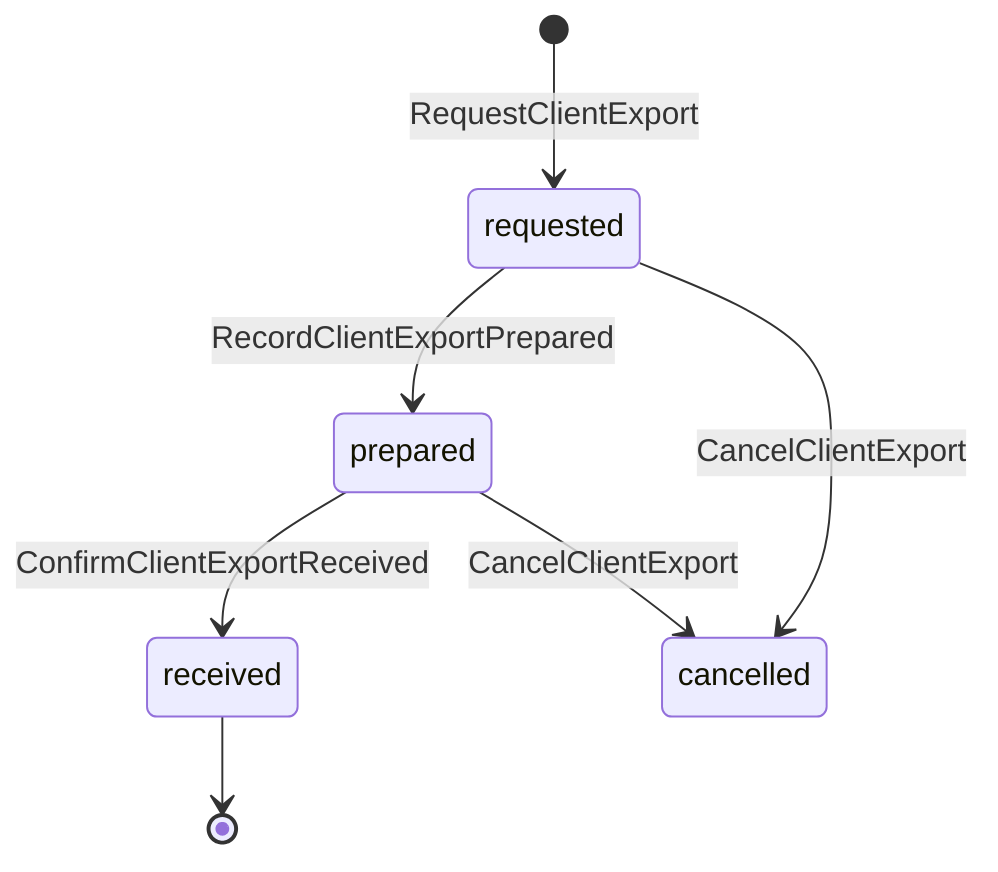

# Exports

Status: **locked**, 2026-11-03. Hand-authored source of truth for this context.
It follows the [context conventions](conventions.md).

## Purpose

Exports gives an organization a complete copy of its own records and evidence,
at any time and as the required step before offboarding (M0-D16, M0-D25).

**Owns:** client exports.

**Does not own:**

| Concern | Owner |
| --- | --- |
| Offboarding | [Platform access](platform-access.md); completion waits on `ClientExportReceived` |
| The attest record package delivered to the firm's audit software | [Firm services](firm-services.md) (M0-D27) |
| Audit packages for auditors | [Auditor collaboration](auditor-collaboration.md) |
| Evidence retention after the export | [Retention](retention.md) |
| Building the archive files | Technical; a failed build is retried ([CV-03](conventions.md#reactors)) |

## Language

| Term | Meaning |
| --- | --- |
| Client export | One complete copy of the tenant's records and evidence as of a time, for a named recipient. |
| Inventory | The list, frozen when the export is prepared, of every record included and every record withheld, with each withholding reason. |
| Withheld | A record left out on purpose: `quarantined` (an artifact that failed inspection), `disposed` (only its tombstone is included) or `firm_workpaper` (attest workpapers belong to the firm). |
| Recipient | An Org Admin named on the request who confirms receipt. |

## Aggregates

### ClientExport

**Identity:** `TenantId` + `ExportId`.

**Invariant:** one export is requested for one recipient, prepared once with a
frozen inventory whose archive counts match it, and counts as delivered only when
the recipient confirms receipt (XP-02). A prepared export never changes; a newer
copy is a new export.

| Command | Who | Accepts when | Emits |
| --- | --- | --- | --- |
| RequestClientExport | Org Admin; platform operator while offboarding | `ExportId` is new; tenant active or offboarding; recipient is an active Org Admin | ClientExportRequested |
| RecordClientExportPrepared | Export builder (reactor) | Requested; archive counts match the inventory; a repeat is a no-op | ClientExportPrepared |
| ConfirmClientExportReceived | The recipient; or a platform operator recording the recipient's written confirmation | Prepared; confirmation evidence given when recorded by an operator | ClientExportReceived |
| CancelClientExport | Its requester or a platform operator | Not received; reason given | ClientExportCancelled |

| Event | Carries |
| --- | --- |
| ClientExportRequested | tenant, export, recipient, as of, offboarding (yes or no), requested by |
| ClientExportPrepared | tenant, export, inventory (included and withheld with reasons), counts, manifest hash, prepared at |
| ClientExportReceived | tenant, export, recipient, confirmation (in product, or the operator's evidence), received at |
| ClientExportCancelled | tenant, export, reason, cancelled by |

## Flows

Diagrams follow [CV-01](conventions.md#flow-diagrams).

```mermaid
flowchart LR
    C1[/RequestClientExport/] --> E1([ClientExportRequested])
    E1 --> R1{{"Build archive (retry technical failures)"}} --> C2[/RecordClientExportPrepared/] --> E2([ClientExportPrepared])
    E2 -. checks .-> C3[/ConfirmClientExportReceived/] --> E3([ClientExportReceived])
    E3 -. "offboarding waits on it" .-> X1[[Platform access: CompleteTenantOffboarding]]
```

## Decisions

Jev answers are from `jev-1.14.0`, 2026-11-03. A yes is ≥ 0.8 and a no is ≤ 0.2.
Anything in between is settled by common sense, with the reasoning stated.

| ID | Decision | Evidence |
| --- | --- | --- |
| XP-01 | An Org Admin can request an export at any time; a platform operator can during offboarding. | 0.79. Common sense: the data is the organization's. |
| XP-02 | Delivery counts only when the recipient confirms receipt. | 0.61. Common sense: offboarding ends access, so it must wait on proof the client has its copy. |
| XP-03 | The inventory lists every withheld record with its reason. | 0.65. Common sense: a client can see the export is complete except for what is named. |

## Open questions

None at this time.

## Superseded owners

| Old owner | Becomes |
| --- | --- |
| ClientExport | ClientExport; `RecordClientExportDelivery` becomes `ConfirmClientExportReceived` |
| `ClientExportBuildFailed` | Removed: a build failure is retried, not a domain fact |
