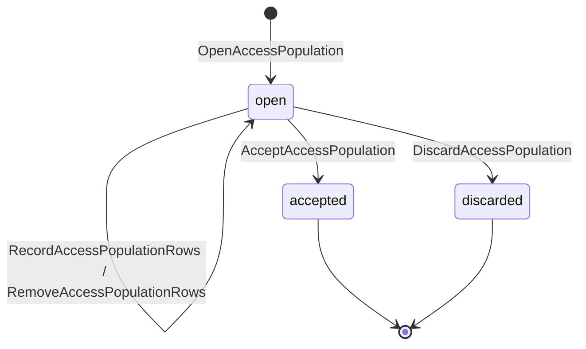
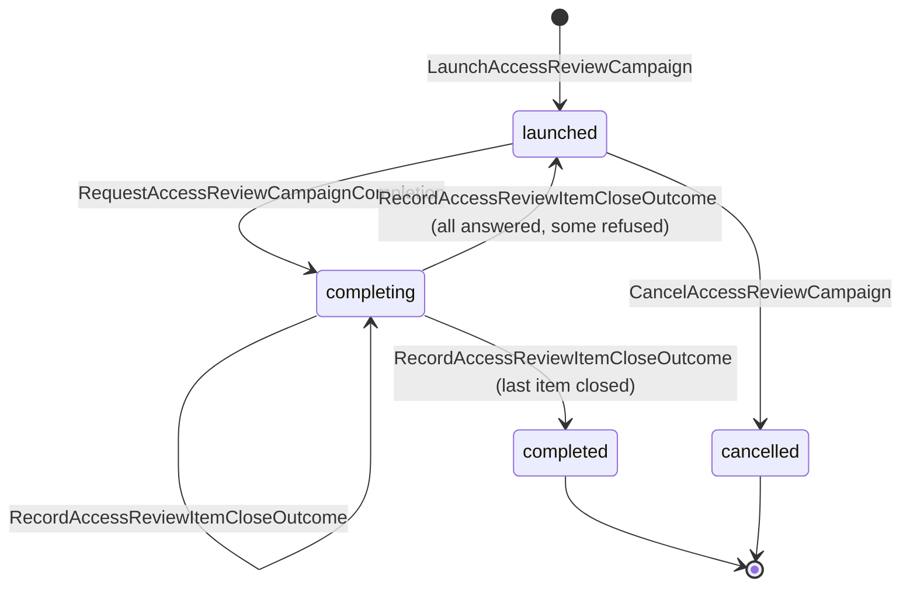
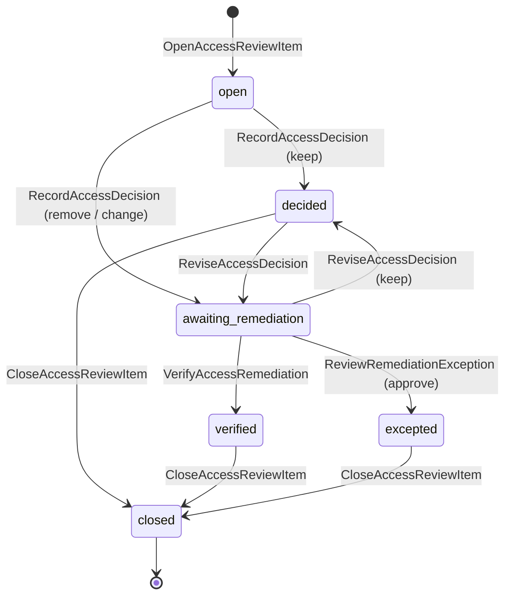
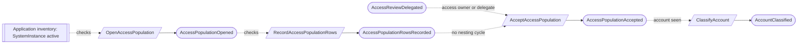
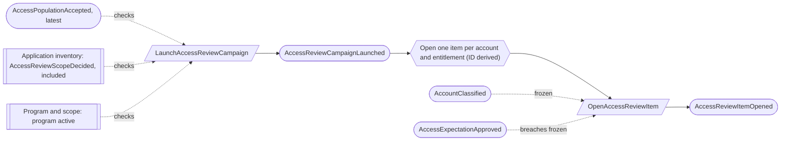
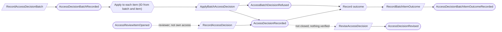
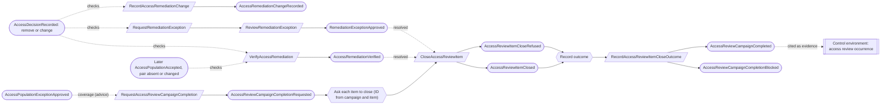

# External access governance

Status: **locked**, 2026-11-03. Hand-authored source of truth for this context.
It follows the [context conventions](conventions.md).

## Purpose

External access governance proves who has access to the organization's outside
systems and that the right people reviewed it (M0-D07). It records observed
access populations per system instance, classifies the accounts in them, states
what access is expected, and runs access review campaigns through to verified
remediation. The product never changes access at an outside system.

**Owns:** access expectations and their exceptions, access review delegations,
access populations, account classifications, access review campaigns, review
items, decision batches and missing-population exceptions.

**Does not own:**

| Concern | Owner |
| --- | --- |
| System instances, access owners and access-review scope | [Application inventory](application-inventory.md) (`SystemInstance`, `AccessReviewScope`) |
| Workforce people and service identities | [Workforce assurance](workforce-assurance.md) |
| Separation-of-duties waivers | [Platform access](platform-access.md) |
| The recurring access review as a control | [Control environment](control-environment.md); its occurrence cites the campaign (M0-D19) |
| Imports and connectors | Deferred; populations are entered by hand (M0-D07, M0-D20) |
| Reminders and work items | [Work queue](work-queue.md) (M0-D15) |

## Language

| Term | Meaning |
| --- | --- |
| Population | The accounts, groups, roles, group memberships and direct entitlement assignments observed at one system instance at one time, accepted as complete and then immutable. |
| Direct assignment | An entitlement the source shows as granted directly to a principal. Inherited access is never recorded as an assignment. |
| Effective access | Computed from an accepted population: each account's entitlements with every path (nested groups, role assumption) that grants them. Never recorded as a fact. |
| Principal kind | `user_account`, `group`, `role`, `service_principal`, `workload_identity`, `access_token` or `app_installation`. |
| Entitlement kind | `membership`, `role_assignment`, `permission_set_assignment`, `permission`, `repository_access` or `admin_privilege`. |
| Classification | What an account is: `human` (one workforce person), `nhi` (one service identity), `shared` (an accountable owner and a justification) or `unclassified` (a review exception). |
| Expectation | An approved rule for one system instance: `forbidden_principal_kind`, `privileged_entitlement` or `requires_expiry`, with parameters. |
| Breach | Computed: an observed account or assignment that an approved expectation forbids or that lacks a required expiry. |
| Delegate | A member named to accept populations and review access for one system instance in place of its access owner. |
| Campaign | One review of frozen populations, placed in one program, with reviewers, a remediation owner and a deadline (R2 campaign routing). |
| Review item | One account–entitlement pair from a frozen population, decided `keep`, `remove` or `change`. |
| Remediation | The removal or change of an entitlement at the outside system, verified only by a later accepted population. |

## Aggregates

### AccessExpectation

**Identity:** `TenantId` + `ExpectationId`, for one system instance for life.

**Invariant:** one expectation is a line of versions of one rule kind for one
instance. A version takes effect only once approved by a Compliance Lead who did
not propose it ([CV-06](conventions.md#guards-and-reviews), EA-08). Different
expectations on one instance coexist.

| Command | Who | Accepts when | Emits |
| --- | --- | --- | --- |
| ProposeAccessExpectation | Compliance Lead or the instance's access owner or delegate | Instance active; rule kind and parameters valid; names the current version (none for the first); none pending | AccessExpectationProposed |
| ReviewAccessExpectation | Compliance Lead who did not propose it, or covered by a waiver | Pending | AccessExpectationApproved or AccessExpectationRejected |
| RetireAccessExpectation | Compliance Lead | Approved; reason given | AccessExpectationRetired |

| Event | Carries |
| --- | --- |
| AccessExpectationProposed | tenant, expectation, instance, version, rule kind, parameters, rationale, proposed by |
| AccessExpectationApproved | tenant, expectation, version, approver, waiver (if any) |
| AccessExpectationRejected | tenant, expectation, version, comments, reviewer |
| AccessExpectationRetired | tenant, expectation, reason, retired by |

### AccessExpectationException

**Identity:** `TenantId` + `ExceptionId`.

**Invariant:** one exception excuses one exact account and entitlement from one
expectation until its expiry, with a rationale. It takes effect once approved by a
Compliance Lead or Org Admin who did not request it, and ends when it expires
(computed) or is revoked (EA-05).

| Command | Who | Accepts when | Emits |
| --- | --- | --- | --- |
| RequestAccessExpectationException | Compliance Lead or the instance's access owner or delegate | `ExceptionId` is new; expectation approved; rationale given; expiry after now | AccessExpectationExceptionRequested |
| ReviewAccessExpectationException | Compliance Lead or Org Admin, not the requester | Requested; unexpired | AccessExpectationExceptionApproved or AccessExpectationExceptionRejected |
| RevokeAccessExpectationException | Compliance Lead or Org Admin | Approved; unexpired; reason given | AccessExpectationExceptionRevoked |

| Event | Carries |
| --- | --- |
| AccessExpectationExceptionRequested | tenant, exception, expectation, instance, account (provider subject ID), entitlement, rationale, expires at, requested by |
| AccessExpectationExceptionApproved | tenant, exception, approver |
| AccessExpectationExceptionRejected | tenant, exception, comments, reviewer |
| AccessExpectationExceptionRevoked | tenant, exception, reason, revoked by |

### AccessReviewDelegation

**Identity:** `TenantId` + `SystemInstanceId`.

**Invariant:** one instance has a set of delegates, each an active member, named
by the access owner or a Compliance Lead. Delegates act only while they remain
active members (checked at each use).

| Command | Who | Accepts when | Emits |
| --- | --- | --- | --- |
| DelegateAccessReview | Member linked to the access owner, or Compliance Lead | Instance active; delegate is an active member; not already a delegate | AccessReviewDelegated |
| RevokeAccessReviewDelegation | Member linked to the access owner, or Compliance Lead | A delegate | AccessReviewDelegationRevoked |

| Event | Carries |
| --- | --- |
| AccessReviewDelegated | tenant, instance, delegate, delegated by |
| AccessReviewDelegationRevoked | tenant, instance, delegate, revoked by |

### AccessPopulation

**Identity:** `TenantId` + `PopulationId`, for one system instance for life.

**Invariant:** one population records what was observed at one exact instance
version at one time. Rows are entered while it is open. It is accepted as
complete by the instance's access owner or a delegate (EA-06), and from then on
never changes; a correction is a new population that names the one it supersedes.

- A provider subject ID appears once per population; every assignment names a
  principal in it.
- Acceptance is refused when group nesting has a cycle (M0-D07).
- Acceptance states the population's scope, observation time and completeness,
  and records a content hash.
- Rows are entered as row files stored by content hash; events carry each file's
  hash and row count, never the rows, so the stream stays small however large the
  population is (EA-12).

| Command | Who | Accepts when | Emits |
| --- | --- | --- | --- |
| OpenAccessPopulation | Compliance Lead, or the access owner or a delegate | `PopulationId` is new; instance active; observed at not in the future; source `manual_attestation`; a superseded population is accepted and of the same instance | AccessPopulationOpened |
| RecordAccessPopulationRows | The opener, the access owner or a delegate | Open; the row file is stored and its rows valid | AccessPopulationRowsRecorded |
| RemoveAccessPopulationRows | The opener, the access owner or a delegate | Open; names a row file recorded here | AccessPopulationRowsRemoved |
| AcceptAccessPopulation | The access owner or a delegate | Open; rules above hold; completeness statement given | AccessPopulationAccepted |
| DiscardAccessPopulation | The opener or Compliance Lead | Open; reason given | AccessPopulationDiscarded |

| Event | Carries |
| --- | --- |
| AccessPopulationOpened | tenant, population, instance, instance version, observed at, source, supersedes (if any), opened by |
| AccessPopulationRowsRecorded | tenant, population, row file hash, row counts by kind (principals, group memberships, role assumptions, entitlements, assignments), recorded by |
| AccessPopulationRowsRemoved | tenant, population, row file hash, removed by |
| AccessPopulationAccepted | tenant, population, row files, row count, content hash, completeness statement, accepted by |
| AccessPopulationDiscarded | tenant, population, reason, discarded by |

### AccountClassification

**Identity:** `TenantId` + `SystemInstanceId` + `ProviderSubjectId`.

**Invariant:** one account at one instance has one current classification, kept
across later populations, with its history (EA-02):

- `human` names one workforce person and no service identity; `nhi` names one
  service identity and no person; `shared` names an accountable person and a
  justification; `unclassified` names nothing.
- An account with no classification is `unclassified`.
- A classification is due for reconfirmation when it is older than 12 months or
  the account's principal kind or display name has changed since; this is
  computed and shown on review items.

| Command | Who | Accepts when | Emits |
| --- | --- | --- | --- |
| ClassifyAccount | Compliance Lead, or the access owner or a delegate | The account appears in an accepted population of the instance; rules above hold; person or service identity active | AccountClassified |
| ReconfirmAccountClassification | Compliance Lead, or the access owner or a delegate | Classified; unchanged | AccountClassificationReconfirmed |

| Event | Carries |
| --- | --- |
| AccountClassified | tenant, instance, provider subject ID, previous classification, classification, person or service identity or accountable person, justification, population seen in, classified by |
| AccountClassificationReconfirmed | tenant, instance, provider subject ID, population seen in, reconfirmed by |

### AccessReviewCampaign

**Identity:** `TenantId` + `CampaignId`.

**Invariant:** one campaign freezes, at launch, its owner program, populations,
reviewers, remediation owner, instructions and deadline (R2 campaign routing).
Later population, scope or boundary changes never rewrite it. It completes only
from recorded outcomes: every item it opened has accepted closing (EA-03, EA-11,
CV-12):

- **Launch.** The program is active. Each population is accepted and is the
  latest accepted one of its instance. Each instance is in access-review scope.
  Each reviewer is the instance's access owner or a delegate. The remediation
  owner holds `access_review.manage` and is not a reviewer.
- **Completion.** A completion request asks every item not yet closed to close.
  An item closes only when resolved (`keep` decided, removal verified, or an
  approved remediation exception) and then accepts no further change; otherwise
  it refuses and says why ([CV-10](conventions.md#reactors)). The campaign records
  each answer, completes with the last closing, and returns to `launched` listing
  the refusals if any item refused. Closed items stay closed.
- **Coverage.** At the completion request, every instance in the program
  boundary whose scope is `included` has a population in the campaign or an
  approved missing-population exception. This is advice
  ([CV-05](conventions.md#guards-and-reviews)): an instance that comes into scope
  later shows as the `Uncovered instance` gap and is covered by the next
  campaign.
- Past its deadline and not completed, the campaign is overdue: a computed gap.

| Command | Who | Accepts when | Emits |
| --- | --- | --- | --- |
| LaunchAccessReviewCampaign | Holder of `access_review.manage` | `CampaignId` is new; launch rules hold | AccessReviewCampaignLaunched |
| ChangeCampaignRemediationOwner | Compliance Lead | Launched; new owner eligible and not a reviewer | CampaignRemediationOwnerChanged |
| RequestAccessReviewCampaignCompletion | The remediation owner or Compliance Lead | Launched; coverage holds (advice) | AccessReviewCampaignCompletionRequested |
| RecordAccessReviewItemCloseOutcome | Reactor on AccessReviewItemClosed or AccessReviewItemCloseRefused | Completing; the item is the campaign's; a repeat is a no-op | AccessReviewItemCloseOutcomeRecorded, then AccessReviewCampaignCompleted or AccessReviewCampaignCompletionBlocked when all have answered |
| CancelAccessReviewCampaign | Compliance Lead | Launched; reason given | AccessReviewCampaignCancelled |

| Event | Carries |
| --- | --- |
| AccessReviewCampaignLaunched | tenant, campaign, program, populations (with instance and content hash), reviewer per instance, remediation owner, instructions, deadline, approved expectations in force, launched by |
| CampaignRemediationOwnerChanged | tenant, campaign, previous owner, new owner, changed by |
| AccessReviewCampaignCompletionRequested | tenant, campaign, items to close, coverage relied on (populations and exceptions), requested by |
| AccessReviewItemCloseOutcomeRecorded | tenant, campaign, item, outcome (`closed` or `refused` with reason) |
| AccessReviewCampaignCompleted | tenant, campaign, item counts by decision and outcome, exceptions relied on, requested by |
| AccessReviewCampaignCompletionBlocked | tenant, campaign, refused items with reasons |
| AccessReviewCampaignCancelled | tenant, campaign, reason, cancelled by |

### AccessReviewItem

**Identity:** `TenantId` + `CampaignId` + `ItemId`, where `ItemId` is derived from
the instance, the account and the entitlement (CV-02).

**Invariant:** one item holds one reviewer decision on one frozen
account–entitlement pair, then its remediation outcome:

- At opening it freezes the account, its classification (and whether it is due
  for reconfirmation), the entitlement, every effective path, whether it is
  privileged, and its breaches, with any expectation exceptions in force.
- **Reviewer.** Only the item's reviewer decides, and never on access that
  belongs to them (an account classified `human` for their person, or `shared`
  with them accountable), unless a separation-of-duties waiver covers it (M0-D07).
  Such an item is opened unassigned; a Compliance Lead assigns another reviewer.
- A privileged item takes only an individual decision, never one from a batch.
- A decision can be revised until the item is closed or its remediation is
  verified (EA-09). Once closed, the item accepts no change; this is decided in
  the item's own stream.
- A batch decision arrives as `ApplyBatchAccessDecision`, which the item records
  or refuses with a reason, so the batch can tell pending from refused.
- A `remove` or `change` is verified only by naming a later accepted population
  of the same instance, observed after the decision, where the pair is absent
  (`remove`) or differs (`change`). A ticket alone is never verification (EA-04).
- Instead, a remediation exception may be approved by a Compliance Lead or Org
  Admin who did not request it, with a rationale and expiry.

| Command | Who | Accepts when | Emits |
| --- | --- | --- | --- |
| OpenAccessReviewItem | Reactor on AccessReviewCampaignLaunched | New; a repeat is a no-op | AccessReviewItemOpened |
| AssignAccessReviewItem | Compliance Lead | Campaign launched; not decided; reviewer is the access owner or a delegate and not the account's person | AccessReviewItemAssigned |
| RecordAccessDecision | The item's reviewer | Open; rationale given | AccessDecisionRecorded |
| ApplyBatchAccessDecision | Reactor on AccessDecisionBatchRecorded | Always answers: records the decision when open, non-privileged and still assigned to the batch's reviewer; otherwise refuses with the reason; a repeat is a no-op | AccessDecisionRecorded or AccessBatchDecisionRefused |
| ReviseAccessDecision | The item's reviewer | Decided or awaiting remediation; not closed; nothing verified; rationale given | AccessDecisionRevised |
| CloseAccessReviewItem | Reactor on AccessReviewCampaignCompletionRequested | Always answers: closes when resolved, otherwise refuses with the reason; a repeat is a no-op | AccessReviewItemClosed or AccessReviewItemCloseRefused |
| RecordAccessRemediationChange | The campaign's remediation owner | Awaiting remediation; note or ticket given | AccessRemediationChangeRecorded |
| VerifyAccessRemediation | The campaign's remediation owner | Awaiting remediation; the named population meets the rule above | AccessRemediationVerified |
| RequestRemediationException | The campaign's remediation owner | Awaiting remediation; rationale and expiry given | RemediationExceptionRequested |
| ReviewRemediationException | Compliance Lead or Org Admin, not the requester | Requested | RemediationExceptionApproved or RemediationExceptionRejected |

| Event | Carries |
| --- | --- |
| AccessReviewItemOpened | tenant, campaign, item, instance, population, account, classification, reconfirmation due, entitlement, effective paths, privileged, breaches, exceptions in force, reviewer (or unassigned) |
| AccessReviewItemAssigned | tenant, campaign, item, previous reviewer, reviewer, assigned by |
| AccessDecisionRecorded | tenant, campaign, item, decision (`keep`, `remove`, `change`), rationale, batch (if any), reviewer, waiver (if any) |
| AccessDecisionRevised | tenant, campaign, item, previous decision, decision, rationale, reviewer |
| AccessBatchDecisionRefused | tenant, campaign, item, batch, reason (`already_decided`, `privileged`, `reassigned`, `closed`) |
| AccessReviewItemClosed | tenant, campaign, item, final state (`kept`, `verified`, `excepted`) |
| AccessReviewItemCloseRefused | tenant, campaign, item, reason (`undecided`, `awaiting_remediation`) |
| AccessRemediationChangeRecorded | tenant, campaign, item, note or ticket, recorded by |
| AccessRemediationVerified | tenant, campaign, item, verifying population, content hash, verified by |
| RemediationExceptionRequested | tenant, campaign, item, rationale, expires at, requested by |
| RemediationExceptionApproved | tenant, campaign, item, approver |
| RemediationExceptionRejected | tenant, campaign, item, comments, reviewer |

### AccessDecisionBatch

**Identity:** `TenantId` + `CampaignId` + `BatchId`.

**Invariant:** one batch records one reviewer's single decision and shared
rationale over an exact list of non-privileged items assigned to them (EA-07).
Each item then answers separately; the batch records every answer and
completes when all have answered ([CV-10](conventions.md#reactors)). An item
decided, closed or reassigned meanwhile refuses, and the batch shows why.

| Command | Who | Accepts when | Emits |
| --- | --- | --- | --- |
| RecordAccessDecisionBatch | A reviewer of the campaign | `BatchId` is new; campaign launched; every item open, non-privileged and assigned to them (advice); rationale given | AccessDecisionBatchRecorded |
| RecordBatchItemOutcome | Reactor on AccessDecisionRecorded (with this batch) or AccessBatchDecisionRefused | Item listed; a repeat is a no-op | AccessDecisionBatchItemOutcomeRecorded, and AccessDecisionBatchCompleted with the last answer |

| Event | Carries |
| --- | --- |
| AccessDecisionBatchRecorded | tenant, campaign, batch, items, decision, rationale, reviewer |
| AccessDecisionBatchItemOutcomeRecorded | tenant, campaign, batch, item, outcome (`decided` or `refused` with reason) |
| AccessDecisionBatchCompleted | tenant, campaign, batch, counts decided and refused |

### AccessPopulationException

**Identity:** `TenantId` + `CampaignId` + `SystemInstanceId`.

**Invariant:** one exception excuses one in-scope instance from having a
population in one campaign, with a rationale. It counts once approved by a
Compliance Lead or Org Admin who did not request it (EA-05).

| Command | Who | Accepts when | Emits |
| --- | --- | --- | --- |
| RequestAccessPopulationException | The campaign's remediation owner or Compliance Lead | Campaign launched; instance has no population in it; rationale given | AccessPopulationExceptionRequested |
| ReviewAccessPopulationException | Compliance Lead or Org Admin, not the requester | Requested | AccessPopulationExceptionApproved or AccessPopulationExceptionRejected |

| Event | Carries |
| --- | --- |
| AccessPopulationExceptionRequested | tenant, campaign, instance, rationale, requested by |
| AccessPopulationExceptionApproved | tenant, campaign, instance, approver |
| AccessPopulationExceptionRejected | tenant, campaign, instance, comments, reviewer |

## Flows

Diagrams follow [CV-01](conventions.md#flow-diagrams).

### Recording a population

### Launching a campaign

### Deciding items

### Remediation and completion

## Computed gaps

| Gap | Shown when |
| --- | --- |
| Breach | The latest accepted population of an instance has an account or assignment an approved expectation forbids or that lacks a required expiry, with no unexpired exception |
| Unclassified account | An account in the latest accepted population is `unclassified` |
| Classification to reconfirm | Older than 12 months, or principal kind or display name changed since |
| Leaver with access | An account classified `human` for a person whose work relationships have all ended appears in the latest accepted population (EA-10) |
| Unassigned item | An item has no reviewer |
| Overdue campaign | Past its deadline and not completed |
| Uncovered instance | An in-scope instance of the program has no population in a launched campaign and no approved exception |

## Authorization contract

- `access_review.manage` is a product-defined permission. The built-in Org Admin
  and Compliance Lead roles include it.
- Reviewing and accepting populations need no role beyond membership: they
  follow from being the instance's access owner or a delegate. Restricted-system
  visibility applies to every read and action (R2 campaign routing).

## Disagreement and replay

Cases required by [CV-12](conventions.md#guards-and-reviews).

| Case | Outcome |
| --- | --- |
| A reviewer revises an item (keep → remove) while completion is requested | The item's stream orders them: a revision first leaves it awaiting remediation, so it refuses to close and the campaign is blocked; a close first refuses the revision |
| A batch lists an item the reviewer has just decided directly | The item refuses the batch decision (`already_decided`); the batch records `refused` |
| `AccessReviewCampaignCompletionRequested` delivered twice | Each `CloseAccessReviewItem` repeat is a no-op |
| An item's answer is not yet recorded | The campaign stays `completing`; it never completes from a read |
| An instance comes into scope during completion | Coverage was advice; the instance shows the `Uncovered instance` gap |

## Decisions

Jev answers are from `jev-1.14.0`, 2026-11-03. A yes is ≥ 0.8 and a no is ≤ 0.2.
Anything in between is settled by common sense, with the reasoning stated.

| ID | Decision | Evidence |
| --- | --- | --- |
| EA-01 | A population stores direct assignments only; effective access is computed. | M0-D07. |
| EA-02 | An account's classification is kept per instance and provider subject ID across populations, and is shown for reconfirmation after 12 months or a change in kind or name. | Carry it: 0.51. Reclassifying every snapshot is a burden: 0.83. Carrying can hide a change: 0.74. Common sense: carry it, and surface the changes and age that could hide one. |
| EA-03 | A campaign completes only when every removal or change is verified or excepted, and every in-scope instance is covered. | 0.93. How it is decided: EA-11. |
| EA-04 | The remediation owner verifies a removal by naming a later accepted population; the product refuses it when the pair is still present. No automatic verification. | Person verifies: 0.81. Automatic verification can be wrong: 0.91. |
| EA-05 | Expectation, missing-population and remediation exceptions are separate records, each approved by someone other than the requester; the general Waiver is not used. | General Waiver: 0.14 (no). Separate kinds: 0.86. |
| EA-06 | Only the instance's access owner or a delegate accepts a population as complete. | 0.81. |
| EA-07 | A bulk decision is its own record listing the exact items and shared rationale, then decided item by item; privileged items are excluded. | Batch record: 0.69. Individual decisions only: 0.31. Auditor value: 0.36. Common sense: the record shows what the reviewer chose together, and per-item decisions keep each item's history whole. |
| EA-08 | An expectation needs approval by a Compliance Lead who did not propose it. | 0.57. Common sense: CV-06, and M0-D07 names an approver. |
| EA-09 | A reviewer can revise a decision while the campaign is launched and nothing is verified. | 0.83. |
| EA-10 | A leaver who still has an account is a computed gap, not an automatic review item or task. | 0.55. Common sense: the product never changes outside access automatically (Workforce assurance), and the work queue projects gaps. |
| EA-11 | Completion asks every item to close; an item closes only when resolved and then accepts no change; the campaign completes from the recorded answers. Coverage stays advice with a gap. | Freeze then complete: 0.87. Completing from reported outcomes alone: 0.22. Keeping the advisory check with a gap: 0.36. Portia guidelines review. |
| EA-12 | Population rows are stored as hashed row files; events carry hashes and counts. | Common sense: an immutable population needs its content hash, not thousands of row events in one stream (Portia guideline 3). |

## Open questions

None at this time.

## Superseded owners

| Old owner | Becomes |
| --- | --- |
| AccessExpectation | AccessExpectation; its exemption becomes AccessExpectationException |
| AccessPopulation, PopulationSnapshot | AccessPopulation |
| PopulationSnapshotChunk | Removed: storage, not domain |
| AccessPopulationException | AccessPopulationException (per campaign and instance) |
| AccessPrincipalClassification | AccountClassification (per instance, EA-02) |
| AccessReviewCampaign | AccessReviewCampaign |
| AccessReviewItem | AccessReviewItem (remediation exception on the item) |
| AccessReviewDecisionBatch | AccessDecisionBatch (EA-07) |
| Access review launch fan-out, bulk admission, settlement and cancellation reactors and processes | "Open one item" and "Decide each listed item" reactions |
| Access review completion reactors and process | Completion request, item closing and recorded outcomes (EA-11) |
| OpenAccessReviewWorkReactor | Work queue projection (M0-D15) |
