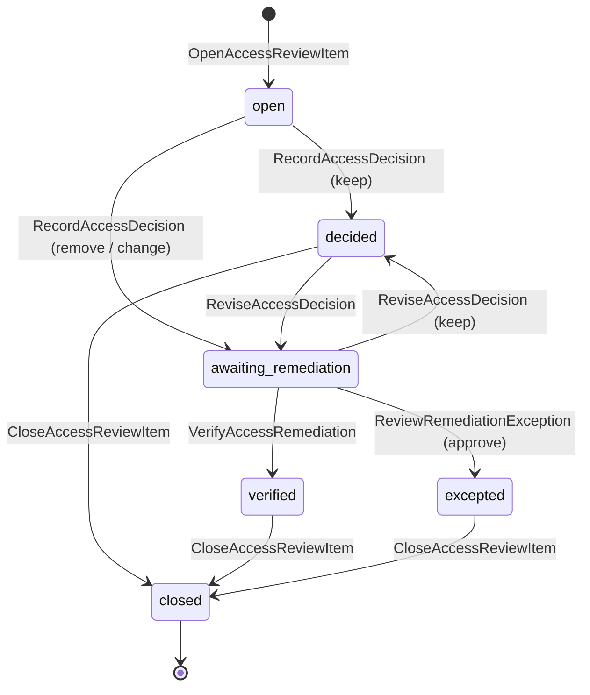

# External access governance

Status: **under boundary review**, 2026-11-05. Product rules remain in force; the
boundary alternatives below are proposals, not yet qualified or locked. This is the hand-authored source for this context.
It follows the [context conventions](conventions.md).

## Purpose

External access governance proves who has access to the organization's outside
systems and that the right people reviewed it (M0-D07). It records observed
access populations per system instance, classifies the accounts in them, states
what access is expected, and runs access review campaigns through to verified
remediation. The product never changes access at an outside system.

**Owns:** access expectations and their exceptions, access review delegations,
access populations, account classifications, access review campaigns, review
items, decision batches and missing-population exceptions.

**Does not own:**

| Concern | Owner |
| --- | --- |
| System instances, access owners and access-review scope | [Application inventory](application-inventory.md) (`SystemInstance`, `AccessReviewScope`) |
| Workforce people and service identities | [Workforce assurance](workforce-assurance.md) |
| Separation-of-duties waivers | [Platform access](platform-access.md) |
| The recurring access review as a control | [Control environment](control-environment.md); its occurrence cites the campaign (M0-D19) |
| Imports and connectors | Deferred; populations are entered by hand (M0-D07, M0-D20) |
| Reminders and work items | [Work queue](work-queue.md) (M0-D15) |

## Language

| Term | Meaning |
| --- | --- |
| Population | The accounts, groups, roles, group memberships and direct entitlement assignments observed at one system instance at one time, accepted as complete and then immutable. |
| Direct assignment | An entitlement the source shows as granted directly to a principal. Inherited access is never recorded as an assignment. |
| Effective access | Computed from an accepted population: each account's entitlements with every path (nested groups, role assumption) that grants them. Never recorded as a fact. |
| Principal kind | `user_account`, `group`, `role`, `service_principal`, `workload_identity`, `access_token` or `app_installation`. |
| Entitlement kind | `membership`, `role_assignment`, `permission_set_assignment`, `permission`, `repository_access` or `admin_privilege`. |
| Classification | What an account is: `human` (one workforce person), `nhi` (one service identity), `shared` (an accountable owner and a justification) or `unclassified` (a review exception). |
| Expectation | An approved rule for one system instance: `forbidden_principal_kind`, `privileged_entitlement` or `requires_expiry`, with parameters. |
| Breach | Computed: an observed account or assignment that an approved expectation forbids or that lacks a required expiry. |
| Delegate | A member named to accept populations and review access for one system instance in place of its access owner. |
| Campaign | One review of frozen populations, placed in one program, with reviewers, a remediation owner and a deadline (R2 campaign routing). |
| Review item | One account–entitlement pair from a frozen population, decided `keep`, `remove` or `change`. |
| Remediation | The removal or change of an entitlement at the outside system, verified only by a later accepted population. |

## Aggregates

### AccessExpectation

**Identity:** `TenantId` + `ExpectationId`, for one system instance for life.

**Invariant:** one expectation is a line of versions of one rule kind for one
instance. A version takes effect only once approved by a Compliance Lead who did
not propose it ([CV-06](conventions.md#guards-and-reviews), EA-08). Different
expectations on one instance coexist.

| Command | Who | Accepts when | Emits |
| --- | --- | --- | --- |
| ProposeAccessExpectation | Compliance Lead or the instance's access owner or delegate | Instance active; rule kind and parameters valid; names the current version (none for the first); none pending | AccessExpectationProposed |
| ReviewAccessExpectation | Compliance Lead who did not propose it, or covered by a waiver | Pending | AccessExpectationApproved or AccessExpectationRejected |
| RetireAccessExpectation | Compliance Lead | Approved; reason given | AccessExpectationRetired |

| Event | Carries |
| --- | --- |
| AccessExpectationProposed | tenant, expectation, instance, version, rule kind, parameters, rationale, proposed by |
| AccessExpectationApproved | tenant, expectation, version, approver, waiver (if any) |
| AccessExpectationRejected | tenant, expectation, version, comments, reviewer |
| AccessExpectationRetired | tenant, expectation, reason, retired by |

### AccessExpectationException

**Identity:** `TenantId` + `ExceptionId`.

**Invariant:** one exception excuses one exact account and entitlement from one
expectation until its expiry, with a rationale. It takes effect once approved by a
Compliance Lead or Org Admin who did not request it, and ends when it expires
(computed) or is revoked (EA-05).

| Command | Who | Accepts when | Emits |
| --- | --- | --- | --- |
| RequestAccessExpectationException | Compliance Lead or the instance's access owner or delegate | `ExceptionId` is new; expectation approved; rationale given; expiry after now | AccessExpectationExceptionRequested |
| ReviewAccessExpectationException | Compliance Lead or Org Admin, not the requester | Requested; unexpired | AccessExpectationExceptionApproved or AccessExpectationExceptionRejected |
| RevokeAccessExpectationException | Compliance Lead or Org Admin | Approved; unexpired; reason given | AccessExpectationExceptionRevoked |

| Event | Carries |
| --- | --- |
| AccessExpectationExceptionRequested | tenant, exception, expectation, instance, account (provider subject ID), entitlement, rationale, expires at, requested by |
| AccessExpectationExceptionApproved | tenant, exception, approver |
| AccessExpectationExceptionRejected | tenant, exception, comments, reviewer |
| AccessExpectationExceptionRevoked | tenant, exception, reason, revoked by |

### AccessReviewDelegation

**Identity:** `TenantId` + `SystemInstanceId` + `MemberId`.

**Invariant:** one member's delegation for one instance is active or revoked;
other delegates have independent lifecycles. Bind a grant to the exact member
episode so a later re-invitation does not inherit it. A delegate acts only while
an active member. A directory of delegates is a projection, not a parent roster.

| Command | Who | Accepts when | Emits |
| --- | --- | --- | --- |
| DelegateAccessReview | Member linked to the access owner, or Compliance Lead | Instance active; delegate is an active member in the named episode; this delegation is inactive | AccessReviewDelegated |
| RevokeAccessReviewDelegation | Member linked to the access owner, or Compliance Lead | This delegation is active | AccessReviewDelegationRevoked |

| Event | Carries |
| --- | --- |
| AccessReviewDelegated | tenant, instance, delegate, member episode, delegated by |
| AccessReviewDelegationRevoked | tenant, instance, delegate, revoked by |

**Authority qualification:** checking membership or ownership in a separate
stream does not serialize revocation against an in-flight action. The required
revocation-versus-action ordering and any admission or fencing mechanism remain
open; a projection or a second check does not prove that ordering.

### AccessPopulation

**Identity:** `TenantId` + `PopulationId`, for one system instance for life.

**Invariant:** one population identifies one observation at one instance and
time; once accepted, its observation is immutable. How the existing
whole-population requirements are enforced without an all-child write remains
unresolved.

**Existing product policy:** one population describes observations at one
instance and time, accepted as complete by the access owner or delegate
(EA-06) and immutable thereafter. A correction is a new population that names
the prior one. A subject appears once; every assignment names a principal;
group nesting must be acyclic (M0-D07). These rules have not been relaxed.

**Boundary direction:** each small principal or direct relationship has its
own identity and source facts. A population must not retain a list of them,
a per-entry ledger, or a reference to one large content object. Pair results,
paths and their individual hops are independently addressable derived evidence,
read in pages; a pair does not contain an array of all its paths.

**Unresolved conflict:** accepting a whole population after scanning every
entry, or serializing every entry through a distributed admission-window chain,
is still a write decision over all children. Bounded windows, cursors and
paged scans do not satisfy the no-all-child-decision constraint. Nor do hashes
or eventually consistent projections prove complete enumeration. This earlier
proposal is rejected as a remedy. A per-principal decision can enforce its own
unique identity, but referential integrity, no new entries after acceptance and
acyclicity need authority across independent records. Checking an arbitrary
path before adding an edge may itself touch an unbounded number of edges. No
mechanism satisfying all of these existing rules and the new constraint is
established here.

An alternative product model could treat an acceptance as the named owner's
attestation about observed evidence, with individual observations independently
accepted and reports showing missing, dangling or cyclic evidence. Such an
attestation does **not** establish a system-enforced complete, immutable,
cycle-free population and cannot silently replace the current policy. It needs
an explicit product decision, and the rules for consuming partial or invalid
evidence must be specified. Until then, population acceptance has no approved
implementation design.

**Local acyclicity candidate:** for a particular population generation, assign
each principal one immutable integer rank. Each individual nested-group edge
names the exact accepted principal identities and generation, and may be
validated only when its source rank is strictly lower than its target rank. If
every accepted nested-group edge uses those immutable ranks, a cycle of accepted
edges is impossible: following a cycle would have to increase a rank and return
to the original rank. Concurrent edge submissions do not change that argument.
The edge keeps only its own endpoint references and validation outcome; no
population aggregate checks a graph or retains child outcomes.

This is **not** yet an alternative for accepting the current complete
population. An acyclic observed graph can contain edges inconsistent with a
particular rank assignment. Do not discard such observations or infer source
completeness from edges that happened to validate. Ranking every finite DAG is
mathematically possible, but how ranks are obtained, corrected or rebuilt without
unbounded in-memory sorting is unspecified. A rank assignment whose write
decision depends on examining every observed edge would recreate the prohibited
all-child decision; independently supplied ranks are a candidate, not a proof
that every legitimate graph can be accepted. A new generation may be needed to
change ranks; its workflow and consequences require product review. Preserve
raw observations and show each rank mismatch as unresolved, not as missing
access. Role-assumption and any other expansion edges must either satisfy an
equivalent graph-wide ordering rule or use separately qualified cycle-safe
expansion. A locally checked rank does not prove complete source capture,
principal existence at the necessary authority boundary, immutable population
membership, valid role-assumption paths, or acceptable audit semantics.
Do not claim an accepted population satisfies M0-D07 until all relevant existing
requirements have an approved design; see the
[local-invariant review](../reviews/access-governance-boundaries.md).

### AccountClassification

**Identity:** `TenantId` + `SystemInstanceId` + `ProviderSubjectId`.

**Invariant:** one account at one instance has one current classification, kept
across later populations, with its history (EA-02):

- `human` names one workforce person and no service identity; `nhi` names one
  service identity and no person; `shared` names an accountable person and a
  justification; `unclassified` names nothing.
- An account with no classification is `unclassified`.
- A classification is due for reconfirmation when it is older than 12 months or
  the account's principal kind or display name has changed since; this is
  computed and shown on review items.

| Command | Who | Accepts when | Emits |
| --- | --- | --- | --- |
| ClassifyAccount | Compliance Lead, or the access owner or a delegate | The account appears in an accepted population of the instance; rules above hold; person or service identity active | AccountClassified |
| ReconfirmAccountClassification | Compliance Lead, or the access owner or a delegate | Classified; unchanged | AccountClassificationReconfirmed |

| Event | Carries |
| --- | --- |
| AccountClassified | tenant, instance, provider subject ID, previous classification, classification, person or service identity or accountable person, justification, population seen in, classified by |
| AccountClassificationReconfirmed | tenant, instance, provider subject ID, population seen in, reconfirmed by |

### AccessReviewCampaign

**Identity:** `TenantId` + `CampaignId`.

**Invariant:** one campaign has one program, remediation owner, instructions
and deadline for its review lifecycle. Existing exact-scope and all-item
completion requirements remain in force, but their authority mechanism is
unresolved under the no-all-child-write constraint.

**Existing product policy:** a campaign freezes the program, selected
populations, reviewers, remediation owner, instructions and deadline at
launch; later changes do not rewrite it. It completes only when all required
items close. At launch, the program is active, each selected population is the
latest accepted population of its included instance, each reviewer is the
access owner or a delegate, and the remediation owner has
`access_review.manage` and is not a reviewer. Coverage of the current program
boundary remains advice, with an `Uncovered instance` gap. These rules are not
changed by this review.

**Boundary direction:** a campaign's scalar lifecycle is independent of each
instance's selection and each account-entitlement review decision. Each item
owns its own decision, remediation and final outcome. Results, refusal reasons
and work remaining can be shown by a paged projection. A per-instance or
per-item record must not be repurposed as a distributed roster that the parent
must enumerate in order to decide a write.

**Unresolved conflict:** the previously proposed completion process traversed
every expected item and then wrote a campaign outcome. That still makes one
write decision depend on all children, even with bounded memory and outcomes
stored on item streams, and is not an acceptable remedy. The proposed admission
window/chain likewise merely spreads a per-item ledger across records. Neither
is retained as the implementation design. Complete authoritative enumeration,
source fencing and cross-owner authorization ordering also remain unresolved;
a projection, count or digest cannot supply them.

A viable **alternative for product consideration** is to let reviewers close
items independently and have reporting show the campaign's observed progress,
including pending and unknown items, without a campaign-wide completion write.
That would trade the current authoritative `completed` fact for a potentially
lagging report. It cannot prove that all required items were closed, and it
must not be treated as equivalent evidence by a control occurrence or auditor.
Likewise, per-instance launch decisions do not by themselves prove that one
exact, globally frozen set was selected at a single launch. The product must
choose whether and how to change those semantics before this alternative can
be adopted; until then campaign launch/completion is not implementation-ready.

**Observed progress contract, if product adopts that alternative:** an item
result is authoritative only for that exact item, and an exact operation ID
identifies the submitted decision and intent. A query can show `pending`,
`accepted`, `refused`, or `unknown` for a known operation and separately show
its own source checkpoint and last update time. An empty result, a zero visible
pending count, a report checkpoint, or an HTTP timeout is not evidence that no
required item exists or that all operations succeeded. Absence of a known
operation is `unknown` until an authoritative terminal outcome or a durable
fence resolves it; exact retries return the same result and changed intent under
the same operation identity is a conflict. The report must identify its scope
as observed rather than present `completed` as a campaign-owned fact. A control
consumer may cite an individual item's exact outcome; what it may conclude
about the campaign as a whole is an explicit product and audit question.

This user-facing contract makes uncertainty visible; it does not solve the
current policy's exact frozen launch scope or all-items-completed assertion. A
checkpoint proves only whatever the qualified source and projector contracts
actually guarantee, not that omitted item openings were ever admitted or created.

### AccessReviewItem

**Identity:** `TenantId` + `CampaignId` + `ItemId`, where `ItemId` is derived from
the instance, the account and the entitlement (CV-02).

**Invariant:** one item holds one reviewer decision on one frozen
account–entitlement pair, then its remediation outcome:

- At opening it freezes the account, classification (including reconfirmation
  status), entitlement, privileged status and exact immutable evidence cut.
  Effective paths and their individual hops, breaches and applicable exceptions
  are individually addressable source-derived evidence, not arrays on the item
  or an unbounded path document. Preserve all
  explanations and applicable versions; their complete frozen enumeration remains
  an explicit source qualification, including proofs of absence.
- **Reviewer.** Only the item's reviewer decides, and never on access that
  belongs to them (an account classified `human` for their person, or `shared`
  with them accountable), unless a separation-of-duties waiver covers it (M0-D07).
  Such an item is opened unassigned; a Compliance Lead assigns another reviewer.
- A privileged item takes only an individual decision, never one from a batch.
- A decision can be revised until the item is closed or its remediation is
  verified (EA-09). Once closed, the item accepts no change; this is decided in
  the item's own stream.
- A batch decision arrives as `ApplyBatchAccessDecision`, which the item records
  or refuses with a reason, so the batch can tell pending from refused.
- A `remove` or `change` is verified only by naming a later accepted population
  of the same instance, observed after the decision, where the pair is absent
  (`remove`) or differs (`change`). A ticket alone is never verification (EA-04).
- Instead, a remediation exception may be approved by a Compliance Lead or Org
  Admin who did not request it, with a rationale and expiry.

| Command | Who | Accepts when | Emits |
| --- | --- | --- | --- |
| OpenAccessReviewItem | Reactor on AccessReviewCampaignLaunched | Exact expected source identity and current admitted generation; no prior opening; exact retry returns the original outcome | AccessReviewItemOpened or AccessReviewItemOpenRefused |
| AssignAccessReviewItem | Compliance Lead | Campaign launched; not decided; reviewer is the access owner or a delegate and not the account's person | AccessReviewItemAssigned |
| RecordAccessDecision | The item's reviewer | Open; rationale given | AccessDecisionRecorded |
| ApplyBatchAccessDecision | Authorized item operation (batch protocol unresolved) | Always answers: records the decision when open, non-privileged and still assigned to the batch's reviewer; otherwise refuses with the reason; exact retry returns the original outcome and changed intent conflicts | AccessDecisionRecorded or AccessBatchDecisionRefused |
| ReviseAccessDecision | The item's reviewer | Decided or awaiting remediation; not closed; nothing verified; rationale given | AccessDecisionRevised |
| CloseAccessReviewItem | Authorized item operation (campaign protocol unresolved) | Always answers: closes when resolved, otherwise records a refusal, including for an absent item; exact retry returns the original outcome | AccessReviewItemClosed or AccessReviewItemCloseRefused |
| RecordAccessRemediationChange | The campaign's remediation owner | Awaiting remediation; note or ticket given | AccessRemediationChangeRecorded |
| VerifyAccessRemediation | The campaign's remediation owner | Awaiting remediation; the named population meets the rule above | AccessRemediationVerified |
| RequestRemediationException | The campaign's remediation owner | Awaiting remediation; rationale and expiry given | RemediationExceptionRequested |
| ReviewRemediationException | Compliance Lead or Org Admin, not the requester | Requested | RemediationExceptionApproved or RemediationExceptionRejected |

| Event | Carries |
| --- | --- |
| AccessReviewItemOpened | tenant, campaign, item, instance, population and exact source cut, account, classification, reconfirmation due, entitlement, privileged, immutable evidence cut, reviewer (or unassigned) |
| AccessReviewItemOpenRefused | tenant, campaign, item, source identity, admission token, reason |
| AccessReviewItemAssigned | tenant, campaign, item, previous reviewer, reviewer, assigned by |
| AccessDecisionRecorded | tenant, campaign, item, decision (`keep`, `remove`, `change`), rationale, batch and operation token (if any), reviewer, waiver (if any) |
| AccessDecisionRevised | tenant, campaign, item, previous decision, decision, rationale, reviewer |
| AccessBatchDecisionRefused | tenant, campaign, item, batch and operation token, reason (`already_decided`, `privileged`, `reassigned`, `closed`) |
| AccessReviewItemClosed | tenant, campaign, item, completion attempt and operation token, final state (`kept`, `verified`, `excepted`) |
| AccessReviewItemCloseRefused | tenant, campaign, item, completion attempt and operation token, reason (`undecided`, `awaiting_remediation`, `not_opened`) |
| AccessRemediationChangeRecorded | tenant, campaign, item, note or ticket, recorded by |
| AccessRemediationVerified | tenant, campaign, item, verifying population, content hash, verified by |
| RemediationExceptionRequested | tenant, campaign, item, rationale, expires at, requested by |
| RemediationExceptionApproved | tenant, campaign, item, approver |
| RemediationExceptionRejected | tenant, campaign, item, comments, reviewer |

### AccessDecisionBatch

**Identity:** `TenantId` + `CampaignId` + `BatchId`.

**Invariant:** one batch identifies one reviewer's shared decision and rationale;
each individual item decides its own eligibility and outcome. Whether the exact
selected set and whole-batch completion remain authoritative is unresolved.

**Existing product policy:** one bulk decision records one reviewer's shared
decision and rationale over an exact selected set; privileged items cannot be
bulk decided. Each item accepts or refuses on its own authority and the result
must explain refusals. An item decided, closed or reassigned meanwhile refuses.

**Candidate independent behavior:** a user action identifier can associate
individual item decision commands with one shared rationale. Each target's own
stream records acceptance or refusal, checks its reviewer and privileged state,
and re-evaluates after an optimistic-concurrency conflict. Exact retries must
return the original outcome; changed intent conflicts. A report can group the
individual results and show pending or unknown deliveries without a batch
parent collecting outcomes. Current membership and permission checks across
separate owners still require a specified authorization ordering.

**Tradeoff and status:** this candidate does not prove an exact selected set
was completely submitted, nor give an authoritative `batch completed` fact.
A projection or count cannot establish those claims. Requiring a sealing or
completion write to traverse all selection records, or introducing short-lived
windows which collectively record each selected child, would merely create a
distributed per-item ledger and is not an acceptable remedy. The product must
explicitly decide whether independent outcomes plus reporting meet bulk-action
needs. Until then the original exact-set semantics stand and the batch design
is unresolved; the candidate is not an implementation contract.

### AccessPopulationException

**Identity:** `TenantId` + `CampaignId` + `SystemInstanceId`.

**Invariant:** one exception excuses one in-scope instance from having a
population in one campaign, with a rationale. It counts once approved by a
Compliance Lead or Org Admin who did not request it (EA-05).

| Command | Who | Accepts when | Emits |
| --- | --- | --- | --- |
| RequestAccessPopulationException | The campaign's remediation owner or Compliance Lead | Campaign launched; instance has no population in it; rationale given | AccessPopulationExceptionRequested |
| ReviewAccessPopulationException | Compliance Lead or Org Admin, not the requester | Requested | AccessPopulationExceptionApproved or AccessPopulationExceptionRejected |

| Event | Carries |
| --- | --- |
| AccessPopulationExceptionRequested | tenant, campaign, instance, rationale, requested by |
| AccessPopulationExceptionApproved | tenant, campaign, instance, approver |
| AccessPopulationExceptionRejected | tenant, campaign, instance, comments, reviewer |

## Flows

Diagrams follow [CV-01](conventions.md#flow-diagrams).

### Independent item decisions and reporting

The report is advisory. Existing population acceptance, exact campaign launch
and campaign-wide completion have no approved design under the current
no-all-child-write constraint; the diagram does not assert those outcomes.

## Computed gaps

| Gap | Shown when |
| --- | --- |
| Breach | The latest accepted population of an instance has an account or assignment an approved expectation forbids or that lacks a required expiry, with no unexpired exception |
| Unclassified account | An account in the latest accepted population is `unclassified` |
| Classification to reconfirm | Older than 12 months, or principal kind or display name changed since |
| Leaver with access | An account classified `human` for a person whose work relationships have all ended appears in the latest accepted population (EA-10) |
| Unassigned item | An item has no reviewer |
| Overdue campaign | Past its deadline and not completed |
| Uncovered instance | An in-scope instance of the program has no population in a launched campaign and no approved exception |

## Authorization contract

- `access_review.manage` is a product-defined permission. The built-in Org Admin
  and Compliance Lead roles include it.
- Reviewing and accepting populations need no role beyond membership: they
  follow from being the instance's access owner or a delegate. Restricted-system
  visibility applies to every read and action (R2 campaign routing).

## Disagreement and replay

Cases required by [CV-12](conventions.md#guards-and-reviews).

| Case | Outcome |
| --- | --- |
| A reviewer revises an item (keep → remove) while completion is requested | The item's stream orders them: a revision first leaves it awaiting remediation, so it refuses to close; a close first refuses the revision. Campaign completion handling remains unresolved. |
| A batch targets an item the reviewer has just decided directly | The item refuses the batch decision (`already_decided`); the item records the exact operation refusal |
| An exact item-close operation is delivered twice | The item returns its original terminal outcome |
| An item's authoritative answer is missing or unknown | Existing policy cannot claim the campaign completed; a projection or incomplete source traversal cannot prove completion |
| An instance comes into scope later | Coverage remains advice; the instance shows the `Uncovered instance` gap |

## Decisions

Historical Jev answers are from `jev-1.14.0`, 2026-11-03. The later
[boundary review](../reviews/access-governance-boundaries.md) records conflicting
and inconclusive answers; Jev is advisory, and unresolved rules remain open.

| ID | Decision | Evidence |
| --- | --- | --- |
| EA-01 | A population stores direct assignments only; effective access is computed. | M0-D07. |
| EA-02 | An account's classification is kept per instance and provider subject ID across populations, and is shown for reconfirmation after 12 months or a change in kind or name. | Carry it: 0.51. Reclassifying every snapshot is a burden: 0.83. Carrying can hide a change: 0.74. Common sense: carry it, and surface the changes and age that could hide one. |
| EA-03 | A campaign completes only when every removal or change is verified or excepted; EA-11 treats coverage as advice with a gap. | Historical answer 0.93; see the coverage qualification and unresolved completion in EA-11. |
| EA-04 | The remediation owner verifies a removal by naming a later accepted population; the product refuses it when the pair is still present. No automatic verification. | Person verifies: 0.81. Automatic verification can be wrong: 0.91. |
| EA-05 | Expectation, missing-population and remediation exceptions are separate records, each approved by someone other than the requester; the general Waiver is not used. | General Waiver: 0.14 (no). Separate kinds: 0.86. |
| EA-06 | Only the instance's access owner or a delegate accepts a population as complete. | 0.81. |
| EA-07 | A bulk decision names an exact selection and shared rationale, then each item decides; privileged items are excluded. Whether independent actions and reporting can replace this exact-set behavior is a product decision. | Batch record: 0.69. Individual decisions only: 0.31. Auditor value: 0.36. Common sense: the record shows what the reviewer chose together, and per-item decisions keep each item's history whole. |
| EA-08 | An expectation needs approval by a Compliance Lead who did not propose it. | 0.57. Common sense: CV-06, and M0-D07 names an approver. |
| EA-09 | A reviewer can revise a decision while the campaign is launched and nothing is verified. | 0.83. |
| EA-10 | A leaver who still has an account is a computed gap, not an automatic review item or task. | 0.55. Common sense: the product never changes outside access automatically (Workforce assurance), and the work queue projects gaps. |
| EA-11 | Current policy requires every item to close before campaign completion; an item closes only when resolved and accepts no later change. An implementation that satisfies the no-all-child-write constraint remains unresolved. Coverage stays advice with a gap. | Freeze then complete: 0.87. Completing from reported outcomes alone: 0.22. Keeping the advisory check with a gap: 0.36. Portia guidelines review. |
| EA-12 | Superseded: large row files and their roster do not meet the small-record boundary. Independent entries are a candidate; complete population acceptance remains unresolved. | Prior rationale preserved for history; see the unresolved source-cut qualification below. |

## Open questions

1. Can current complete, immutable, cycle-free population acceptance be
   preserved without a write that must validate all entries or an equivalent
   distributed per-item ledger? If not, should acceptance become attestation
   with partial/invalid observations reported, and what may consume it?
2. Should campaign completion remain an authoritative all-items assertion, or
   should independent item outcomes and a potentially lagging progress report
   replace it? A control occurrence cannot silently treat the latter as proof.
   How should the exact frozen launch scope change, if at all?
3. Should a bulk action retain its authoritative exact selected set and complete
   result, or group independently delivered item commands for reporting? What
   recovery and user-visible pending semantics are required?
4. Specify ordering for membership, owner, scope, latest population, reviewer
   and remediation-owner changes racing launch or action. Cross-stream reads
   alone do not serialize these decisions. Qualify immutable path, expectation
   and exception evidence, including completeness and absence.
5. Is a rank-based nested-group representation acceptable when the observed
   data is preserved but a rank mismatch blocks edge validation? Determine
   rank assignment and correction, graph-generation lifecycle, role-assumption
   cycles, and how to handle legitimate edges invalid under a chosen ordering.
   No source-completeness or population-acceptance claim follows from ranks.

Until these conflicts are resolved, the boundary redesign is **not locked or
ready for implementation**. The [Jev boundary review](../reviews/access-governance-boundaries.md)
records advisory answers and counterexamples; it is not proof.

## Superseded owners

| Old owner | Becomes |
| --- | --- |
| AccessExpectation | AccessExpectation; its exemption becomes AccessExpectationException |
| AccessPopulation, PopulationSnapshot | AccessPopulation |
| PopulationSnapshotChunk | Removed: the population source uses individually addressed small observations |
| AccessPopulationException | AccessPopulationException (per campaign and instance) |
| AccessPrincipalClassification | AccountClassification (per instance, EA-02) |
| AccessReviewCampaign | AccessReviewCampaign |
| AccessReviewItem | AccessReviewItem (remediation exception on the item) |
| AccessReviewDecisionBatch | AccessDecisionBatch (EA-07) |
| Access review launch fan-out, bulk admission, settlement and cancellation reactors and processes | Independent per-item decisions are a candidate; exact launch and bulk semantics remain unresolved |
| Access review completion reactors and process | Existing all-item completion policy has no approved no-all-child-write design (EA-11) |
| OpenAccessReviewWorkReactor | Work queue projection (M0-D15) |
