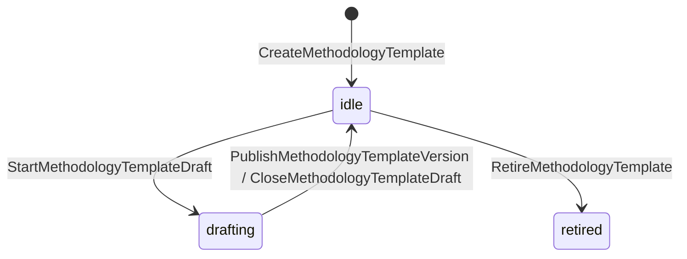
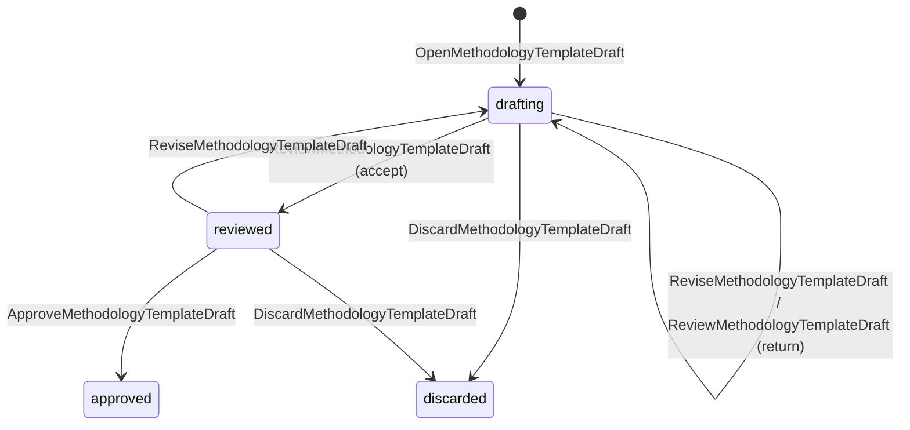

# Firm methodology

Status: **locked**, 2026-11-03. Hand-authored source of truth for this context.
It follows the [context conventions](conventions.md).

## Purpose

Firm methodology keeps the firm's starting content for clients, such as controls,
policies and risks, as platform-level templates that never contain client data,
and records each time a client applies one (M0-D25, F1-04).

**Owns:** methodology templates (platform level) and template applications
(per tenant).

**Does not own:**

| Concern | Owner |
| --- | --- |
| The drafts an application creates, and their approval | Their own contexts ([Control environment](control-environment.md), [Policies](policies.md), [Risk and provider oversight](risk-and-provider-oversight.md)) |
| Criteria editions | [Criteria](criteria.md) |
| Platform operators | [Platform access](platform-access.md) |

## Language

| Term | Meaning |
| --- | --- |
| Template | A named line of methodology versions, kept at platform level. |
| Template version | One published, immutable set of entries. Each entry has a stable key and the content for one control, policy or risk. |
| Application | A tenant's use of template versions for one program. Each applied entry becomes a draft or revision proposal in the owning context, with the template version and entry key as provenance. |

## Aggregates

### MethodologyTemplate

**Identity:** `TemplateId` (platform level).

**Invariant:** one template has a line of published versions and at most one
open draft. The line starts each draft and publishes a version only from its open
draft's approval. Published versions never change. A retired template takes no
new drafts, and a template with an open draft is not retired.

- The line grows by a few events per version; each draft's revisions, which carry
  the template's entries, live in its own `MethodologyTemplateDraft` stream
  ([CV-13](conventions.md#stream-growth), FM-05).

| Command | Who | Accepts when | Emits |
| --- | --- | --- | --- |
| CreateMethodologyTemplate | Platform operator with `methodology.author` | `TemplateId` is new; name unused | MethodologyTemplateCreated |
| StartMethodologyTemplateDraft | Platform operator with `methodology.author` | Not retired; no open draft; starts from the latest version (or empty) | MethodologyTemplateDraftStarted |
| PublishMethodologyTemplateVersion | Reactor on MethodologyTemplateDraftApproved | The draft is the open one; a repeat is a no-op | MethodologyTemplateVersionPublished |
| CloseMethodologyTemplateDraft | Reactor on MethodologyTemplateDraftDiscarded | The draft is the open one; a repeat is a no-op | MethodologyTemplateDraftClosed |
| RetireMethodologyTemplate | Platform operator with `methodology.approve` | Not retired; no open draft; reason given | MethodologyTemplateRetired |

| Event | Carries |
| --- | --- |
| MethodologyTemplateCreated | template, name, purpose, created by |
| MethodologyTemplateDraftStarted | template, draft, based on version, started by |
| MethodologyTemplateVersionPublished | template, version, draft, revision, entries, changed entry keys, approver |
| MethodologyTemplateDraftClosed | template, draft, reason |
| MethodologyTemplateRetired | template, reason, retired by |

### MethodologyTemplateDraft

**Identity:** `TemplateId` + `DraftId`, opened only by the line's
`MethodologyTemplateDraftStarted`.

**Invariant:** one draft is approved only after a reviewer who authored no
revision accepts it and a third person, neither author nor reviewer, approves it
(FM-01). Entry keys are unique. An approved or discarded draft accepts nothing
further.

- Entries never contain client data. Content from client records is never
  contributed into a template (FM-02).

| Command | Who | Accepts when | Emits |
| --- | --- | --- | --- |
| OpenMethodologyTemplateDraft | Reactor on MethodologyTemplateDraftStarted | New; a repeat is a no-op; copies the based-on version's entries | MethodologyTemplateDraftOpened |
| ReviseMethodologyTemplateDraft | Platform operator with `methodology.author` | Drafting or reviewed; names the current revision; entry keys unique | MethodologyTemplateDraftRevised |
| ReviewMethodologyTemplateDraft | Platform operator with `methodology.author` who authored no revision | Drafting; reviews the current revision | MethodologyTemplateDraftAccepted or MethodologyTemplateDraftReturned |
| ApproveMethodologyTemplateDraft | Platform operator with `methodology.approve`, neither author nor reviewer | Reviewed; the accepted revision is current | MethodologyTemplateDraftApproved |
| DiscardMethodologyTemplateDraft | Platform operator with `methodology.author` | Not approved; reason given | MethodologyTemplateDraftDiscarded |

| Event | Carries |
| --- | --- |
| MethodologyTemplateDraftOpened | template, draft, based on version |
| MethodologyTemplateDraftRevised | template, draft, revision, entries (key, kind, content, criteria edition references), revised by |
| MethodologyTemplateDraftAccepted | template, draft, revision, reviewer |
| MethodologyTemplateDraftReturned | template, draft, revision, comments, reviewer |
| MethodologyTemplateDraftApproved | template, draft, revision, entries, approver |
| MethodologyTemplateDraftDiscarded | template, draft, reason, discarded by |

### TemplateApplication

**Identity:** `TenantId` + `ProgramId` + `TemplateId`.

**Invariant:** one program applies one template's versions in order, each later
than the last applied, and starts the next only after the previous one has
completed. The first application creates a draft for each entry; a later one
creates revision proposals only for entries that changed, and never overwrites
approved client content (FM-03).

- The record grows by two events per applied version; each version's entry
  outcomes live on its `TemplateVersionApplication` (CV-13, FM-05).
- Only the tenant's Compliance Lead applies a template (FM-04).

| Command | Who | Accepts when | Emits |
| --- | --- | --- | --- |
| ApplyMethodologyTemplate | Compliance Lead | Program active; version published; template not retired; later than the last applied version; the previous application completed | MethodologyTemplateApplied |
| RecordTemplateApplicationCompleted | Reactor on TemplateVersionApplicationCompleted | The version is the one being applied; a repeat is a no-op | TemplateApplicationCompleted |

| Event | Carries |
| --- | --- |
| MethodologyTemplateApplied | tenant, program, template, version, previous version, entries to create, entries to propose, applied by |
| TemplateApplicationCompleted | tenant, program, template, version, counts by outcome |

### TemplateVersionApplication

**Identity:** `TenantId` + `ProgramId` + `TemplateId` + version.

**Invariant:** one version's application records every entry's outcome,
`created`, `proposed` or `refused` with the reason, and completes only when each
entry has one ([CV-10](conventions.md#reactors), CV-12).

- Each draft or proposal takes an ID derived from the application, the version
  and the entry key ([CV-02](conventions.md#reactors)); a control, commitment or
  risk entry takes the ID its identifier derives, so an identifier already used
  in the program is refused by the owner.

| Command | Who | Accepts when | Emits |
| --- | --- | --- | --- |
| OpenTemplateVersionApplication | Reactor on MethodologyTemplateApplied | New; a repeat is a no-op | TemplateVersionApplicationOpened |
| RecordTemplateEntryOutcome | The reaction that created or proposed the entry | Entry listed; a repeat is a no-op | TemplateEntryOutcomeRecorded, and TemplateVersionApplicationCompleted with the last outcome |

| Event | Carries |
| --- | --- |
| TemplateVersionApplicationOpened | tenant, program, template, version, entry keys |
| TemplateEntryOutcomeRecorded | tenant, program, template, version, entry key, outcome (`created`, `proposed`, `refused` with reason), record created (if any) |
| TemplateVersionApplicationCompleted | tenant, program, template, version, counts by outcome |

## Flows

Diagrams follow [CV-01](conventions.md#flow-diagrams).

```mermaid
flowchart LR
    C0[/StartMethodologyTemplateDraft/] --> E0([MethodologyTemplateDraftStarted])
    E0 --> R0{{"Open the draft (ID from the start)"}} --> C9[/OpenMethodologyTemplateDraft/] --> E9([MethodologyTemplateDraftOpened])
    E9 -. checks .-> C1[/ReviseMethodologyTemplateDraft/] --> E1([MethodologyTemplateDraftRevised])
    E1 -. "reviewer authored none" .-> C2[/ReviewMethodologyTemplateDraft/] --> E2([MethodologyTemplateDraftAccepted])
    E2 -. "approver is a third person" .-> C3[/ApproveMethodologyTemplateDraft/] --> E6([MethodologyTemplateDraftApproved])
    E6 --> R2{{Publish}} --> C7[/PublishMethodologyTemplateVersion/] --> E3([MethodologyTemplateVersionPublished])
    E3 -. checks .-> C4[/ApplyMethodologyTemplate/] --> E4([MethodologyTemplateApplied])
    E4 --> R3{{Open the version application}} --> C8[/OpenTemplateVersionApplication/] --> E8([TemplateVersionApplicationOpened])
    E4 --> R1{{"Create drafts or proposals (ID from application, version, entry)"}} --> X1[[Control environment, Policies, Risk: draft or propose]]
    X1 --> C5[/RecordTemplateEntryOutcome/] --> E5([TemplateEntryOutcomeRecorded])
    C5 --> E7([TemplateVersionApplicationCompleted]) --> R4{{Record completion}} --> C6[/RecordTemplateApplicationCompleted/] --> E10([TemplateApplicationCompleted])
```

## Authorization contract

- `methodology.author` and `methodology.approve` are platform-operator
  permissions. Templates are readable by every tenant; they hold no client data.

## Disagreement and replay

Cases required by [CV-12](conventions.md#guards-and-reviews).

| Case | Outcome |
| --- | --- |
| A template control's identifier is already used in the program | The owner refuses the draft; the application records `refused` (`identifier_in_use`) |
| `MethodologyTemplateApplied` delivered twice | Entry IDs are derived, so repeats are no-ops |
| An entry's outcome is not yet recorded | The version application stays incomplete, so the next version cannot be applied |
| `MethodologyTemplateDraftApproved` delivered twice | `PublishMethodologyTemplateVersion` repeat is a no-op; one draft gives one version |
| An outcome arrives before the version application is opened | Its reaction retries until the record exists (CV-03); nothing is lost |

## Decisions

Jev answers are from `jev-1.14.0`, 2026-11-03. A yes is ≥ 0.8 and a no is ≤ 0.2.
Anything in between is settled by common sense, with the reasoning stated.

| ID | Decision | Evidence |
| --- | --- | --- |
| FM-01 | A template version needs a reviewer who authored none, then a third-person approver. | Reviewer alone is enough: 0.24. Third approver: 0.53. Common sense: firm methodology reaches every client, so it carries the firm's approval. |
| FM-02 | Firm staff never contribute content from client records into templates. | Contributions: 0.15 (no). A contribution keeping no client reference: 0.92, which only matters if contributions exist. |
| FM-03 | Applying a later version proposes revisions only for changed entries, never overwriting approved content. | 0.83. |
| FM-04 | Only the tenant's Compliance Lead applies a template. | Advisor applying: 0.35. Common sense: the client owns what enters its program. |
| FM-05 | A template is a version line with one stream per draft, and a program's application of a template is an ordering record with one record per applied version for the entry outcomes. | Same pattern as SD-04 (0.85), [CV-13](conventions.md#stream-growth). Common sense: drafts carry every entry and applications record every entry, so on the long-lived records both would grow for the life of the template or program. |

## Open questions

None at this time.

## Superseded owners

| Old owner | Becomes |
| --- | --- |
| MethodologyTemplate | MethodologyTemplate (version line) and MethodologyTemplateDraft (FM-05) |
| MethodologyTemplateContribution | Removed (FM-02) |
| TemplateApplication | TemplateApplication and TemplateVersionApplication (FM-05); successor adoption is a later `ApplyMethodologyTemplate` (FM-03) |
| `ProposeTemplateSuccessorAdoption`, `DecideWhetherToAdoptNewTemplateVersion` | Removed: not applying a version is the decision |
