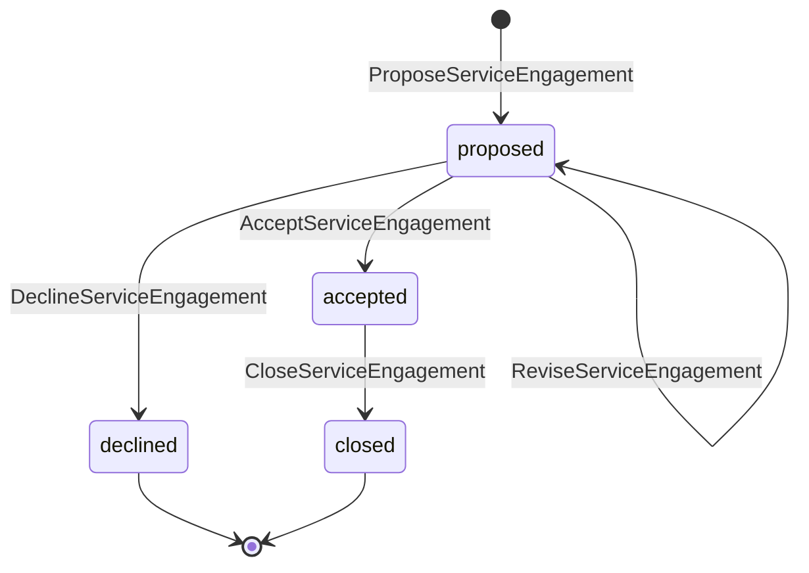
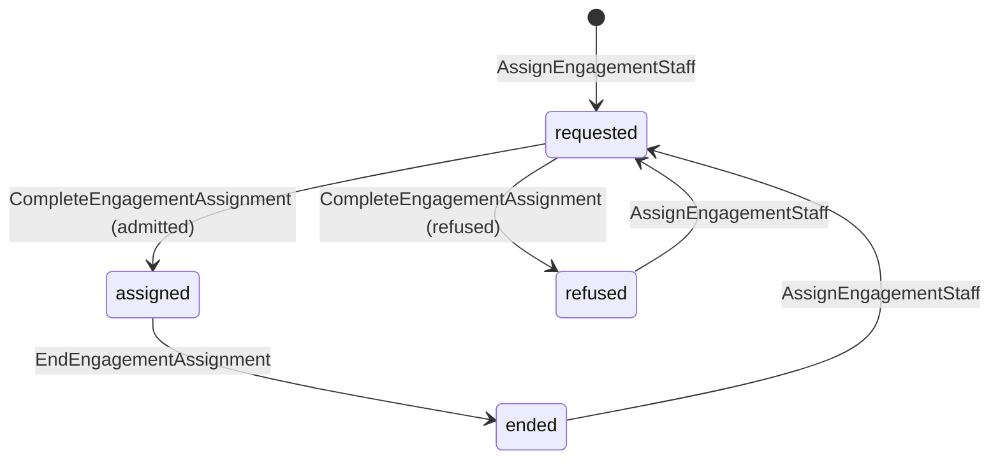
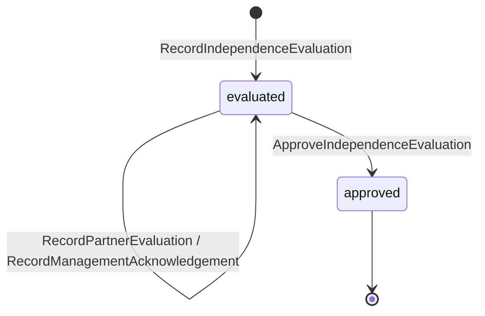
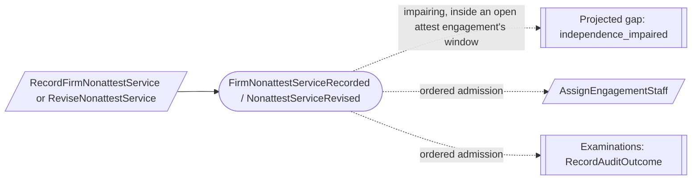

# Firm services

Status: **domain policy locked; authority protocol under refinement**, 2026-11-05.
Hand-authored source of truth for this context. The acceptance and impairment
guards below are required outcomes, not qualified implementation claims. The
ordering and complete source cuts described here must be proved before this
context is implementation-ready; see [boundary review](../reviews/firm-services-boundaries.md).

## Purpose

Firm services records the work the firm does for a client organization, who on
the firm's staff does it, and whether the firm can stay independent while doing
it. It keeps advisory and attest work apart (M0-D26) and makes sure the firm keeps
its own record of in-product attest work (M0-D27).

**Owns:** service engagements, engagement assignments, nonattest service records,
independence rule sets, independence evaluations, partner designations, and attest
engagement record packages.

**Does not own:**

| Concern | Owner |
| --- | --- |
| Firm staff directory and practice | Platform access (`FirmStaffMember`) |
| The client's own audit engagement (Type I, Type II) | Examinations; it is a different record from a `ServiceEngagement` (M0-D23) |
| Advisor feedback and handoffs | Advisor collaboration |
| Auditor requests, populations, samples | Auditor requests, Audit populations |
| Engagement hold on evidence | Retention |
| Attest workpapers, tests, report drafts | Not in the product; they stay in the attest team's audit software (M0-D27) |
| Quality management, competence, financial interests, partner rotation | Firm procedure, not platform (M0-D26) |

## Language

| Term | Meaning |
| --- | --- |
| Service engagement | One service the firm provides to one client: its practice, service kind, scope, period and acceptance decision. |
| Practice | `advisory` or `attest`. |
| Service kind | Advisory: readiness assessment, control design, control implementation, operating controls on the client's behalf, vCISO. Attest: SOC 2 Type I, SOC 2 Type II. |
| Engagement assignment | One firm staff member assigned to one accepted engagement. It gives Advisor or Attest work for that client, per the engagement's practice. |
| Nonattest service record | One advisory service the firm performed for a client, with its kind and dates, whether or not it was delivered through the product. |
| Independence rule set | A numbered version of the service classification (`impairing` or `conditionally_compatible`) and the look-back period. |
| Independence evaluation | The record that an attest engagement may, or may not, be accepted under one rule-set version and the client's service history. |
| Partner designation | A firm staff member's designation as `engagement_partner` or `quality_management_partner`. |
| Attest engagement record package | The package of an attest engagement's collaboration records that is delivered into the attest team's audit software. |

## Aggregates

### ServiceEngagement

**Identity:** `TenantId` + `EngagementId`.

**Invariant:** one engagement has one practice, one service kind, and one
lifecycle. Its terms change only while it is proposed.

Acceptance rules, decided against authoritative participant outcomes at the
action's ordering point (a current-state projection read is advice only):

- **Attest:** the engagement's independence evaluation is approved, was made under
  the active rule-set version, and considered the client's current nonattest
  service history. An `impaired` result can never be accepted, and there is no
  override (M0-D26, FS-03).
- **Advisory:** a service kind that the active rule set classifies `impairing` is
  refused while the client has an accepted, open attest engagement (FS-04).

Closing an attest engagement is refused until its record package delivery is
recorded (M0-D27, FS-06).

Proposing or accepting an engagement needs an active tenant (Platform access
offboarding rule).

**Independence impaired** (FS-11): an accepted, open attest engagement shows an
`independence_impaired` gap when the client's nonattest service history holds
a service that the engagement's rule-set version classifies `impairing`, dated
within the look-back before the examination period starts or during it. The gap
can be displayed from a projection. While impaired, new staff assignments and
audit outcomes for an examination naming the engagement must not take effect.
The projected gap cannot enforce these refusals: both actions require an
authoritative ordering outcome as described below.

**Ordering requirement, not yet qualified:** service recording, revision and
voiding; ratification of rule sets; attest and impairing advisory acceptance;
attest assignment; and audit outcome recording can race. Each truthfully
entered service is recorded even when it impairs independence. Neither a prior
current-state read nor a later projected gap authorizes a protected action at
its commit point. Retries bind one operation identity to one intent; a lost
response stays pending until its owner confirms the committed fact or refusal.

The former chain of admission windows is **withdrawn**, not a solution: even
small windows form a client-wide ledger of service and protected-action attempts,
serialize unrelated work and make later decisions depend on the set of children.
The former full-service scan for an acceptance decision likewise conflicts with
CV-13, even when it streams with bounded memory. No replacement ordering or
absence-of-impairment authority is established. FS-03, FS-04 and FS-11 remain
accepted requirements and are **not implementation-ready** under this proposal.

An individual service revision can independently establish a positive
impairment witness under an exact rule version and look-back interval. That one
fact can explain a refusal or a visible gap. The absence of a witness in a
projection or partial search does not establish absence of all impairing
services. Each assignment continues to own its own request, grant or refusal;
the fixed person/client practice compartment owns only its first practice
decision. A complete service list is useful as a paged read and audit evidence,
not a parent aggregate, client-wide coordinator, or proof by itself that a
protected write is safe.

The remaining design problem is genuine: M0-D26 expressly requires the platform
to block an attest acceptance if *any* service in a look-back is impairing, and
to use the active rule version. A signed partner assertion alone would replace
that platform-enforced guarantee with a human assertion; a projected 'clear'
status would weaken it further. Neither change is approved. Resolve whether a
different local business invariant can preserve the accepted guarantee without
a whole-set write decision, or propose an explicit product decision to change
it. Any authority protocol must also order rule ratification, corrections,
voids and effective dates, including unknown commits and delayed commands; a
generic fence or ordered event feed does not by itself prove those properties.

| Command | Who | Accepts when | Emits |
| --- | --- | --- | --- |
| ProposeServiceEngagement | Firm staff of the engagement's practice | `EngagementId` is new; tenant active | ServiceEngagementProposed |
| ReviseServiceEngagement | Firm staff of the practice | Proposed | ServiceEngagementRevised |
| DeclineServiceEngagement | Engagement partner | Proposed | ServiceEngagementDeclined |
| AcceptServiceEngagement | Engagement partner | Proposed; tenant active; acceptance rules hold | ServiceEngagementAccepted |
| CloseServiceEngagement | Engagement partner | Accepted; for attest, package delivered | ServiceEngagementClosed |

| Event | Carries |
| --- | --- |
| ServiceEngagementProposed | tenant, engagement, practice, service kind, scope, period, engagement partner, proposed by |
| ServiceEngagementRevised | tenant, engagement, changed terms, revised by |
| ServiceEngagementDeclined | tenant, engagement, reason, declined by |
| ServiceEngagementAccepted | tenant, engagement, practice, service kind, period, independence evaluation (attest), accepted by |
| ServiceEngagementClosed | tenant, engagement, actual end date, closed by |

### EngagementAssignment

**Identity:** `TenantId` + `EngagementId` + `UserId`.

**Invariant:** one firm staff member is assigned to one engagement, or is not.
An assignment is first requested, and takes effect only once the person's
`ClientPracticeCompartment` for this client admits it (FS-13). An ended
assignment can be requested again, and its history is kept.

Assignment rules checked when the request is made (advice, [CV-05](conventions.md#guards-and-reviews));
the impairment rule additionally needs an authoritative ordered admission
covering the assignment's effect:

- The engagement is accepted and not closed (FS-05), and the tenant is active.
- For an attest engagement, it shows no `independence_impaired` gap (FS-11).
- The person is an active firm staff member whose practice matches the
  engagement's practice.

Person exclusivity is not checked here; the compartment decides it.

| Command | Who | Accepts when | Emits |
| --- | --- | --- | --- |
| AssignEngagementStaff | Engagement partner | Not requested or assigned; rules above hold | EngagementStaffAssignmentRequested |
| CompleteEngagementAssignment | Reactor on participant answers | Requested; names the compartment answer and authoritative independence admission; both remain valid through the target append | EngagementStaffAssigned or EngagementStaffAssignmentRefused |
| EndEngagementAssignment | Engagement partner or reactor | Assigned | EngagementAssignmentEnded |

| Event | Carries |
| --- | --- |
| EngagementStaffAssignmentRequested | tenant, engagement, user, practice, requested by |
| EngagementStaffAssigned | tenant, engagement, user, practice, compartment answer, independence admission where required, assigned by |
| EngagementStaffAssignmentRefused | tenant, engagement, user, reason (`other_practice` with the practice held) |
| EngagementAssignmentEnded | tenant, engagement, user, reason, ended by |

Access through an assignment starts only at `EngagementStaffAssigned`.

### ClientPracticeCompartment

**Identity:** `TenantId` + `UserId`.

**Invariant:** one person serves one client in one practice, `advisory` or
`attest`, for life. The first admitted assignment fixes the practice; every later
assignment of the other practice for the same client is refused. Advisory staff
who served a client are never on its attest team (M0-D26, FS-13, CV-11).

- The compartment records only its first lifetime practice. After that, a
  matching request can be answered from that immutable fact, and a conflicting
  request is refused; the requesting assignment records its own outcome. No
  lifetime stream receives an event for every assignment. Requests carry a
  stable operation identity and an uncertain first append is reconciled before
  any success is reported ([CV-10](conventions.md#reactors)).
- Ending an assignment never releases the compartment.

| Command | Who | Accepts when | Emits |
| --- | --- | --- | --- |
| EnterPracticeCompartment | Reactor on EngagementStaffAssignmentRequested | The first committed request fixes the practice; later requests are answered from that fact | PracticeCompartmentEntered on first entry; matching or refused participant answer thereafter |

| Event | Carries |
| --- | --- |
| PracticeCompartmentEntered | tenant, user, lifetime practice, first admission identity |

### NonattestServiceRecord

**Identity:** `TenantId` + `RecordId`.

**Invariant:** one record states one advisory service the firm performed for the
client: its kind, start and end dates, and the engagement it came from, if any.
Corrections are revisions with a reason, and a record entered in error is voided.
Nothing is ever deleted.

- Services delivered through the product are recorded by a reactor when an
  advisory engagement is accepted, and their end date is set when it closes. That
  record's `RecordId` is the engagement's `EngagementId`, so a repeated trigger
  records it once and the closure reactor finds it directly ([CV-02](conventions.md#reactors)).
  The accepted advisory engagement is itself a relevant pending source fact:
  an evaluation or admission cannot treat the delayed reactor as evidence of
  no service. The ordering protocol must cover that source as well as the
  resulting service record and handle the transition without double counting.
- Recording or revising a service is never refused because it impairs an open
  attest engagement. The engagement shows the gap instead (FS-11).
- Services delivered outside the product are recorded by an engagement partner,
  so the look-back sees the client's full history (FS-02).
- Every revision or void makes earlier independence evaluations stale (FS-03).

| Command | Who | Accepts when | Emits |
| --- | --- | --- | --- |
| RecordFirmNonattestService | Engagement partner or reactor | `RecordId` is new | FirmNonattestServiceRecorded |
| ReviseNonattestService | Engagement partner or reactor | Not voided; reason given | NonattestServiceRevised |
| VoidNonattestService | Engagement partner | Not voided; reason given | NonattestServiceVoided |

| Event | Carries |
| --- | --- |
| FirmNonattestServiceRecorded | tenant, record, service kind, start, end, engagement (optional), recorded by |
| NonattestServiceRevised | tenant, record, changed fields, reason, revised by |
| NonattestServiceVoided | tenant, record, reason, voided by |

### IndependenceRuleSet

**Identity:** version number. Platform-level, outside every tenant.

**Invariant:** one version has one classification of each advisory service kind
and one look-back period. A draft can change; a ratified version never changes.
The active rule set is the highest ratified version, and evaluations keep the
version they were made under (M0-D26).

- A new version's number is the previous number plus one.
- Only a quality-management partner drafts and ratifies (FS-07). A version is
  used for evaluations only once ratified (FS-08).
- The classification has exactly the five named advisory service kinds; this
  fixed, product-defined rule set is bounded and changes as one ratified policy.
  Adding service kinds requires a rule-set contract change, not a growing client roster.

| Command | Who | Accepts when | Emits |
| --- | --- | --- | --- |
| DraftIndependenceRuleSet | Quality-management partner | Next version number | IndependenceRuleSetDrafted |
| ReviseIndependenceRuleSetDraft | Quality-management partner | Draft | IndependenceRuleSetDraftRevised |
| RatifyIndependenceRuleSet | Quality-management partner | Draft | IndependenceRuleSetRatified |

| Event | Carries |
| --- | --- |
| IndependenceRuleSetDrafted | version, classifications, look-back months, drafted by |
| IndependenceRuleSetDraftRevised | version, classifications, look-back months, revised by |
| IndependenceRuleSetRatified | version, ratified by |

The initial version classifies a readiness assessment as
`conditionally_compatible`; control design, control implementation, operating
controls and vCISO as `impairing`; with a 12-month look-back before the
examination period starts (M0-D26).

### IndependenceEvaluation

**Identity:** `TenantId` + `EvaluationId`, for one attest engagement.

**Invariant:** one evaluation records one result under one rule-set version and
can be approved once. It does not own a collection of the client's services.
How that result can authorize acceptance while satisfying M0-D26 and CV-13 is
unresolved.

Each `IndependenceServiceContribution` is an immutable, independently addressed
record keyed by tenant, evaluation, service record and source revision. It
records the service classification and date facts used in that evaluation. The
evaluation retains its result and its own review facts, never an array of
contributions or one event for each contribution. Contributions may support
paged historical review, but a complete fold of them as a precondition for an
aggregate write is an all-child decision and is not the accepted replacement.
A cursor, completed query or builder-supplied hash alone does not establish
complete, current service history. A negative result must not authorize
acceptance until its independent authority and race handling are specified and
qualified. A positive exact service-revision witness can identify impairment;
when that service is corrected or voided, the current assessment and effect on
pending operations need authoritative handling, not deletion of history.

- The result is computed from the recorded facts (FS-01):
  - `impaired`: any `impairing` service within the look-back before the
    examination period starts, or during the examination period (FS-04);
  - `conditionally_compatible`: otherwise, when any `conditionally_compatible`
    service is in the history;
  - `compatible`: no such services.
- A `conditionally_compatible` result needs a partner evaluation with a
  conclusion and rationale.
- Management's acknowledgement of responsibility for nonattest services is
  recorded by a client-personnel Org Admin (FS-09).
- Approval needs a result other than `impaired`, a partner evaluation that
  concludes `acceptable` when the result is conditional, and the management
  acknowledgement. It records the approver and
  time.
- A newer nonattest service change or a newer ratified rule set makes the
  evaluation stale for acceptance; a new evaluation is recorded instead (FS-03).

| Command | Who | Accepts when | Emits |
| --- | --- | --- | --- |
| RecordIndependenceEvaluation | Engagement partner | `EvaluationId` is new; engagement is an attest proposal | IndependenceEvaluated |
| RecordPartnerEvaluation | Engagement partner | Result is `conditionally_compatible`; not approved | PartnerEvaluationRecorded |
| RecordManagementAcknowledgement | Client-personnel Org Admin | Not approved | ManagementAcknowledgementRecorded |
| ApproveIndependenceEvaluation | Engagement partner | Approval rules hold | IndependenceEvaluationApproved |

| Event | Carries |
| --- | --- |
| IndependenceEvaluated | tenant, evaluation, engagement, rule-set version, evidence reference, examination period, result, evaluated by; authority and evidence contract unresolved |
| PartnerEvaluationRecorded | tenant, evaluation, conclusion (`acceptable` or `not_acceptable`), rationale, partner |
| ManagementAcknowledgementRecorded | tenant, evaluation, acknowledged by |
| IndependenceEvaluationApproved | tenant, evaluation, approved by, approved at |

### PartnerDesignation

**Identity:** `UserId` + duty (`engagement_partner` or
`quality_management_partner`). Platform-level.

**Invariant:** one firm staff member holds one duty, or does not. Each grant and
revocation records actor, time and reason.

- Only an active firm staff member can be designated, and a designation acts only
  while its holder is an active firm staff member. Authorization checks the
  status, so no reactor revokes the designation (FS-12).
- Platform operators designate and revoke (FS-07).

| Command | Who | Accepts when | Emits |
| --- | --- | --- | --- |
| DesignatePartner | Operator | Not designated; active firm staff | PartnerDesignated |
| RevokePartnerDesignation | Operator | Designated | PartnerDesignationRevoked |

| Event | Carries |
| --- | --- |
| PartnerDesignated | user, duty, reason, designated by |
| PartnerDesignationRevoked | user, duty, reason, revoked by |

### AttestEngagementRecordPackage

**Identity:** `TenantId` + `EngagementId` + `PackageId`.

**Invariant:** one package for one attest engagement is requested, then generated
or failed, then delivered. Only a recorded delivery into the attest team's audit
software satisfies M0-D27; a client export never does. It does not own its entries.

- M0-D27 requires every request, response, population and sample version, and
  delivered evidence item for the engagement, with an M0-D17 manifest. Each
  package entry independently identifies one source record and immutable version;
  the M0-D17 `manifest.json` and ZIP are streamed from entries and are not held
  in the package aggregate or one event. Content is delivered incrementally,
  without requiring all entries or the entire export in memory or a single giant
  stored content object. Preserve the M0-D17 delivery format; streaming is not
  permission to substitute a different multi-file contract.
- A complete delivery must include M0-D27's required source records, including
  writes racing the boundary. Building the ZIP is read-side enumeration, not an
  aggregate-owned list or a decision that collects a child outcome per entry.
  A timestamp, projection watermark, builder-supplied hash or list of observed
  entries alone does not establish completeness. A complete, repeatable source
  boundary and the resulting delivery claim remain unqualified; do not assume a
  compact cut solves them or report an incomplete export as M0-D27 completion.
- After a failure, a new package is requested.

| Command | Who | Accepts when | Emits |
| --- | --- | --- | --- |
| RequestAttestEngagementRecordPackage | Attest staff on the engagement | `PackageId` is new | AttestEngagementRecordPackageRequested |
| RecordAttestEngagementRecordPackageGenerated | Reactor (package build) | Requested | AttestEngagementRecordPackageGenerated |
| RecordAttestEngagementRecordPackageFailed | Reactor (package build) | Requested | AttestEngagementRecordPackageGenerationFailed |
| RecordAttestEngagementRecordPackageDelivery | Attest staff on the engagement | Generated | AttestEngagementRecordPackageDelivered |

| Event | Carries |
| --- | --- |
| AttestEngagementRecordPackageRequested | tenant, engagement, package, requested by |
| AttestEngagementRecordPackageGenerated | tenant, engagement, package, source-cut reference, bounded delivery metadata |
| AttestEngagementRecordPackageGenerationFailed | tenant, engagement, package, reason |
| AttestEngagementRecordPackageDelivered | tenant, engagement, package, delivered by, delivered at |

## Flows

### Advisory engagement

```mermaid
flowchart LR
    T([Tenant active]) -. checks .-> C1
    C1[/ProposeServiceEngagement/] --> E1([ServiceEngagementProposed])
    E1 -. checks .-> C2[/AcceptServiceEngagement/]
    A([Ordered admission: no accepted, open attest engagement, for an impairing kind]) -. admits .-> C2
    C2 --> E2([ServiceEngagementAccepted])
    E2 --> R1{{"Record the service (RecordId = EngagementId)"}} --> C3[/RecordFirmNonattestService/] --> E3([FirmNonattestServiceRecorded])
    E2 -. checks .-> C4[/AssignEngagementStaff/] --> E4([EngagementStaffAssignmentRequested])
    E4 --> RC{{Admit to compartment}} --> CC[/EnterPracticeCompartment/] --> EC([Compartment admission answer])
    EC --> RA{{Complete}} --> CA[/CompleteEngagementAssignment/] --> EA([EngagementStaffAssigned])
    E2 -. checks .-> C5[/CloseServiceEngagement/] --> E5([ServiceEngagementClosed])
    E5 --> R2{{Set actual end date}} --> C6[/ReviseNonattestService/] --> E6([NonattestServiceRevised])
    E5 --> R3{{End assignments}} --> C7[/EndEngagementAssignment/] --> E7([EngagementAssignmentEnded])
```

### Attest engagement acceptance

```mermaid
flowchart LR
    T([Tenant active]) -. checks .-> C1
    C1[/ProposeServiceEngagement/] --> E1([ServiceEngagementProposed])
    E1 -. checks .-> C2[/RecordIndependenceEvaluation/]
    H([Required service-history and active-rule authority: unresolved]) -. supplies .-> C2
    C2 --> E2([IndependenceEvaluated])
    E2 -. "conditionally_compatible only" .-> C3[/RecordPartnerEvaluation/] --> E3([PartnerEvaluationRecorded])
    E2 -. checks .-> C4[/RecordManagementAcknowledgement/] --> E4([ManagementAcknowledgementRecorded])
    E3 -. checks .-> C5[/ApproveIndependenceEvaluation/]
    E4 -. checks .-> C5
    C5 --> E5([IndependenceEvaluationApproved])
    E5 -. "ordered admission; not stale (FS-03)" .-> C6[/AcceptServiceEngagement/] --> E6([ServiceEngagementAccepted])
    E6 -. checks .-> C7[/AssignEngagementStaff/] --> E7([EngagementStaffAssignmentRequested])
    E7 --> R8{{Admit to compartment}} --> C8[/EnterPracticeCompartment/]
    C8 --> E8([Compartment admitted])
    C8 --> E9([Compartment refused])
    E8 --> R9{{Complete}} --> C9[/CompleteEngagementAssignment/]
    E9 --> R9
    C9 --> E10([EngagementStaffAssigned])
    C9 --> E11([EngagementStaffAssignmentRefused])
```

These are separate decisions by different people. Dotted edges represent facts
or admissions, not atomic cross-aggregate reads. The ordering protocol must keep
the admission valid through the target append. The partner evaluation is needed
only for a `conditionally_compatible` result.

### Attest engagement closure

```mermaid
flowchart LR
    C1[/RequestAttestEngagementRecordPackage/] --> E1([AttestEngagementRecordPackageRequested])
    E1 --> P1{{Package build}}
    P1 --> C2[/RecordAttestEngagementRecordPackageGenerated/] --> E2([AttestEngagementRecordPackageGenerated])
    P1 --> C3[/RecordAttestEngagementRecordPackageFailed/] --> E3([AttestEngagementRecordPackageGenerationFailed])
    E2 -. checks .-> C4[/RecordAttestEngagementRecordPackageDelivery/] --> E4([AttestEngagementRecordPackageDelivered])
    E3 -. "failed: request a new package" .-> C1
    E4 -. checks .-> C5[/CloseServiceEngagement/] --> E5([ServiceEngagementClosed])
    E4 -.-> X1[[Retention: engagement hold; Platform access: offboarding]]
    E5 --> R1{{End assignments}} --> C6[/EndEngagementAssignment/] --> E6([EngagementAssignmentEnded])
```

### Independence impaired during an attest engagement

The service is recorded as the truth; nothing is refused at the record. The gap
is computed, so voiding a record entered in error clears it (FS-11). It explains
the current state; it does not provide the ordering needed to refuse the actions.

### Firm staff leaves

Access already stopped, because authorization requires an active firm staff
member and an open engagement. Ending the assignments is housekeeping. Partner
designations stay recorded but act only while the holder is active (FS-12).

## Authorization contract

Firm services adds these checks to the Platform access authorization contract:

1. Advisor or Attest work for a client needs an assignment that has not ended, to
   an accepted engagement that is not closed, held by an active firm staff member.
   A partner duty acts only while its holder is an active firm staff member
   (FS-12).
2. **Compartments:** Attest assignees cannot read advisory working notes (advisor
   feedback, handoff content, advisory notes). Advisors cannot read attest-side
   request discussions marked `attest_internal`. Shared management records follow
   normal permissions (M0-D26).
3. A firm-staff member's client-role permissions from teams do not bypass rule 2.

## Cross-context contracts

- **Platform access:** `CompleteTenantOffboarding` needs a delivered record package
  for every attest engagement of the tenant, and no accepted, open engagement.
  Proposing, accepting and assigning need an active tenant.
- **Examinations:** an examination names an attest engagement only when it is
  accepted, not closed, and in the same tenant. `RecordAuditOutcome` requires
  an ordered admission that refuses an impaired engagement (FS-11); a projected
  gap alone is advisory. Firm staff status and practice come
  from `FirmStaffMember`.
- **Retention:** the engagement hold blocks evidence disposition until the attest
  record package is delivered (M0-D16, M0-D27).

## Disagreement and replay

Cases required by [CV-12](conventions.md#guards-and-reviews).

| Case | Outcome |
| --- | --- |
| Advisory and attest assignments for the same person and client requested at the same time | The compartment admits whichever arrives first and refuses the other; the refused assignment records `EngagementStaffAssignmentRefused` |
| Assignment requested while the engagement is being closed | The request was advice-checked; an assignment that completes after the close grants no access, because authorization requires an open engagement; a reaction to `EngagementStaffAssigned` on a closed engagement ends it (reason `engagement_closed`) |
| `EngagementStaffAssignmentRequested` delivered twice | The stable request identity and immutable practice yield the same answer; no second compartment event is appended. |
| Impairing service recorded while an attest engagement is being accepted | If the service commits first, acceptance must be refused or reevaluated; if acceptance commits first, the service is still recorded and subsequent protected actions must be refused. The ordering and any unknown append remain pending until proven by the participants. |
| Impairing service recorded while staff assignment or audit outcome is being committed | The service fact is never refused for impairment. A protected action ordered after it is refused; the system must not report success on an unknown or stale admission. |
| Rule set ratified while an evaluation is being accepted | Acceptance uses the active rule-set version at its ordered admission; a newer ratification first makes the evaluation stale. |
| Package producer still writing when the source cut is taken | Generation remains pending unless a source-backed closed cut covers the write as before or after the boundary. |
| Compartment answer not yet received | The assignment stays `requested` and grants no access |

## Decisions

Historical Jev answers are from `jev-1.14.0`, 2026-11-03. The former 0.8 and
0.2 thresholds were triage conventions, not proof or validated probabilities
that the design is correct; conflicting or inconclusive questions remain open.

| ID | Decision | Evidence |
| --- | --- | --- |
| FS-01 | The evaluation result is computed from recorded facts. Professional judgment sits in the partner evaluation. | Computable from kind, dates and rule set: 0.91. Asked without that detail it was near-even (0.51). |
| FS-02 | Services performed outside the product are recorded too, so the look-back sees the full history. | 0.80. |
| FS-03 | Acceptance needs an evaluation made under the active rule set and the client's current service history. Any later service change makes it stale. | Stale evaluation refused: 0.93. |
| FS-04 | An advisory engagement for an impairing service kind is refused while the client has an accepted, open attest engagement. | An impairing service during an attest engagement impairs independence: 0.94. The direct question was 0.64. |
| FS-05 | Staff are assigned only to accepted engagements, so every assignment counts towards person exclusivity. | Jev disagreed with itself on unaccepted assignments (counted 0.77; no concern 0.35). Assigning only after acceptance removes the question. |
| FS-06 | Closing an attest engagement waits for the recorded record-package delivery. | 0.97. M0-D27. |
| FS-07 | Partners are recorded as `PartnerDesignation`, and platform operators designate them. Only engagement partners accept, decline, assign, evaluate and record partner evaluations; only quality-management partners draft and ratify rule sets. | Without a recorded designation, any attest staff member could act as a partner: 0.68; another platform-level authority exists: 0.41. Common sense: a gate needs a recorded fact, and operators are the only platform-level authority (as PA-14). |
| FS-08 | Only ratified rule-set versions are used. | 0.72. M0-D26 says the quality-management partner ratifies. |
| FS-09 | Management's acknowledgement is recorded by a client-personnel Org Admin. | 0.78. Common sense: management means the client. |
| FS-10 | Small independent aggregates; cross-owner facts are advisory unless an authoritative admission or coordination protocol orders the invariant. | Supersedes the earlier assumption that checking current state was sufficient: acceptance and impairment races show otherwise. |
| FS-11 | An impairing service inside an open attest engagement's window is recorded as the truth and shows as an `independence_impaired` gap. Authoritative ordered admission must refuse new staff assignments and audit outcomes while impaired. | Flow audit B7. Record and show a gap rather than refuse: 0.89. Block new assignments: 0.83. Block the audit outcome: 0.92. The gap is display, not authority. |
| FS-12 | A partner designation acts only while its holder is an active firm staff member; authorization checks this, so no reactor revokes it. | Flow audit G13. 0.78. Same approach as PA-09. |
| FS-13 | Person exclusivity is decided by one `ClientPracticeCompartment` per person per client, which admits each assignment before it takes effect. Independence admission is a distinct required ordering decision; detecting a breach later cannot enforce acceptance-time rules. | Separate compartment admitting assignments: 0.85. Merging assignments into one record per person per client: 0.74. Detecting a breach after the fact: 0.10 (no). |

## Open questions

- Redesign the accepted absence-of-impairment and no-open-attest checks around
  local decisions without per-child coordinator history, child-wide scans or
  unapproved changes to M0-D26. The same applies to current-rule ratification,
  assignments and audit outcomes. Prove the participant and storage guarantees,
  including independent service changes, retries, crashes and unknown commits;
  neither this document nor Jev establishes them.
- Specify how the externally delivered attest package can truthfully include
  the required records without embedding a roster in the aggregate or assuming
  an unproven snapshot. Include racing writes, retention, streaming and retry.

## Superseded owners

| Old owner | Becomes |
| --- | --- |
| ServiceEngagementIndependence | ServiceEngagement and EngagementAssignment |
| ClientServiceIndependence | NonattestServiceRecord; authoritative cut and ordered acceptance still require qualification (FS-03) |
| ClientIndependenceDecision, PartnerIndependenceDecision, EngagementManagementAcknowledgement | IndependenceEvaluation |
| IndependenceRuleCatalog, IndependenceRuleRatificationCatalog | IndependenceRuleSet |
| PracticeIndependenceCommitment | ClientPracticeCompartment (FS-13) |
| ProfessionalAssertionIdentityClaim | Removed |
| FirmProfessionalDutyDesignation | PartnerDesignation |
| FirmStaffRecord engagement and duty authorizations | Removed; checks read `FirmStaffMember` and `PartnerDesignation` |
| AttestEngagementRecordPackage | AttestEngagementRecordPackage |
| ClientService | Not Firm services: the client's own services belong to Program and scope |
