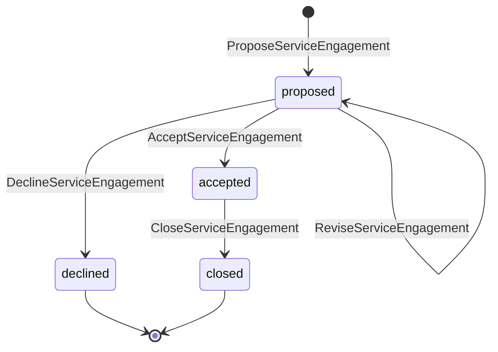
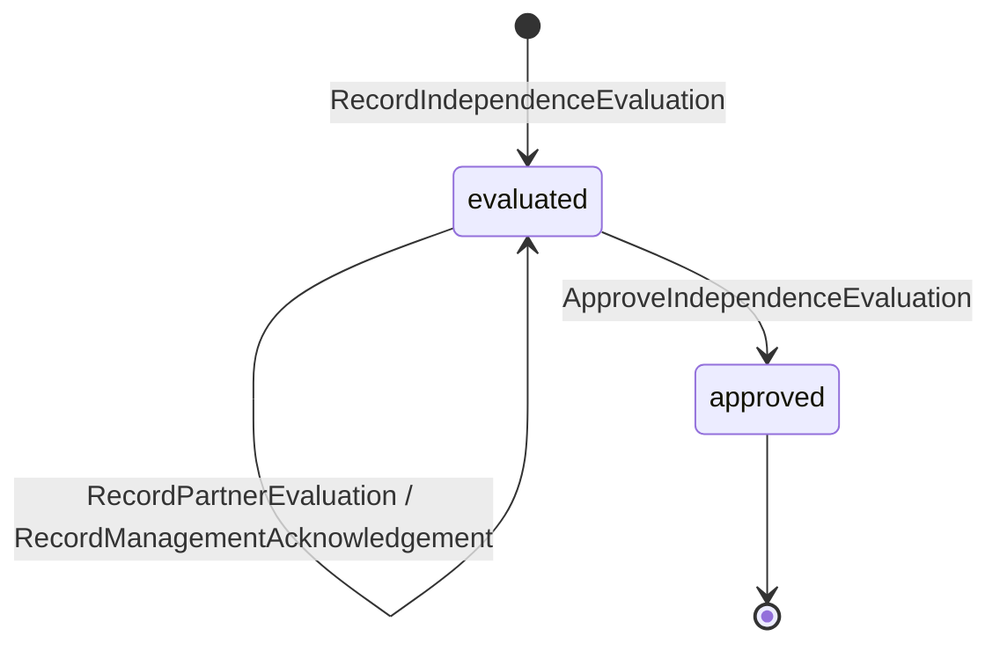
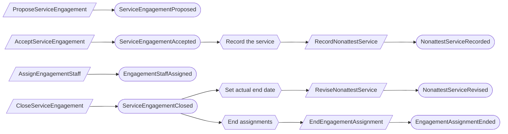
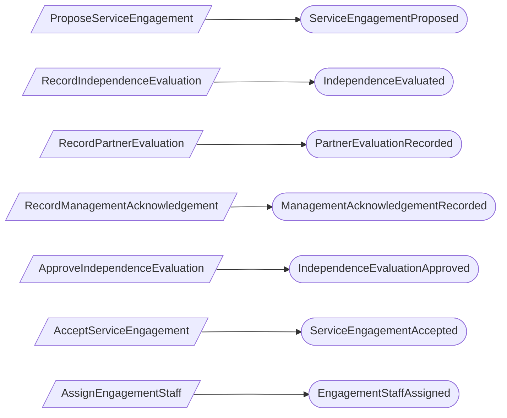
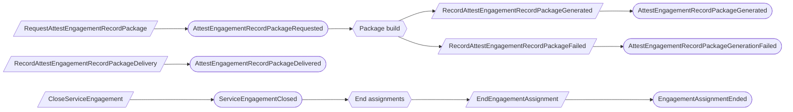

# Firm services

Status: **locked**, 2026-11-03. Hand-authored source of truth for this context.

## Purpose

Firm services records the work the firm does for a client organization, who on
the firm's staff does it, and whether the firm can stay independent while doing
it. It keeps advisory and attest work apart (M0-D26) and makes sure the firm keeps
its own record of in-product attest work (M0-D27).

**Owns:** service engagements, engagement assignments, nonattest service records,
independence rule sets, independence evaluations, partner designations, and attest
engagement record packages.

**Does not own:**

| Concern | Owner |
| --- | --- |
| Firm staff directory and practice | Platform access (`FirmStaffMember`) |
| The client's own audit engagement (Type I, Type II) | Examinations; it is a different record from a `ServiceEngagement` (M0-D23) |
| Advisor feedback and handoffs | Advisor collaboration |
| Auditor requests, populations, samples | Auditor requests, Audit populations |
| Engagement hold on evidence | Retention |
| Attest workpapers, tests, report drafts | Not in the product; they stay in the attest team's audit software (M0-D27) |
| Quality management, competence, financial interests, partner rotation | Firm procedure, not platform (M0-D26) |

## Language

| Term | Meaning |
| --- | --- |
| Service engagement | One service the firm provides to one client: its practice, service kind, scope, period and acceptance decision. |
| Practice | `advisory` or `attest`. |
| Service kind | Advisory: readiness assessment, control design, control implementation, operating controls on the client's behalf, vCISO. Attest: SOC 2 Type I, SOC 2 Type II. |
| Engagement assignment | One firm staff member assigned to one accepted engagement. It gives Advisor or Attest work for that client, per the engagement's practice. |
| Nonattest service record | One advisory service the firm performed for a client, with its kind and dates, whether or not it was delivered through the product. |
| Independence rule set | A numbered version of the service classification (`impairing` or `conditionally_compatible`) and the look-back period. |
| Independence evaluation | The record that an attest engagement may, or may not, be accepted under one rule-set version and the client's service history. |
| Partner designation | A firm staff member's designation as `engagement_partner` or `quality_management_partner`. |
| Attest engagement record package | The package of an attest engagement's collaboration records that is delivered into the attest team's audit software. |

## Aggregates

### ServiceEngagement

**Identity:** `TenantId` + `EngagementId`.

**Invariant:** one engagement has one practice, one service kind, and one
lifecycle. Its terms change only while it is proposed.

Acceptance rules, checked against current state when the command runs:

- **Attest:** the engagement's independence evaluation is approved, was made under
  the active rule-set version, and considered the client's current nonattest
  service history. An `impaired` result can never be accepted, and there is no
  override (M0-D26, FS-03).
- **Advisory:** a service kind that the active rule set classifies `impairing` is
  refused while the client has an accepted, open attest engagement (FS-04).

Closing an attest engagement is refused until its record package delivery is
recorded (M0-D27, FS-06).

| Command | Who | Accepts when | Emits |
| --- | --- | --- | --- |
| ProposeServiceEngagement | Firm staff of the engagement's practice | `EngagementId` is new | ServiceEngagementProposed |
| ReviseServiceEngagement | Firm staff of the practice | Proposed | ServiceEngagementRevised |
| DeclineServiceEngagement | Engagement partner | Proposed | ServiceEngagementDeclined |
| AcceptServiceEngagement | Engagement partner | Proposed; acceptance rules hold | ServiceEngagementAccepted |
| CloseServiceEngagement | Engagement partner | Accepted; for attest, package delivered | ServiceEngagementClosed |

| Event | Carries |
| --- | --- |
| ServiceEngagementProposed | tenant, engagement, practice, service kind, scope, period, engagement partner, proposed by |
| ServiceEngagementRevised | tenant, engagement, changed terms, revised by |
| ServiceEngagementDeclined | tenant, engagement, reason, declined by |
| ServiceEngagementAccepted | tenant, engagement, practice, service kind, period, independence evaluation (attest), accepted by |
| ServiceEngagementClosed | tenant, engagement, actual end date, closed by |

### EngagementAssignment

**Identity:** `TenantId` + `EngagementId` + `UserId`.

**Invariant:** one firm staff member is assigned to one engagement, or is not. An
ended assignment can be assigned again, and its history is kept.

Assignment rules, checked against current state when the command runs:

- The engagement is accepted and not closed (FS-05).
- The person is an active firm staff member whose practice matches the
  engagement's practice.
- **Person exclusivity:** a person who has ever held an assignment of the other
  practice for the same client is refused. Advisory staff who served a client are
  never on its attest team (M0-D26).

| Command | Who | Accepts when | Emits |
| --- | --- | --- | --- |
| AssignEngagementStaff | Engagement partner | Assignment rules hold | EngagementStaffAssigned |
| EndEngagementAssignment | Engagement partner or reactor | Assigned | EngagementAssignmentEnded |

| Event | Carries |
| --- | --- |
| EngagementStaffAssigned | tenant, engagement, user, practice, assigned by |
| EngagementAssignmentEnded | tenant, engagement, user, reason, ended by |

### NonattestServiceRecord

**Identity:** `TenantId` + `RecordId`.

**Invariant:** one record states one advisory service the firm performed for the
client: its kind, start and end dates, and the engagement it came from, if any.
Corrections are revisions with a reason, and a record entered in error is voided.
Nothing is ever deleted.

- Services delivered through the product are recorded by a reactor when an
  advisory engagement is accepted, and their end date is set when it closes.
- Services delivered outside the product are recorded by an engagement partner,
  so the look-back sees the client's full history (FS-02).
- Every revision or void makes earlier independence evaluations stale (FS-03).

| Command | Who | Accepts when | Emits |
| --- | --- | --- | --- |
| RecordNonattestService | Engagement partner or reactor | `RecordId` is new | NonattestServiceRecorded |
| ReviseNonattestService | Engagement partner or reactor | Not voided; reason given | NonattestServiceRevised |
| VoidNonattestService | Engagement partner | Not voided; reason given | NonattestServiceVoided |

| Event | Carries |
| --- | --- |
| NonattestServiceRecorded | tenant, record, service kind, start, end, engagement (optional), recorded by |
| NonattestServiceRevised | tenant, record, changed fields, reason, revised by |
| NonattestServiceVoided | tenant, record, reason, voided by |

### IndependenceRuleSet

**Identity:** version number. Platform-level, outside every tenant.

**Invariant:** one version has one classification of each advisory service kind
and one look-back period. A draft can change; a ratified version never changes.
The active rule set is the highest ratified version, and evaluations keep the
version they were made under (M0-D26).

- A new version's number is the previous number plus one.
- Only a quality-management partner drafts and ratifies (FS-07). A version is
  used for evaluations only once ratified (FS-08).

| Command | Who | Accepts when | Emits |
| --- | --- | --- | --- |
| DraftIndependenceRuleSet | Quality-management partner | Next version number | IndependenceRuleSetDrafted |
| ReviseIndependenceRuleSetDraft | Quality-management partner | Draft | IndependenceRuleSetDraftRevised |
| RatifyIndependenceRuleSet | Quality-management partner | Draft | IndependenceRuleSetRatified |

| Event | Carries |
| --- | --- |
| IndependenceRuleSetDrafted | version, classifications, look-back months, drafted by |
| IndependenceRuleSetDraftRevised | version, classifications, look-back months, revised by |
| IndependenceRuleSetRatified | version, ratified by |

The initial version classifies a readiness assessment as
`conditionally_compatible`; control design, control implementation, operating
controls and vCISO as `impairing`; with a 12-month look-back before the
examination period starts (M0-D26).

### IndependenceEvaluation

**Identity:** `TenantId` + `EvaluationId`, for one attest engagement.

**Invariant:** one evaluation records one result under one rule-set version and
one exact set of nonattest services, and can be approved once.

- The result is computed from the recorded facts (FS-01):
  - `impaired`: any `impairing` service within the look-back before the
    examination period starts, or during the examination period (FS-04);
  - `conditionally_compatible`: otherwise, when any `conditionally_compatible`
    service is in the history;
  - `compatible`: no such services.
- A `conditionally_compatible` result needs a partner evaluation with a
  conclusion and rationale.
- Management's acknowledgement of responsibility for nonattest services is
  recorded by a client-personnel Org Admin (FS-09).
- Approval needs a result other than `impaired`, a partner evaluation that
  concludes `acceptable` when the result is conditional, and the management
  acknowledgement. It records the approver and
  time.
- A newer nonattest service change or a newer ratified rule set makes the
  evaluation stale for acceptance; a new evaluation is recorded instead (FS-03).

| Command | Who | Accepts when | Emits |
| --- | --- | --- | --- |
| RecordIndependenceEvaluation | Engagement partner | `EvaluationId` is new; engagement is an attest proposal | IndependenceEvaluated |
| RecordPartnerEvaluation | Engagement partner | Result is `conditionally_compatible`; not approved | PartnerEvaluationRecorded |
| RecordManagementAcknowledgement | Client-personnel Org Admin | Not approved | ManagementAcknowledgementRecorded |
| ApproveIndependenceEvaluation | Engagement partner | Approval rules hold | IndependenceEvaluationApproved |

| Event | Carries |
| --- | --- |
| IndependenceEvaluated | tenant, evaluation, engagement, rule-set version, services considered (record and revision), examination period start, result, evaluated by |
| PartnerEvaluationRecorded | tenant, evaluation, conclusion (`acceptable` or `not_acceptable`), rationale, partner |
| ManagementAcknowledgementRecorded | tenant, evaluation, acknowledged by |
| IndependenceEvaluationApproved | tenant, evaluation, approved by, approved at |

### PartnerDesignation

**Identity:** `UserId` + duty (`engagement_partner` or
`quality_management_partner`). Platform-level.

**Invariant:** one firm staff member holds one duty, or does not. Each grant and
revocation records actor, time and reason.

- Only an active firm staff member can be designated.
- Platform operators designate and revoke (FS-07).

| Command | Who | Accepts when | Emits |
| --- | --- | --- | --- |
| DesignatePartner | Operator | Not designated; active firm staff | PartnerDesignated |
| RevokePartnerDesignation | Operator | Designated | PartnerDesignationRevoked |

| Event | Carries |
| --- | --- |
| PartnerDesignated | user, duty, reason, designated by |
| PartnerDesignationRevoked | user, duty, reason, revoked by |

### AttestEngagementRecordPackage

**Identity:** `TenantId` + `EngagementId` + `PackageId`.

**Invariant:** one package for one attest engagement is requested, then generated
or failed, then delivered. Only a recorded delivery into the attest team's audit
software satisfies M0-D27; a client export never does.

- The package holds every request, response, population and sample version, and
  delivered evidence item for the engagement, with its manifest (M0-D17 format).
- After a failure, a new package is requested.

| Command | Who | Accepts when | Emits |
| --- | --- | --- | --- |
| RequestAttestEngagementRecordPackage | Attest staff on the engagement | `PackageId` is new | AttestEngagementRecordPackageRequested |
| RecordAttestEngagementRecordPackageGenerated | Reactor (package build) | Requested | AttestEngagementRecordPackageGenerated |
| RecordAttestEngagementRecordPackageFailed | Reactor (package build) | Requested | AttestEngagementRecordPackageGenerationFailed |
| RecordAttestEngagementRecordPackageDelivery | Attest staff on the engagement | Generated | AttestEngagementRecordPackageDelivered |

| Event | Carries |
| --- | --- |
| AttestEngagementRecordPackageRequested | tenant, engagement, package, requested by |
| AttestEngagementRecordPackageGenerated | tenant, engagement, package, manifest, content reference |
| AttestEngagementRecordPackageGenerationFailed | tenant, engagement, package, reason |
| AttestEngagementRecordPackageDelivered | tenant, engagement, package, delivered by, delivered at |

## Flows

### Advisory engagement

### Attest engagement acceptance

These are separate decisions by different people; each command checks the facts
it needs, so no reactor connects them. The partner evaluation is needed only for
a `conditionally_compatible` result.

### Attest engagement closure

### Firm staff leaves

Access already stopped, because authorization requires an active firm staff
member and an open engagement. Ending the assignments is housekeeping.

## Authorization contract

Firm services adds these checks to the Platform access authorization contract:

1. Advisor or Attest work for a client needs an assignment that has not ended, to
   an accepted engagement that is not closed, held by an active firm staff member.
2. **Compartments:** Attest assignees cannot read advisory working notes (advisor
   feedback, handoff content, advisory notes). Advisors cannot read attest-side
   request discussions marked `attest_internal`. Shared management records follow
   normal permissions (M0-D26).
3. A firm-staff member's client-role permissions from teams do not bypass rule 2.

## Cross-context contracts

- **Platform access:** `CompleteTenantOffboarding` needs a delivered record package
  for every attest engagement of the tenant. Firm staff status and practice come
  from `FirmStaffMember`.
- **Retention:** the engagement hold blocks evidence disposition until the attest
  record package is delivered (M0-D16, M0-D27).

## Decisions

Jev answers are from `jev-1.14.0`, 2026-11-03. A yes is ≥ 0.8 and a no is ≤ 0.2.
Anything in between is settled by common sense, with the reasoning stated.

| ID | Decision | Evidence |
| --- | --- | --- |
| FS-01 | The evaluation result is computed from recorded facts. Professional judgment sits in the partner evaluation. | Computable from kind, dates and rule set: 0.91. Asked without that detail it was near-even (0.51). |
| FS-02 | Services performed outside the product are recorded too, so the look-back sees the full history. | 0.80. |
| FS-03 | Acceptance needs an evaluation made under the active rule set and the client's current service history. Any later service change makes it stale. | Stale evaluation refused: 0.93. |
| FS-04 | An advisory engagement for an impairing service kind is refused while the client has an accepted, open attest engagement. | An impairing service during an attest engagement impairs independence: 0.94. The direct question was 0.64. |
| FS-05 | Staff are assigned only to accepted engagements, so every assignment counts towards person exclusivity. | Jev disagreed with itself on unaccepted assignments (counted 0.77; no concern 0.35). Assigning only after acceptance removes the question. |
| FS-06 | Closing an attest engagement waits for the recorded record-package delivery. | 0.97. M0-D27. |
| FS-07 | Partners are recorded as `PartnerDesignation`, and platform operators designate them. Only engagement partners accept, decline, assign, evaluate and record partner evaluations; only quality-management partners draft and ratify rule sets. | Without a recorded designation, any attest staff member could act as a partner: 0.68; another platform-level authority exists: 0.41. Common sense: a gate needs a recorded fact, and operators are the only platform-level authority (as PA-14). |
| FS-08 | Only ratified rule-set versions are used. | 0.72. M0-D26 says the quality-management partner ratifies. |
| FS-09 | Management's acknowledgement is recorded by a client-personnel Org Admin. | 0.78. Common sense: management means the client. |
| FS-10 | Small independent aggregates, each checking other facts against current state when its command runs. No reservations, epochs or identity claims. | Product owner, 2026-11-03. |

## Open questions

None at this time.

## Superseded owners

| Old owner | Becomes |
| --- | --- |
| ServiceEngagementIndependence | ServiceEngagement and EngagementAssignment |
| ClientServiceIndependence | NonattestServiceRecord; the acceptance check reads the history (FS-03) |
| ClientIndependenceDecision, PartnerIndependenceDecision, EngagementManagementAcknowledgement | IndependenceEvaluation |
| IndependenceRuleCatalog, IndependenceRuleRatificationCatalog | IndependenceRuleSet |
| PracticeIndependenceCommitment | Removed; person exclusivity checks the assignment history (FS-05) |
| ProfessionalAssertionIdentityClaim | Removed |
| FirmProfessionalDutyDesignation | PartnerDesignation |
| FirmStaffRecord engagement and duty authorizations | Removed; checks read `FirmStaffMember` and `PartnerDesignation` |
| AttestEngagementRecordPackage | AttestEngagementRecordPackage |
| ClientService | Not Firm services: the client's own services belong to Program and scope |
