# Platform access

Status: **locked**, 2026-11-03. Hand-authored source of truth for this context. It
replaced the generated owner pages listed in [Superseded owners](#superseded-owners).

## Purpose

Platform access decides who an organization is, who belongs to it, what each
person may do there, and who operates the platform. It answers *may this person
act here*. It does not answer *is this person expected to do this work*; that is
a responsibility, owned by the context that owns the work (M0-D03).

**Owns:** organizations (tenants) and their lifecycle, slugs,
invitations, members and their affiliation, teams and their members, team role
assignments, roles and their permissions,
separation-of-duties waivers, platform users
and their sign-in identities, email address ownership, platform operators,
the firm-staff directory, and per-organization sign-in connections.

**Does not own:**

| Concern | Owner |
| --- | --- |
| Advisor and Attest access through engagement assignment | Firm services (`ServiceEngagement`); authorization reads it |
| Independence decisions about firm staff | Firm services |
| Responsibilities (control owner, reviewer, approver) | The context that owns the work; it references members, people and teams |
| Workforce `Person` records | Workforce assurance; a person may never sign in |
| Client export, attest record package, evidence retention | Exports and Firm services (offboarding waits on their facts); Retention keeps evidence on its schedule after offboarding (RT-04) |
| Acknowledgement waivers for policies | Policies |

## Language

| Term | Meaning |
| --- | --- |
| Organization | A client organization. Its technical name is **tenant** (`tenant_id`) everywhere in contracts; product text says organization (M0-D25). |
| Platform user | A person who can sign in. Exists outside every tenant. |
| Sign-in identity | One external issuer + subject pair that authenticates exactly one platform user. |
| Slug | The organization's normalized, globally unique short name used in its workspace URL. |
| Membership | One platform user's belonging to one organization. |
| Membership episode | One continuous period of membership. Deprovisioning ends it for good; rejoining starts a new episode. |
| Affiliation | Exactly one of `client_personnel`, `firm_staff`, `guest` per episode. |
| Role | A named set of permissions managed by the organization. Built-in roles are Org Admin, Compliance Lead, Contributor and Viewer; an Org Admin can add custom roles. |
| Team | A named group of members. Teams are assigned roles, and teams can hold responsibilities. Names need not be unique. |
| Role assignment | One role given to one team at one scope: the whole organization, a program, an engagement, or a deliberately shared resource. |
| Administrators team | The built-in team that permanently holds Org Admin at organization scope. |
| Primary Org Admin | One of the one or two members designated to keep the organization administrable. A primary holds Org Admin by the designation, cannot be suspended or deprovisioned, and is released only after a replacement is designated. |
| Platform operator | Platform super administrator. Sees tenant metadata only. |
| Firm staff member | A platform user in the firm-staff directory, with one practice: `advisory` or `attest`. |

**How a member gets permission:** member → team → role assignment (role + scope)
→ role permissions. The team is the only path for client members (PA-01). Firm
staff get Advisor or Attest work only through engagement assignment in Firm
services (M0-D25). The set of permissions that a role can contain is
product-defined.

## Aggregates

### Tenant

**Identity:** `TenantId`, supplied by the caller at registration.

**Invariant:** one organization moves through one lifecycle, and holds at most
one pending slug change.

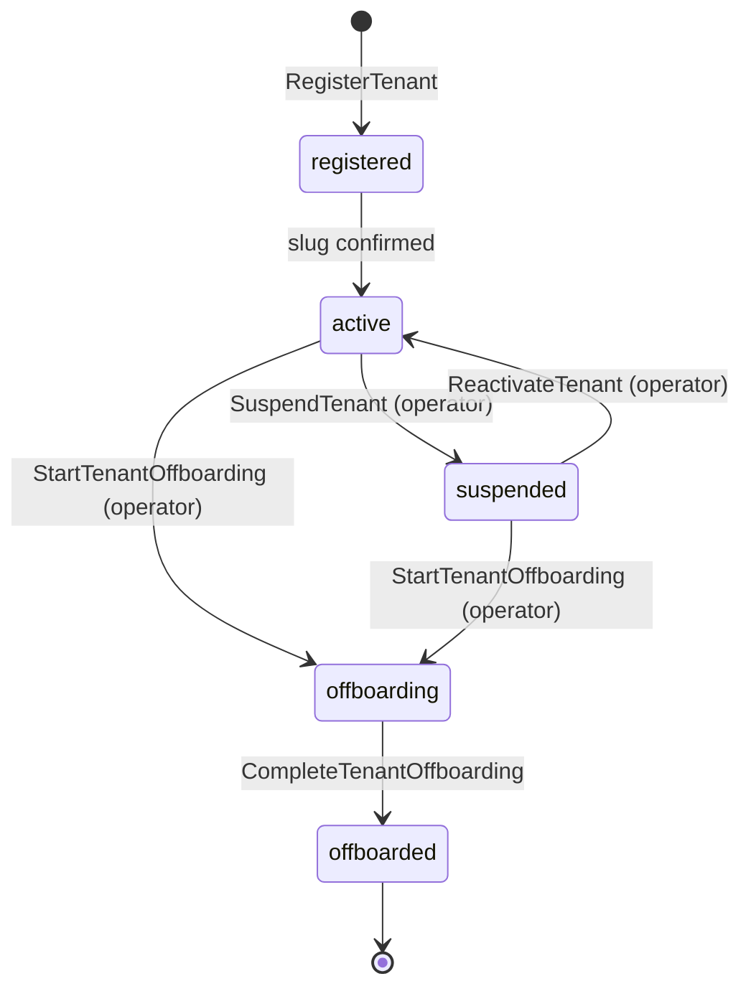

- A registered organization becomes active when its first slug is
  confirmed. The creator is already its first Org Admin on the Administrators team and
  is designated its first primary, so activation waits for nothing else.
- When the first slug is rejected, the organization stays registered and the
  creator requests another slug. This is the one command anyone can issue in a
  registered organization (PA-21).
- Suspension blocks every member and assigned firm staff member and preserves all
  records. Only an operator suspends, reactivates or offboards.
- Offboarding forbids new active service: Firm services refuses to propose or
  accept an engagement, or assign staff, unless the tenant is active. Offboarding
  completes only after the client export is received and the attest engagement
  record package delivery for every attest engagement are recorded, and no
  service engagement is still accepted and open (M0-D16, M0-D25, M0-D27).
  Evidence then stays on its retention schedule, and a platform operator
  approves later dispositions (Retention, RT-04).
- Repeating the current state is a no-op; every other transition is refused.

| Command | Who | Accepts when | Emits |
| --- | --- | --- | --- |
| RegisterTenant | Platform user with a verified email | `TenantId` is new | TenantRegistered |
| ConfirmTenantSlug | Reactor | Slug claim matches the pending request | TenantActivated (first slug) or TenantSlugChanged |
| RejectTenantSlug | Reactor | Slug claim was denied for the pending request | TenantSlugRejected |
| RequestTenantSlugChange | Org Admin; or the creator while registered | Registered or active; no change pending (PA-21) | TenantSlugChangeRequested |
| SuspendTenant | Operator | Active | TenantSuspended |
| ReactivateTenant | Operator | Suspended | TenantReactivated |
| StartTenantOffboarding | Operator | Active or suspended | TenantOffboardingStarted |
| CompleteTenantOffboarding | Operator | Offboarding; a client export received; every attest record package delivered; no accepted, open service engagement | TenantOffboardingCompleted |

| Event | Carries |
| --- | --- |
| TenantRegistered | tenant, display name, requested slug, creator user, registered at |
| TenantActivated | tenant, slug, activated at |
| TenantSlugChangeRequested | tenant, current slug, requested slug, requested by |
| TenantSlugChanged | tenant, previous slug, new slug |
| TenantSlugRejected | tenant, requested slug, reason (`taken` or `retired`) |

The tenant has a pending request from `RegisterTenant` until its first slug is
confirmed or rejected, and from `RequestTenantSlugChange` until that
slug is confirmed or rejected.
| TenantSuspended | tenant, operator, reason |
| TenantReactivated | tenant, operator, reason |
| TenantOffboardingStarted | tenant, operator, reason |
| TenantOffboardingCompleted | tenant, operator, client export received, record package deliveries |

### TenantSlug

**Identity:** the normalized slug.

**Invariant:** a slug belongs to at most one tenant, and once released it is
retired permanently, so a former organization's slug can never be reused.

| Command | Who | Accepts when | Emits |
| --- | --- | --- | --- |
| ClaimTenantSlug | Reactor | Unclaimed; a repeat claim by the same tenant is a no-op | TenantSlugClaimed, or TenantSlugClaimDenied when taken or retired |
| RetireTenantSlug | Reactor | Claimed by the releasing tenant | TenantSlugRetired |

| Event | Carries |
| --- | --- |
| TenantSlugClaimed | slug, tenant |
| TenantSlugClaimDenied | slug, requesting tenant, reason (`taken` or `retired`) |
| TenantSlugRetired | slug, tenant |

### TenantInvitation

**Identity:** `TenantId` + normalized email address.

**Invariant:** an email address has at most one pending invitation in an
organization. The invitation holds its current offer and its history.

- An offer lives 7 days; expiry is computed, not recorded.
- It is accepted only by a signed-in user whose verified email matches.
- An offer names the affiliation (`client_personnel`, `firm_staff` or `guest`)
  and the teams to join. A guest offer also names a finite end date and at least
  one program.
- Inviting someone who has a current membership episode (active or suspended) is
  refused. A suspended member comes back by reinstatement, not invitation (PA-22).

| Command | Who | Accepts when | Emits |
| --- | --- | --- | --- |
| InviteMember | Org Admin | No pending offer; no current episode | MemberInvited |
| RevokeInvitation | Org Admin | Offer pending | InvitationRevoked |
| AcceptInvitation | The invited platform user | Pending, unexpired, verified email matches | InvitationAccepted |

| Event | Carries |
| --- | --- |
| MemberInvited | tenant, email, offer, affiliation, teams, guest end date and programs, invited by, expires at |
| InvitationRevoked | tenant, email, offer, revoked by |
| InvitationAccepted | tenant, email, offer, user |

### Member

**Identity:** `TenantId` + `UserId`.

**Invariant:** one platform user has one membership in an organization, made of
episodes. Each episode has one affiliation and a status (active, suspended,
deprovisioned). A deprovisioned episode is final; only a new accepted invitation
starts a new episode.

- A guest's end date and programs are on the episode. The programs limit whatever
  the guest's teams give them, and access stops after the end date (UTC) (PA-03).
- A firm-staff member has no business-record access unless they are put on a
  team. Advisor and Attest come only from engagement assignment.
- Self-suspension and self-deprovisioning are refused. Each change records actor,
  time and reason.
- A member marked primary cannot be suspended or deprovisioned; they are
  released from `PrimaryOrgAdmins` after a replacement is designated (PA-27).
  Other Org Admins, however they hold the role, need no check (PA-23).

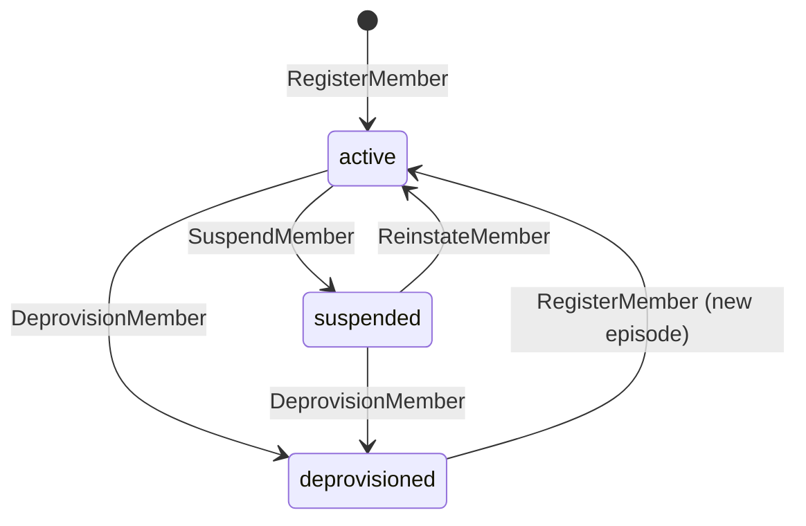

| Command | Who | Accepts when | Emits |
| --- | --- | --- | --- |
| RegisterMember | Reactor | No current episode | MemberRegistered |
| SuspendMember | Org Admin | Active; not self; not marked primary | MemberSuspended |
| ReinstateMember | Org Admin | Suspended | MemberReinstated |
| DeprovisionMember | Org Admin | Active or suspended; not self; not marked primary | MemberDeprovisioned |
| MarkMemberPrimary | Reactor on PrimaryOrgAdminDesignationRequested | Active and not a guest; a repeat is a no-op | MemberMarkedPrimary or MemberPrimaryMarkRefused |
| UnmarkMemberPrimary | Reactor on PrimaryOrgAdminReleased | Marked; a repeat is a no-op | MemberPrimaryMarkRemoved |

| Event | Carries |
| --- | --- |
| MemberRegistered | tenant, user, episode, origin (`tenant_creation` or the accepted invitation offer), affiliation, guest end date and programs |
| MemberSuspended | tenant, user, episode, actor, reason |
| MemberReinstated | tenant, user, episode, actor, reason |
| MemberDeprovisioned | tenant, user, episode, actor, reason |
| MemberMarkedPrimary | tenant, user, episode |
| MemberPrimaryMarkRefused | tenant, user, reason (`not_active` or `guest`) |
| MemberPrimaryMarkRemoved | tenant, user, episode |

### Team

**Identity:** `TenantId` + `TeamId`. The built-in Administrators team has a fixed
ID in every organization.

**Invariant:** one team has one name and one lifecycle: active, then deleted.

- The Administrators team cannot be deleted.
- Team names need not be unique (PA-13).

| Command | Who | Accepts when | Emits |
| --- | --- | --- | --- |
| CreateTeam | Org Admin, or reactor for the built-in team | `TeamId` is new | TeamCreated |
| RenameTeam | Org Admin | Active | TeamRenamed |
| DeleteTeam | Org Admin | Active, and not the Administrators team | TeamDeleted |

| Event | Carries |
| --- | --- |
| TeamCreated | tenant, team, name, built-in flag, created by |
| TeamRenamed | tenant, team, previous name, new name |
| TeamDeleted | tenant, team, deleted by |

### TeamMember

**Identity:** `TenantId` + `TeamId` + `UserId`.

**Invariant:** one member is on one team, or is not. A repeat assignment is a
no-op.

- Only a non-guest member can be put on the Administrators team.
- A team membership counts only while the member's episode is active (PA-09).

| Command | Who | Accepts when | Emits |
| --- | --- | --- | --- |
| AssignTeamMember | Org Admin or reactor | Team active; not on the team; not a guest when the team is Administrators | TeamMemberAssigned |
| RemoveTeamMember | Org Admin or reactor | On the team | TeamMemberRemoved |

| Event | Carries |
| --- | --- |
| TeamMemberAssigned | tenant, team, user, episode, assigned by |
| TeamMemberRemoved | tenant, team, user, removed by |

### PrimaryOrgAdmins

**Identity:** `TenantId`.

**Invariant:** the organization always has one or two primary Org Admins (PA-27,
CV-11). A primary holds Org Admin through the designation itself, and their own
membership refuses suspension and deprovisioning while they are primary, so the
organization never loses its last Org Admin. To remove a primary, a replacement
is designated first: a primary is released only while another primary is fully
designated.

- The organization's creator becomes the first primary when it is created.
- Designation has two steps. This record holds a seat for the request, the
  person's `Member` record accepts the primary mark (active, non-guest) or
  refuses it, and the outcome is recorded here ([CV-10](conventions.md#reactors)).
  A pending designation counts toward the two seats but never toward the one that
  must remain.
- A release is recorded here first; the mark is then removed from the member.
  Until it is, the released person stays protected, which is harmless.
- The stream grows only when primaries change. Ordinary Org Admins come and go
  through the Administrators team without touching it
  ([CV-13](conventions.md#stream-growth)).
- Offboarding is exempt: a completed offboarding ends every membership.

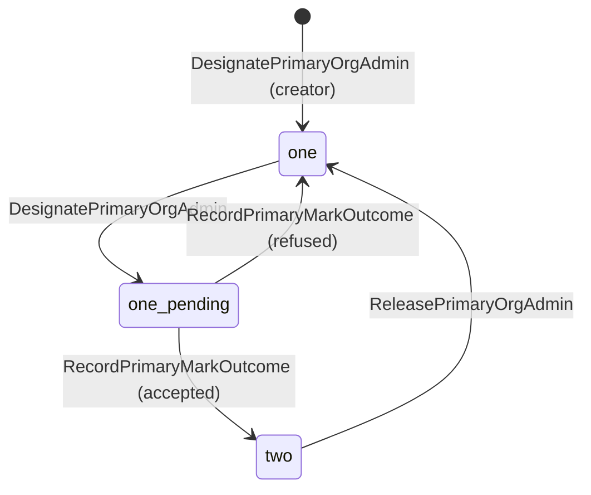

| Command | Who | Accepts when | Emits |
| --- | --- | --- | --- |
| DesignatePrimaryOrgAdmin | Org Admin; reactor on MemberRegistered (origin `tenant_creation`) for the creator | Fewer than two primaries, counting a pending one; not already primary; a repeat is a no-op | PrimaryOrgAdminDesignationRequested |
| RecordPrimaryMarkOutcome | Reactor on MemberMarkedPrimary or MemberPrimaryMarkRefused | Designation pending; a repeat is a no-op | PrimaryOrgAdminDesignated or PrimaryOrgAdminDesignationRefused |
| ReleasePrimaryOrgAdmin | Org Admin, including the primary themself | Primary; another primary fully designated; reason given | PrimaryOrgAdminReleased |

| Event | Carries |
| --- | --- |
| PrimaryOrgAdminDesignationRequested | tenant, user, requested by |
| PrimaryOrgAdminDesignated | tenant, user |
| PrimaryOrgAdminDesignationRefused | tenant, user, reason (`not_active` or `guest`) |
| PrimaryOrgAdminReleased | tenant, user, replaced by, reason, released by |

### TeamRole

**Identity:** `TenantId` + `TeamId` + `RoleId` + scope.

**Invariant:** one role is assigned to one team at one scope, or it is not. A
repeat assignment is a no-op.

- The Administrators team's Org Admin assignment at organization scope cannot be
  removed. Because built-in IDs are fixed, the assignment can check this itself
  (PA-04).
- Org Admin is assigned only at organization scope (PA-12). Advisor and Attest
  cannot be assigned to a team; they come only from engagement assignment.
- An assignment counts only while its team and role are both active (PA-19).

| Command | Who | Accepts when | Emits |
| --- | --- | --- | --- |
| AssignRoleToTeam | Org Admin, or reactor for the built-in team | Not assigned; scope rules hold | RoleAssignedToTeam |
| RemoveRoleFromTeam | Org Admin or reactor | Assigned, and not the protected Administrators assignment | RoleRemovedFromTeam |

| Event | Carries |
| --- | --- |
| RoleAssignedToTeam | tenant, team, role, scope, assigned by |
| RoleRemovedFromTeam | tenant, team, role, scope, removed by |

### Role

**Identity:** `TenantId` + `RoleId`. Built-in roles have fixed IDs in every
organization.

**Invariant:** one role has one name and one lifecycle: active, then deleted.

- Built-in roles are Org Admin, Compliance Lead, Contributor, Viewer, Advisor
  and Attest. They are defined with the organization and cannot be renamed or
  deleted (PA-18).
- Custom roles are created, renamed and deleted by an Org Admin.
- What a role permits is recorded by `RolePermission`.

| Command | Who | Accepts when | Emits |
| --- | --- | --- | --- |
| DefineRole | Org Admin, or reactor for built-in roles | `RoleId` is new | RoleDefined |
| RenameRole | Org Admin | Custom and active | RoleRenamed |
| DeleteRole | Org Admin | Custom and active | RoleDeleted |

| Event | Carries |
| --- | --- |
| RoleDefined | tenant, role, name, built-in flag, defined by |
| RoleRenamed | tenant, role, previous name, new name |
| RoleDeleted | tenant, role, deleted by |

### RolePermission

**Identity:** `TenantId` + `RoleId` + permission.

**Invariant:** one permission is assigned to one role, or it is not. A repeat
assignment is a no-op.

- The permission must be one of the product's known permissions.
- Built-in roles' permissions cannot be changed. Because built-in role IDs are
  fixed, the assignment can check this itself (PA-18).
- A permission counts only while its role is active (PA-19). A change applies at
  once to every team holding the role.

| Command | Who | Accepts when | Emits |
| --- | --- | --- | --- |
| AssignRolePermission | Org Admin, or reactor for built-in roles | Not assigned; known permission; custom role (or built-in at setup) | RolePermissionAssigned |
| RemoveRolePermission | Org Admin or reactor | Assigned; custom role | RolePermissionRemoved |

| Event | Carries |
| --- | --- |
| RolePermissionAssigned | tenant, role, permission, assigned by |
| RolePermissionRemoved | tenant, role, permission, removed by |

### SeparationOfDutiesWaiver

**Identity:** `TenantId` + `WaiverId`.

**Invariant:** one waiver exempts one beneficiary from the self-review or
self-approval block for one record type and scope until its expiry. It takes
effect only after a second Org Admin, who is neither the requester nor the
beneficiary, approves it once (M0-D03, M0-D23).

| Command | Who | Accepts when | Emits |
| --- | --- | --- | --- |
| RequestSeparationOfDutiesWaiver | Org Admin | Reason given; expiry after now | SeparationOfDutiesWaiverRequested |
| ApproveSeparationOfDutiesWaiver | A different Org Admin, not the beneficiary | Requested and unexpired | SeparationOfDutiesWaiverApproved |
| RevokeSeparationOfDutiesWaiver | Org Admin | Requested or approved; unexpired; reason given | SeparationOfDutiesWaiverRevoked |

| Event | Carries |
| --- | --- |
| SeparationOfDutiesWaiverRequested | tenant, waiver, beneficiary, record type, scope, reason, expires at, requested by |
| SeparationOfDutiesWaiverApproved | tenant, waiver, approved by, approved at |
| SeparationOfDutiesWaiverRevoked | tenant, waiver, reason, revoked by |

Expiry is computed, not recorded. A revoked waiver covers nothing from the moment
it is revoked; actions already taken under it keep their flag.

Every waived action is flagged in readiness results and audit exports; the
contexts that perform the action record that flag.

### PlatformUser, SignInIdentity, EmailAddress

These three platform-level aggregates live outside every tenant.

- **PlatformUser** (`UserId`): the person who signs in, with display name and
  verified email. Their history (approvals, evidence, actions) stays attached to
  this identity for good, so recovery restores the same user rather than creating
  a new one (PA-10).
- **SignInIdentity** (issuer + subject): `unattached` → `attached` to exactly one
  platform user → `revoked`. Only an attached identity authenticates, and a
  revoked one never does again.
- **EmailAddress** (normalized address): claimed by at most one platform user
  across the platform, and only once it is verified, either by the issuer's
  verified-email claim or by an email challenge (PA-11). Invitation acceptance and
  organization creation rely on this.

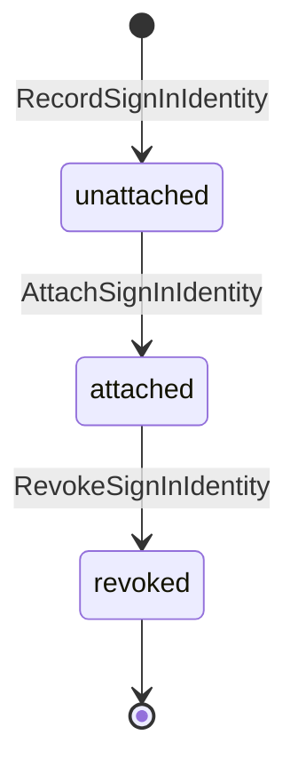

| Command | Owner | Accepts when | Emits |
| --- | --- | --- | --- |
| RecordSignInIdentity | SignInIdentity | First sign-in with this issuer and subject | SignInIdentityRecorded |
| AttachSignInIdentity | SignInIdentity (reactor) | Unattached, or already attached to the same user (no-op) | SignInIdentityAttached |
| RevokeSignInIdentity | SignInIdentity (reactor or the user) | Attached | SignInIdentityRevoked |
| RecordIssuerVerifiedEmail | EmailAddress (reactor) | The sign-in identity's issuer verified the address | EmailAddressVerified |
| IssueEmailChallenge | EmailAddress (reactor) | Issuer did not verify the address; requested for an unattached sign-in identity | EmailChallengeIssued |
| CompleteEmailChallenge | EmailAddress | Current challenge answered from the same sign-in identity, unexpired | EmailAddressVerified |
| ClaimEmailAddress | EmailAddress (reactor) | Verified, and unclaimed or claimed by the same user | EmailAddressClaimed, or EmailAddressClaimDenied when another user owns it |
| RegisterPlatformUser | PlatformUser (reactor) | `UserId` is new; a repeat for the same sign-in identity is a no-op | PlatformUserRegistered |
| RequestAccountRecovery | EmailAddress | Claimed; requested from an unattached sign-in identity | AccountRecoveryChallengeIssued |
| CompleteAccountRecovery | EmailAddress | Current challenge answered from the same sign-in identity | AccountRecoveryVerified |

| Event | Carries |
| --- | --- |
| SignInIdentityRecorded | issuer, subject, email as asserted, whether the issuer verified it |
| SignInIdentityAttached | issuer, subject, user, reason (`first_sign_in` or `account_recovery`) |
| SignInIdentityRevoked | issuer, subject, user, reason, revoked by |
| EmailChallengeIssued | address, sign-in identity, challenge, expires at |
| EmailAddressVerified | address, sign-in identity, method (`issuer` or `challenge`) |
| EmailAddressClaimed | address, user |
| EmailAddressClaimDenied | address, sign-in identity, owning user |
| PlatformUserRegistered | user, display name, verified email, first sign-in identity |
| AccountRecoveryChallengeIssued | address, user, new sign-in identity, challenge, expires at |
| AccountRecoveryVerified | address, user, new sign-in identity |

The new user's `UserId` is derived from the first sign-in identity, so a repeated
trigger registers the same user once ([CV-02](conventions.md#reactors)). An
issuer-verified email is recorded as `EmailAddressVerified` with method `issuer`,
so the claim always follows the same fact.

**Account recovery** (PA-10): a person who has lost their old sign-in method
signs in with a new one. Because their verified email already belongs to their
account, the new identity stays unattached and they are offered recovery. Proving
control of that email attaches the new identity to the existing user, revokes
every other identity of that user, and emails a notice to the address. No second
person approves it.

Successful authentications are audit-log entries, not domain events (PA-08).

### PlatformOperators

**Identity:** the platform (one record).

**Invariant:** the platform's operators are one set that is never empty once
seeded. Each grant and revocation records actor, time and reason, and revoking
the last operator is refused in this one stream (M0-D25, PA-20, CV-11).

- An existing operator grants and revokes operator status. There is no two-person
  rule.
- Configured operator IDs are granted only while the platform has no operator. A
  configured ID never re-grants a revoked operator on restart.

| Command | Who | Accepts when | Emits |
| --- | --- | --- | --- |
| SeedPlatformOperator | System | The set is empty; this user was never revoked | PlatformOperatorGranted |
| GrantPlatformOperator | Operator | Not an operator | PlatformOperatorGranted |
| RevokePlatformOperator | Operator | An operator; not the last one | PlatformOperatorRevoked |

| Event | Carries |
| --- | --- |
| PlatformOperatorGranted | user, granted by (operator or `configuration`), reason |
| PlatformOperatorRevoked | user, revoked by, reason |

### FirmStaffMember

**Identity:** `UserId`. Each platform user has at most one firm-staff entry.

**Invariant:** the practice (`advisory` or `attest`) is recorded once and never
changes. The entry is active or inactive, and it lives outside every tenant.

| Command | Who | Accepts when | Emits |
| --- | --- | --- | --- |
| RegisterFirmStaffMember | Operator (PA-14) | No entry for this user; practice given | FirmStaffMemberRegistered |
| ChangeFirmStaffStatus | Operator (PA-14) | Registered; status differs; reason given | FirmStaffMemberStatusChanged |

| Event | Carries |
| --- | --- |
| FirmStaffMemberRegistered | user, practice, registered by |
| FirmStaffMemberStatusChanged | user, previous status, new status, reason, changed by |

An inactive firm staff member holds no engagement work and no partner duty;
authorization checks the status (PA-09 approach, FS-12 in Firm services).

### TenantSignInConnection (later release, F1-06)

**Identity:** `TenantId` + `ConnectionId`.

**Invariant:** a connection is enabled only after a successful test of its current
credentials. A credential rotation invalidates any earlier test, and a disabled
connection stays disabled. The detailed design is deferred to F1-06.

## Flows

Diagrams follow [CV-01](conventions.md#flow-diagrams), and reactors follow
[CV-02 to CV-04](conventions.md#reactors).

Delivery of invitation and verification emails is a technical process; it records
send attempts and makes no business decision.

### Organization creation

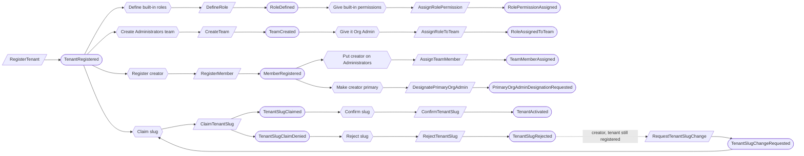

`MemberRegistered` carries origin `tenant_creation`, which is what the "Put
creator on Administrators" reactor reacts to. Built-in role and team IDs are
fixed, so the creator can be put on the Administrators team before it exists. The
creator acts once the team's Org Admin assignment is recorded.
After a rejection the tenant stays registered, and the creator requests another
slug (PA-21). Dotted edges are facts a command checks, not reactions.

### Slug change

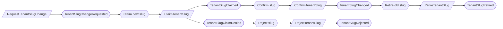

### Invitation and joining

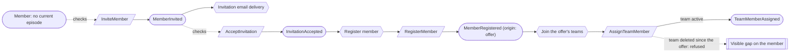

A guest's invited programs are recorded on the member episode and limit what
those teams give them. The teams come from the offer named by the event's origin.

### First sign-in

```mermaid
flowchart LR
    C1[/RecordSignInIdentity/] --> E1([SignInIdentityRecorded])
    E1 -->|issuer verified the email| R0{{Record issuer verification}} --> C8[/RecordIssuerVerifiedEmail/] --> V([EmailAddressVerified])
    E1 -->|not verified| R5{{Challenge the email}} --> C6[/IssueEmailChallenge/] --> E6([EmailChallengeIssued])
    E6 --> P1{{Challenge email delivery}}
    E6 -. checks .-> C7[/CompleteEmailChallenge/] --> V
    V --> R1{{Claim verified email}} --> C2[/ClaimEmailAddress/]
    C2 --> E2([EmailAddressClaimed]) --> R2{{"Register user (UserId from identity)"}} --> C3[/RegisterPlatformUser/] --> E3([PlatformUserRegistered])
    E3 --> R3{{Attach identity}} --> C4[/AttachSignInIdentity/] --> E4(["SignInIdentityAttached (first_sign_in)"])
    C2 --> E5([EmailAddressClaimDenied]) -.-> X1[[Offer account recovery]]
```

After a denial, the identity stays unattached and the person is offered account
recovery. Both verification paths end in `EmailAddressVerified`, so the claim
always follows the same fact.

### Account recovery

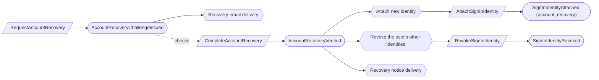

Revocation reacts to `AccountRecoveryVerified`, which names the identity to keep,
never to `SignInIdentityAttached`, which every first sign-in also records.

### Membership ends

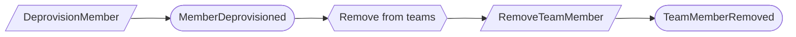

Access stops at MemberDeprovisioned, because team memberships count only while
the episode is active. Removing them is housekeeping.

### Primary Org Admins

```mermaid
flowchart LR
    C1[/DesignatePrimaryOrgAdmin/] --> E1([PrimaryOrgAdminDesignationRequested])
    E1 --> R1{{Mark the member}} --> C2[/MarkMemberPrimary/]
    C2 --> E2([MemberMarkedPrimary])
    C2 --> E3([MemberPrimaryMarkRefused])
    E2 --> R2{{Record outcome}} --> C3[/RecordPrimaryMarkOutcome/]
    E3 --> R2
    C3 --> E4([PrimaryOrgAdminDesignated])
    C3 --> E5([PrimaryOrgAdminDesignationRefused])
    E4 -. "replacement in place" .-> C4[/ReleasePrimaryOrgAdmin/] --> E6([PrimaryOrgAdminReleased])
    E6 --> R3{{Unmark the member}} --> C5[/UnmarkMemberPrimary/] --> E7([MemberPrimaryMarkRemoved])
    E2 -. "marked: refused" .-> X1[/SuspendMember, DeprovisionMember/]
```

### Role or team deleted

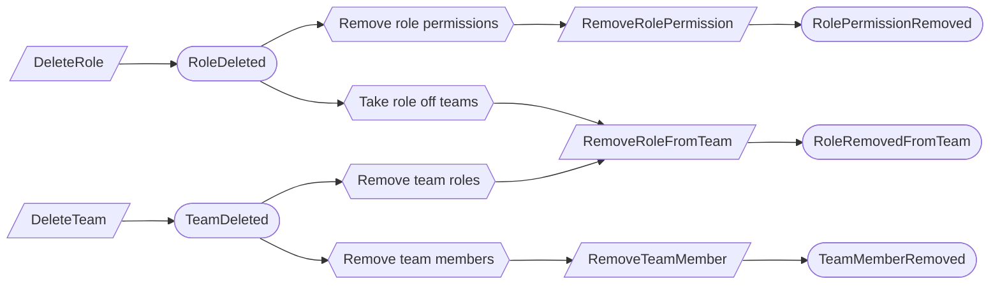

Permission checks ignore a deleted role or team immediately. These reactors tidy
up the records; they do not stop access.

### Offboarding

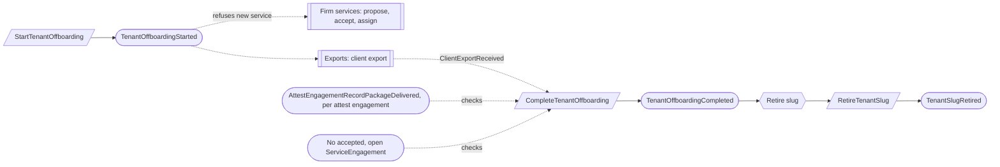

The export belongs to Exports. After completion, Retention keeps the evidence on its schedule (RT-04).

## Authorization contract

Authorization is a query, not an aggregate. A person may act in an organization
when every one of these holds:

1. The tenant is active (not registered, suspended, offboarding or offboarded).
   The one exception: while the tenant is registered, its creator may issue
   `RequestTenantSlugChange` (PA-21).
2. The person has a current, active membership episode, and a guest's end date has
   not passed, **or** they have an active engagement assignment from Firm services
   for Advisor or Attest work.
3. A permission for the action comes from either path:
   - a role assigned to an active team they are on, with an active role and a
     scope that covers the target (a wider scope covers the narrower ones inside
     it); for a guest, the target is also inside one of their programs;
   - their engagement role (Advisor or Attest);
   - being a primary Org Admin, which gives Org Admin at organization scope.
4. Separation of duties: self-review and self-approval are refused unless an
   approved, unexpired waiver covers the record type, scope and beneficiary.
5. Independence walls from Firm services still apply.

Platform operators see tenant lifecycle, who the Org Admins are, and usage.
They read business records only through a membership or engagement assignment.

## Disagreement and replay

Cases required by [CV-12](conventions.md#guards-and-reviews).

| Case | Outcome |
| --- | --- |
| Both primaries are released at the same moment | `PrimaryOrgAdmins` orders them; the second is refused because no other primary would remain |
| A member is suspended while being designated primary | Their `Member` record orders the two: suspended first refuses the mark, and the designation is recorded refused; marked first refuses the suspension |
| A release is recorded but the mark is not yet removed | The person stays protected a little longer; harmless |
| An organization adds 100 Org Admins and removes 99 | No events on `PrimaryOrgAdmins`; only the members' and teams' own records change |
| `PrimaryOrgAdminDesignationRequested` delivered twice | `MarkMemberPrimary` repeat is a no-op |
| Two operators revoke each other at once | `PlatformOperators` orders them; the second revocation is refused |

## Decisions

Jev answers come from `jev-1.14.0`, 2026-11-03. A yes is ≥ 0.8 and a no is ≤ 0.2;
anything between is left open.

| ID | Decision | Evidence |
| --- | --- | --- |
| PA-01 | Roles are aggregates that each organization manages. Teams hold members and are assigned roles, and a member gets client permissions only through their teams. There are no direct member grants, so `AccessGrant` is removed. | Product owner, 2026-11-03. This supersedes M0-D03's fixed catalog and "custom roles are out of scope". |
| PA-02 | A team role assignment names its scope: organization, program, engagement or shared resource. | Scope fits team role assignments: 0.77, adopted because the M0-D03 scope hierarchy needs a place to live once grants go through teams. |
| PA-03 | A guest's programs are recorded on the membership and limit whatever their teams give them. | Guest capped by programs: 0.95. M0-D03. |
| PA-04 | Small independent aggregates: `TenantInvitation`, `Member`, `Team` and `TeamMember`, alongside `Role`, `RolePermission` and `TeamRole`. The organization always keeps one or two primary Org Admins, decided by `PrimaryOrgAdmins` (PA-27). The built-in Administrators team permanently holds Org Admin and cannot be deleted. | Product owner, 2026-11-03: "each of these things is a small independent thing". The last-admin rule moved to the primary Org Admins after the Portia guidelines review. |
| PA-05 | Self-service creation registers the creator as a member and puts them on the Administrators team. There is no first-owner invitation, and activation waits only for the slug. | First administrator invited by email: 0.05. M0-D25. |
| PA-06 | The firm-staff directory has one entry per platform user, keyed by `UserId`. `FirmStaffIdentityClaim` is not needed. | One entry per user: 0.80. M0-D25. |
| PA-07 | Engagement authorization and professional-duty facts move from the firm-staff record to Firm services. | Ownership table in [domain-model.md](../domain-model.md). |
| PA-08 | Sign-in events (authenticated, profile observed) are audit-log entries, not domain events. | Modeling rule: a status or activity log does not own business state. |
| PA-09 | A team membership counts only while the member's episode is active, so access stops at suspension or deprovisioning. Removing a deprovisioned member from teams is housekeeping, and work for a team reaches only active members. | Delivery filtered by active membership is harmless: 0.13. |
| PA-10 | Account recovery restores the same platform user. Proving control of the verified email attaches the new sign-in identity, revokes the others and sends a notice. No second-person approval. Replaces the old 9-step identity recovery process. | Coming back as a new user damages the audit trail: 0.87. Operator or admin approval needed: 0.18. "Email proof is standard" alone was 0.59; the decision rests on the two decisive answers. |
| PA-11 | One verified email address belongs to at most one platform user across the platform, and an email is claimed only once verified. | Shared email lets the wrong person accept an invitation: 0.86. The direct question was 0.75. |
| PA-12 | Org Admin is assigned only at organization scope. Other roles can be assigned at program, engagement or shared-resource scope. | Org Admin org-wide only: 0.86. Other roles scopable: 0.93. |
| PA-13 | Team names need not be unique. No team-name claim aggregate. | Product owner, 2026-11-03. Duplicate names cause real harm: 0.18. |
| PA-14 | Platform operators register firm staff members and change their status. | Anyone other than operators has platform-level authority: 0.14. The direct question was 0.65. |
| PA-15 | An Org Admin can suspend and reinstate a member, alongside permanent deprovisioning. A suspended member keeps their teams. | Without suspension, rebuilding teams and grants after a temporary absence is a real burden: 0.89. The deprovisioning rule assumes member suspension: 0.71. |
| PA-17 | Small aggregates: `Role` is the role's name and lifecycle, `RolePermission` is one permission assigned to one role, and `TeamRole` is one role assigned to one team at one scope. Each assignment is decided on its own, and built-in protections are checked locally against fixed built-in IDs. | Product owner, 2026-11-03, for `Role` and `RolePermission`; `TeamRole` follows the same principle. Supersedes Jev's earlier lean towards one role record owning its whole permission set (0.86). |
| PA-18 | Built-in roles cannot be renamed, edited or deleted. Custom roles cover anything else. | Built-in roles deletable: 0.22. Keeping all built-ins fixed (not only Org Admin) is a common-sense choice: everyone, auditors included, can rely on what a built-in role means. |
| PA-19 | Removing a deleted role's permissions and team assignments, and a deleted team's members and roles, is done by reactors as housekeeping, because permission checks ignore deleted roles and teams immediately. | Later tidy-up harmless: 0.75. Adopted because the check ignores deleted records, so nothing depends on how fast the tidy-up runs. |
| PA-16 | Slugs are claimed by a reactor after registration or a change request, and a denial is a recorded fact. In a reactor-driven claim, that fact is the only way the tenant learns of the denial and leaves its pending state. | Claim-first alternative: sound 0.56, harm from abandoned claims 0.32. Both near-even, so the existing design stays: it leaves no reservations behind for abandoned sign-ups, and it uses the same pattern as email claims. |
| PA-20 | One `PlatformOperators` record holds the operator set, so the last-operator rule is decided in one stream. | An advisory last-admin or last-operator check: 0.11 (no). Reverses the earlier one-aggregate-per-user choice after the Portia guidelines review (CV-11). |
| PA-21 | A tenant whose first slug is rejected stays registered, and its creator requests another slug. `RequestTenantSlugChange` accepts in `registered` or `active`, and authorization lets the creator issue it while registered. | Flow audit 2026-11-03 (B1): without it a rejected first slug strands the organization. Creator-only change while registered: 0.75; common sense, since the alternative is a dead end. |
| PA-22 | Inviting a user with a current episode, active or suspended, is refused; a suspended member returns by reinstatement. | Flow audit B3: otherwise an accepted invitation dead-ends at `RegisterMember`. 0.60. Common sense: suspension is a deliberate Org Admin decision, and an invitation must not undo it. |
| PA-23 | Only primary Org Admins are protected. Every other Org Admin, on the Administrators team or holding the role through another team, can be suspended, deprovisioned or removed with no check. | Flow audit B2, revised by PA-27. Common sense: the guarantee lives entirely in the primaries, so no other path needs a guard. |
| PA-24 | Withdrawn. The last-Org-Admin and last-operator rules are now decided authoritatively (PA-20, PA-27), so simultaneous removals cannot both pass. | Advisory check with repair: 0.11 (no). |
| PA-25 | The organization's globally unique short name is the `TenantSlug` aggregate, and its commands and events say slug (`ClaimTenantSlug`, `TenantSlugClaimed`, and so on). `WorkspaceWebAddress` was a longer rename of the same thing. | Product owner, 2026-11-03: slug is the common term. |
| PA-26 | Completing offboarding is refused while any of the firm's service engagements with the tenant is accepted and not closed. Proposing, accepting and assigning need an active tenant. | Flow audit G1. 0.79; common sense: offboarding already forbids new active service. |
| PA-27 | Every organization has one or two primary Org Admins. A primary holds Org Admin by designation, their membership refuses suspension and deprovisioning, and they are released only after a replacement is fully designated. | Product owner, 2026-11-03: "at any given point the org must have 1 primary org admin, and up to 2" and "if you remove a primary org admin you must replace them first". Sound guarantee: 0.63. Org Admin by designation rather than the Administrators team: 0.51; common sense: the protection then lives on one record, the member's. A roster of every Org Admin was rejected because its stream grows with all admin churn and aggregates are replayed in full. Advisory check: 0.11 (no). |

## Open questions

None at this time. New questions found while designing the other contexts are
added here.

## Superseded owners

The generated pages for these owners were deleted when this context was locked.

| Old owner | Becomes |
| --- | --- |
| Tenant | Tenant |
| TenantSlug, WorkspaceWebAddress | TenantSlug (one aggregate; WorkspaceWebAddress was a rename, PA-25) |
| Member | Member, with the primary mark (PA-27) |
| OrgAdminRoster (proposed in the Portia review) | PrimaryOrgAdmins (PA-27) |
| TenantInvitation, TenantInvitationMailboxClaim | TenantInvitation, keyed by tenant and email (one pending offer per email: Jev 0.80) |
| TenantAdministratorContinuity, TenantManagerGuard | Removed; last-admin check on Member and TeamMember commands (PA-04) |
| TenantInvitationDeliveryProcess | Technical invitation email delivery |
| Team | Team |
| TeamRole | TeamRole |
| TeamMember | TeamMember |
| Role | Role |
| RolePermission | RolePermission (PA-17) |
| AccessGrant | Removed; permissions come only through teams (PA-01) |
| SeparationOfDutiesWaiver | SeparationOfDutiesWaiver (acknowledgement waivers move to Policies) |
| UserIdentity | SignInIdentity |
| EmailAddress | EmailAddress (also owns the recovery challenge) |
| EmailChallengeDeliveryLedger | Technical verification and recovery email delivery |
| IdentityRecovery, IdentityRecoveryNoticeProcess | Account recovery on EmailAddress and SignInIdentity (PA-10) |
| PlatformOperatorRoster | PlatformOperators (PA-20) |
| FirmStaffRecord, FirmStaffIdentityClaim | FirmStaffMember (PA-06, PA-07) |
| TenantIdentityProvider | TenantSignInConnection (F1-06) |
