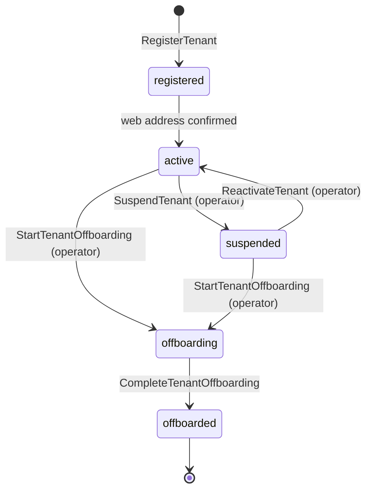
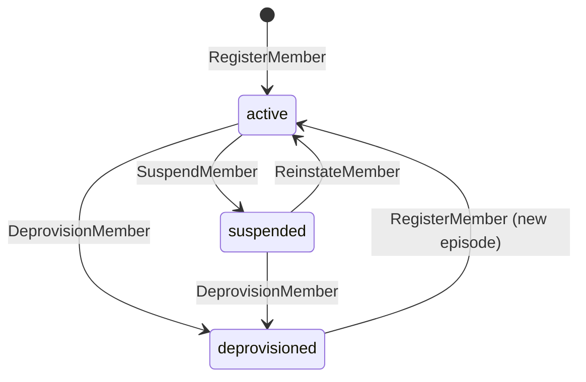
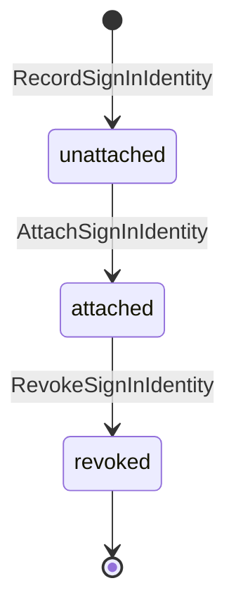
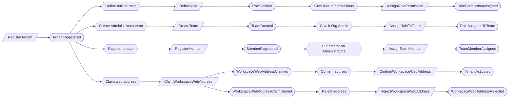
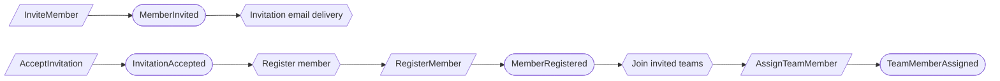
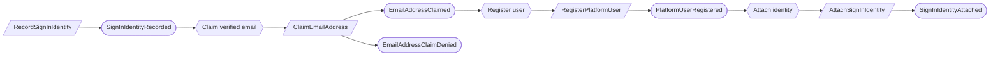
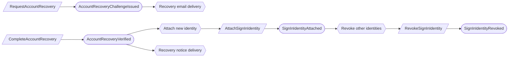
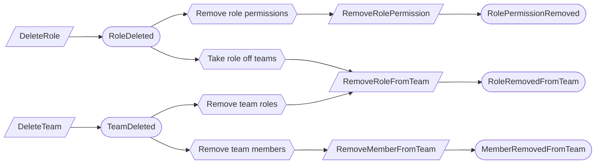
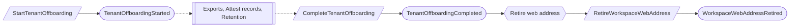

# Platform access

Status: **locked**, 2026-11-03. Hand-authored source of truth for this context. It
replaced the generated owner pages listed in [Superseded owners](#superseded-owners).

## Purpose

Platform access decides who an organization is, who belongs to it, what each
person may do there, and who operates the platform. It answers *may this person
act here*. It does not answer *is this person expected to do this work*; that is
a responsibility, owned by the context that owns the work (M0-D03).

**Owns:** organizations (tenants) and their lifecycle, workspace web addresses,
invitations, members and their affiliation, teams and their members, team role
assignments, roles and their permissions,
separation-of-duties waivers, platform users
and their sign-in identities, email address ownership, platform operators,
the firm-staff directory, and per-organization sign-in connections.

**Does not own:**

| Concern | Owner |
| --- | --- |
| Advisor and Attest access through engagement assignment | Firm services (`ServiceEngagement`); authorization reads it |
| Independence decisions about firm staff | Firm services |
| Responsibilities (control owner, reviewer, approver) | The context that owns the work; it references members, people and teams |
| Workforce `Person` records | Workforce assurance; a person may never sign in |
| Client export, attest record package, retention disposition | Exports, Attest records, Retention; offboarding waits on their facts |
| Acknowledgement waivers for policies | Policies |

## Language

| Term | Meaning |
| --- | --- |
| Organization | A client organization. Its technical name is **tenant** (`tenant_id`) everywhere in contracts; product text says organization (M0-D25). |
| Platform user | A person who can sign in. Exists outside every tenant. |
| Sign-in identity | One external issuer + subject pair that authenticates exactly one platform user. |
| Workspace web address | The organization's normalized, globally unique address (slug). |
| Membership | One platform user's belonging to one organization. |
| Membership episode | One continuous period of membership. Deprovisioning ends it for good; rejoining starts a new episode. |
| Affiliation | Exactly one of `client_personnel`, `firm_staff`, `guest` per episode. |
| Role | A named set of permissions managed by the organization. Built-in roles are Org Admin, Compliance Lead, Contributor and Viewer; an Org Admin can add custom roles. |
| Team | A named group of members. Teams are assigned roles, and teams can hold responsibilities. Names need not be unique. |
| Role assignment | One role given to one team at one scope: the whole organization, a program, an engagement, or a deliberately shared resource. |
| Administrators team | The built-in team that permanently holds Org Admin at organization scope. |
| Platform operator | Platform super administrator. Sees tenant metadata only. |
| Firm staff member | A platform user in the firm-staff directory, with one practice: `advisory` or `attest`. |

**How a member gets permission:** member → team → role assignment (role + scope)
→ role permissions. The team is the only path for client members (PA-01). Firm
staff get Advisor or Attest work only through engagement assignment in Firm
services (M0-D25). The set of permissions that a role can contain is
product-defined.

## Aggregates

### Tenant

**Identity:** `TenantId`, supplied by the caller at registration.

**Invariant:** one organization moves through one lifecycle, and holds at most
one pending web-address change.

- A registered organization becomes active when its first web address is
  confirmed. The creator is already its first Org Admin on the Administrators team, so
  activation waits for nothing else.
- Suspension blocks every member and assigned firm staff member and preserves all
  records. Only an operator suspends, reactivates or offboards.
- Offboarding forbids new active service. It completes only after the export
  delivery, the attest engagement record package delivery decision, and the
  retention disposition are recorded (M0-D16, M0-D25, M0-D27).
- Repeating the current state is a no-op; every other transition is refused.

| Command | Who | Accepts when | Emits |
| --- | --- | --- | --- |
| RegisterTenant | Platform user with a verified email | `TenantId` is new | TenantRegistered |
| ConfirmWorkspaceWebAddress | Reactor | Address claim matches the pending request | TenantActivated (first address) or WorkspaceWebAddressChanged |
| RejectWorkspaceWebAddress | Reactor | Address claim was denied for the pending request | WorkspaceWebAddressRejected |
| RequestWorkspaceWebAddressChange | Org Admin | Active; no change pending | WorkspaceWebAddressChangeRequested |
| SuspendTenant | Operator | Active | TenantSuspended |
| ReactivateTenant | Operator | Suspended | TenantReactivated |
| StartTenantOffboarding | Operator | Active or suspended | TenantOffboardingStarted |
| CompleteTenantOffboarding | Operator | Offboarding, and the three closing facts are recorded | TenantOffboardingCompleted |

| Event | Carries |
| --- | --- |
| TenantRegistered | tenant, display name, requested web address, creator user, registered at |
| TenantActivated | tenant, web address, activated at |
| WorkspaceWebAddressChangeRequested | tenant, current address, requested address, requested by |
| WorkspaceWebAddressChanged | tenant, previous address, new address |
| WorkspaceWebAddressRejected | tenant, requested address, reason (`taken` or `retired`) |
| TenantSuspended | tenant, operator, reason |
| TenantReactivated | tenant, operator, reason |
| TenantOffboardingStarted | tenant, operator, reason |
| TenantOffboardingCompleted | tenant, operator, references to the three closing facts |

### WorkspaceWebAddress

**Identity:** the normalized address.

**Invariant:** an address belongs to at most one tenant, and once released it is
retired permanently, so a former organization's address can never be reused.

| Command | Who | Accepts when | Emits |
| --- | --- | --- | --- |
| ClaimWorkspaceWebAddress | Reactor | Unclaimed; a repeat claim by the same tenant is a no-op | WorkspaceWebAddressClaimed, or WorkspaceWebAddressClaimDenied when taken or retired |
| RetireWorkspaceWebAddress | Reactor | Claimed by the releasing tenant | WorkspaceWebAddressRetired |

### TenantInvitation

**Identity:** `TenantId` + normalized email address.

**Invariant:** an email address has at most one pending invitation in an
organization. The invitation holds its current offer and its history.

- An offer lives 7 days; expiry is computed, not recorded.
- It is accepted only by a signed-in user whose verified email matches.
- An offer names the affiliation (`client_personnel`, `firm_staff` or `guest`)
  and the teams to join. A guest offer also names a finite end date and at least
  one program.
- Inviting someone who is already an active member is refused.

| Command | Who | Accepts when | Emits |
| --- | --- | --- | --- |
| InviteMember | Org Admin | No pending offer; not an active member | MemberInvited |
| RevokeInvitation | Org Admin | Offer pending | InvitationRevoked |
| AcceptInvitation | The invited platform user | Pending, unexpired, verified email matches | InvitationAccepted |

| Event | Carries |
| --- | --- |
| MemberInvited | tenant, email, offer, affiliation, teams, guest end date and programs, invited by, expires at |
| InvitationRevoked | tenant, email, offer, revoked by |
| InvitationAccepted | tenant, email, offer, user |

### Member

**Identity:** `TenantId` + `UserId`.

**Invariant:** one platform user has one membership in an organization, made of
episodes. Each episode has one affiliation and a status (active, suspended,
deprovisioned). A deprovisioned episode is final; only a new accepted invitation
starts a new episode.

- A guest's end date and programs are on the episode. The programs limit whatever
  the guest's teams give them, and access stops after the end date (UTC) (PA-03).
- A firm-staff member has no business-record access unless they are put on a
  team. Advisor and Attest come only from engagement assignment.
- Self-suspension and self-deprovisioning are refused. Each change records actor,
  time and reason.
- Suspending or deprovisioning the last active Org Admin is refused (PA-04).

| Command | Who | Accepts when | Emits |
| --- | --- | --- | --- |
| RegisterMember | Reactor | No current episode | MemberRegistered |
| SuspendMember | Org Admin | Active; not self; not the last active Org Admin | MemberSuspended |
| ReinstateMember | Org Admin | Suspended | MemberReinstated |
| DeprovisionMember | Org Admin | Active or suspended; not self; not the last active Org Admin | MemberDeprovisioned |

| Event | Carries |
| --- | --- |
| MemberRegistered | tenant, user, episode, affiliation, guest end date and programs |
| MemberSuspended | tenant, user, episode, actor, reason |
| MemberReinstated | tenant, user, episode, actor, reason |
| MemberDeprovisioned | tenant, user, episode, actor, reason |

### Team

**Identity:** `TenantId` + `TeamId`. The built-in Administrators team has a fixed
ID in every organization.

**Invariant:** one team has one name and one lifecycle: active, then deleted.

- The Administrators team cannot be deleted.
- Team names need not be unique (PA-13).

| Command | Who | Accepts when | Emits |
| --- | --- | --- | --- |
| CreateTeam | Org Admin, or reactor for the built-in team | `TeamId` is new | TeamCreated |
| RenameTeam | Org Admin | Active | TeamRenamed |
| DeleteTeam | Org Admin | Active, and not the Administrators team | TeamDeleted |

| Event | Carries |
| --- | --- |
| TeamCreated | tenant, team, name, built-in flag, created by |
| TeamRenamed | tenant, team, previous name, new name |
| TeamDeleted | tenant, team, deleted by |

### TeamMember

**Identity:** `TenantId` + `TeamId` + `UserId`.

**Invariant:** one member is on one team, or is not. A repeat assignment is a
no-op.

- Removing the last active Org Admin from the Administrators team is refused
  (PA-04).
- A team membership counts only while the member's episode is active (PA-09).

| Command | Who | Accepts when | Emits |
| --- | --- | --- | --- |
| AssignTeamMember | Org Admin or reactor | Not on the team | TeamMemberAssigned |
| RemoveTeamMember | Org Admin or reactor | On the team; not the last active Org Admin on Administrators | TeamMemberRemoved |

| Event | Carries |
| --- | --- |
| TeamMemberAssigned | tenant, team, user, episode, assigned by |
| TeamMemberRemoved | tenant, team, user, removed by |

### TeamRole

**Identity:** `TenantId` + `TeamId` + `RoleId` + scope.

**Invariant:** one role is assigned to one team at one scope, or it is not. A
repeat assignment is a no-op.

- The Administrators team's Org Admin assignment at organization scope cannot be
  removed. Because built-in IDs are fixed, the assignment can check this itself
  (PA-04).
- Org Admin is assigned only at organization scope (PA-12). Advisor and Attest
  cannot be assigned to a team; they come only from engagement assignment.
- An assignment counts only while its team and role are both active (PA-19).

| Command | Who | Accepts when | Emits |
| --- | --- | --- | --- |
| AssignRoleToTeam | Org Admin, or reactor for the built-in team | Not assigned; scope rules hold | RoleAssignedToTeam |
| RemoveRoleFromTeam | Org Admin or reactor | Assigned, and not the protected Administrators assignment | RoleRemovedFromTeam |

| Event | Carries |
| --- | --- |
| RoleAssignedToTeam | tenant, team, role, scope, assigned by |
| RoleRemovedFromTeam | tenant, team, role, scope, removed by |

### Role

**Identity:** `TenantId` + `RoleId`. Built-in roles have fixed IDs in every
organization.

**Invariant:** one role has one name and one lifecycle: active, then deleted.

- Built-in roles are Org Admin, Compliance Lead, Contributor, Viewer, Advisor
  and Attest. They are defined with the organization and cannot be renamed or
  deleted (PA-18).
- Custom roles are created, renamed and deleted by an Org Admin.
- What a role permits is recorded by `RolePermission`.

| Command | Who | Accepts when | Emits |
| --- | --- | --- | --- |
| DefineRole | Org Admin, or reactor for built-in roles | `RoleId` is new | RoleDefined |
| RenameRole | Org Admin | Custom and active | RoleRenamed |
| DeleteRole | Org Admin | Custom and active | RoleDeleted |

| Event | Carries |
| --- | --- |
| RoleDefined | tenant, role, name, built-in flag, defined by |
| RoleRenamed | tenant, role, previous name, new name |
| RoleDeleted | tenant, role, deleted by |

### RolePermission

**Identity:** `TenantId` + `RoleId` + permission.

**Invariant:** one permission is assigned to one role, or it is not. A repeat
assignment is a no-op.

- The permission must be one of the product's known permissions.
- Built-in roles' permissions cannot be changed. Because built-in role IDs are
  fixed, the assignment can check this itself (PA-18).
- A permission counts only while its role is active (PA-19). A change applies at
  once to every team holding the role.

| Command | Who | Accepts when | Emits |
| --- | --- | --- | --- |
| AssignRolePermission | Org Admin, or reactor for built-in roles | Not assigned; known permission; custom role (or built-in at setup) | RolePermissionAssigned |
| RemoveRolePermission | Org Admin or reactor | Assigned; custom role | RolePermissionRemoved |

| Event | Carries |
| --- | --- |
| RolePermissionAssigned | tenant, role, permission, assigned by |
| RolePermissionRemoved | tenant, role, permission, removed by |

### SeparationOfDutiesWaiver

**Identity:** `TenantId` + `WaiverId`.

**Invariant:** one waiver exempts one beneficiary from the self-review or
self-approval block for one record type and scope until its expiry. It takes
effect only after a second Org Admin, who is neither the requester nor the
beneficiary, approves it once (M0-D03, M0-D23).

| Command | Who | Accepts when | Emits |
| --- | --- | --- | --- |
| RequestSeparationOfDutiesWaiver | Org Admin | Reason given; expiry after now | SeparationOfDutiesWaiverRequested |
| ApproveSeparationOfDutiesWaiver | A different Org Admin, not the beneficiary | Requested and unexpired | SeparationOfDutiesWaiverApproved |

Every waived action is flagged in readiness results and audit exports; the
contexts that perform the action record that flag.

### PlatformUser, SignInIdentity, EmailAddress

These three platform-level aggregates live outside every tenant.

- **PlatformUser** (`UserId`): the person who signs in, with display name and
  verified email. Their history (approvals, evidence, actions) stays attached to
  this identity for good, so recovery restores the same user rather than creating
  a new one (PA-10).
- **SignInIdentity** (issuer + subject): `unattached` → `attached` to exactly one
  platform user → `revoked`. Only an attached identity authenticates, and a
  revoked one never does again.
- **EmailAddress** (normalized address): claimed by at most one platform user
  across the platform, and only once it is verified, either by the issuer's
  verified-email claim or by an email challenge (PA-11). Invitation acceptance and
  organization creation rely on this.

| Command | Owner | Accepts when | Emits |
| --- | --- | --- | --- |
| RecordSignInIdentity | SignInIdentity | First sign-in with this issuer and subject | SignInIdentityRecorded |
| AttachSignInIdentity | SignInIdentity (reactor) | Unattached, or already attached to the same user (no-op) | SignInIdentityAttached |
| RevokeSignInIdentity | SignInIdentity (reactor or the user) | Attached | SignInIdentityRevoked |
| IssueEmailChallenge | EmailAddress | Issuer did not verify the address | EmailChallengeIssued |
| ClaimEmailAddress | EmailAddress (reactor) | Verified, and unclaimed or claimed by the same user | EmailAddressClaimed, or EmailAddressClaimDenied when another user owns it |
| RegisterPlatformUser | PlatformUser (reactor) | `UserId` is new | PlatformUserRegistered |
| RequestAccountRecovery | EmailAddress | Claimed; requested from an unattached sign-in identity | AccountRecoveryChallengeIssued |
| CompleteAccountRecovery | EmailAddress | Current challenge answered from the same sign-in identity | AccountRecoveryVerified |

**Account recovery** (PA-10): a person who has lost their old sign-in method
signs in with a new one. Because their verified email already belongs to their
account, the new identity stays unattached and they are offered recovery. Proving
control of that email attaches the new identity to the existing user, revokes
every other identity of that user, and emails a notice to the address. No second
person approves it.

Successful authentications are audit-log entries, not domain events (PA-08).

### PlatformOperator

**Identity:** `UserId`.

**Invariant:** one platform user is an operator, or is not. Each grant and
revocation records actor, time and reason (M0-D25).

- An existing operator grants and revokes operator status. There is no two-person
  rule.
- Revoking the last active operator is refused. Like the last Org Admin, this is
  checked against current state when the command runs (PA-20).
- Configured operator IDs are granted only while the platform has no operator. A
  configured ID never re-grants a revoked operator on restart.

| Command | Who | Accepts when | Emits |
| --- | --- | --- | --- |
| SeedPlatformOperator | System | The platform has no operator; this user was never revoked | PlatformOperatorGranted |
| GrantPlatformOperator | Operator | Not an operator | PlatformOperatorGranted |
| RevokePlatformOperator | Operator | An operator; not the last active one | PlatformOperatorRevoked |

| Event | Carries |
| --- | --- |
| PlatformOperatorGranted | user, granted by (operator or `configuration`), reason |
| PlatformOperatorRevoked | user, revoked by, reason |

### FirmStaffMember

**Identity:** `UserId`. Each platform user has at most one firm-staff entry.

**Invariant:** the practice (`advisory` or `attest`) is recorded once and never
changes. The entry is active or inactive, and it lives outside every tenant.

| Command | Who | Emits |
| --- | --- | --- |
| RegisterFirmStaffMember | Operator (PA-14) | FirmStaffMemberRegistered |
| ChangeFirmStaffStatus | Operator (PA-14) | FirmStaffMemberStatusChanged |

### TenantSignInConnection (later release, F1-06)

**Identity:** `TenantId` + `ConnectionId`.

**Invariant:** a connection is enabled only after a successful test of its current
credentials. A credential rotation invalidates any earlier test, and a disabled
connection stays disabled. The detailed design is deferred to F1-06.

## Flows

Delivery of invitation and verification emails is a technical process; it records
send attempts and makes no business decision.

### Organization creation

Built-in role and team IDs are fixed, so the creator can be put on the
Administrators team before it exists. The creator acts once the team's Org Admin
assignment is recorded.
After a rejection the tenant stays registered. The creator chooses another
address with RequestWorkspaceWebAddressChange.

### Web address change

```mermaid
flowchart LR
    C1[/RequestWorkspaceWebAddressChange/] --> E1([WorkspaceWebAddressChangeRequested])
    E1 --> R1{{Claim new address}} --> C2[/ClaimWorkspaceWebAddress/]
    C2 --> E2([WorkspaceWebAddressClaimed]) --> R2{{Confirm address}} --> C3[/ConfirmWorkspaceWebAddress/] --> E3([WorkspaceWebAddressChanged])
    C2 --> E4([WorkspaceWebAddressClaimDenied]) --> R3{{Reject address}} --> C4[/RejectWorkspaceWebAddress/] --> E5([WorkspaceWebAddressRejected])
    E3 --> R4{{Retire old address}} --> C5[/RetireWorkspaceWebAddress/] --> E6([WorkspaceWebAddressRetired])
```

### Invitation and joining

A guest's invited programs are recorded on the member episode and limit what
those teams give them.

### First sign-in

After a denial, the identity stays unattached and the person is offered account
recovery. When the issuer has not verified the email, an email challenge
(IssueEmailChallenge) comes before the claim.

### Account recovery

### Membership ends

Access stops at MemberDeprovisioned, because team memberships count only while
the episode is active. Removing them is housekeeping.

### Role or team deleted

Permission checks ignore a deleted role or team immediately. These reactors tidy
up the records; they do not stop access.

### Offboarding

The dotted steps belong to other contexts and are designed there.

## Authorization contract

Authorization is a query, not an aggregate. A person may act in an organization
when every one of these holds:

1. The tenant is active (not registered, suspended, offboarding or offboarded).
2. The person has a current, active membership episode, and a guest's end date has
   not passed, **or** they have an active engagement assignment from Firm services
   for Advisor or Attest work.
3. A permission for the action comes from either path:
   - a role assigned to an active team they are on, with an active role and a
     scope that covers the target (a wider scope covers the narrower ones inside
     it); for a guest, the target is also inside one of their programs;
   - their engagement role (Advisor or Attest).
4. Separation of duties: self-review and self-approval are refused unless an
   approved, unexpired waiver covers the record type, scope and beneficiary.
5. Independence walls from Firm services still apply.

Platform operators see tenant lifecycle, who the Org Admins are, and usage.
They read business records only through a membership or engagement assignment.

## Decisions

Jev answers come from `jev-1.14.0`, 2026-11-03. A yes is ≥ 0.8 and a no is ≤ 0.2;
anything between is left open.

| ID | Decision | Evidence |
| --- | --- | --- |
| PA-01 | Roles are aggregates that each organization manages. Teams hold members and are assigned roles, and a member gets client permissions only through their teams. There are no direct member grants, so `AccessGrant` is removed. | Product owner, 2026-11-03. This supersedes M0-D03's fixed catalog and "custom roles are out of scope". |
| PA-02 | A team role assignment names its scope: organization, program, engagement or shared resource. | Scope fits team role assignments: 0.77, adopted because the M0-D03 scope hierarchy needs a place to live once grants go through teams. |
| PA-03 | A guest's programs are recorded on the membership and limit whatever their teams give them. | Guest capped by programs: 0.95. M0-D03. |
| PA-04 | Small independent aggregates: `TenantInvitation`, `Member`, `Team` and `TeamMember`, alongside `Role`, `RolePermission` and `TeamRole`. The organization always keeps an active Org Admin: `SuspendMember`, `DeprovisionMember` and removing someone from the Administrators team are refused when the current state shows they are the last active Org Admin. The built-in Administrators team permanently holds Org Admin and cannot be deleted. | Product owner, 2026-11-03: "each of these things is a small independent thing". The check reads current state at command time, and no extra guard aggregate is added. |
| PA-05 | Self-service creation registers the creator as a member and puts them on the Administrators team. There is no first-owner invitation, and activation waits only for the web address. | First administrator invited by email: 0.05. M0-D25. |
| PA-06 | The firm-staff directory has one entry per platform user, keyed by `UserId`. `FirmStaffIdentityClaim` is not needed. | One entry per user: 0.80. M0-D25. |
| PA-07 | Engagement authorization and professional-duty facts move from the firm-staff record to Firm services. | Ownership table in [domain-model.md](../domain-model.md). |
| PA-08 | Sign-in events (authenticated, profile observed) are audit-log entries, not domain events. | Modeling rule: a status or activity log does not own business state. |
| PA-09 | A team membership counts only while the member's episode is active, so access stops at suspension or deprovisioning. Removing a deprovisioned member from teams is housekeeping, and work for a team reaches only active members. | Delivery filtered by active membership is harmless: 0.13. |
| PA-10 | Account recovery restores the same platform user. Proving control of the verified email attaches the new sign-in identity, revokes the others and sends a notice. No second-person approval. Replaces the old 9-step identity recovery process. | Coming back as a new user damages the audit trail: 0.87. Operator or admin approval needed: 0.18. "Email proof is standard" alone was 0.59; the decision rests on the two decisive answers. |
| PA-11 | One verified email address belongs to at most one platform user across the platform, and an email is claimed only once verified. | Shared email lets the wrong person accept an invitation: 0.86. The direct question was 0.75. |
| PA-12 | Org Admin is assigned only at organization scope. Other roles can be assigned at program, engagement or shared-resource scope. | Org Admin org-wide only: 0.86. Other roles scopable: 0.93. |
| PA-13 | Team names need not be unique. No team-name claim aggregate. | Product owner, 2026-11-03. Duplicate names cause real harm: 0.18. |
| PA-14 | Platform operators register firm staff members and change their status. | Anyone other than operators has platform-level authority: 0.14. The direct question was 0.65. |
| PA-15 | An Org Admin can suspend and reinstate a member, alongside permanent deprovisioning. A suspended member keeps their teams. | Without suspension, rebuilding teams and grants after a temporary absence is a real burden: 0.89. The deprovisioning rule assumes member suspension: 0.71. |
| PA-17 | Small aggregates: `Role` is the role's name and lifecycle, `RolePermission` is one permission assigned to one role, and `TeamRole` is one role assigned to one team at one scope. Each assignment is decided on its own, and built-in protections are checked locally against fixed built-in IDs. | Product owner, 2026-11-03, for `Role` and `RolePermission`; `TeamRole` follows the same principle. Supersedes Jev's earlier lean towards one role record owning its whole permission set (0.86). |
| PA-18 | Built-in roles cannot be renamed, edited or deleted. Custom roles cover anything else. | Built-in roles deletable: 0.22. Keeping all built-ins fixed (not only Org Admin) is a common-sense choice: everyone, auditors included, can rely on what a built-in role means. |
| PA-19 | Removing a deleted role's permissions and team assignments, and a deleted team's members and roles, is done by reactors as housekeeping, because permission checks ignore deleted roles and teams immediately. | Later tidy-up harmless: 0.75. Adopted because the check ignores deleted records, so nothing depends on how fast the tidy-up runs. |
| PA-16 | Web addresses are claimed by a reactor after registration or a change request, and a denial is a recorded fact. In a reactor-driven claim, that fact is the only way the tenant learns of the denial and leaves its pending state. | Claim-first alternative: sound 0.56, harm from abandoned claims 0.32. Both near-even, so the existing design stays: it leaves no reservations behind for abandoned sign-ups, and it uses the same pattern as email claims. |
| PA-20 | One `PlatformOperator` aggregate per user replaces the single platform roster. The last-operator rule is a check against current state when the command runs. | Small independent aggregates (product owner, 2026-11-03). Supersedes the earlier OWNER_PlatformOperatorGrant choice of one roster. |

## Open questions

None at this time. New questions found while designing the other contexts are
added here.

## Superseded owners

The generated pages for these owners were deleted when this context was locked.

| Old owner | Becomes |
| --- | --- |
| Tenant | Tenant |
| TenantSlug, WorkspaceWebAddress | WorkspaceWebAddress (TenantSlug was a duplicate) |
| Member | Member |
| TenantInvitation, TenantInvitationMailboxClaim | TenantInvitation, keyed by tenant and email (one pending offer per email: Jev 0.80) |
| TenantAdministratorContinuity, TenantManagerGuard | Removed; last-admin check on Member and TeamMember commands (PA-04) |
| TenantInvitationDeliveryProcess | Technical invitation email delivery |
| Team | Team |
| TeamRole | TeamRole |
| TeamMember | TeamMember |
| Role | Role |
| RolePermission | RolePermission (PA-17) |
| AccessGrant | Removed; permissions come only through teams (PA-01) |
| SeparationOfDutiesWaiver | SeparationOfDutiesWaiver (acknowledgement waivers move to Policies) |
| UserIdentity | SignInIdentity |
| EmailAddress | EmailAddress (also owns the recovery challenge) |
| EmailChallengeDeliveryLedger | Technical verification and recovery email delivery |
| IdentityRecovery, IdentityRecoveryNoticeProcess | Account recovery on EmailAddress and SignInIdentity (PA-10) |
| PlatformOperatorRoster | PlatformOperator, one per user (PA-20) |
| FirmStaffRecord, FirmStaffIdentityClaim | FirmStaffMember (PA-06, PA-07) |
| TenantIdentityProvider | TenantSignInConnection (F1-06) |
