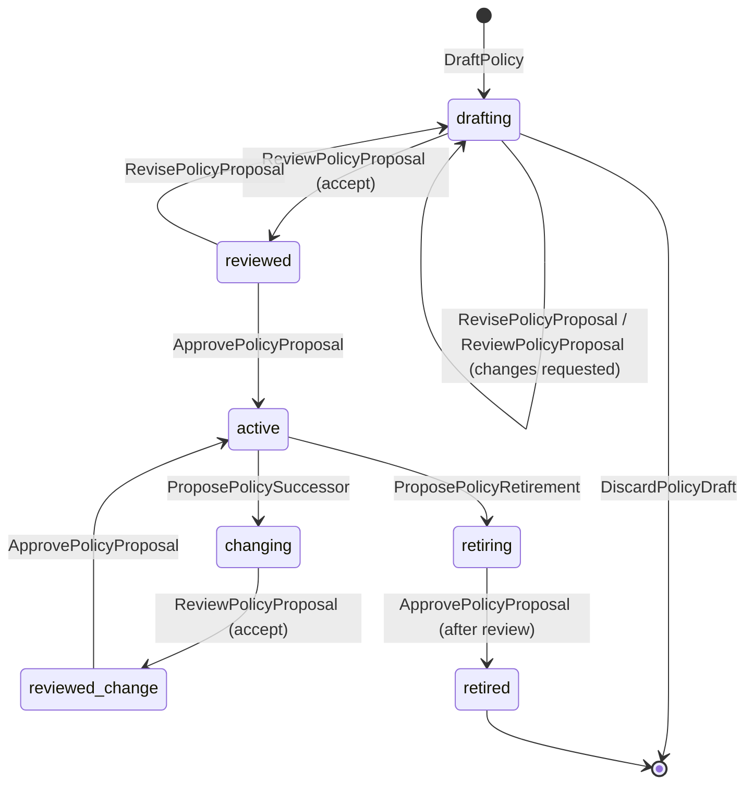
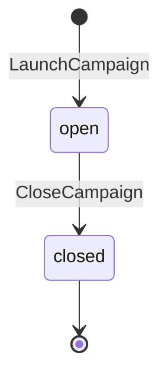
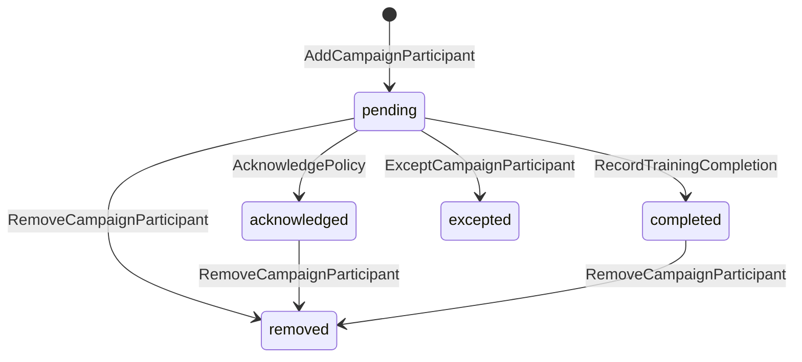
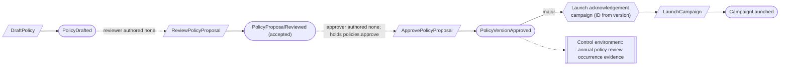
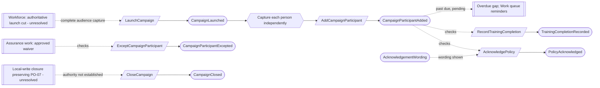
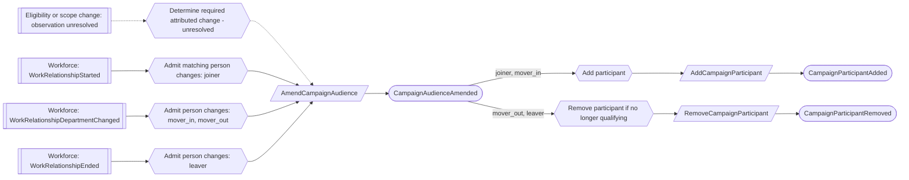

# Policies

Status: **under refinement**, 2026-11-05. Hand-authored source of truth for this
context; campaign launch and closure authority remain unqualified. It follows the
[context conventions](conventions.md).

## Purpose

Policies records the organization's governed statements of intent and required
behavior, and proves that the right people acknowledged them and completed
security-awareness training (M0-D12).

**Owns:** policies and their versions, acknowledgement and training campaigns,
campaign participants, training requirements, and the organization's
acknowledgement wording.

**Does not own:**

| Concern | Owner |
| --- | --- |
| Workforce people, their teams and joiner/mover/leaver facts | Workforce assurance |
| Annual policy review | Control environment: a control whose occurrence subject is `policy` (M0-D19, CE-11) |
| Exceptions to acknowledgement or training | Assurance work (`Waiver`, rule `policy_acknowledgement` or `training_completion`) |
| Reminders and work items | [Work queue](work-queue.md) (M0-D15) |
| Course content and the LMS | Outside the product (M0-D20) |

## Language

| Term | Meaning |
| --- | --- |
| Policy | A governed statement with a stable identity, owner, purpose and a line of approved versions. |
| Policy version | One approved statement, effective from a date: content or an exact source artifact, audience kind, roster teams (role-targeted), and whether it is a `major` or `minor` change. |
| Audience kind | `core_security` (employees and contractors with access to in-scope systems or data) or `role_targeted` (people whose roster department is named on the version) (PO-05). |
| Campaign | One request to a frozen audience to acknowledge an exact policy version (`acknowledgement`) or complete an exact training requirement version (`training`), over a due period. |
| Audience amendment | An attributed change to a campaign's audience after launch: `joiner`, `mover_in`, `mover_out` or `leaver`. The launch audience plus amendments is the evidence population. |
| Participant | One person in one campaign: `pending`, `acknowledged` or `completed`, `excepted` or `removed`. `overdue` is computed from the due date. |
| Training requirement | The security-awareness course, its audience rule and its cadence (within 30 days of hire, then annually), delivered `manual` or `lms_export`. |

## Aggregates

### Policy

**Identity:** `TenantId` + `PolicyId`.

**Invariant:** one policy has a line of approved versions with strictly
increasing effective dates and at most one open proposal: the first version, a
successor, or retirement. A proposal is reviewed by a Compliance Lead, then
approved by a management approver; neither may have authored a revision of it,
and the approver may be the reviewer (PO-01). Approved content never changes.
Retirement is final.

- A `role_targeted` version names at least one roster department.
- A never-approved policy can be discarded; otherwise removal is reviewed and
  approved retirement, which stops future campaigns and keeps history.

The existing event shapes below describe a policy version and its audience rule;
they are **not qualified** to embed an unbounded list of roster teams or the
full policy text in one event. A candidate separates each audience target as
described below and binds policy content through a small exact source reference
and hash. The reviewed content and approved audience must remain recoverable;
the content source, exact approval binding and replay bounds need qualification.
The Policy stream also records revisions across its lifetime, so its own event
history can grow even after its independent children are separated. Do not
assume Portia hydrates only the latest revision.

| Command | Who | Accepts when | Emits |
| --- | --- | --- | --- |
| DraftPolicy | Compliance Lead or Contributor | `PolicyId` is new | PolicyDrafted |
| RevisePolicyProposal | Compliance Lead or Contributor | A first version or successor is proposed; a revision clears an earlier review | PolicyProposalRevised |
| DiscardPolicyDraft | Compliance Lead | Never approved | PolicyDraftDiscarded |
| ProposePolicySuccessor | Compliance Lead or Contributor | Active; no proposal open | PolicySuccessorProposed |
| ProposePolicyRetirement | Compliance Lead | Active; no proposal open; reason and effective date given | PolicyRetirementProposed |
| WithdrawPolicyProposal | Its proposer or Compliance Lead | A successor or retirement is proposed | PolicyProposalWithdrawn |
| ReviewPolicyProposal | Compliance Lead who authored no revision, or covered by a waiver | A proposal is open; reviews the current revision | PolicyProposalReviewed (accepted or changes requested) |
| ApprovePolicyProposal | Holder of `policies.approve` who authored no revision, or covered by a waiver | The current revision was accepted in review; effective date later than the current version's | PolicyVersionApproved or PolicyRetired |

| Event | Carries |
| --- | --- |
| PolicyDrafted | tenant, policy, owner, purpose, exact content reference (candidate), drafted by |
| PolicyProposalRevised | tenant, policy, revision, exact content reference (candidate), revised by |
| PolicyDraftDiscarded | tenant, policy, discarded by |
| PolicySuccessorProposed | tenant, policy, from version, exact content reference (candidate), change kind (`major` or `minor`), proposed by |
| PolicyRetirementProposed | tenant, policy, reason, effective at, proposed by |
| PolicyProposalWithdrawn | tenant, policy, withdrawn by |
| PolicyProposalReviewed | tenant, policy, revision, outcome, comments, reviewer, waiver (if any) |
| PolicyVersionApproved | tenant, policy, version, revision, exact content reference and hash (candidate), audience/version reference, change kind, effective at, approver, waiver (if any); binding remains unqualified |
| PolicyRetired | tenant, policy, effective at, reason, approver |

### PolicyAudienceTarget

**Identity:** candidate `TenantId` + `PolicyId` + proposal or exact policy
version + roster-department identity; one independently governed target per
department and version, not a list on Policy.

**Invariant:** one target represents one named roster department for one
role-targeted version. It does not authorize a person by itself and does not
change the accepted audience rule. The authoritative point at which its
membership becomes immutable, and how it binds to the approved version, remain
unqualified.

M0-D12 still requires a `role_targeted` approved version to have at least one
department and to preserve exactly which departments the version names. A
possible nonempty check cites one exact accepted target as a witness; all other
targets remain independently owned and are listed through a read model. This
only establishes the required property if the witness remains included at
approval. A witness removed concurrently, an unqualified read, a projected count
or a bare hash cannot supply that guarantee. A version boundary must also make
target additions and removals racing review or approval settle unambiguously,
preserve the exact set that was reviewed and approved, and define delayed writes,
retries, cancellation and correction. No such source/target protocol is assumed
to exist. An event or linked coordinator per target stored solely to rebuild a
parent roster would reintroduce the same design smell.

PO-01's reviewer and approver may not have authored **any revision** of the
proposal, including audience changes. An individually keyed authorship fact for
the particular reviewer is a candidate for avoiding an all-author list; a
missing fact is not proof of non-authorship without qualified complete source
and revision-fence semantics. Reviewing individual targets instead would alter
the existing whole-proposal rule. Neither is established by the split alone.

### TrainingRequirement

**Identity:** `TenantId` + `RequirementId`.

**Invariant:** one requirement names one course, one audience rule, the cadence
(within 30 days of hire, then annually) and one delivery source. Each revision is
a numbered version; campaigns bind an exact version.

| Command | Who | Accepts when | Emits |
| --- | --- | --- | --- |
| DefineTrainingRequirement | Compliance Lead | `RequirementId` is new | TrainingRequirementDefined |
| ReviseTrainingRequirement | Compliance Lead | Exists | TrainingRequirementRevised |

| Event | Carries |
| --- | --- |
| TrainingRequirementDefined | tenant, requirement, version, course, audience kind and exact audience-rule version reference (candidate), delivery source, defined by |
| TrainingRequirementRevised | tenant, requirement, version, changed scalar fields or exact audience-rule version reference (candidate), revised by |

For a role-targeted training requirement, an independently owned target per
`(tenant, requirement, exact version, roster department)` is also a candidate.
The requirement event or referenced rule must not embed a team roster. Preserve
the same accepted nonempty audience rule and an exact immutable rule version;
target ownership, witness and version-change races are not yet qualified.

### Campaign

**Identity:** `TenantId` + `CampaignId`. A campaign launched by a reaction takes
an ID derived from its trigger (CV-02).

**Invariant:** one campaign binds one exact policy version or training requirement
version and its audience rule and due date. Its launch audience is frozen, and
later audience changes are attributed amendments (M0-D12). A campaign closes
once no participant is still pending within their due date (PO-07).

The campaign holds its fixed configuration and lifecycle, not a roster, child
list, per-person amendment facts, or participant outcomes. Each person's launch
membership, amendments, and result belong to that person's `CampaignParticipant`.
An audience list and audit export can be projected from those facts; neither a
projection nor a count is authority for launch completeness or closure. Read-side
enumeration and evidence export must be incremental: no whole-population event,
manifest, in-memory roster, or global in-memory sort. A cut or proof reference
must stay compact and must not hide a participant collection in one record.
Moving a per-person closing vote into each participant or scanning all votes is
still an all-children write decision and is not the proposed solution. How PO-07's
recorded closure can be achieved without such a decision is unresolved.

#### Individual audience and progress candidate

At launch the campaign could bind a single retained roster boundary. Given a
qualified source capable of answering membership at that exact boundary, each
person's participant owner can independently establish its launch origin from
that person's source facts. Later qualifying observations produce attributed
amendments on that person's stream. Campaign and participant histories do not
contain the other people. This is conditional on a real historical source,
complete discovery and a gapless transition to later observations; a timestamp,
ID or eventual listing does not establish any of those guarantees.

An incremental read model can report individual outcomes, overdue work, and
whether its currently observed participants appear to meet PO-07 at an explicit
evaluation time. It must expose incomplete or unknown audience coverage; zero
known blockers before launch capture is complete is **unknown**, not ready. A
status computed from that read model is informative and may change when delayed
facts arrive or time passes. It does not authorize `CampaignClosed` or prove
the exact audience. In particular, an overdue pending person does not block
PO-07, although that person is still pending and must remain visible as overdue.

One alternative for product review is a recorded request to close paired with a
non-final derived readiness status; this avoids a parent write that settles all
participants. It changes PO-07's recorded, terminal closure and its boundary for
automatic amendments unless an authoritative transition is separately designed.
The request, a stale readiness result and successful delivery are not a
`CampaignClosed` decision. No such behavior change is approved here.

- Joiners are due 30 days after their start date; everyone else by the
  campaign's due date.
- A second campaign may use the same version and roster; nothing forbids it.
- **Implementation gate:** a complete, replayable, authoritative workforce cut
  at launch and a gapless handoff to subsequent workforce changes are not yet
  specified. Nor is an authoritative close protocol qualified. Until the open
  questions below are resolved, the launch audience and closure cannot be claimed
  correct or implemented as complete.

| Command | Who | Accepts when | Emits |
| --- | --- | --- | --- |
| LaunchCampaign | Compliance Lead, or reactor on a major PolicyVersionApproved | `CampaignId` is new; version approved and current; due date given; authoritative launch capture is established | CampaignLaunched |
| CloseCampaign | Compliance Lead | Open; an authoritative close protocol establishes that no participant is pending within their due date | CampaignClosed |

| Event | Carries |
| --- | --- |
| CampaignLaunched | tenant, campaign, kind, exact approved policy version and hash or exact training requirement version, small exact audience-rule version reference (candidate), reference to authoritative launch cut, due date, launched by; audience membership and binding remain unqualified |
| CampaignClosed | tenant, campaign, close decision and authoritative evidence references, closed by |

### CampaignParticipant

**Identity:** `TenantId` + `CampaignId` + `PersonId`.

**Invariant:** one person in one campaign has one status. An acknowledgement
binds the exact policy version, its content hash and the exact wording shown. A
training completion binds the course, completed date, source and evidence. A
person removed by `mover_out` or `leaver` keeps their earlier result (M0-D12).

Launch membership is a separate origin fact in this person's stream, even when
later amendments change their status. Each amendment records its attribution,
source roster observation and reason on the same person's stream; it does not
rewrite launch membership. A retry with the same source fact is a no-op; changed
intent is not silently treated as a retry. If more than one work relationship
qualifies a person, ending one alone does not remove the person while another
qualifies. The eligibility decision must use authoritative person-level facts,
not an eventually consistent roster lookup.

- A person who never signs in is acknowledged on their behalf by a member, and
  both are attributed.
- An exception needs an approved, unexpired waiver of at most 12 months; an
  excepted person never counts as acknowledged.
- A participant owns its own acknowledgements, completion, exception and
  attributed audience changes. An exact retry is a no-op; unknown results remain
  pending. A later, distinct source observation is not a retry. The owner does
  not cast a close vote for every campaign close attempt. Admission and status
  changes racing the campaign's closing boundary remain unresolved; successful
  decisions for known participants cannot prove the full audience or closure.

| Command | Who | Accepts when | Emits |
| --- | --- | --- | --- |
| AddCampaignParticipant | Reactor on authoritative launch capture or attributed audience amendment | The person qualifies at the relevant cut; the origin or source fact is new; an exact retry is a no-op | CampaignParticipantAdded |
| AmendCampaignAudience | Reactor on qualified roster observations, or Compliance Lead | The change is authoritatively admitted while the campaign is open; source fact is new and the person's change matches the audience rule; an exact retry is a no-op | CampaignAudienceAmended |
| AcknowledgePolicy | The person, or a member on their behalf | Pending; acknowledgement campaign | PolicyAcknowledged |
| RecordTrainingCompletion | The person, a member on their behalf, or Compliance Lead | Pending; training campaign; evidence given | TrainingCompletionRecorded |
| ExceptCampaignParticipant | Compliance Lead | Pending; approved, unexpired waiver of at most 12 months for this person | CampaignParticipantExcepted |
| RemoveCampaignParticipant | Reactor on a `mover_out` or `leaver` amendment | Not removed; no remaining qualifying relationship keeps this person in the audience | CampaignParticipantRemoved |

| Event | Carries |
| --- | --- |
| CampaignParticipantAdded | tenant, campaign, person, origin (`launch` or amendment), source fact and cut reference, due date |
| CampaignAudienceAmended | tenant, campaign, person, reason (`joiner`, `mover_in`, `mover_out`, `leaver`), source roster observation, time, due date, amended by |
| PolicyAcknowledged | tenant, campaign, person, policy version, content hash, wording shown, acknowledged at, recorded by, on behalf of |
| TrainingCompletionRecorded | tenant, campaign, person, course, completed on, source, evidence (artifact version), recorded by |
| CampaignParticipantExcepted | tenant, campaign, person, waiver, excepted by |
| CampaignParticipantRemoved | tenant, campaign, person, reason, prior result |

### AcknowledgementWording

**Identity:** `TenantId`.

**Invariant:** one organization has one current acknowledgement wording: the
product default until an Org Admin replaces it. Each change is kept.

| Command | Who | Accepts when | Emits |
| --- | --- | --- | --- |
| SetAcknowledgementWording | Org Admin | Wording differs | AcknowledgementWordingSet |

| Event | Carries |
| --- | --- |
| AcknowledgementWordingSet | tenant, wording, set by |

## Flows

Diagrams follow [CV-01](conventions.md#flow-diagrams).

### Approving a policy version

### Running a campaign

The dotted links below are requirements to qualify, not authority supplied by a
roster projection. See the open questions before implementation.

### Joiners, movers and leavers

The relationship events below are not an exhaustive account of eligibility
changes. A person's in-scope access qualification or organizational scope can
change without a relationship event. M0-D12 does not authorize inferring the
audience from application access, platform team membership, or the IdP. The
meaning and authoritative reconciled-roster observations and triggers for those
changes remain unresolved; the dotted branch is a requirement, not a chosen
source or an invented amendment reason.

Annual re-acknowledgement and annual training are not automatic. People whose
last result is more than a year old show as a gap, and a Compliance Lead launches
the annual campaign (PO-08).

## Authorization contract

- `policies.approve` is a product-defined permission. The built-in Org Admin and
  Compliance Lead roles include it; an Org Admin can add it to a custom role.
- Campaign evidence (launch audience, amendments, each participant's result and
  the acknowledged version and hash) is exported in the M0-D17 formats.

## Decisions

Jev answers below are from `jev-1.14.0`, 2026-11-03. The historical review used
0.8 and 0.2 as triage thresholds; neither constitutes a proof of the design.
Conflicting or inconclusive judgments remain open and must be checked against
source and executable behavior.

| ID | Decision | Evidence |
| --- | --- | --- |
| PO-01 | A policy proposal is reviewed by a Compliance Lead, then approved by a holder of `policies.approve`. Neither authored a revision; the approver may be the reviewer. | Skipping separate approval harms: 0.76. Review then a separate approver: 0.64. One-step by a management approver: 0.43. Burden of two extra people on a small team: 0.53. Common sense: two recorded decisions show management approval, and letting one person make both keeps small teams workable. |
| PO-02 | Annual policy review is a control occurrence (M0-D19); the policy has no review command. | M0-D19, CE-11. Replaces `ConfirmPolicyReview`. |
| PO-03 | Each participant is its own small record; launch origin and attributed person amendments are facts in that record, not a campaign-owned collection. | 2026-11-05 Jev: reconstruction given a complete cut 0.88; campaign record holding a growing participant list 0.05. Source completeness remains unproved; see the [review](../reviews/policy-campaign-boundaries.md). |
| PO-04 | Approving a major policy version launches an acknowledgement campaign automatically. | 0.87. |
| PO-05 | The accepted `core_security` audience is employees and contractors with access to in-scope systems or data. | M0-D12. The earlier proposal to include all active employees and contractors broadened this accepted rule and is not authorized by Jev; interpretation of the access qualifier and authoritative roster observations remain open; M0-D12 prohibits inferring the audience from application access, platform team membership, or IdP. |
| PO-06 | Joiners, movers and leavers amend open campaigns automatically, each attributed. | 0.56. M0-D12 decided it. |
| PO-07 | A campaign closes once no participant is pending within their due date. | 0.75. |
| PO-08 | Annual re-acknowledgement and training show as a gap; a Compliance Lead launches the annual campaign. | 0.69. Common sense: the timing of an annual campaign is the organization's choice, while a major version needs re-acknowledgement at once (PO-04). |
| PO-09 | A training completion is recorded on the participant in a training campaign. | 0.67. Common sense: one place holds both kinds of campaign result. |

## Open questions

These are implementation blockers, not assumptions supplied by the diagrams:

1. **Launch and handoff:** define a complete, durable and replayable cut of the
   accepted reconciled workforce roster at the actual launch boundary, and a
   gapless handoff that accounts for every later change. Specify how historical
   department values, effective and corrected start/end dates, late/backdated
   facts, on-leave status and overlapping work relationships affect the cut and
   subsequent amendments. Define how a delayed launch origin is ordered against
   amendments and how a removed person who later qualifies re-enters without
   losing their earlier result. A timestamp, deterministic ID, projection, or
   per-stream replay alone does not prove a complete cross-stream cut. If the
   storage/source cannot provide it, change the source contract or make an
   explicit product decision; do not invent historical roster state.
2. **Audience rule:** resolve how the accepted reconciled roster observes the
   M0-D12 access qualifier and how changes to a person's qualification or the
   organizational scope are observed, classified, ordered and handed off without
   gaps, including changes that have no relationship event. Specify their
   temporal and correction semantics and whether the accepted amendment reasons
   cover them. M0-D12 forbids inferring audience membership from application
   access, platform team membership, or the IdP; do not substitute those sources.
   A broader audience needs an explicit product decision; a projection or Jev
   score cannot change the accepted rule.
3. **Closing:** preserve PO-07 while finding a design in which the `CampaignClosed`
   write does not scan, collect or vote across all participants. The prior
   segmented coordinator and all-participant outcome protocol conflict with the
   boundary direction and are not accepted solutions. A read-side readiness status
   alone cannot establish terminal closure or protect against a delayed join or
   amendment; making that status the lifecycle authority would change the
   product's closure and amendment semantics. Qualify the launch boundary,
   admission ordering and late/unknown outcomes for whichever alternative is
   chosen. Decide the closure's business time and due-date boundary, including
   waiver semantics. A pending person whose due date has passed need not block
   closure under PO-07; this does not require every participant to have a
   completed business outcome. The exception rule requires a valid waiver when
   recorded; it does not specify automatic reversal at expiry. An incomplete
   projection or a zero count cannot establish the prerequisite. Qualification
   must include replay cost as repeated amendments grow a person's own history.
4. **Role-targeted version:** qualify independent per-department target ownership,
   an immutable reviewed target set, a valid nonempty witness and concurrent
   change/approval handling without a parent-owned target roster or an all-target
   write decision. Establish how an exact approved version and reviewer/approver
   independence apply across target changes, and keep the accepted nonempty rule.
   Qualify replay limits for the policy's own revision line and an exact small
   content reference; do not silently put the full text or audience back into one
   event, or assume a projected target list proves what was approved.

## Superseded owners

| Old owner | Becomes |
| --- | --- |
| Policy | Policy (review then approval; PO-01) |
| PolicyDistributionCampaign | Campaign (kind `acknowledgement` or `training`) |
| PolicyCampaignParticipant | CampaignParticipant |
| TrainingRequirement | TrainingRequirement |
| PolicyCampaignClosureReactor, PolicyCampaignClosureProcess | Closing coordination remains unresolved; `CloseCampaign` requires its authoritative proof (PO-07). |
| PolicyParticipantResultReactor, RecordPolicyRequirementOutcomesReactor | Removed: the participant holds its own result (PO-03) |
