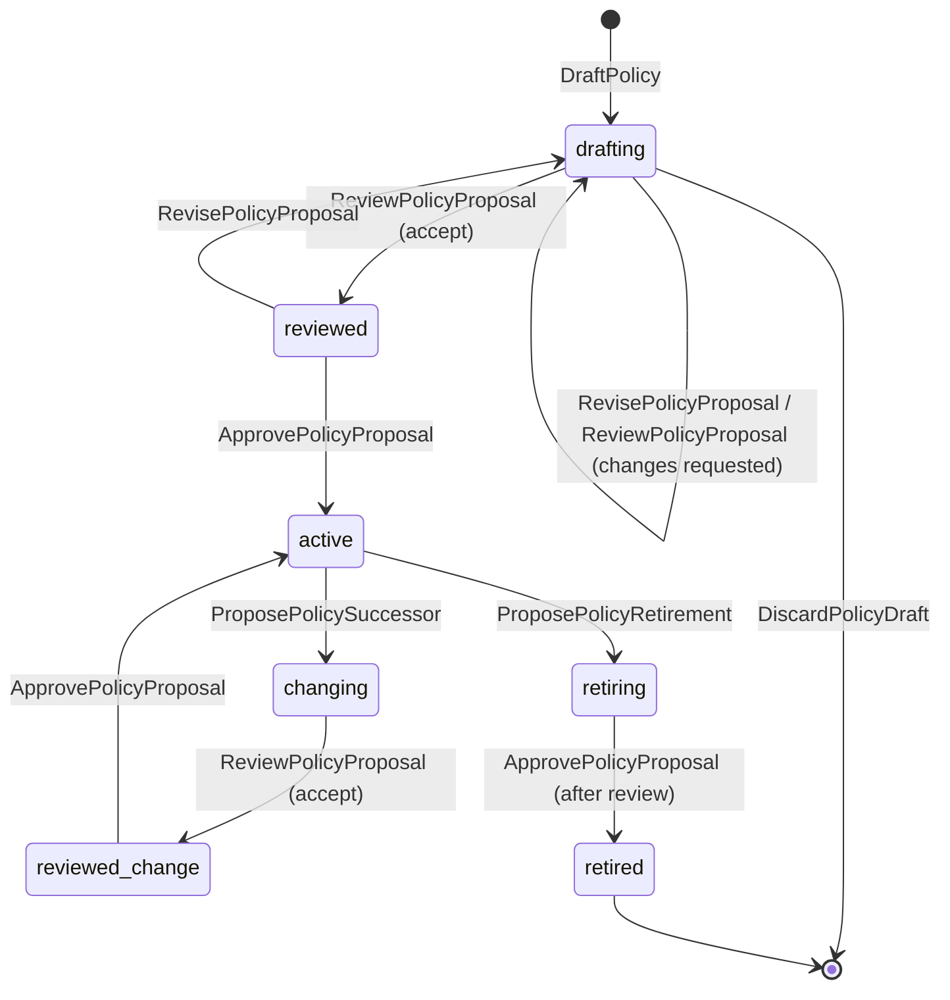
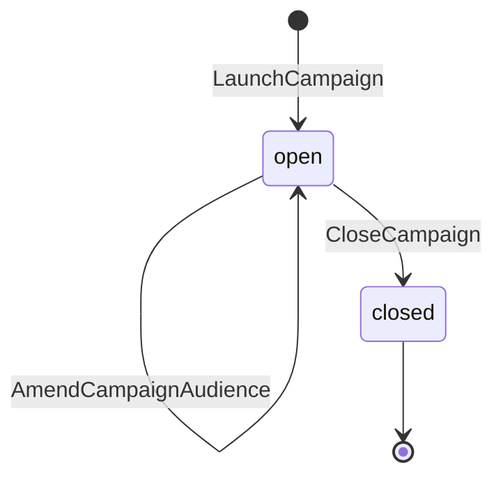
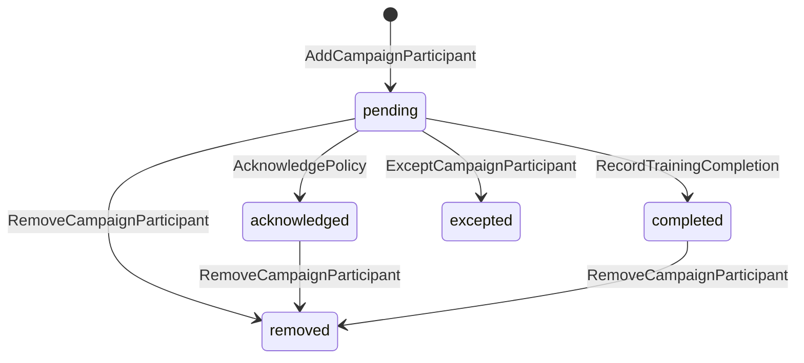
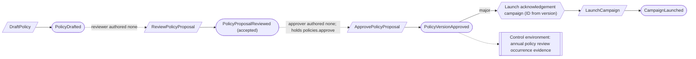
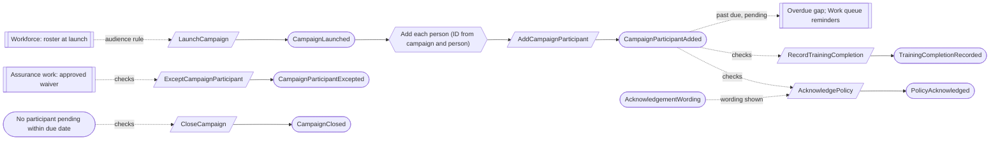
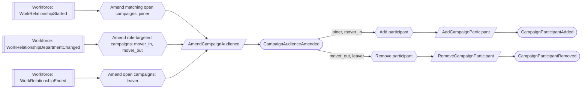

# Policies

Status: **locked**, 2026-11-03. Hand-authored source of truth for this context.
It follows the [context conventions](conventions.md).

## Purpose

Policies records the organization's governed statements of intent and required
behavior, and proves that the right people acknowledged them and completed
security-awareness training (M0-D12).

**Owns:** policies and their versions, acknowledgement and training campaigns,
campaign participants, training requirements, and the organization's
acknowledgement wording.

**Does not own:**

| Concern | Owner |
| --- | --- |
| Workforce people, their teams and joiner/mover/leaver facts | Workforce assurance |
| Annual policy review | Control environment: a control whose occurrence subject is `policy` (M0-D19, CE-11) |
| Exceptions to acknowledgement or training | Assurance work (`Waiver`, rule `policy_acknowledgement` or `training_completion`) |
| Reminders and work items | [Work queue](work-queue.md) (M0-D15) |
| Course content and the LMS | Outside the product (M0-D20) |

## Language

| Term | Meaning |
| --- | --- |
| Policy | A governed statement with a stable identity, owner, purpose and a line of approved versions. |
| Policy version | One approved statement, effective from a date: content or an exact source artifact, audience kind, roster teams (role-targeted), and whether it is a `major` or `minor` change. |
| Audience kind | `core_security` (every employee and contractor with an active work relationship) or `role_targeted` (people whose roster department is named on the version) (PO-05). |
| Campaign | One request to a frozen audience to acknowledge an exact policy version (`acknowledgement`) or complete an exact training requirement version (`training`), over a due period. |
| Audience amendment | An attributed change to a campaign's audience after launch: `joiner`, `mover_in`, `mover_out` or `leaver`. The launch audience plus amendments is the evidence population. |
| Participant | One person in one campaign: `pending`, `acknowledged` or `completed`, `excepted` or `removed`. `overdue` is computed from the due date. |
| Training requirement | The security-awareness course, its audience rule and its cadence (within 30 days of hire, then annually), delivered `manual` or `lms_export`. |

## Aggregates

### Policy

**Identity:** `TenantId` + `PolicyId`.

**Invariant:** one policy has a line of approved versions with strictly
increasing effective dates and at most one open proposal: the first version, a
successor, or retirement. A proposal is reviewed by a Compliance Lead, then
approved by a management approver; neither may have authored a revision of it,
and the approver may be the reviewer (PO-01). Approved content never changes.
Retirement is final.

- A `role_targeted` version names at least one roster department.
- A never-approved policy can be discarded; otherwise removal is reviewed and
  approved retirement, which stops future campaigns and keeps history.

| Command | Who | Accepts when | Emits |
| --- | --- | --- | --- |
| DraftPolicy | Compliance Lead or Contributor | `PolicyId` is new | PolicyDrafted |
| RevisePolicyProposal | Compliance Lead or Contributor | A first version or successor is proposed; a revision clears an earlier review | PolicyProposalRevised |
| DiscardPolicyDraft | Compliance Lead | Never approved | PolicyDraftDiscarded |
| ProposePolicySuccessor | Compliance Lead or Contributor | Active; no proposal open | PolicySuccessorProposed |
| ProposePolicyRetirement | Compliance Lead | Active; no proposal open; reason and effective date given | PolicyRetirementProposed |
| WithdrawPolicyProposal | Its proposer or Compliance Lead | A successor or retirement is proposed | PolicyProposalWithdrawn |
| ReviewPolicyProposal | Compliance Lead who authored no revision, or covered by a waiver | A proposal is open; reviews the current revision | PolicyProposalReviewed (accepted or changes requested) |
| ApprovePolicyProposal | Holder of `policies.approve` who authored no revision, or covered by a waiver | The current revision was accepted in review; effective date later than the current version's | PolicyVersionApproved or PolicyRetired |

| Event | Carries |
| --- | --- |
| PolicyDrafted | tenant, policy, owner, purpose, version content, drafted by |
| PolicyProposalRevised | tenant, policy, revision, version content, revised by |
| PolicyDraftDiscarded | tenant, policy, discarded by |
| PolicySuccessorProposed | tenant, policy, from version, version content, change kind (`major` or `minor`), proposed by |
| PolicyRetirementProposed | tenant, policy, reason, effective at, proposed by |
| PolicyProposalWithdrawn | tenant, policy, withdrawn by |
| PolicyProposalReviewed | tenant, policy, revision, outcome, comments, reviewer, waiver (if any) |
| PolicyVersionApproved | tenant, policy, version, revision, full content, content hash, change kind, effective at, approver, waiver (if any) |
| PolicyRetired | tenant, policy, effective at, reason, approver |

### TrainingRequirement

**Identity:** `TenantId` + `RequirementId`.

**Invariant:** one requirement names one course, one audience rule, the cadence
(within 30 days of hire, then annually) and one delivery source. Each revision is
a numbered version; campaigns bind an exact version.

| Command | Who | Accepts when | Emits |
| --- | --- | --- | --- |
| DefineTrainingRequirement | Compliance Lead | `RequirementId` is new | TrainingRequirementDefined |
| ReviseTrainingRequirement | Compliance Lead | Exists | TrainingRequirementRevised |

| Event | Carries |
| --- | --- |
| TrainingRequirementDefined | tenant, requirement, version, course, audience rule, delivery source, defined by |
| TrainingRequirementRevised | tenant, requirement, version, changed fields, revised by |

### Campaign

**Identity:** `TenantId` + `CampaignId`. A campaign launched by a reaction takes
an ID derived from its trigger (CV-02).

**Invariant:** one campaign binds one exact policy version or training requirement
version, freezes its launch audience from the roster at launch, and records every
later audience change as an attributed amendment. The launch audience is never
edited. A campaign closes once no participant is still pending within their due
date (PO-07).

- Joiners are due 30 days after their start date; everyone else by the
  campaign's due date.
- A second campaign may use the same version and roster; nothing forbids it.

| Command | Who | Accepts when | Emits |
| --- | --- | --- | --- |
| LaunchCampaign | Compliance Lead, or reactor on a major PolicyVersionApproved | `CampaignId` is new; version approved and current; due date given | CampaignLaunched |
| AmendCampaignAudience | Reactor on workforce facts, or Compliance Lead | Open; the person's change matches the audience rule; a repeat is a no-op | CampaignAudienceAmended |
| CloseCampaign | Compliance Lead | Open; no participant pending within their due date | CampaignClosed |

| Event | Carries |
| --- | --- |
| CampaignLaunched | tenant, campaign, kind, policy version and hash or requirement version, audience kind and departments, launch audience (people), roster observation, due date, launched by |
| CampaignAudienceAmended | tenant, campaign, person, reason (`joiner`, `mover_in`, `mover_out`, `leaver`), workforce fact, due date, amended by |
| CampaignClosed | tenant, campaign, closed by |

### CampaignParticipant

**Identity:** `TenantId` + `CampaignId` + `PersonId`.

**Invariant:** one person in one campaign has one status. An acknowledgement
binds the exact policy version, its content hash and the exact wording shown. A
training completion binds the course, completed date, source and evidence. A
person removed by `mover_out` or `leaver` keeps their earlier result (M0-D12).

- A person who never signs in is acknowledged on their behalf by a member, and
  both are attributed.
- An exception needs an approved, unexpired waiver of at most 12 months; an
  excepted person never counts as acknowledged.

| Command | Who | Accepts when | Emits |
| --- | --- | --- | --- |
| AddCampaignParticipant | Reactor on CampaignLaunched or CampaignAudienceAmended | Not present; a repeat is a no-op | CampaignParticipantAdded |
| AcknowledgePolicy | The person, or a member on their behalf | Pending; acknowledgement campaign | PolicyAcknowledged |
| RecordTrainingCompletion | The person, a member on their behalf, or Compliance Lead | Pending; training campaign; evidence given | TrainingCompletionRecorded |
| ExceptCampaignParticipant | Compliance Lead | Pending; approved, unexpired waiver of at most 12 months for this person | CampaignParticipantExcepted |
| RemoveCampaignParticipant | Reactor on a `mover_out` or `leaver` amendment | Not removed | CampaignParticipantRemoved |

| Event | Carries |
| --- | --- |
| CampaignParticipantAdded | tenant, campaign, person, reason (`launch` or amendment), due date |
| PolicyAcknowledged | tenant, campaign, person, policy version, content hash, wording shown, acknowledged at, recorded by, on behalf of |
| TrainingCompletionRecorded | tenant, campaign, person, course, completed on, source, evidence (artifact version), recorded by |
| CampaignParticipantExcepted | tenant, campaign, person, waiver, excepted by |
| CampaignParticipantRemoved | tenant, campaign, person, reason, prior result |

### AcknowledgementWording

**Identity:** `TenantId`.

**Invariant:** one organization has one current acknowledgement wording: the
product default until an Org Admin replaces it. Each change is kept.

| Command | Who | Accepts when | Emits |
| --- | --- | --- | --- |
| SetAcknowledgementWording | Org Admin | Wording differs | AcknowledgementWordingSet |

| Event | Carries |
| --- | --- |
| AcknowledgementWordingSet | tenant, wording, set by |

## Flows

Diagrams follow [CV-01](conventions.md#flow-diagrams).

### Approving a policy version

### Running a campaign

### Joiners, movers and leavers

Annual re-acknowledgement and annual training are not automatic. People whose
last result is more than a year old show as a gap, and a Compliance Lead launches
the annual campaign (PO-08).

## Authorization contract

- `policies.approve` is a product-defined permission. The built-in Org Admin and
  Compliance Lead roles include it; an Org Admin can add it to a custom role.
- Campaign evidence (launch audience, amendments, each participant's result and
  the acknowledged version and hash) is exported in the M0-D17 formats.

## Decisions

Jev answers are from `jev-1.14.0`, 2026-11-03. A yes is ≥ 0.8 and a no is ≤ 0.2.
Anything in between is settled by common sense, with the reasoning stated.

| ID | Decision | Evidence |
| --- | --- | --- |
| PO-01 | A policy proposal is reviewed by a Compliance Lead, then approved by a holder of `policies.approve`. Neither authored a revision; the approver may be the reviewer. | Skipping separate approval harms: 0.76. Review then a separate approver: 0.64. One-step by a management approver: 0.43. Burden of two extra people on a small team: 0.53. Common sense: two recorded decisions show management approval, and letting one person make both keeps small teams workable. |
| PO-02 | Annual policy review is a control occurrence (M0-D19); the policy has no review command. | M0-D19, CE-11. Replaces `ConfirmPolicyReview`. |
| PO-03 | Each participant is its own small record, separate from the campaign's frozen audience. | 0.76. Common sense: small independent aggregates, and the campaign stays small. |
| PO-04 | Approving a major policy version launches an acknowledgement campaign automatically. | 0.87. |
| PO-05 | The `core_security` audience is every employee and contractor with an active work relationship. | 0.75. Common sense: who has access to in-scope systems cannot be read reliably from the roster, and a person without such access can be excepted. |
| PO-06 | Joiners, movers and leavers amend open campaigns automatically, each attributed. | 0.56. M0-D12 decided it. |
| PO-07 | A campaign closes once no participant is pending within their due date. | 0.75. |
| PO-08 | Annual re-acknowledgement and training show as a gap; a Compliance Lead launches the annual campaign. | 0.69. Common sense: the timing of an annual campaign is the organization's choice, while a major version needs re-acknowledgement at once (PO-04). |
| PO-09 | A training completion is recorded on the participant in a training campaign. | 0.67. Common sense: one place holds both kinds of campaign result. |

## Open questions

None at this time.

## Superseded owners

| Old owner | Becomes |
| --- | --- |
| Policy | Policy (review then approval; PO-01) |
| PolicyDistributionCampaign | Campaign (kind `acknowledgement` or `training`) |
| PolicyCampaignParticipant | CampaignParticipant |
| TrainingRequirement | TrainingRequirement |
| PolicyCampaignClosureReactor, PolicyCampaignClosureProcess | `CloseCampaign` check (PO-07) |
| PolicyParticipantResultReactor, RecordPolicyRequirementOutcomesReactor | Removed: the participant holds its own result (PO-03) |
