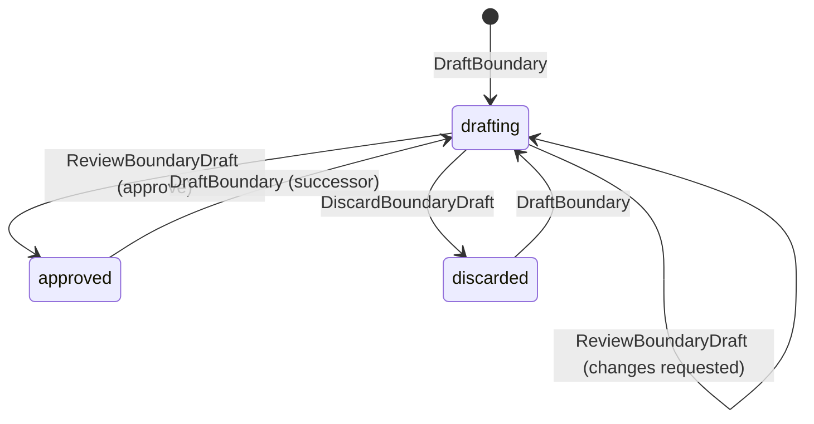
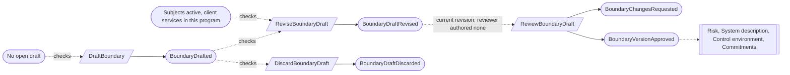
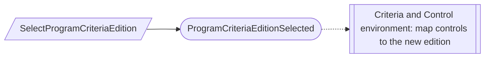

# Program and scope

Status: **locked**, 2026-11-03. Hand-authored source of truth for this context.

## Purpose

Program and scope records what a client organization is pursuing and what is in
scope. A program keeps one identity through readiness, Type I and Type II
(M0-D01). Its system boundary states which system, services and Trust Services
categories the examination covers.

**Owns:** programs (targets, criteria edition, stage), system boundaries and their
versions, and client services.

**Does not own:**

| Concern | Owner |
| --- | --- |
| Examinations, Type II plans, observation periods, and moving to the next period | Examinations (PS-02) |
| Criteria catalog editions | Criteria |
| Applications, system instances, locations, information, providers | Their inventories; the boundary references them |
| Readiness results | Readiness |
| Firm `ServiceEngagement` | Firm services; a client service is a different thing |

## Language

| Term | Meaning |
| --- | --- |
| Program | One compliance effort of an organization, carried through readiness, Type I and Type II. |
| Stage | `readiness`, `type_i` or `type_ii`. These are planned stages, not claims that an examination happened. |
| Target date | An optional planned date with its author. It is never promoted to a confirmed date. |
| System boundary | The statement of what a program's examination covers. |
| Boundary version | One immutable approved statement of the boundary, with an effective date. |
| Boundary draft | The single working copy of the next version. |
| Trust Services categories | A set drawn from `security`, `availability`, `confidentiality`, `processing_integrity`, `privacy`; `security` is always included. |
| Scope decision | One inclusion or exclusion of a subject (service, application, system instance, location, provider, information) in a boundary version, with its rationale. |
| Client service | A client offering or operated service system. It is distinct from an application and from a firm `ServiceEngagement` (M0-D22). |

## Aggregates

### Program

**Identity:** `TenantId` + `ProgramId`.

**Invariant:** one program has one name, one selected criteria edition, one
current stage, and one plan of target dates whose present dates are in order:
readiness ≤ Type I as-of ≤ Type II start ≤ Type II end.

- A target-date revision is appended with its author; earlier targets are kept.
  Missing dates stay unknown, never placeholders (M0-D01).
- A program holds one exact criteria edition. Moving to a newer edition is an
  explicit, attributed selection.
- A stage change is an attributable decision that references the readiness
  decision or examination outcome it relied on (PS-03).

| Command | Who | Accepts when | Emits |
| --- | --- | --- | --- |
| CreateProgram | Compliance Lead | `ProgramId` is new; edition published | ProgramCreated |
| RenameProgram | Compliance Lead | Exists | ProgramRenamed |
| ReviseProgramTargets | Compliance Lead | Dates in order | ProgramTargetsRevised |
| SelectProgramCriteriaEdition | Compliance Lead | Edition published and differs | ProgramCriteriaEditionSelected |
| ChangeProgramStage | Compliance Lead | Next stage; supporting reference given | ProgramStageChanged |

| Event | Carries |
| --- | --- |
| ProgramCreated | tenant, program, name, criteria edition, created by |
| ProgramRenamed | tenant, program, previous name, new name |
| ProgramTargetsRevised | tenant, program, readiness, Type I as-of, Type II start, Type II end, revised by |
| ProgramCriteriaEditionSelected | tenant, program, previous edition, new edition, selected by |
| ProgramStageChanged | tenant, program, previous stage, new stage, supporting reference, rationale, changed by |

### SystemBoundary

**Identity:** `TenantId` + `ProgramId`. One boundary per program (PS-01).

**Invariant:** a boundary has at most one draft and a sequence of approved
versions, whose effective dates strictly increase. Approved versions never
change.

- A draft states the system description, the Trust Services categories, and the
  scope decisions. Categories are 1–5 distinct values and must include
  `security`; optional categories are recorded explicitly and never inferred
  (M0-D01). Creation, revision and approval each check this.
- A scope decision references a subject by tenant, ID and exact version. Before
  the subject's inventory exists, it may be a typed unresolved reference with
  owner and rationale. A client service must be active and belong to this
  program (M0-D22).
- Approval is a review of the exact draft revision by someone who authored no
  revision of the draft, unless a separation-of-duties waiver covers it
  ([CV-06](conventions.md#guards-and-reviews)). The review approves or requests
  changes (PS-04).
- A never-approved draft can be discarded (PS-05).
- Dropping a category or a subject is a new version, never an edit.

| Command | Who | Accepts when | Emits |
| --- | --- | --- | --- |
| DraftBoundary | Compliance Lead or Contributor | No open draft | BoundaryDrafted |
| ReviseBoundaryDraft | Compliance Lead or Contributor | Draft open; content rules hold | BoundaryDraftRevised |
| ReviewBoundaryDraft | Compliance Lead who authored no revision, or covered by a waiver | Draft open; reviews the current revision; approval needs a later effective date and content rules | BoundaryChangesRequested or BoundaryVersionApproved |
| DiscardBoundaryDraft | Compliance Lead | Draft open | BoundaryDraftDiscarded |

| Event | Carries |
| --- | --- |
| BoundaryDrafted | tenant, program, draft, based on version (if a successor), content, drafted by |
| BoundaryDraftRevised | tenant, program, draft, revision, content, revised by |
| BoundaryChangesRequested | tenant, program, draft, revision, comments, reviewer |
| BoundaryVersionApproved | tenant, program, version, draft revision, content, effective date, approver, waiver (if any) |
| BoundaryDraftDiscarded | tenant, program, draft, discarded by |

### ClientService

**Identity:** `TenantId` + `ServiceId`.

**Invariant:** one service belongs to one program for life, and is active or
retired. A retired service cannot be revised.

| Command | Who | Accepts when | Emits |
| --- | --- | --- | --- |
| CreateClientService | Compliance Lead | `ServiceId` is new; program exists | ClientServiceCreated |
| ReviseClientService | Compliance Lead | Active | ClientServiceRevised |
| RetireClientService | Compliance Lead | Active | ClientServiceRetired |

| Event | Carries |
| --- | --- |
| ClientServiceCreated | tenant, service, program, name, description, created by |
| ClientServiceRevised | tenant, service, changed fields, revised by |
| ClientServiceRetired | tenant, service, reason, retired by |

## Flows

### Boundary approval

Approving a boundary version notifies the contexts that depend on scope (risk
reassessment, the system description, control applicability, commitment
categories). They design their own reactions.

### Criteria edition change

The program records the selection only. Not-applicable decisions are made again
for the new edition ([Criteria](criteria.md), CR-05), and controls are mapped to it
in Control environment.

Program and scope has no reactors of its own. Each command checks the facts it
needs against current state.

## Decisions

Jev answers are from `jev-1.14.0`, 2026-11-03. A yes is ≥ 0.8 and a no is ≤ 0.2.
Anything in between is settled by common sense, with the reasoning stated.

| ID | Decision | Evidence |
| --- | --- | --- |
| PS-01 | One system boundary per program, keyed by the program, with its history as versions. | 0.84. |
| PS-02 | Moving to the next period is designed in Examinations; the program simply continues. The old `ProgramRollover` record and its execution process are not carried forward here. | 0.85. |
| PS-03 | The program records each stage change as an attributable decision with its supporting reference. | 0.87. Domain rule: a stage transition is a decision against a stable readiness or outcome snapshot. |
| PS-04 | Boundary review and approval are one step: a review of the exact revision by someone other than the author, which approves or requests changes. | The approver need not differ from the reviewer: 0.12. |
| PS-05 | Never-approved drafts can be discarded; approved versions stay forever. | 0.75. EN-02 allows never-used-draft deletion. |
| PS-06 | Each client service belongs to one program. | M0-D22 product rule. Jev leaned towards shared services (0.24), not decisive, so the product rule stands. |
| PS-07 | Responsibility assignments recorded on the old boundary (`ResponsibilityAssigned`, `ResponsibilityRevoked`) move to the context that owns the work: control responsibilities are `ControlResponsibility` in [Control environment](control-environment.md). | M0-D03: a responsibility belongs to the context that owns the work. |

## Open questions

None at this time.

## Superseded owners

| Old owner | Becomes |
| --- | --- |
| ComplianceProgram | Program |
| SystemBoundary | SystemBoundary (one per program; review and approval merged) |
| ClientService | ClientService |
| ProgramRollover, ProgramRolloverExecutionProcess | Moved to Examinations (PS-02) |
