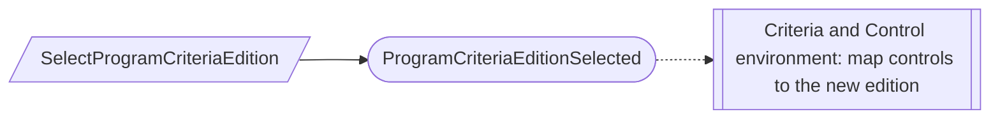

# Program and scope

Status: **blocked on domain design**, revised 2026-11-05. Existing product rules
remain in force; whole-draft approval has not been reconciled with independent
scope decisions and the no-whole-collection write rule. This document records
the product requirements and an unapproved alternative, not an implementation
contract.

## Purpose

Program and scope records what a client organization is pursuing and what is in
scope. A program keeps one identity through readiness, Type I and Type II
(M0-D01). Its system boundary states which system, services and Trust Services
categories the examination covers.

**Owns:** programs (targets, criteria edition, stage), system boundaries and their
versions, and client services.

**Does not own:**

| Concern | Owner |
| --- | --- |
| Examinations, Type II plans, observation periods, and moving to the next period | Examinations (PS-02) |
| Criteria catalog editions | Criteria |
| Applications, system instances, locations, information, providers | Their inventories; the boundary references them |
| Readiness results | Readiness |
| Firm `ServiceEngagement` | Firm services; a client service is a different thing |

## Language

| Term | Meaning |
| --- | --- |
| Program | One compliance effort of an organization, carried through readiness, Type I and Type II. |
| Stage | `readiness`, `type_i` or `type_ii`. These are planned stages, not claims that an examination happened. |
| Target date | An optional planned date with its author. It is never promoted to a confirmed date. |
| System boundary | The statement of what a program's examination covers. |
| Boundary version | One immutable approved statement of the boundary, with an effective date. |
| Boundary draft | The single working copy of the next version. |
| Trust Services categories | A set drawn from `security`, `availability`, `confidentiality`, `processing_integrity`, `privacy`; `security` is always included. |
| Scope decision | One inclusion or exclusion of a subject (service, application, system instance, location, provider, information) in a boundary version, with its rationale. |
| Client service | A client offering or operated service system. It is distinct from an application and from a firm `ServiceEngagement` (M0-D22). |

## Aggregates

### Program

**Identity:** `TenantId` + `ProgramId`.

**Invariant:** one program has one name, one selected criteria edition, one
current stage, and one plan of target dates whose present dates are in order:
readiness ≤ Type I as-of ≤ Type II start ≤ Type II end.

- A target-date revision is appended with its author; earlier targets are kept.
  Missing dates stay unknown, never placeholders (M0-D01).
- A program holds one exact published criteria edition. The client supplies the
  stable `ProgramId`; an exact authorized creation retry returns its original
  result and changed creation intent under the same ID conflicts. Publication is
  irreversible, so the committed edition source can be verified before the
  program records that exact ID without a continuing reservation. A projection is
  not publication authority. Moving to a newer edition is an explicit, attributed
  selection; there is no automatic upgrade.
- **Selected creation behavior:** an exact, valid and irreversible published
  edition can be selected when creating a program, even if unrelated entry
  outcomes are pending. Publication must first meet its own authority and
  nonempty-witness rules; a raw request is not publication. A consumer of a
  particular criterion distinguishes pending or unresolved from refused or
  absent and requires the entry's exact accepted outcome and publication-cut
  membership; a point of focus also requires proof that its exact accepted parent
  incarnation is effective at that same publication cut, not just that the parent
  once existed or shared its category.
  Applicability and readiness report incomplete coverage while relevant outcomes
  or discovery are unresolved. See [criteria](criteria.md) and the
  [creation design](../reviews/program-creation-criteria-design.md).
- The client's `ProgramId` and normalized creation intent, including `EditionId`,
  determine retries. Exact authorized retries return the committed original
  result; changed intent conflicts. Competing appends reload the actual winner,
  and unknown commits are reconciled rather than assigned a new ID. Historical
  creation events without an edition remain explicitly `legacy_unknown` until
  an attributed selection; no default is fabricated. The API/MCP compatibility
  and source-authority qualifications are recorded in the creation design.
- Creation authorizes at a fresh, coherent, source-current admission decision
  for the actor, active tenant, member episode and one qualifying organization-wide
  `program.manage` path. Later revocation prevents new admissions but does not
  cancel that exact uninterrupted in-flight append. `ProgramCreated` is both the
  durable admitted intent and final creation fact; there is no separate receipt
  stream. A crash before a known commit requires fresh authorization after any
  unknown commit is settled. An empty read alone does not prove an earlier append
  cannot still arrive. Require definitive provider settlement or an exact-attempt
  fence competing on the same program stream at the original expected position,
  including position zero. If the original creation wins, reconcile it; if the
  fence wins, that attempt cannot rebase. A newly authorized execution generation
  can use the same client `ProgramId` and bound intent after the fence; changed
  intent conflicts. If no earlier intent was durable and its identity is no
  longer known, the recovery fence binds the currently authorized request and
  blocks all stale appends at that expected position; it does not claim to know
  a lost request's intent. If an earlier creation wins instead, compare against
  that committed intent. A fence does not create a program. A retry's result is
  disclosed only after current authorization. The bounded evidence and ordering
  contract, including team/role revocations and the current implementation gap, are in the
  [program-creation design](../reviews/program-creation-criteria-design.md).
- To establish that coherent decision without loading every grant, use a paged
  index only to locate one candidate positive path. Fresh, linearizable reads
  obtain the exact state and monotonically increasing physical position for each
  fixed path participant and every applicable global veto owner, including the
  tenant and member episode. Capture a trusted admission instant `T` **after all
  first reads finish and before any second read starts**, then freshly read the
  same participants again. Only identical first/second positions prove that all
  those states coexisted at `T`; evaluate expiry and other time-dependent rules at
  that same trusted instant. Bind the credential's issuer and subject to the
  exact user; for a session JWT resolve its identity ID to the provider identity
  and same user rather than conflating session and provider issuer/subject.
  Include the current sign-in identity and any applicable session
  revocation sources: a previously issued token alone does not authorize a new
  admission after the identity is revoked. Verify that all path identities join:
  tenant, user and member episode agree; the TeamMember and TeamRole name the
  same active team; the TeamRole, active Role and RolePermission name the same
  role; scope is this organization and the normalized permission is
  `program.manage`. Excluded roles and every applicable global veto remain
  excluded. The applicable veto owners must form an authoritative, closed,
  bounded set; if policy permits an independently growing deny list, a sampled
  list is insufficient and a separate authoritative per-key decision or policy
  redesign is required. A change, unknown read, missing required veto, or
  inability to establish currentness fails closed or retries. `T` is provisional
  until every second read succeeds; even a later-than-`T` revocation may cause a
  conservative retry if it changes a participant before its second read.
  A fact first committed after the certified `T` does not retroactively cancel
  the admitted operation merely because its business effective date is earlier;
  any correction or audit consequence is recorded separately.
  Persist the bounded path, positions, `T` and intent as admission evidence. A
  lagging discovery index may fail to find a valid path, but cannot authorize or
  prove no grant exists. This reads one path, not every team or grant. Exact-source
  freshness, no position resets, all applicable vetoes, and trusted time are
  implementation qualifications; the current Portia reader contract does not
  establish all of them. Evaluate raw membership expiry at `T`, not a Boolean
  cached before `T`. An authoritative current role-permission policy/catalog
  generation is also a twice-read participant: the local binary must implement
  that exact generation, and mismatch or an unknown generation fails closed.
  Merely recording the binary's own version is insufficient if the authoritative
  policy changed before `T`. Rolling deployments must not silently admit under
  different policy generations.
  Every fact that can change a participant's allow or veto must advance the
  compared physical stream position or be immutable content bound and verified
  by that version. An out-of-band mutable value or an audit-only event in another
  stream cannot silently change the decision while the compared position stays
  equal. The trusted authority service must attest the actual two-pass ordering;
  a later list of source versions and a timestamp alone does not prove the reads
  overlapped at `T`.
- A stage change is an attributable decision that references the readiness
  decision or examination outcome it relied on (PS-03).

| Command | Who | Accepts when | Emits |
| --- | --- | --- | --- |
| CreateProgram | Authorized organization-wide program manager | Client `ProgramId`; exact valid published edition; coherent active-tenant/member/permission admission; any prior unknown attempt settled or fenced | ProgramCreated |
| FenceProgramCreationAttempt | Program recovery | Original expected stream position; no committed winner; bind the authorized recovering intent without inventing lost prior intent | ProgramCreationAttemptFenced |
| RenameProgram | Compliance Lead | Exists | ProgramRenamed |
| ReviseProgramTargets | Compliance Lead | Dates in order | ProgramTargetsRevised |
| SelectProgramCriteriaEdition | Compliance Lead | Exact published source evidence; edition differs; client operation ID and expected program revision | ProgramCriteriaEditionSelected |
| ChangeProgramStage | Compliance Lead | Next stage; supporting reference given | ProgramStageChanged |

| Event | Carries |
| --- | --- |
| ProgramCreated | tenant, program, normalized creation intent including name, plan and criteria edition, exact published-edition evidence, creation actor and bounded admission evidence, original response or durable response reference |
| ProgramCreationAttemptFenced | tenant, program, recovery generation, authorized recovering-intent binding, original expected position and recovery evidence; a fence alone does not create a program or assert an unknown prior intent |
| ProgramRenamed | tenant, program, previous name, new name |
| ProgramTargetsRevised | tenant, program, readiness, Type I as-of, Type II start, Type II end, revised by |
| ProgramCriteriaEditionSelected | tenant, program, operation ID, expected revision, previous edition, new edition, exact publication evidence, selected by |
| ProgramStageChanged | tenant, program, previous stage, new stage, supporting reference, rationale, changed by |

### SystemBoundary

**Identity:** `TenantId` + `ProgramId`. One boundary per program (PS-01).

**Invariant:** at most one draft is open; approved versions are immutable,
with strictly increasing effective dates.

**Existing product rules:** A boundary includes a description,
Trust Services categories, and scope decisions. Categories are 1–5 distinct
values and include `security` (M0-D01); optional categories are explicit. A
never-approved draft can be discarded (PS-05). Dropping a category or subject
is a new version. A reviewer approves or requests changes to an exact draft
revision, and must have authored **no revision of that entire draft** unless an
approved separation-of-duties waiver covers the reviewer (PS-04, CV-06).

These rules do **not** establish a qualified implementation that avoids writes
depending on all scope decisions. In particular, a human's whole-draft review
needs a complete exact-version view, while reviewer independence needs authority
about that reviewer's authorship. Splitting all authorship and membership evidence
into small admission windows, paging
it, and scanning the chain with bounded memory still makes the approval write
depend on all children. It is a distributed per-decision ledger, not a remedy
for this domain smell. The previously proposed window-chain publication protocol
is withdrawn. No draft, approval event, aggregate, manifest or other durable
parent-like record may acquire the complete subject or author roster instead.
A source-cut, digest, projection, or cursor by itself neither proves completeness
nor solves the whole-set write dependency.

#### Whole-draft review without an author roster: candidates

The existing review rule asks whether **this one reviewer** authored any
revision, not for a list of all authors. A human can review an exact historical
version through paged reads; the approval command need not load all scope
decisions to record that person's attestation. Neither a paged view nor an
attestation proves that the view is complete. The following candidates are
unapproved and require the exact-version and authority guarantees below.

1. **Choose the reviewer when the draft opens.** Bind one immutable reviewer to
   that draft, and refuse a revision authored by that person. Any number of
   other authors may make independently owned changes. On an exact freeze, the
   designated reviewer reads that version and attests to the whole draft. The
   approval checks the reviewer, draft lifecycle and exact version, not every
   subject or author. If all admitted writes actually enforce the restriction,
   the reviewer cannot have authored an accepted revision; no author roster is
   needed. This narrows the current workflow: a reviewer must be selected before
   edits, cannot be changed within that draft, and the current waived-author
   review path is lost unless explicitly redesigned. A user who started editing
   cannot later be chosen as reviewer for the same draft. These are product
   changes, not consequences already authorized by PS-04 or M0-D03.
2. **Check one prospective reviewer's author claim.** Keep later reviewer
   selection by addressing one independent claim keyed by `(draft, person)`,
   whose fact means that person actually authored at least one accepted draft
   revision. Approval checks and fences only its prospective reviewer's claim;
   other author claims are neither enumerated nor stored on the boundary. The
   first accepted edit and its first claim must agree atomically or through a
   proven protocol. A claim written before a refused edit falsely excludes an
   eligible reviewer; an accepted edit followed by a crash before its claim can
   permit self-review. A pending first edit, including an absent target, needs an
   exact outcome or durable fence before a no-author answer can be final.
   Existing Portia single-stream concurrency does not establish atomic
   cross-stream claim-plus-edit. Claim cleanup, retries, fence races, waived
   review and bounded replay remain unresolved; a claim per attempted edit or
   per subject would recreate the prohibited ledger.

For either candidate, a proposed freeze marker in the same ordered source scope
as all draft revisions may give a version a stable read boundary. Every writer,
including imports and retries, must use the qualified ordering and the correct
draft epoch; a raw append is not necessarily an accepted edit. A delayed edit
after the marker must receive a durable refusal or be assigned to a different
draft; a preliminary read that said “open” is not a fence. The reviewer needs a
complete, retained, exact-version view, including accepted revisions that had
not yet reached a projection when the freeze was requested. A view checkpoint
can locate progress, but only a qualified gapless source, projection and retention
contract can support its completeness claim. Waiting for that checkpoint still
means waiting for all relevant earlier facts to be processed; a scalar cursor
does not make that dependency disappear. Whether this read-side requirement
satisfies the no-all-children-write rule remains to be resolved, rather than
declaring a marker to solve the domain problem. No entire set is sorted or held
in memory merely to perform the approval.

Source ordering, processing through the marker, durable refusal after a freeze,
ambiguous commit recovery, one-open-draft concurrency, old-version retention,
discard versus delayed writers, and the lifetime replay cost of the boundary
line all remain unqualified. Exact historic inclusion/exclusion is a read-side
contract, not permission to store a roster in the approval event. These
candidates do not change accepted product policy until explicitly adopted.

### Boundary scope decisions: independent candidate

**Identity:** Candidate: `TenantId` + `ProgramId` + `DraftId` + subject kind +
subject ID.

**Invariant:** Candidate: one subject decision has one attributable state at
each revision; its independently reviewed revision cannot be approved by an
author of that decision unless an approved waiver covers that reviewer. This is
a local invariant only and does not satisfy the existing whole-draft reviewer
rule. Its authority and lifecycle remain unqualified.

A `BoundaryScopeDecision` could instead own one subject's inclusion or exclusion,
rationale, exact subject identity and version, and its own attributed revision
and review. It can enforce local author/reviewer separation using only its own
revision facts. A typed unresolved reference names owner and rationale until its
owning inventory exists. Exact retries recover the original outcome; changed
intent under the same operation identity conflicts. Source-bound participant
acceptance, refusal and a durable fence remain necessary wherever the decision
requires another owner; a projection read is not authority.

Under this candidate, each scope decision is reviewed and published separately.
Readers can page across independently approved decisions without a write command
collecting or approving them. Description and categories can likewise be governed
by the small fact that owns them, with `security` mandatory. A boundary line can
own one-open-draft and strictly increasing effective dates without owning child
rosters. Neither individual scope approval nor that line's write may require
enumerating all scope decisions.

**This is a product semantic change, not a restatement of PS-04 or CV-06.**
Independent review does not establish that one reviewer examined the exact whole
draft or authored none of its revisions. For example, Alice can author decision
A and review decision B, while Bob authors B and reviews A; both local reviews
pass but neither is independent of the whole draft. Independent publication also
does not by itself create one immutable boundary version containing an exact,
complete set of decisions: a paged report of current decisions is not such a
version, and a cursor or timestamp is not proof of its membership. Discarding a
draft while independent writes are in flight and determining the exact historical
scope consumed by an examination likewise need a design without whole-set
admission, hidden collection-wide write checks, or post hoc mutation.

Resolve these semantics with the product owner and develop an authoritative
protocol before implementation. Either identify a real, small invariant whose
atomic owner preserves the existing whole-draft approval without per-child
coordination or all-child write checks, or explicitly adopt an independently
reviewed scope model and define how examination-time scope and version history
work. Until then neither option is locked or implementation-ready. Read-side
pagination may present many facts; it is not a substitute for a required write
invariant.

A resolved subject reference names its tenant, ID and exact source version. A
boundary draft may cite a client service only when it is active and belongs to
the program; subject types whose owning inventories are not yet delivered remain
typed unresolved references (M0-D22). Ownership and activity are decided by
`ClientService`, not by a boundary projection. A later retirement remains
recordable and exposes any resulting dependent gap (CV-08). The service-owner
acceptance protocol and the exact linearization of the draft citation remain
unqualified: a successful read cannot establish a concurrent mutable fact. M0-D22
does not say that later retirement must be blocked or that the service remains
active forever; whether approval adds an activity requirement needs an explicit
product decision. Qualify concurrency, retirement, source-version, refusal,
replay, delayed commands and failure semantics. Similar proof is required for
each other inventory's mutable eligibility rules.

### ClientService

**Identity:** `TenantId` + `ServiceId`.

**Invariant:** one service belongs to one program for life, and is active or
retired. A retired service cannot be revised.

| Command | Who | Accepts when | Emits |
| --- | --- | --- | --- |
| CreateClientService | Compliance Lead | `ServiceId` is new; program exists | ClientServiceCreated |
| ReviseClientService | Compliance Lead | Active | ClientServiceRevised |
| RetireClientService | Compliance Lead | Active | ClientServiceRetired |

| Event | Carries |
| --- | --- |
| ClientServiceCreated | tenant, service, program, name, description, created by |
| ClientServiceRevised | tenant, service, changed fields, revised by |
| ClientServiceRetired | tenant, service, reason, retired by |

## Flows

### Boundary approval

The existing requirement is review and approval of an exact whole-draft revision.
Its realization without a write decision depending on every scope decision is
unresolved. Independent per-decision review is a possible alternative, with the
semantic differences above; it has not been adopted. Dependent contexts need an
exact scope reference appropriate to the eventual decision and must not treat a
current projection as historical scope authority.

### Criteria edition change

The program records the selection only. Not-applicable decisions are made again
for the new edition ([Criteria](criteria.md), CR-05), and controls are mapped to it
in Control environment.

No cross-owner current-state read is publication authority. Participant outcomes,
source fencing and historical scope semantics remain to be qualified.

## Decisions

Jev answers are from `jev-1.14.0`, 2026-11-03. Earlier review thresholds were
triage conventions, not measured proof of correctness. Inconclusive or
contradictory answers remain open until resolved with source and scenario evidence.

| ID | Decision | Evidence |
| --- | --- | --- |
| PS-01 | One system boundary per program, keyed by the program, with its history as versions. | 0.84. |
| PS-02 | Moving to the next period is designed in Examinations; the program simply continues. The old `ProgramRollover` record and its execution process are not carried forward here. | 0.85. |
| PS-03 | The program records each stage change as an attributable decision with its supporting reference. | 0.87. Domain rule: a stage transition is a decision against a stable readiness or outcome snapshot. |
| PS-04 | Boundary review and approval are one step: a review of the exact revision by someone other than the author, which approves or requests changes. | The approver need not differ from the reviewer: 0.12. |
| PS-05 | Never-approved drafts can be discarded; approved versions stay forever. | 0.75. EN-02 allows never-used-draft deletion. |
| PS-06 | Each client service belongs to one program. | M0-D22 product rule. Jev leaned towards shared services (0.24), not decisive, so the product rule stands. |
| PS-07 | Responsibility assignments recorded on the old boundary (`ResponsibilityAssigned`, `ResponsibilityRevoked`) move to the context that owns the work: control responsibilities are `ControlResponsibility` in [Control environment](control-environment.md). | M0-D03: a responsibility belongs to the context that owns the work. |

## Open questions

- Reconcile the whole-draft, all-author review requirement and exact immutable
  boundary version with independent per-decision publication and no write that
  depends on all children. Obtain an explicit product decision for any change to
  those review or version semantics.
- Specify and qualify source-owner acceptance and citation linearization for
  client services and other mutable subjects; resolve retirement races without
  suppressing truthful source changes. Establish whether any additional
  approval-time activity rule applies.
- Define cancellation, discarded drafts, exact retries, durable target fences,
  competing appends, immutable historical scope and missing evidence without a
  per-child parent ledger or a cross-owner projection as authority.

## Superseded owners

| Old owner | Becomes |
| --- | --- |
| ComplianceProgram | Program |
| SystemBoundary | SystemBoundary (one per program; review and approval merged) |
| ClientService | ClientService |
| ProgramRollover, ProgramRolloverExecutionProcess | Moved to Examinations (PS-02) |
