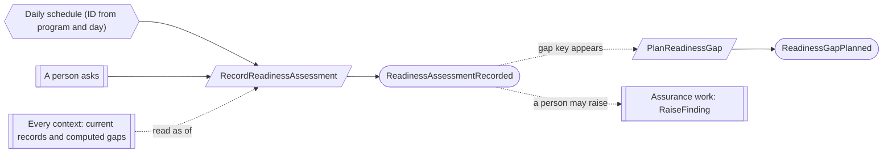
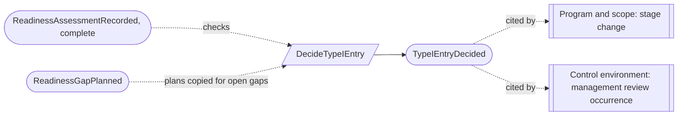

# Readiness

Status: **locked**, 2026-11-03. Hand-authored source of truth for this context.
It follows the [context conventions](conventions.md).

## Purpose

Readiness answers whether a program is ready for its Type I examination. It
evaluates the product's readiness rules over the program's current records,
keeps each result as an immutable assessment, lets the team plan every gap, and
records management's decision to enter Type I (M0-D23).

**Owns:** readiness assessments, gap plans and Type I entry decisions.

**Does not own:**

| Concern | Owner |
| --- | --- |
| The readiness rules themselves | The product: versioned rule sets released with the product, never edited by a tenant |
| The facts the rules read | Every other context; each names its computed gaps |
| Findings raised from a gap | [Assurance work](assurance-work.md) (`RaiseFinding`, source `readiness_gap`); neither closes the other |
| The program's stage | [Program and scope](program-and-scope.md); a stage change cites the Type I entry decision (PS-03) |
| Monitoring measures and forecasts | Read models over the same rule outputs; they never change a verdict |
| The management compliance review | Control environment: an occurrence citing an assessment (M0-D19) |

## Language

| Term | Meaning |
| --- | --- |
| Rule set | One product-released version of the readiness rules. Each rule names what it checks and how a result is explained. |
| Assessment | One evaluation of one rule set over one program's records as of a time, with the source record versions read, its completeness, verdict and gaps. |
| Verdict | `ready` (no open gap), `not_ready` (at least one gap) or `incomplete` (an input the rules need is unknown or still a draft) (RD-04). |
| Gap | One unmet rule for one subject record in one assessment, with an explanation. Its key is the rule and the subject, so the same gap is recognized across assessments. |
| Gap plan | The owner, action and target date for a gap key, with notes. It carries over to later assessments while the gap stays open. |
| Type I entry decision | Management's decision, `enter_type_i` or `not_yet`, based on one exact complete assessment. |

## Aggregates

### ReadinessAssessment

**Identity:** `TenantId` + `AssessmentId`.

**Invariant:** one assessment records one evaluation of one rule set over one
program as of one time, and never changes. It is reproducible from the source
record versions it lists (M0-D23).

- It is run when a person asks and once a day for each active program (RD-05).
  A scheduled run takes an ID derived from the program and the day
  ([CV-09](conventions.md#reactors)).

| Command | Who | Accepts when | Emits |
| --- | --- | --- | --- |
| RecordReadinessAssessment | The readiness calculator, on a person's request or on schedule | `AssessmentId` is new; program active; rule set released; a repeat is a no-op | ReadinessAssessmentRecorded |

| Event | Carries |
| --- | --- |
| ReadinessAssessmentRecorded | tenant, assessment, program, rule set version, as of, source record versions, completeness (unknown or draft inputs listed), verdict, gaps (key, rule, subject, explanation), requested by or schedule |

### ReadinessGapPlan

**Identity:** `TenantId` + `ProgramId` + `GapKey` (rule + subject record).

**Invariant:** one gap key has one current plan (owner, action, target date) and
its notes, kept with their history. Whether the gap is open comes from the
latest assessment, never from the plan (RD-03).

- A plan can be made only for a key that appears in an assessment of the
  program.
- An open gap past its plan's target date is overdue: a computed gap.

| Command | Who | Accepts when | Emits |
| --- | --- | --- | --- |
| PlanReadinessGap | Compliance Lead or Contributor | The key appears in an assessment of the program; owner is a member or an active team; action and target date given | ReadinessGapPlanned |
| AnnotateReadinessGap | Compliance Lead, Contributor or the plan's owner | The key appears in an assessment of the program; note given | ReadinessGapAnnotated |

| Event | Carries |
| --- | --- |
| ReadinessGapPlanned | tenant, program, gap key, previous plan, owner, action, target date, planned by |
| ReadinessGapAnnotated | tenant, program, gap key, note, annotated by |

### TypeIEntryDecision

**Identity:** `TenantId` + `DecisionId`, for one program.

**Invariant:** one decision records management's `enter_type_i` or `not_yet` for
one program, based on one exact complete assessment, with a rationale (RD-01,
RD-02):

- It is made by an Org Admin.
- `enter_type_i` with open gaps lists each one with its plan at the time of the
  decision.
- A decision never changes. A later decision replaces it as the program's
  current one, and the earlier stays in history (RD-06).

| Command | Who | Accepts when | Emits |
| --- | --- | --- | --- |
| DecideTypeIEntry | Org Admin | `DecisionId` is new; program active; the assessment is of the program and `complete`; rationale given | TypeIEntryDecided |

| Event | Carries |
| --- | --- |
| TypeIEntryDecided | tenant, decision, program, assessment, verdict, outcome, open gaps with their plans, rationale, replaces (previous decision, if any), decided by |

## Flows

Diagrams follow [CV-01](conventions.md#flow-diagrams).

### Assessing and planning

### Type I entry

## Decisions

Jev answers are from `jev-1.14.0`, 2026-11-03. A yes is ≥ 0.8 and a no is ≤ 0.2.
Anything in between is settled by common sense, with the reasoning stated.

| ID | Decision | Evidence |
| --- | --- | --- |
| RD-01 | Management may decide `enter_type_i` with open gaps, and the decision lists each one with its plan. | 0.73. Common sense: the decision is management's to own, and listing the gaps makes the risk explicit. |
| RD-02 | The Type I entry decision is made by an Org Admin, based on a complete assessment, which need not be the latest. | Org Admin: 0.77. Latest only: 0.43. Common sense: management decides for the organization; the decision names its exact assessment, and any later one is visible beside it. |
| RD-03 | A gap plan is keyed by rule and subject and carries over across assessments; open or closed comes from the latest assessment. | 0.57. Common sense: re-planning the same gap after every run would lose work, and the assessment stays the only source of status. |
| RD-04 | Unknown or draft inputs give an `incomplete` verdict, not `not_ready`. | 0.59. Common sense: R1-08 names unknown and draft treatment, and a decision needs to know the result is whole. |
| RD-05 | Assessments run daily for each active program and whenever a person asks. | 0.50. Common sense: current gaps feed the work queue, and a daily run keeps them fresh without hiding history. |
| RD-06 | A Type I entry decision is replaced only by a new decision, keeping the earlier in history. | 0.83. |

## Open questions

None at this time.

## Superseded owners

| Old owner | Becomes |
| --- | --- |
| ReadinessAssessment | ReadinessAssessment (computation and record in one command) |
| ProgramReadiness | Removed: the latest assessment and current decision are read models; the decision is TypeIEntryDecision |
| ReadinessGapPlan | ReadinessGapPlan (no decision fence; the decision copies the plans) |
| `DecideReadiness` | Removed: the verdict is on the assessment |
| Readiness run, decision and reassessment reactors and processes | The daily schedule and `DecideTypeIEntry` |
