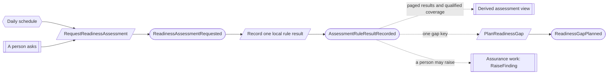
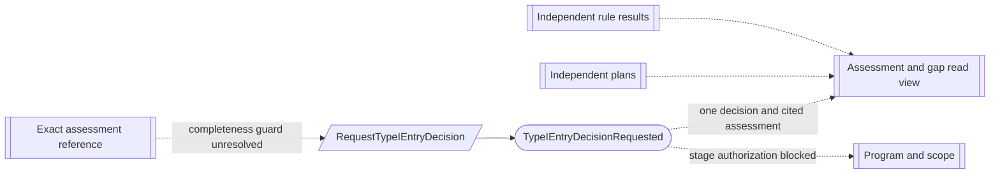

# Readiness

Status: **under refinement**, revised 2026-11-05. RD-01–RD-06 remain product decisions. The local-decision alternative below changes the complete-assessment entry guard and is not approved; authoritative reproducible assessment evidence is unresolved. Hand-authored source of truth for this context.
It follows the [context conventions](conventions.md).

## Purpose

Readiness answers whether a program is ready for its Type I examination. It
evaluates the product's readiness rules over the program's current records,
keeps each result as an immutable assessment, lets the team plan every gap, and
records management's decision to enter Type I (M0-D23).

**Owns:** readiness assessment metadata and individual evidence, gap plans and notes, and Type I entry decisions and individual gap evidence.

**Does not own:**

| Concern | Owner |
| --- | --- |
| The readiness rules themselves | The product: versioned rule sets released with the product, never edited by a tenant |
| The facts the rules read | Every other context; each names its computed gaps |
| Findings raised from a gap | [Assurance work](assurance-work.md) (`RaiseFinding`, source `readiness_gap`); neither closes the other |
| The program's stage | [Program and scope](program-and-scope.md); a stage change cites the Type I entry decision (PS-03) |
| Monitoring measures and forecasts | Read models over the same rule outputs; they never change a verdict |
| The management compliance review | Control environment: an occurrence citing an assessment (M0-D19) |

## Language

| Term | Meaning |
| --- | --- |
| Rule set | One product-released version of the readiness rules. Each rule names what it checks and how a result is explained. |
| Assessment | One evaluation of one rule set over one program's records. Rule results have independent identities; an assessment view derives completeness, verdict and gaps. A reproducible complete historic assessment needs an independently qualified immutable source cut and required universe; neither the assessment ID nor a projection establishes one. |
| Verdict | `ready` (no open gap), `not_ready` (at least one gap) or `incomplete` (an input the rules need is unknown or still a draft) (RD-04). |
| Gap | One unmet rule for one subject record and one rule-defined result discriminator in one assessment, with an explanation. A stable gap key distinguishes multiple gaps for the same rule and subject; cross-version carry-over remains to be defined. |
| Gap plan | The owner, action and target date for a gap key. Separately recorded notes and the plan carry over to later assessments while the gap stays open. |
| Type I entry decision | Management's decision, `enter_type_i` or `not_yet`, based on one exact complete assessment. |

## Aggregates

### ReadinessAssessment

**Identity:** `TenantId` + `AssessmentId`.

**Invariant:** one request binds an immutable program, released rule-set version,
request identity and requested observation contract. An exact retry is a no-op;
the same ID with changed intent is refused. The request owner stores no inputs,
results, gaps, per-result outcomes or per-child event history. One request does
not by itself establish a source cut, completion, or a readiness verdict.

A daily request uses a deterministic ID derived from program and day (RD-05,
CV-09); a manual request uses its own stable ID. The original design finalized
this owner after enumerating and settling every result. Even with independent
records or bounded batches, that is an all-child write decision and is
**withdrawn as a candidate**. There is no `FinalizeReadinessAssessment` write
or authoritative root verdict under the candidate below. Existing source code
and earlier decision language are not evidence that this replacement is shipped.

| Command | Who | Accepts when | Emits |
| --- | --- | --- | --- |
| RequestReadinessAssessment | Readiness calculator, on request or schedule | ID is new, program active, rule set released; exact retry is a no-op | ReadinessAssessmentRequested |

| Event | Carries |
| --- | --- |
| ReadinessAssessmentRequested | tenant, assessment, program, rule-set version, requester or schedule, requested observation contract |

### AssessmentRuleResult

**Identity:** `TenantId` + `AssessmentId` + versioned rule + subject + the
rule-defined result discriminator. A rule that can produce several gaps for
one subject must give each a distinct discriminator.

**Invariant:** one independently owned result binds one rule, subject, source
revision references, outcome and bounded explanation for that assessment.
Its local outcome is `satisfied`, `gap`, or `unknown`; an unavailable or draft
required local fact must not be represented as satisfied.
`(rule, subject)` alone cannot identify two different gaps. An exact retry is a
no-op; changed intent with the same identity is refused. No result owns other
results. A versioned rule must describe the small set of exact facts necessary
for its local result; if a proposed rule needs every member of an unbounded set
as a write guard, its own boundary and business semantics need redesign. Facts
that associate one result and one source revision may be stored independently;
they do not authorize a hidden all-input result decision.

| Command | Who | Accepts when | Emits |
| --- | --- | --- | --- |
| RecordAssessmentRuleResult | Readiness calculator | The assessment and exact rule/subject identity are valid and local input authority is qualified; exact retry is a no-op | AssessmentRuleResultRecorded |

| Event | Carries |
| --- | --- |
| AssessmentRuleResultRecorded | tenant, assessment, rule version, subject, result discriminator, outcome, one optional stable gap key, exact source references needed for that result, bounded explanation |

**Derived view, not a sealing write.** An authorized read calculates readiness
from independent results using the released rule semantics. The existing RD-04
precedence is `incomplete` when any required input is unknown, draft,
unsupported or unavailable; otherwise `not_ready` when a gap exists and
`ready` when none does. When required membership or projection coverage is not
proven, show `incomplete`/coverage unknown, never infer ready from zero rows or
matching counts. Page or stream results and gap details; the verdict fold needs
only bounded working state and must not sort or load the entire dataset in
memory. This does not prove that every rule can be evaluated with bounded
resources or that its source universe is complete.

The source contract must independently establish the required subject universe,
empty sets, immutable source revisions and the reproducible observation cut
required by M0-D23; no source frontier or coverage proof is assumed here. The
view must distinguish an authoritative, reproducible historical assessment
from a current or lagging estimate. New source changes after a qualified cut do
not retroactively change that historical result, but the historical result must
not be labeled current. Retention, late arrivals, revisions, retry recovery and
exact source versions require implementation qualification.

### ReadinessGapPlan

**Identity:** `TenantId` + `ProgramId` + `GapKey` (rule identity, subject and rule-defined result discriminator).

**Invariant:** one gap key has one current plan (owner, action and target date),
with its own revision history. Whether the gap is open comes from the latest
assessment, never from the plan (RD-03). A plan may be made only for a key in an
assessment of the program. An open gap past its target date is a computed gap.
Notes are independent facts, not children held by the plan. Stable key migration
when a rule version changes is an open product/source contract, not an implicit
match by display text or the assessment-local result ID.

| Command | Who | Accepts when | Emits |
| --- | --- | --- | --- |
| PlanReadinessGap | Compliance Lead or Contributor | The key appears in an assessment of the program; owner is a member or an active team; action and target date given | ReadinessGapPlanned |
| AnnotateReadinessGap | Compliance Lead, Contributor or the plan's owner | The key appears in an assessment of the program; note and stable note ID given; exact retry is a no-op | ReadinessGapAnnotated |

| Event | Carries |
| --- | --- |
| ReadinessGapPlanned | tenant, program, gap key, previous plan, owner, action, target date, planned by |
| ReadinessGapAnnotated | tenant, program, gap key, note ID, bounded note, annotated by |

Each note has its own identity `(TenantId, ProgramId, GapKey, NoteId)` and
immutable record. Reusing its ID for different content is refused. Listing notes
is a projection, not plan state. The plan's cross-owner eligibility checks also
need an authoritative participation protocol before implementation; a stale
membership projection is not proof that an owner is active.

### TypeIEntryDecision

**Identity:** `TenantId` + `DecisionId`, for one program.

**Invariant:** one immutable management decision binds one program, exact
assessment identity, `enter_type_i` or `not_yet`, rationale and actor. An exact
retry is a no-op; changed intent under the same ID is refused. Earlier decisions
remain history and a later decision becomes current (RD-06). The decision owns no
gap or plan roster, per-gap outcome ledger, or manifest.

**Existing rule and conflict.** RD-02 requires an Org Admin to use an exact
complete assessment, including an older complete assessment. RD-01 permits
entry with gaps and says the decision lists them with their plans. M0-D23 requires
a reproducible calculation and exact underlying source versions. These decisions
remain in force. If authorization of the decision must establish a verdict over
every required result or wait on every gap/plan, the write decision still depends
on all children even when a separate calculator, projected flag, certificate or
coordinator supplies the answer. The prior evidence-cut/finalization proposal
had that problem and is withdrawn, not an implementation-ready solution.

**Candidate requiring product decision:** management records the decision and
its one exact assessment reference with a rationale while completeness, gaps and
plans are displayed as a read-side evaluation. The action does not guard on a
collection-wide computed state and does not claim that a missing or incomplete
assessment was complete. Allowing entry where completeness is unknown or
incomplete changes RD-02 and potentially M0-D23; it is not an equivalent
implementation. Until the accepted guard is revised or a genuinely local
mechanism preserving it is established, this candidate must not authorize the
Program stage transition. Org Admin authorization, assessment/program ownership,
exact retry and changed-intent behavior remain local or require separately
qualified source-owner authority.

A historical decision view can show each gap and independently governed plan
without putting a list on the decision. To claim those were the gaps **and the
plan versions at decision time**, it needs a reproducible assessment and a
qualified common plan-observation frontier; showing current plans or plans read
at different instants is a different representation and must be labeled as
such. Late or unavailable evidence is unknown, not an empty list. RD-01 does not
say whether a missing plan blocks entry; that policy remains unresolved. What
`not_yet` must preserve beyond the cited assessment also remains open.

| Command | Who | Accepts when | Emits |
| --- | --- | --- | --- |
| RequestTypeIEntryDecision | Org Admin | Candidate only: ID is new, exact assessment belongs to program, rationale given; exact retry is a no-op. The complete-assessment guard and stage authorization remain unresolved | TypeIEntryDecisionRequested |

| Event | Carries |
| --- | --- |
| TypeIEntryDecisionRequested | tenant, decision, program, exact assessment reference, proposed outcome, rationale, requester; no claim that a result set is complete |

## Flows

Diagrams follow [CV-01](conventions.md#flow-diagrams).

### Assessing and planning

### Type I entry

## Decisions

Jev answers are from `jev-1.14.0`, 2026-11-03. The historical 0.8/0.2 thresholds were triage conventions, not proof or calibrated design correctness. Conflicting or inconclusive judgments remain open.

| ID | Decision | Evidence |
| --- | --- | --- |
| RD-01 | Management may decide `enter_type_i` with open gaps, and the decision lists each one with its plan. | 0.73. Common sense: the decision is management's to own, and listing the gaps makes the risk explicit. |
| RD-02 | The Type I entry decision is made by an Org Admin, based on a complete assessment, which need not be the latest. | Org Admin: 0.77. Latest only: 0.43. Common sense: management decides for the organization; the decision names its exact assessment, and any later one is visible beside it. |
| RD-03 | A gap plan is keyed by rule and subject and carries over across assessments; open or closed comes from the latest assessment. | 0.57. Common sense: re-planning the same gap after every run would lose work, and the assessment stays the only source of status. |
| RD-04 | Unknown or draft inputs give an `incomplete` verdict, not `not_ready`. | 0.59. Common sense: R1-08 names unknown and draft treatment, and a decision needs to know the result is whole. |
| RD-05 | Assessments run daily for each active program and whenever a person asks. | 0.50. Common sense: current gaps feed the work queue, and a daily run keeps them fresh without hiding history. |
| RD-06 | A Type I entry decision is replaced only by a new decision, keeping the earlier in history. | 0.83. |
| RD-07 | Candidate: independent rule results and plans, with verdicts and gap lists calculated on reads. The former all-result finalization is withdrawn. A local entry decision without a completeness guard changes RD-02 and is unapproved; reproducible source evidence remains unresolved. | [2026-11-05 Jev review](../reviews/readiness-boundaries-review.md): an external all-result status still makes the write depend on all results 0.90; a zero-row projection proves no gaps 0.04. Signals, not authority or distributed-systems proof. |

## Open questions

- Can the accepted complete-assessment entry guard and a write that never depends
  on all results both be satisfied, or must RD-02/M0-D23 explicitly change? A
  derived flag or small certificate does not remove that dependency.
- What actual source contract establishes a complete deterministic input
  universe, immutable source revisions and a reproducible as-of observation,
  including empty subject sets, concurrent changes, unavailable sources,
  retention and crash recovery? A paged read and an assessment ID do not prove it.
- What do the decision-time gaps and plans mean when plans change or are missing?
  May entry proceed without a plan? Can `not_yet` use the same evidence rule?
- How do rule-defined discriminators and stable gap identities migrate when a
  rule-set version changes, without merging separate gaps or losing a plan?
- How are each result's small local input authority, cross-owner admission,
  replay growth and stage consumers qualified against actual storage contracts?

## Superseded owners

| Old owner | Becomes |
| --- | --- |
| ReadinessAssessment | A request with no all-result finalization; independent results and a derived assessment view are candidates |
| ProgramReadiness | Removed: the latest assessment and current decision are read models; the decision is TypeIEntryDecision |
| ReadinessGapPlan | ReadinessGapPlan and separate notes; individual decision evidence references plan revisions |
| `DecideReadiness` | Removed: the verdict is on the assessment |
| Readiness run, decision and reassessment reactors and processes | Daily scheduling and independent result production; authoritative completeness and any stage guard remain unresolved |
