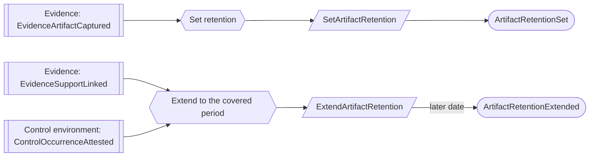
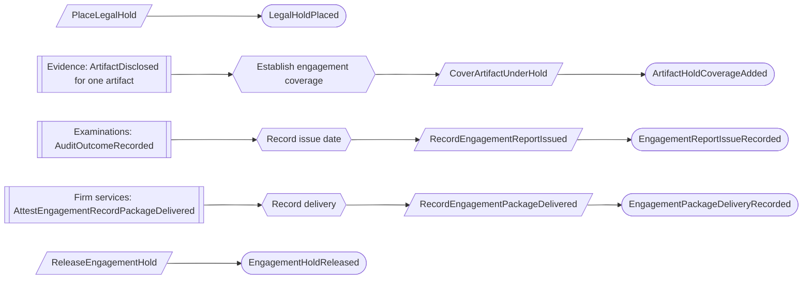
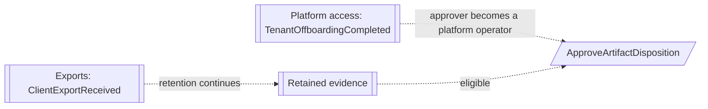

# Retention

Status: **boundary revision required**, 2026-11-05. Business invariants remain in
force. The tenant-lifetime hold register and list-bearing 2026-11-03 event
shapes are withdrawn; the independent owners below are candidates, and their
cross-owner authority is unqualified. See the [retention boundary review](../reviews/retention-boundaries-review.md)
for concrete alternatives, Jev evidence and unresolved proof obligations. It
follows the [context conventions](conventions.md).

## Purpose

Retention decides how long evidence is kept and when it may go: each artifact's
retention date, the legal and engagement holds that protect it, and the approved
dispositions that remove its content. Nothing is disposed of automatically
(M0-D16).

**Owns:** per-artifact retention and disposition decisions, independent legal
and engagement holds, and hold coverage. Cross-owner authorization remains
under qualification.

**Does not own:**

| Concern | Owner |
| --- | --- |
| Artifact content, inspection and the removal of content | [Evidence](evidence.md) (`DisposeArtifact`) |
| Report issuance | Examinations (`AuditOutcomeRecorded`) |
| Attest record package delivery | Firm services |
| The client export at offboarding | Exports |

## Language

| Term | Meaning |
| --- | --- |
| Retention date | The date until which an artifact is kept: 7 years after the end of the latest period it supports, or after its as-of date for point-in-time evidence. |
| Legal hold | An Org Admin's hold over the whole organization's evidence or a listed set of artifacts, until the Org Admin releases it. |
| Engagement hold | The hold over evidence disclosed for one examination, until one year after its report is issued and, when our firm is the auditor, until the attest record package is delivered. |
| Hold authority | The not-yet-qualified ordering needed to decide whether a hold or one artifact's authorization wins. It must not be an aggregate roster or an eventually consistent projection. |
| Eligible | Retention date passed and no active hold covers the artifact. |
| Disposition | An approved decision for one eligible artifact, with a rationale and its recorded outcome. The proposed replacement of RT-05 batch completion is not yet approved. |

## Aggregates

### ArtifactRetention

**Identity:** `TenantId` + `ArtifactId`.

**Invariant:** one artifact has one retention date, which only ever moves later
(RT-01).

- It is set from the artifact's as-of date or covered period when captured, and
  extended when the artifact comes to support a later period.
- A rejected artifact has no retention; only its tombstone remains.
- RT-07 treats the date as advice and records an extension after authorization
  as `disposed_before_extension`. M0-D16 also requires retention to have elapsed
  at eligibility; whether an extension already committed before authorization
  may be missed by an advisory read is unresolved and must not be assumed safe.

| Command | Who | Accepts when | Emits |
| --- | --- | --- | --- |
| SetArtifactRetention | Reactor on EvidenceArtifactCaptured | Not set; a repeat is a no-op | ArtifactRetentionSet |
| ExtendArtifactRetention | Reactor on EvidenceSupportLinked or ControlOccurrenceAttested | New date later than the current one; otherwise a no-op | ArtifactRetentionExtended |

| Event | Carries |
| --- | --- |
| ArtifactRetentionSet | tenant, artifact, basis (as-of date or period end), retained until |
| ArtifactRetentionExtended | tenant, artifact, basis, previous date, retained until |

### LegalHold

**Identity:** `TenantId` + `HoldId`.

**Invariant:** one legal hold has its own scope mode, lifecycle, reason and
release authority. Placement is never refused merely because an artifact was
already authorized for disposal; that outcome remains visible. A hold does not
store a collection of covered artifact IDs. The disposal-ordering guarantee
below is a required cross-owner rule and is not established by this aggregate
alone.

An organization-wide hold is a single hold fact. A selected-artifact hold uses
individual `HoldCoverage` records. Until an authoritative scope-admission and
activation protocol is proven, do not report the whole selected hold as active
when some requested memberships are still pending. Whether an organization-wide
protective pending state is needed during staging is an open product decision.

| Command | Who | Accepts when | Emits |
| --- | --- | --- | --- |
| PlaceLegalHold | Org Admin | Hold ID new; scope mode and reason provided; ordering outcome established | LegalHoldPlaced |
| ReleaseLegalHold | Org Admin | Active; reason given; ordering outcome established | LegalHoldReleased |

| Event | Carries |
| --- | --- |
| LegalHoldPlaced | tenant, hold, scope mode, reason, actor, operation identity and authoritative decision reference |
| LegalHoldReleased | tenant, hold, reason, actor, operation identity and authoritative decision reference |

Scope changes and staged activation remain unqualified; do not implement a
whole-set command or an arbitrary list in these events.

### EngagementHold

**Identity:** `TenantId` + `ExaminationId`.

**Invariant:** one engagement hold has its own lifecycle and cannot be released
before the report-age and, when required, attest-package conditions are met
(RT-03). Delivery-specific artifact coverage is owned separately. Report reissue,
package delivery, release and their source-ordering protocol need qualification.

| Command | Who | Accepts when | Emits |
| --- | --- | --- | --- |
| PlaceEngagementHold | Reactor on the first relevant disclosure | Not placed; a repeat is a no-op | EngagementHoldPlaced |
| RecordEngagementReportIssued | Reactor on AuditOutcomeRecorded | Active; reissue extends the date | EngagementReportIssueRecorded |
| RecordEngagementPackageDelivered | Reactor on AttestEngagementRecordPackageDelivered | Active; our firm is the auditor | EngagementPackageDeliveryRecorded |
| ReleaseEngagementHold | Engagement partner, or Org Admin for an external auditor | Report-age and package conditions hold; actor authorized | EngagementHoldReleased |

| Event | Carries |
| --- | --- |
| EngagementHoldPlaced | tenant, examination, auditor kind, engagement if applicable |
| EngagementReportIssueRecorded | tenant, examination, outcome, issued at |
| EngagementPackageDeliveryRecorded | tenant, examination, package, delivered at |
| EngagementHoldReleased | tenant, examination, actor, reason |

### HoldCoverage

**Identity:** `TenantId` + `HoldId` + hold generation + `ArtifactId`.

**Invariant:** one record represents one artifact's admitted coverage under one
hold generation; an exact retry cannot create a second coverage fact. Its
acceptance and release must participate in the same proven order as disposition
for that artifact. A projection or a prior membership read is not that order.

| Command | Who | Accepts when | Emits |
| --- | --- | --- | --- |
| CoverArtifactUnderHold | Authorized hold operation or reactor | The exact hold generation and artifact are admitted by the qualified authority | ArtifactHoldCoverageAdded |
| EndArtifactHoldCoverage | Authorized hold operation or reactor | Coverage active; ordering outcome established | ArtifactHoldCoverageEnded |

| Event | Carries |
| --- | --- |
| ArtifactHoldCoverageAdded | tenant, hold, generation, artifact, source, operation identity and decision reference |
| ArtifactHoldCoverageEnded | tenant, hold, generation, artifact, reason, operation identity and decision reference |

A new generation does not silently resurrect coverage from an earlier one.
Protection for an engagement disclosure must precede exposing that artifact's
bytes; the interaction with an earlier disposal authorization is unresolved.
Previously external disclosures are recorded as truth. Changing the prior
whole-delivery ordering to per-artifact admission is a product tradeoff, not
yet approved.

### ArtifactDisposition

**Identity:** `TenantId` + `DispositionId` + `ArtifactId`.

**Invariant:** one independently approved artifact disposition has one
idempotent authorization or refusal and one attributable removal outcome.
Authorization must not occur while an active covering hold has won the
specified order. This required invariant is **not yet qualified** across owners.
Evidence remains the authority for physical content removal. An unknown result
is pending until reconciled; it is never converted into refusal or success by a
timeout. An authorization is a decision, not proof that bytes have been removed.
A hold may become active after authorization but before deletion. Whether the
old authorization still permits later deletion conflicts with the reading of
M0-D16 that an active hold blocks disposition; that product meaning is open.
Until resolved and proven, do not issue or continue deletion while such a hold
is known active. This is a conservative design requirement, not a claim that
the existing runtime can stop a deletion already in flight.

An interface may submit several independent per-artifact requests with the same
batch reference and rationale. A batch is not an aggregate roster. Showing
progress from item outcomes is a read concern; a projected status is not the
existing RT-05 authoritative all-items completion guarantee. Whether to replace
that guarantee with per-item outcomes is an open product decision.

| Command | Who | Accepts when | Emits |
| --- | --- | --- | --- |
| ApproveArtifactDisposition | Org Admin; platform operator after offboarding | New exact item intent; rationale given; qualified authority decides retention and hold eligibility | ArtifactDispositionApproved |
| RecordArtifactDispositionRefusal | Reactor on an authoritative refusal | Exact matching item decision; identical retry no-op; changed intent under same identity conflicts | ArtifactDispositionRefused |
| RecordArtifactDisposalOutcome | Reactor on EvidenceArtifactDisposed | Exact matching item decision; identical retry no-op; changed intent under same identity conflicts | ArtifactDisposalOutcomeRecorded |

| Event | Carries |
| --- | --- |
| ArtifactDispositionApproved | tenant, disposition, artifact, rationale, approver, retention basis, operation identity and authoritative eligibility decision reference |
| ArtifactDispositionRefused | tenant, disposition, artifact, refusal reason, exact authority decision |
| ArtifactDisposalOutcomeRecorded | tenant, disposition, artifact, outcome (`disposed` or `disposed_before_extension`), exact source outcome |

## Cross-owner hold and disposition authority

The desired decision for **one** artifact asks whether an active organization-
wide hold or an active coverage fact for that artifact exists. A qualified
indexed existence check could return one blocking hold or prove the relevant
index ranges empty; it does not load, sort, or settle all artifacts or all hold
records as an aggregate. The authority must order hold placement, coverage,
release and this artifact's authorization, including concurrent insertion into
an empty range. A stale projection or eventually consistent index cannot prove
absence.

One candidate is a serializable transaction that atomically reads the relevant
hold predicates and durably records the authorization or refusal, including
phantom protection and exact-retry identity. Another is an authoritative
ordered processor whose durable index, operation outcomes, checkpoint and
outbox are updated atomically. The latter is a **new, centralized substrate**,
not a normal eventually consistent projection. Neither is established by the
current Portia per-stream expected-position append. Index/event dual writes,
ordering, acknowledgment, source routing, retention, scope resets, crash
recovery and fencing all require proof. A command is pending until its own
outcome is durable; a missing or uncertain response is not an authorization.

If M0-D16 protects content until its physical deletion, the authority must also
order hold activation against the irreversible Evidence-side deletion boundary.
The target needs a durable, atomic acceptance/fence or a provider-enforced
equivalent: a second pre-delete read can race a hold, and a prior authorization
or best-effort cancellation cannot stop a deletion already accepted elsewhere.
Until that protocol is proven, an in-flight or ambiguous delete remains pending
and the system cannot claim a later hold has protected those bytes. Reconcile
the actual storage outcome; never hide a deletion that already happened.

The prior tenant-window chain and source-history scan are withdrawn: together
they are a distributed per-operation ledger and require growing traversal.
RT-06's singleton register and RT-08's whole-batch event are historical designs,
not approved replacement boundaries. No implementation may claim the hold
invariant until one concrete authority is qualified.

## Flows

Diagrams follow [CV-01](conventions.md#flow-diagrams).

### Setting and extending retention

### Holds

The individual-coverage path is a candidate. Protection must be admitted
before artifact disclosure if it is meant to guard that disclosure; the
ordering authority and any change from whole-delivery semantics remain open.

### Disposition

```mermaid
flowchart LR
    RD([Retention eligibility]) -. "authority to qualify" .-> C1
    C1[/ApproveArtifactDisposition for one artifact/] --> E1([ArtifactDispositionApproved])
    E1 --> R1{{Request deletion with qualified hold fence}} --> X1[[Evidence: DisposeArtifact]] --> E2([EvidenceArtifactDisposed])
    E2 --> R2{{Record exact removal outcome}} --> C2[/RecordArtifactDisposalOutcome/] --> E3([ArtifactDisposalOutcomeRecorded])
```

`ArtifactDispositionApproved` requires the qualified, authoritative hold
ordering described above. This diagram does not claim it already exists.
Refusals remain explicit per-item decisions and cannot be inferred from silence.

### Offboarding

After offboarding, evidence is kept on the normal schedule. Active holds still
block disposal, and a platform operator approves each later disposition
(RT-04, M0-D16).

## Disagreement and replay

| Case | Required outcome or open issue |
| --- | --- |
| Legal hold committed before an artifact's authorization decision | Authorization is refused as held; independent streams and a stale read do not establish this order. |
| Authorization committed; covering hold activates before physical deletion | The historical RT-06 rule and M0-D16's active-hold protection have an unresolved interpretation. Keep deletion pending under the conservative candidate; an already in-flight delete needs a real target-side fence and outcome reconciliation. |
| Content was irreversibly deleted before a covering hold activated | Record the deletion and later hold as facts; a hold cannot restore removed bytes. |
| Two overlapping holds cover the artifact; one is released | The other continues to block authorization. Retry cannot debit a shared counter twice. |
| Authorization or hold outcome is unknown | Remain pending and reconcile the exact operation; a timeout is neither a refusal nor a fence. |
| Exact retry after hold release | Return the originally committed decision, not a new answer based on the later hold state. Changed intent under the same operation identity conflicts. |
| Hold scope contains A and B; only A coverage is confirmed | B is not shown protected by the confirmed membership; do not claim the entire selected scope active. Atomic group activation versus visible per-artifact activation is unresolved. |
| Concurrent hold insertion follows an empty hold lookup | The authority must prevent a phantom and produce a valid ordered decision. A normal empty projection query cannot establish this. |
| Evidence removal acknowledgement is lost | Query/reconcile the exact Evidence outcome; do not claim failure or repeat a non-idempotent physical effect blindly. |
| Retention extension arrives after authorization | Record `disposed_before_extension` under RT-07. Whether a previously committed extension may be missed at authorization remains an open M0-D16/RT-07 interpretation. |
| Approval is given through one bulk user action | Each artifact has its own durable outcome. A derived worklist can be pending or stale; it does not itself prove the old RT-05 authoritative batch completion. |

## Decisions

Jev answers below are historical `jev-1.14.0` judgments from 2026-11-03.
Historical triage thresholds were not proof of correct design or provider behavior.
The revised boundaries and conflicting assumptions remain unqualified.

| ID | Decision | Evidence |
| --- | --- | --- |
| RT-01 | Retention is 7 years after the latest supported period end (or as-of date) and only moves later. | 0.79. M0-D16. |
| RT-02 | A legal hold covers the whole organization or listed artifacts; holds are independent. | 0.78. M0-D16. |
| RT-03 | An engagement hold is released explicitly, by the engagement partner when our firm is the auditor and by an Org Admin otherwise, only once its conditions hold. | Partner releases: 0.87. Ending on its own: 0.28. |
| RT-04 | After offboarding, evidence follows the normal schedule, and a platform operator approves each later disposition. | Keep the schedule: 0.72. Operator approves: 0.80 among the choices (firm quality partner 0.17). A disposal decision made by the client before leaving: 0.15. |
| RT-05 | Historical rule: a disposition completes only from every artifact's recorded outcome. An independent-item worklist changes that completion claim and needs a product decision. | 0.88. CV-12. |
| RT-06 | The hold-versus-authorization ordering is required; the old tenant-lifetime hold register is withdrawn. Independent owners and the cross-owner authority remain unqualified. | Historical register: 0.82, not proof of acceptable replay or a working replacement. |
| RT-07 | Historical rule: the retention date was read as advice; an extension after authorization is recorded as `disposed_before_extension`. Whether that also permits missing an extension committed earlier remains unresolved against M0-D16. | Historical reservation: 0.33; it does not establish correct source ordering. |
| RT-08 | The former whole-delivery coverage and whole-disposition event shapes are withdrawn; independently admitted coverage and item decisions need ordering and product-semantic qualification. | Historical one decision per disposition: 0.69; it did not establish a bounded payload. |

## Open questions

1. Qualify an actual authoritative hold/authorization order, predicate phantom
   protection, durable decision, exact retry, dual-write recovery and fencing.
2. Resolve selected-scope staging and engagement delivery semantics without
   pretending pending artifacts are protected or an entire set was admitted.
3. Decide whether independent item outcomes and a projected worklist can replace
   RT-05's authoritative all-items batch completion. M0-D16 allows batching but
   does not itself require a batch-completion event.
4. Resolve the tension between M0-D16 eligibility and RT-07's advisory date read,
   especially an extension committed before authorization but not yet visible.
5. Resolve whether an authorization survives a hold activated before physical
   deletion, and prove the Evidence/storage hold fence if it does not. Verify
   actual deletion, unknown outcomes, idempotency and late-extension reporting
   through crash and retry; see the [boundary review](../reviews/retention-boundaries-review.md).

## Superseded owners

| Old owner | Candidate direction |
| --- | --- |
| HoldRegister | Independent LegalHold, EngagementHold and HoldCoverage; authoritative ordering unqualified |
| ArtifactDisposition with an artifact roster | One ArtifactDisposition per artifact; RT-05 completion semantics remain open |
| ArtifactLegalHoldReactor, ProtectArtifactsUnderLegalHoldReactor | Per-artifact coverage with a qualified ordered admission |
| KeepEngagementEvidenceProtectedAfterDeliveryReactor | Per-artifact disclosure protection with source ordering still to qualify |
