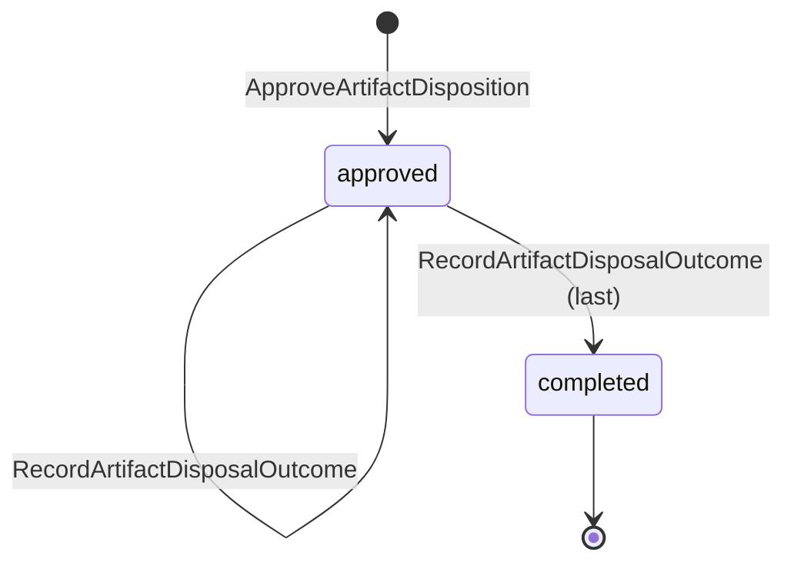
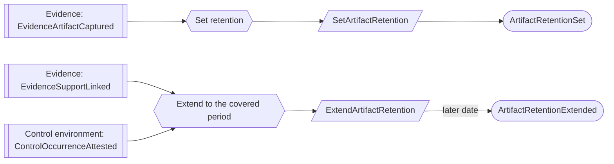
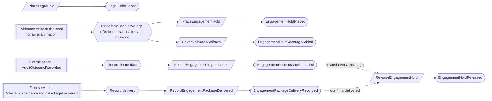
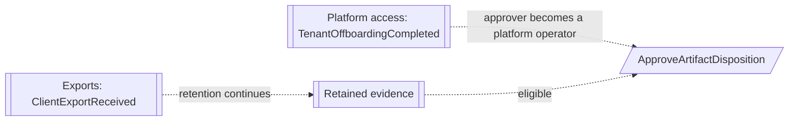

# Retention

Status: **locked**, 2026-11-03. Hand-authored source of truth for this context.
It follows the [context conventions](conventions.md).

## Purpose

Retention decides how long evidence is kept and when it may go: each artifact's
retention date, the legal and engagement holds that protect it, and the approved
dispositions that remove its content. Nothing is disposed of automatically
(M0-D16).

**Owns:** artifact retention, the organization's hold register (legal holds,
engagement holds and the final authorization of each disposal) and artifact
dispositions.

**Does not own:**

| Concern | Owner |
| --- | --- |
| Artifact content, inspection and the removal of content | [Evidence](evidence.md) (`DisposeArtifact`) |
| Report issuance | Examinations (`AuditOutcomeRecorded`) |
| Attest record package delivery | Firm services |
| The client export at offboarding | Exports |

## Language

| Term | Meaning |
| --- | --- |
| Retention date | The date until which an artifact is kept: 7 years after the end of the latest period it supports, or after its as-of date for point-in-time evidence. |
| Legal hold | An Org Admin's hold over the whole organization's evidence or a listed set of artifacts, until the Org Admin releases it. |
| Engagement hold | The hold over evidence disclosed for one examination, until one year after its report is issued and, when our firm is the auditor, until the attest record package is delivered. |
| Hold register | The organization's one record of every hold and every disposal authorization, so that a hold and a disposal of the same artifact are never decided apart (RT-06). |
| Eligible | Retention date passed and no active hold covers the artifact. |
| Disposition | An approved decision to dispose of a set of eligible artifacts, with a rationale, and the recorded outcome for each artifact. |

## Aggregates

### ArtifactRetention

**Identity:** `TenantId` + `ArtifactId`.

**Invariant:** one artifact has one retention date, which only ever moves later
(RT-01).

- It is set from the artifact's as-of date or covered period when captured, and
  extended when the artifact comes to support a later period.
- A rejected artifact has no retention; only its tombstone remains.
- The hold register reads the date as advice when it authorizes a disposal. An
  extension that lands after that authorization is recorded and shown on the
  disposition as `disposed_before_extension` (RT-07).

| Command | Who | Accepts when | Emits |
| --- | --- | --- | --- |
| SetArtifactRetention | Reactor on EvidenceArtifactCaptured | Not set; a repeat is a no-op | ArtifactRetentionSet |
| ExtendArtifactRetention | Reactor on EvidenceSupportLinked or ControlOccurrenceAttested | New date later than the current one; otherwise a no-op | ArtifactRetentionExtended |

| Event | Carries |
| --- | --- |
| ArtifactRetentionSet | tenant, artifact, basis (as-of date or period end), retained until |
| ArtifactRetentionExtended | tenant, artifact, basis, previous date, retained until |

### HoldRegister

**Identity:** `TenantId`.

**Invariant:** no artifact is authorized for disposal while an active hold
covers it. Holds and disposal authorizations are decided in this one stream, so
a hold placed and a disposal authorized at the same moment are ordered: whichever
commits first wins, and a hold is never refused (RT-06, CV-11).

- **Legal holds.** Each covers the whole organization or a listed set of
  artifacts, from placement until an Org Admin releases it. Holds are
  independent: releasing one never releases another (RT-02).
- **Engagement holds.** One per examination. The register adds the artifacts
  of each delivery or firm-staff download for the examination to the hold's
  coverage, once per delivery, not once per artifact (RT-08). The hold is released by the engagement partner when our firm is the
  auditor, or by an Org Admin for an external auditor, and only once the report
  was issued more than one year ago and, for our firm, the attest record package
  is delivered (M0-D16, M0-D27, RT-03).
- **Authorization.** The register answers each approved disposition in one
  recorded decision that lists the authorized artifacts and the refused ones
  with their reasons ([CV-10](conventions.md#reactors), RT-08). An artifact is
  refused while a hold covers it or its retention date (read as advice) has not
  passed.
- The stream grows only with holds, auditor deliveries and dispositions: a few
  dozen events a year, never one per artifact, so it stays short enough to
  replay for the organization's life ([CV-13](conventions.md#stream-growth), RT-06, RT-08).

| Command | Who | Accepts when | Emits |
| --- | --- | --- | --- |
| PlaceLegalHold | Org Admin | `HoldId` is new; scope and reason given | LegalHoldPlaced |
| ChangeLegalHoldScope | Org Admin | Active; reason given | LegalHoldScopeChanged |
| ReleaseLegalHold | Org Admin | Active; reason given | LegalHoldReleased |
| PlaceEngagementHold | Reactor on ArtifactDisclosed naming an examination | No hold for the examination; a repeat is a no-op | EngagementHoldPlaced |
| CoverDeliveredArtifacts | Reactor on ArtifactDisclosed naming an examination, grouped by its delivery or download | Hold for the examination active; artifacts already covered are skipped; a repeat for the delivery is a no-op | EngagementHoldCoverageAdded |
| RecordEngagementReportIssued | Reactor on AuditOutcomeRecorded | Hold active; a reissue moves the date later only | EngagementReportIssueRecorded |
| RecordEngagementPackageDelivered | Reactor on AttestEngagementRecordPackageDelivered | Hold active; our firm is the auditor | EngagementPackageDeliveryRecorded |
| ReleaseEngagementHold | Engagement partner (our firm), or Org Admin (external auditor) | Active; report issued more than a year ago; package delivered when our firm is the auditor | EngagementHoldReleased |
| DecideDisposition | Reactor on ArtifactDispositionApproved | Always answers for every listed artifact; a repeat for the disposition is a no-op | DispositionDecided |

| Event | Carries |
| --- | --- |
| LegalHoldPlaced | tenant, hold, scope (`organization` or artifacts), reason, placed by |
| LegalHoldScopeChanged | tenant, hold, previous scope, new scope, reason, changed by |
| LegalHoldReleased | tenant, hold, reason, released by |
| EngagementHoldPlaced | tenant, examination, auditor kind, engagement (if our firm) |
| EngagementHoldCoverageAdded | tenant, examination, delivery or download, artifacts newly covered |
| EngagementReportIssueRecorded | tenant, examination, outcome, issued at |
| EngagementPackageDeliveryRecorded | tenant, examination, package, delivered at |
| EngagementHoldReleased | tenant, examination, released by |
| DispositionDecided | tenant, disposition, authorized artifacts (each with retained until, as read), refused artifacts (each with reason: `held` with the holds, or `retention_not_elapsed`) |

### ArtifactDisposition

**Identity:** `TenantId` + `DispositionId`.

**Invariant:** one disposition approves disposing of a listed set of artifacts,
with a rationale, by an Org Admin, or by a platform operator once the tenant is
offboarded (RT-04). Its eligibility check at approval is advice; the hold
register decides each artifact. The disposition records every artifact's outcome
and completes only when each one is `disposed` or `refused`
([CV-12](conventions.md#guards-and-reviews), RT-05).

| Command | Who | Accepts when | Emits |
| --- | --- | --- | --- |
| ApproveArtifactDisposition | Org Admin; platform operator after offboarding | `DispositionId` is new; every artifact eligible (advice); rationale given | ArtifactDispositionApproved |
| RecordArtifactDisposalOutcome | Reactor on DispositionDecided (each refused artifact), EvidenceArtifactDisposed, or ArtifactRetentionExtended after disposal | Artifact listed; a repeat is a no-op | ArtifactDisposalOutcomeRecorded, and ArtifactDispositionCompleted with the last outcome |

| Event | Carries |
| --- | --- |
| ArtifactDispositionApproved | tenant, disposition, artifacts, retention bases, rationale, approved by |
| ArtifactDisposalOutcomeRecorded | tenant, disposition, artifact, outcome (`disposed`, `refused` with reason, or `disposed_before_extension`) |
| ArtifactDispositionCompleted | tenant, disposition, counts by outcome |

## Flows

Diagrams follow [CV-01](conventions.md#flow-diagrams).

### Setting and extending retention

### Holds

All of these commands are on the one `HoldRegister` stream.

### Disposition

```mermaid
flowchart LR
    RD([Retention date passed]) -. "advice" .-> C1
    C1[/ApproveArtifactDisposition/] --> E1([ArtifactDispositionApproved])
    E1 --> R1{{"Ask the register (ID from disposition)"}} --> C2[/DecideDisposition/] --> E2([DispositionDecided])
    E2 --> R2{{"Remove each authorized artifact"}} --> X1[[Evidence: DisposeArtifact]] --> E4([EvidenceArtifactDisposed])
    E2 --> R3{{"Record each refused artifact"}} --> C3[/RecordArtifactDisposalOutcome/]
    E4 --> R3
    C3 --> E5([ArtifactDisposalOutcomeRecorded])
    C3 --> E6([ArtifactDispositionCompleted])
```

### Offboarding

After offboarding, evidence is kept on the normal schedule. Active holds still
block disposal, and a platform operator approves each later disposition
(RT-04, M0-D16).

## Disagreement and replay

Cases required by [CV-12](conventions.md#guards-and-reviews).

| Case | Outcome |
| --- | --- |
| Disposition approved as eligible; a legal hold is placed before the register answers | The register refuses that artifact (`held`); the disposition records `refused` |
| Disposal authorized; a hold is placed afterwards | The authorization committed first and stands, and the content is removed. The hold's coverage shows the artifact as already authorized for disposal |
| Retention extended after authorization | The content is removed; the disposition records `disposed_before_extension` (RT-07) |
| `ArtifactDispositionApproved` delivered twice | The repeated `DecideDisposition` is a no-op (ID from the disposition) |
| Evidence removal still retrying | The disposition stays `approved` with the artifact pending; an operational alert shows the failing reactor (CV-03) |
| Artifact disclosed for an examination while its disposal is in flight | Whichever reaches the register first wins; coverage added after the decision is shown on the hold |
| Many artifacts delivered to the auditor at once | One coverage event for the delivery; the register's stream does not grow per artifact |

## Decisions

Jev answers are from `jev-1.14.0`, 2026-11-03. A yes is ≥ 0.8 and a no is ≤ 0.2.
Anything in between is settled by common sense, with the reasoning stated.

| ID | Decision | Evidence |
| --- | --- | --- |
| RT-01 | Retention is 7 years after the latest supported period end (or as-of date) and only moves later. | 0.79. M0-D16. |
| RT-02 | A legal hold covers the whole organization or listed artifacts; holds are independent. | 0.78. M0-D16. |
| RT-03 | An engagement hold is released explicitly, by the engagement partner when our firm is the auditor and by an Org Admin otherwise, only once its conditions hold. | Partner releases: 0.87. Ending on its own: 0.28. |
| RT-04 | After offboarding, evidence follows the normal schedule, and a platform operator approves each later disposition. | Keep the schedule: 0.72. Operator approves: 0.80 among the choices (firm quality partner 0.17). A disposal decision made by the client before leaving: 0.15. |
| RT-05 | A disposition completes only from each artifact's recorded outcome; artifacts the register refuses are recorded and shown. | 0.88. CV-12. |
| RT-06 | One hold register per organization owns every hold and the final authorization of each disposal. | Register: 0.82. Acceptable bottleneck: 0.77. Fanning holds out to each artifact and accepting the window: 0.29. A recoverable grace period instead: 0.15. Replaces the separate `LegalHold` and `EngagementHold` aggregates. |
| RT-07 | The retention date is advice to the register; an extension after authorization is recorded as `disposed_before_extension`. | Reserving on the retention record first: 0.33. Common sense: the date only moves later, extensions of long-expired evidence are rare, and holds are the legal protection. |
| RT-08 | The register records coverage once per delivery and decides a whole disposition in one event, so its stream grows with business occasions, not with artifacts. | One decision per disposition: 0.69. Yearly register streams carrying holds forward: 0.23 (no). Common sense: with no aggregate snapshots, a stream that grows per artifact would slow every hold decision for the organization's life. |

## Open questions

None at this time.

## Superseded owners

| Old owner | Becomes |
| --- | --- |
| ArtifactRetentionBasis | ArtifactRetention (RT-01) |
| ArtifactLegalHold, LegalHold | HoldRegister legal holds (RT-02, RT-06) |
| ArtifactEngagementHold, EngagementHold | HoldRegister engagement holds (RT-03, RT-06) |
| ArtifactDisposition | ArtifactDisposition (approval and outcomes; removal is `DisposeArtifact` in Evidence) |
| ArtifactLegalHoldReactor, ProtectArtifactsUnderLegalHoldReactor | `DecideDisposition` on the register |
| KeepEngagementEvidenceProtectedAfterDeliveryReactor | HoldRegister engagement hold reactions |
