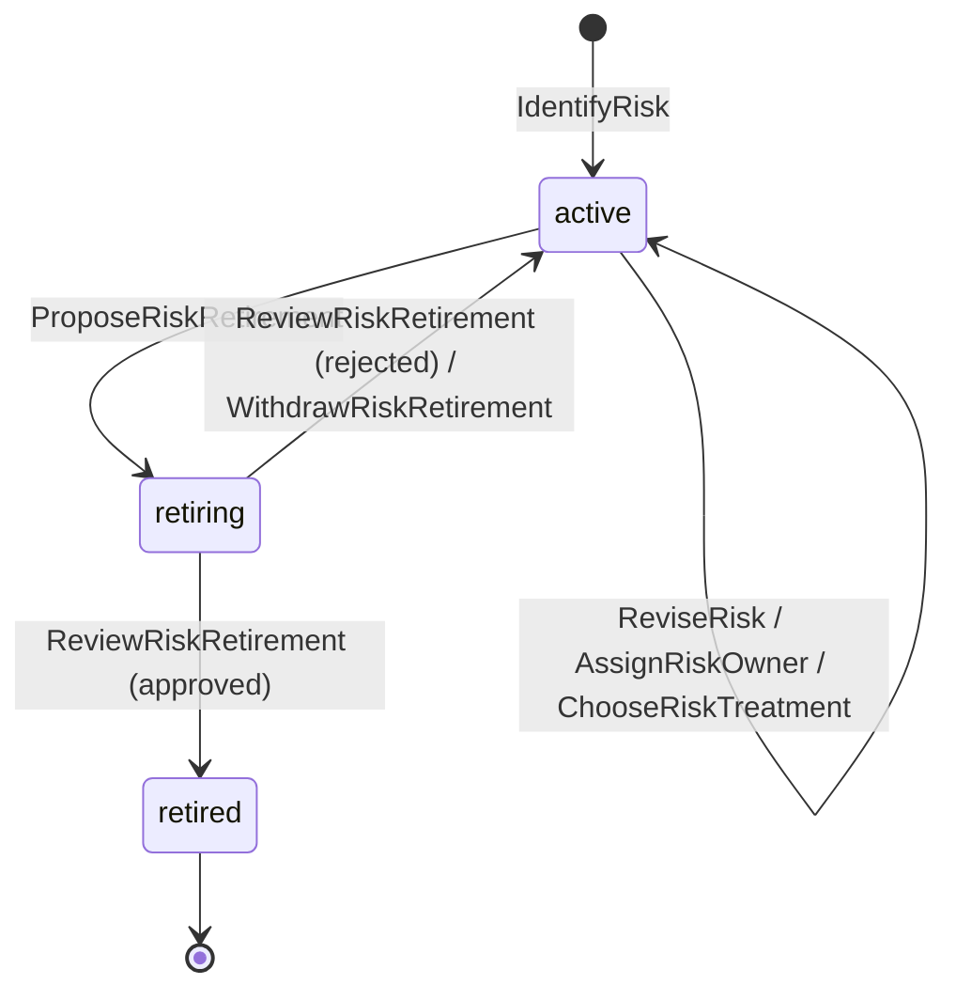
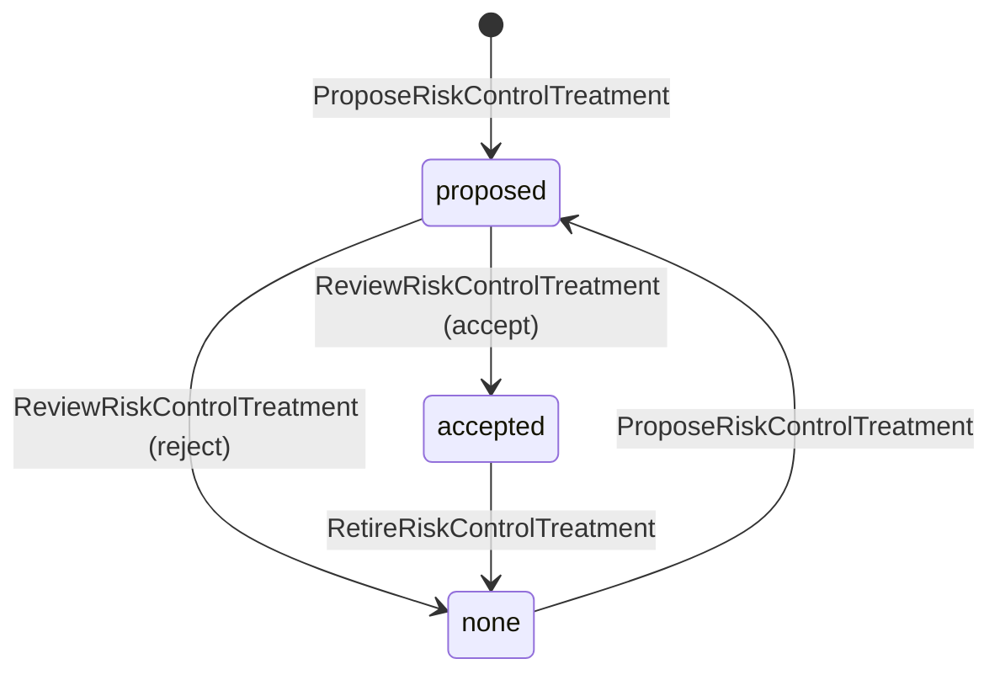
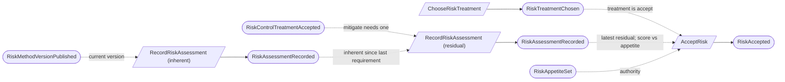
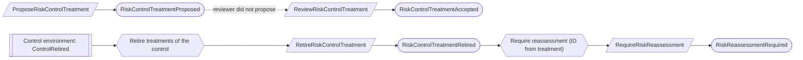
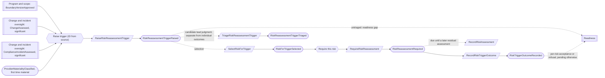
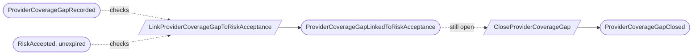

# Risk and provider oversight

Status: **refining**, 2026-11-05. Hand-authored proposal; the authority and
completeness questions below block implementation of the affected decisions.
It follows the [context conventions](conventions.md).

## Purpose

Risk and provider oversight keeps the organization's risk register and the due
diligence on its providers (vendors). Risks are assessed on a 5×5 method, treated,
and accepted within a time limit by the right authority (M0-D10). Providers are
classified by materiality, reviewed on onboarding and every year, and their
assurance gaps are tracked (M0-D11).

**Owns:** risk methods, risks, risk assessments, risk-to-control treatments, risk
acceptances, risk treatment actions, reassessment triggers, providers, provider
assurance reports, provider reviews and provider coverage gaps.

**Does not own:**

| Concern | Owner |
| --- | --- |
| Controls and their retirement | [Control environment](control-environment.md) |
| The annual risk reassessment and vendor review as recurring work | Control environment: ordinary controls, the vendor one with occurrence subject `material_provider` (M0-D19, CE-11) |
| Findings raised from a provider review or a risk | [Assurance work](assurance-work.md) (`RaiseFinding`, source `provider_review`) |
| Separation-of-duties waivers | [Platform access](platform-access.md) |
| Boundary versions and scope decisions | [Program and scope](program-and-scope.md) |
| Significant changes and incidents | [Change and incident oversight](change-and-incident-oversight.md) (M0-D21) |
| Subservice CSOC commitments | [Commitments](commitments.md) (kind `subservice_responsibility`) |
| Report and questionnaire artifacts | [Evidence](evidence.md) |

## Language

| Term | Meaning |
| --- | --- |
| Risk method | The program's qualitative 5×5 method: five described likelihood levels, five described impact levels, an appetite threshold and a reassessment interval of one year. Each change is a new method version. |
| Appetite | The highest residual score (1–25) the Compliance Lead may accept alone. While it is unset, every risk is above appetite. |
| Risk | One named risk in a program's register, with an identifier unique in the program, an owner and a chosen treatment. |
| Assessment | One immutable scoring of a risk, `inherent` (before controls) or `residual` (after treatment), against one method version. Score is likelihood × impact, never entered. |
| Treatment | How a risk is handled: `mitigate`, `accept`, `transfer` or `avoid`, with a rationale. |
| Control treatment | A reviewed statement that one control treats one risk. |
| Acceptance | A time-bounded decision, by the right authority, to accept a risk at its current residual score. |
| Treatment action | One owned piece of work that reduces a risk, with a due date and completion evidence. |
| Reassessment trigger | An event that may change risks: a boundary change, significant change, incident or new material provider, triaged by a person into the risks it affects. |
| Due for reassessment | Computed: a reassessment was required after the latest residual assessment, the latest residual assessment is older than the method's interval, or the risk's acceptance expired. |
| Provider | An outside organization the tenant relies on, with a name unique among active providers, an owner, a materiality classification and, for a subservice organization, a boundary treatment. |
| Material | A provider that stores or processes customer data (`customer_data`) or is on the critical path of an in-scope service (`critical_path`). Spend never counts. |
| Boundary treatment | For a subservice organization: `carve_out` (the default) or `inclusive`, an explicit reasoned exception. |
| Assurance report | A provider's SOC 2 Type 1 or Type 2 report, ISO/IEC 27001 certificate or completed questionnaire, with its fields and artifact. |
| Provider review | One person's due-diligence conclusion on a provider from one exact assurance report revision, with the next review due date. |
| Coverage gap | A service or period the provider's assurance does not cover, open until a Compliance Lead closes it with a reason. |

## Aggregates

### RiskMethod

**Identity:** `TenantId` + `ProgramId`.

**Invariant:** one program has one line of method versions. Each version has
complete 5×5 scales, an appetite that is unset or 1–25, and an interval of `P1Y`.
A new version replaces the current one; earlier versions stay readable because
assessments name them.

- The Compliance Lead publishes the scales. Only an Org Admin sets the appetite,
  because it limits the Compliance Lead's own acceptance authority (RP-02).
- Each change carries the other part forward unchanged into the new version.

| Command | Who | Accepts when | Emits |
| --- | --- | --- | --- |
| PublishRiskMethodVersion | Compliance Lead | Program active; both scales have five described levels; interval `P1Y`; names the current version (none for the first) | RiskMethodVersionPublished |
| SetRiskAppetite | Org Admin | A version exists; threshold 1–25 or unset; differs from the current one; names the current version; rationale given | RiskAppetiteSet |

| Event | Carries |
| --- | --- |
| RiskMethodVersionPublished | tenant, program, method version, previous version, likelihood scale, impact scale, appetite (carried), interval, published by |
| RiskAppetiteSet | tenant, program, method version, previous version, previous appetite, appetite, rationale, set by |

### Risk

**Identity:** `TenantId` + `RiskId`, where `RiskId` is derived from the program and the normalized identifier (RP-13).

**Invariant:** one risk has one identifier for life, unique in the program
including retired risks because the identity enforces it (CV-11), one owner and one chosen treatment with its rationale (RP-01). It is active until
a retirement proposal is approved by a Compliance Lead who did not propose it
(RP-07).

- Each reassessment requirement has its own source-derived identity and stream;
  a risk does not record an event for every trigger or retain a requirement
  roster. Whether reassessment is due is derived from individual requirements
  and assessments ([CV-09](conventions.md#reactors)). This design does not yet
  prove that an assessment observed all concurrent requirements.
- Choosing `mitigate` is allowed before any control treatment exists; the residual
  assessment is what needs one.
- Risk state must not retain a roster of requirements or trigger selections.
  Exact retry of an individual requirement uses a durable source-derived operation
  identity without reconstructing all prior requirements in memory. Its precise
  idempotency mechanism is an implementation gate.

| Command | Who | Accepts when | Emits |
| --- | --- | --- | --- |
| IdentifyRisk | Compliance Lead or Contributor | `RiskId` (from program and identifier) is new; program active; owner given | RiskIdentified |
| ReviseRisk | Compliance Lead, Contributor or the owner | Active; names the current revision; the identifier is not changed | RiskRevised |
| AssignRiskOwner | Compliance Lead | Active; owner is a member or an active team | RiskOwnerAssigned |
| ChooseRiskTreatment | Compliance Lead or the owner | Active; kind and rationale given; differs from the current treatment | RiskTreatmentChosen |
| ProposeRiskRetirement | Compliance Lead or the owner | Active; reason given | RiskRetirementProposed |
| WithdrawRiskRetirement | Its proposer | Retiring | RiskRetirementWithdrawn |
| ReviewRiskRetirement | Compliance Lead who did not propose it, or covered by a waiver | Retiring | RiskRetired or RiskRetirementRejected |

| Event | Carries |
| --- | --- |
| RiskIdentified | tenant, risk, program, identifier, title, description, category, owner, identified by |
| RiskRevised | tenant, risk, revision, title, description, category, revised by |
| RiskOwnerAssigned | tenant, risk, previous owner, new owner, assigned by |
| RiskTreatmentChosen | tenant, risk, previous treatment, treatment, rationale, chosen by |
| RiskRetirementProposed | tenant, risk, reason, proposed by |
| RiskRetirementWithdrawn | tenant, risk, withdrawn by |
| RiskRetired | tenant, risk, reason, reviewer, waiver (if any) |
| RiskRetirementRejected | tenant, risk, comments, reviewer |

### RiskReassessmentRequirement

**Identity:** tenant + risk + exact source reason identity, including its source
episode when a reason can recur.

**Invariant:** one accepted source reason requires reassessment of one risk;
an exact retry cannot create a second requirement and changed intent cannot
reuse its identity. This stream owns only that requirement, not the risk's other
requirements or assessments. Its active-risk admission and late-writer recovery
are unqualified; a prior read of the risk is not a retirement fence. Requirements
are retained individually even if a later assessment addresses them.

| Command | Who | Accepts when | Emits |
| --- | --- | --- | --- |
| RequireRiskReassessment | Reactor | Exact source identity and risk are bound; risk-owner admission is authoritative; exact retry is a no-op; changed intent is refused. Admission protocol remains unresolved. | RiskReassessmentRequired |

| Event | Carries |
| --- | --- |
| RiskReassessmentRequired | tenant, requirement, risk, reason (`trigger` with exact trigger, or `control_retired` with exact treatment and control), required at |

### RiskAssessment

**Identity:** `TenantId` + `AssessmentId`.

**Invariant:** one assessment begins as a draft and scores one risk once, in one phase, against the
program's current method version; its finalized score never changes. Score is likelihood ×
impact (M0-D10).

- A residual assessment requires an inherent assessment after the latest
  reassessment requirement and, for `mitigate`, at least one accepted control
  treatment. These are mutable cross-owner facts: projections and version reads
  alone cannot authorize the decision. The source owners must confirm exact
  versions under a protocol that prevents a conflicting mutation between their
  admission and the assessment decision. The protocol and recovery of unknown
  outcomes remain an implementation gate; until settled, no residual assessment
  may claim those current-state guards are enforced.
- Each treatment or action relied on is a separate assessment reference, not an
  array on the assessment. It names the exact source identity and version. A
  historical reference proves what was recorded, not that it remains current.
  A current reliance requires authoritative source admission and re-evaluation
  after invalidating source changes (RP-06). Naming the latest known requirement
  does not prove a concurrent requirement did not commit. One possible historical
  claim is to record only the exact evidence cited and show later requirements as
  separate reassessment gaps; that weakens the existing current-at-commit rule
  and is **not an approved replacement**.
- A correction is a new assessment; nothing is overwritten.

| Command | Who | Accepts when | Emits |
| --- | --- | --- | --- |
| StartRiskAssessment | Compliance Lead, Contributor or the risk owner | `AssessmentId` is new; risk identified; exact retry is a no-op | RiskAssessmentStarted |
| RecordRiskAssessment | Compliance Lead, Contributor or the risk owner | Draft; risk active; names the current method version; likelihood and impact 1–5; rationale given; residual rules above hold | RiskAssessmentRecorded |

| Event | Carries |
| --- | --- |
| RiskAssessmentStarted | tenant, assessment, risk, started by |
| RiskAssessmentRecorded | tenant, assessment, risk, phase, method version, likelihood, impact, score, above appetite, rationale, treatment at the time, assessed by; source references are separate records |

### RiskAssessmentReference

**Identity:** `TenantId` + `AssessmentId` + reference kind + source ID.

**Invariant:** one reference records one exact treatment or action revision used
by one assessment; it neither contains other references nor asserts currentness.
An individual reference does not prove the reviewer's entire selection was
captured, or that its source remains current. The assessment's exact admission
and races with source changes remain subject to the protocol gate above. Do not
replace that gate with a requirement to scan or settle every reference; any
product promise of a complete selected set remains a separate open question.

| Command | Who | Accepts when | Emits |
| --- | --- | --- | --- |
| RecordRiskAssessmentReference | Assessor | Assessment and exact source version identified; source belongs to the same tenant and risk; exact retry is a no-op; changed intent is refused | RiskAssessmentReferenceRecorded |

| Event | Carries |
| --- | --- |
| RiskAssessmentReferenceRecorded | tenant, assessment, reference kind, source ID and exact version, recorded by |

### RiskControlTreatment

**Identity:** `TenantId` + `RiskId` + `ControlId`.

**Invariant:** one control treats one risk only once a proposal with a rationale
is accepted by a reviewer who did not propose it
([CV-06](conventions.md#guards-and-reviews), RP-03). It ends when retired, and can
be proposed again after a rejection or retirement.

- A proposal is refused when the risk or the control is retired.
- When the control is retired, its treatments are retired and their risks are
  required for reassessment (RP-08).

| Command | Who | Accepts when | Emits |
| --- | --- | --- | --- |
| ProposeRiskControlTreatment | Compliance Lead, Contributor or the risk owner | None pending or accepted; risk and control active; rationale given | RiskControlTreatmentProposed |
| ReviewRiskControlTreatment | Compliance Lead who did not propose it, or covered by a waiver | Proposed | RiskControlTreatmentAccepted or RiskControlTreatmentRejected |
| RetireRiskControlTreatment | Compliance Lead, or reactor on ControlRetired | Accepted; reason given; a repeat by the reactor is a no-op | RiskControlTreatmentRetired |

| Event | Carries |
| --- | --- |
| RiskControlTreatmentProposed | tenant, risk, control, control version, rationale, proposed by |
| RiskControlTreatmentAccepted | tenant, risk, control, reviewer, waiver (if any) |
| RiskControlTreatmentRejected | tenant, risk, control, comments, reviewer |
| RiskControlTreatmentRetired | tenant, risk, control, reason (`control_retired` or a person's reason), retired by |

### RiskAcceptance

**Identity:** `TenantId` + `AcceptanceId`.

**Invariant:** one acceptance accepts one risk at one exact residual assessment
until its expiry, no more than 12 months after acceptance. It is valid only when
made by the right authority and by someone independent of the risk (M0-D10):

- The risk's treatment is `accept`, and the assessment is the risk's latest
  residual assessment.
- **Authority.** A Compliance Lead may accept when the current method has an
  appetite and the residual score is at or below it. Otherwise the approver must
  hold `risks.accept_above_appetite`.
- **Independence.** The approver is neither the risk's owner nor the residual
  assessor, unless a separation-of-duties waiver covers it (RP-04).
- Expiry is computed; an expired acceptance makes the risk due for reassessment.
  Revocation ends it early, with a reason.
- Treatment, latest assessment, authority and independence cross multiple owners.
  Their coordinated admission and the handling of competing changes are not
  specified yet. A projection or read of exact versions is insufficient. Do
  not finalize an acceptance under these guards until the protocol is defined.

| Command | Who | Accepts when | Emits |
| --- | --- | --- | --- |
| AcceptRisk | Compliance Lead, or holder of `risks.accept_above_appetite` | `AcceptanceId` is new; rules above hold; expiry after now and within 12 months; rationale given | RiskAccepted |
| RevokeRiskAcceptance | Compliance Lead, or holder of `risks.accept_above_appetite` | Accepted; unexpired; reason given | RiskAcceptanceRevoked |

| Event | Carries |
| --- | --- |
| RiskAccepted | tenant, acceptance, risk, residual assessment, score, appetite, authority (`compliance_lead` or `above_appetite`), expires at, rationale, approver, waiver (if any) |
| RiskAcceptanceRevoked | tenant, acceptance, reason, revoked by |

### RiskTreatmentAction

**Identity:** `TenantId` + `ActionId`, for one risk for life.

**Invariant:** one action has one owner, a description and a due date, and is
open, then completed with evidence or cancelled with a reason. Completion has no
separate review; the residual assessment that relies on it names it (RP-06).

- An action is added only while its risk is active. Past its due date and not
  completed, it is overdue: a computed gap.

| Command | Who | Accepts when | Emits |
| --- | --- | --- | --- |
| AddRiskTreatmentAction | Compliance Lead or the risk owner | `ActionId` is new; risk active | RiskTreatmentActionAdded |
| ChangeRiskTreatmentAction | Compliance Lead or the risk owner | Open | RiskTreatmentActionChanged |
| CompleteRiskTreatmentAction | The action's owner or Compliance Lead | Open; completion evidence given | RiskTreatmentActionCompleted |
| CancelRiskTreatmentAction | Compliance Lead | Open; reason given | RiskTreatmentActionCancelled |

| Event | Carries |
| --- | --- |
| RiskTreatmentActionAdded | tenant, action, risk, description, owner, due date, added by |
| RiskTreatmentActionChanged | tenant, action, changed fields (description, owner, due date), changed by |
| RiskTreatmentActionCompleted | tenant, action, one evidence artifact version, note, completed by |
| RiskTreatmentActionCancelled | tenant, action, reason, cancelled by |

### RiskReassessmentTrigger

**Identity:** `TenantId` + `TriggerId`, derived from the source event
([CV-02](conventions.md#reactors)).

**Invariant:** one trigger records one event that may change risks in one
program. A Compliance Lead determines affected risks or records why none are
affected (RP-05). Each selection and its result is independently owned below;
the trigger never carries a roster. Unfinished or indeterminate triage remains
a visible readiness gap.

- Kind is `boundary_change`, `significant_change`, `incident`,
  `new_material_provider` or `manual`, with the exact source record. An expired
  acceptance and the annual interval need no trigger; both are computed.
- A tenant-level source (a provider) raises one trigger per active program, with
  an ID derived from the source and the program.
- A completed triage is never reopened. A subsequently discovered risk is named
  by a `manual` trigger. The former proposal required a cut and a terminal
  outcome for **every** selected risk before recording triage: that is an
  all-child write decision, even if the cut is streamed or segmented, and is
  withdrawn as a design. RP-05 still requires a lead's affected-risk decision
  or a reason that none are affected.
- **Candidate, not approved:** record the lead's triage judgment independently;
  each affected-risk selection and reassessment requirement has its own durable
  outcome. The user can see `triage submitted`, a particular requirement's
  pending/accepted/refused state and any associated gap. A submitted judgment
  does **not** prove every selected requirement was accepted. Treating submission
  as completion changes the earlier all-outcomes-terminal guarantee and must be
  explicitly resolved; the UI and readiness consumer must not conflate them.
  A `none affected` judgment is the lead's attributed determination, not a proof
  that an eventually consistent projection contains no selected risks. Authority
  for late selection, no-affected decisions and competing submissions remains
  unresolved; unknown target outcomes remain pending.

| Command | Who | Accepts when | Emits |
| --- | --- | --- | --- |
| RaiseRiskReassessmentTrigger | Reactor, or Compliance Lead (kind `manual`) | `TriggerId` is new; program active; a repeat is a no-op | RiskReassessmentTriggerRaised |
| TriageRiskReassessmentTrigger | Compliance Lead | **Candidate only:** one attributed triage judgment for the trigger; `none affected` needs a reason; admission and late-selection rules unresolved. Does not claim all individual outcomes settled. | RiskReassessmentTriggerTriaged |

| Event | Carries |
| --- | --- |
| RiskReassessmentTriggerRaised | tenant, trigger, program, kind, source record, summary, raised by |
| RiskReassessmentTriggerTriaged | **Candidate only:** tenant, trigger, attributed lead judgment, reason when none, triaged by; no child list, set-wide completion proof or claim that each selection was applied |

### RiskTriggerDisposition

**Identity:** `TenantId` + `TriggerId` + `RiskId`.

**Invariant:** one lead's selection of one risk for one trigger has one durable
outcome. The requirement owner independently accepts the reassessment requirement or
returns an explicit terminal rejection (for example, retirement); an unknown
outcome stays pending and is retried using the same operation identity. A rejected
selection requires an explicit lead disposition; whether it blocks a separate
completion claim remains an open product rule. This
record does not establish that all selections have been admitted.

| Command | Who | Accepts when | Emits |
| --- | --- | --- | --- |
| SelectRiskForTrigger | Compliance Lead | Trigger and risk belong to the same program; source-bound admission is permitted; exact retry is a no-op and changed intent is refused | RiskForTriggerSelected |
| RecordRiskTriggerOutcome | Reactor | Same selection and operation identity; authoritative risk outcome received; exact retry is a no-op | RiskTriggerOutcomeRecorded |

| Event | Carries |
| --- | --- |
| RiskForTriggerSelected | tenant, trigger, risk, source cut, selected by |
| RiskTriggerOutcomeRecorded | tenant, trigger, risk, operation identity, accepted or rejected outcome, reason, source version |

### Provider

**Identity:** `TenantId` + `ProviderId`.

**Invariant:** one provider has one name, one owner, and at most
one current materiality classification and boundary treatment. It is active until
retired.

- `material` needs a basis of `customer_data`, `critical_path` or both, and a
  rationale; `not_material` needs only a rationale (M0-D11).
- Names should be unique among active providers: advice checked when a name is
  set, with the `duplicate_provider_name` gap and a rename to repair it (RP-09).
- A subservice organization is `carve_out` unless an `inclusive` treatment is set
  with a rationale.

| Command | Who | Accepts when | Emits |
| --- | --- | --- | --- |
| RegisterProvider | Compliance Lead or Contributor | `ProviderId` is new; owner given; duplicate-name check is advisory and creates a gap, not authoritative admission | ProviderRegistered |
| ReviseProvider | Compliance Lead, Contributor or the owner | Active; names the current revision; duplicate-name check is advisory and creates a gap | ProviderRevised |
| AssignProviderOwner | Compliance Lead | Active | ProviderOwnerAssigned |
| ClassifyProviderMateriality | Compliance Lead | Active; basis rules hold; differs from the current classification | ProviderMaterialityClassified |
| SetProviderSubservice | Compliance Lead | Active; `inclusive` needs a rationale | ProviderSubserviceSet |
| RetireProvider | Compliance Lead | Active; reason given | ProviderRetired |

| Event | Carries |
| --- | --- |
| ProviderRegistered | tenant, provider, name, kind, owner, registered by |
| ProviderRevised | tenant, provider, revision, name, kind, revised by |
| ProviderOwnerAssigned | tenant, provider, previous owner, new owner, assigned by |
| ProviderMaterialityClassified | tenant, provider, previous materiality, materiality, basis, rationale, first time material, classified by |
| ProviderSubserviceSet | tenant, provider, subservice, boundary treatment, rationale, set by |
| ProviderRetired | tenant, provider, reason, retired by |

### ProviderServiceUse

**Identity:** `TenantId` + `ProviderId` + `ServiceId`.

**Invariant:** one independently governed provider-service relationship is
active or ended. It contains no roster of services. This records the service
used by the organization, not a claim that a provider report covers it; that
claim belongs to an exact report item and its review outcome.

| Command | Who | Accepts when | Emits |
| --- | --- | --- | --- |
| RecordProviderServiceUse | Compliance Lead or Contributor | Provider and service identified; relationship is not active; exact retry is a no-op | ProviderServiceUseRecorded |
| EndProviderServiceUse | Compliance Lead or Contributor | Relationship active; reason given; exact retry is a no-op | ProviderServiceUseEnded |

| Event | Carries |
| --- | --- |
| ProviderServiceUseRecorded | tenant, provider, service, recorded by |
| ProviderServiceUseEnded | tenant, provider, service, reason, ended by |

### ProviderAssuranceReport

**Identity:** `TenantId` + `ReportId`, for one provider for life.

**Invariant:** one report records one provider's assurance document with the
M0-D11 fields and its artifact version. Corrections make new revisions; a review
names the exact revision it read.

- Kind is `soc2_type1`, `soc2_type2`, `iso27001` or `questionnaire`. A SOC 2
  Type 2 report has a period; the others have a point-in-time date.
- A bridge letter (period and date) is added as a correction when the report
  period ends before the organization's need.
- Covered services, exceptions, CUECs and noted gaps are separate report item
  records bound to an exact report revision and source location; the report
  retains no item roster. The artifact remains evidence, not aggregate state.
  Each item is independently identified and has bounded content.

| Command | Who | Accepts when | Emits |
| --- | --- | --- | --- |
| RecordProviderAssuranceReport | Compliance Lead or Contributor | `ReportId` is new; provider active; fields complete for the kind; artifact version is accepted evidence | ProviderAssuranceReportRecorded |
| CorrectProviderAssuranceReport | Compliance Lead or Contributor | Names the current revision; reason given; only scalar fields or one artifact reference, never an item list | ProviderAssuranceReportCorrected |

| Event | Carries |
| --- | --- |
| ProviderAssuranceReportRecorded | tenant, report, provider, revision, kind, period or as-of date, issuing firm, opinion, bridge letter reference, artifact version, recorded by |
| ProviderAssuranceReportCorrected | tenant, report, revision, changed fields, reason, corrected by |

### ProviderReview

**Identity:** `TenantId` + `ReviewId`.

**Invariant:** one review starts as a draft and records one person's due-diligence conclusion on one
provider from one exact report revision; the finalized conclusion never changes (M0-D11):

- The evidence kind is the report's kind. A `questionnaire` review states that
  the provider has no SOC 2 report or ISO/IEC 27001 certificate (RP-10).
- The next review is due after the review date and, for a material provider,
  within 12 months of it. A material provider whose latest review's due date has
  passed is a computed readiness gap.
- Conclusion is `acceptable`, `acceptable_with_gaps` or `not_acceptable`. Each
  gap and each CUEC adoption is a separate result tied to this review and the
  relevant exact report item; neither is an array on the review. A result
  naming a gap directly creates one independently owned coverage gap.
- The former candidate finalized a review only after a cut and terminal results
  for **all** report items. That is an all-child write decision and is withdrawn;
  paging the cut or splitting admissions does not change it. M0-D11 requires the
  report fields and a review, but does not by itself establish that every piece
  of the source artifact must be represented by a separate application record.
- **Candidate, not approved:** a reviewer records an attributed conclusion on
  one exact source artifact and report revision; individual extraction and gap
  decisions remain separate. This can record what the person reviewed, but does
  not mechanically prove every exception or CUEC was extracted, nor that every
  item has a result. If the product promises complete extraction or settlement
  as a precondition, that stronger guarantee remains unresolved; do not present
  the candidate as equivalent. A human's attestation must remain distinguishable
  from a mechanically verified item universe.
- A possible local precondition for `acceptable_with_gaps` is one immutable,
  accepted, exact-report gap result as a witness. The witness proves one gap,
  not all gaps. Gap-result acceptance, report correction/retirement races and
  exact review authorization remain unqualified. No conclusion may assert more
  than the record and its admission actually establish.
- The vendor-review control occurrence for the provider cites the review as
  evidence (M0-D19, RP-11).

| Command | Who | Accepts when | Emits |
| --- | --- | --- | --- |
| StartProviderReview | Compliance Lead or Contributor | `ReviewId` is new; provider and exact report revision identified; exact retry is a no-op | ProviderReviewStarted |
| RecordProviderReview | Compliance Lead or Contributor | **Candidate only:** draft; provider/report admission and exact report revision established; reviewer attributes the conclusion and any required one-gap witness. Cross-owner authority and product semantics remain unresolved. | ProviderReviewRecorded |

| Event | Carries |
| --- | --- |
| ProviderReviewStarted | tenant, review, provider, report, report revision, started by |
| ProviderReviewRecorded | **Candidate only:** tenant, review, provider, report, report revision, evidence kind, no SOC 2 or ISO statement (questionnaire), attributed conclusion, optional one accepted gap witness, next review due, reviewed by; no item list or all-results proof |

### ProviderReportItem

**Identity:** `TenantId` + `ReportId` + report revision + item ID.

**Invariant:** one item describes one covered service, exception, CUEC or noted
gap from one exact source revision and location. It is not a list of other items.
A correction creates source-bound items for the new revision; earlier items stay
historical. A link to an artifact location does not prove that all source items
have been captured.

| Command | Who | Accepts when | Emits |
| --- | --- | --- | --- |
| RecordProviderReportItem | Compliance Lead or Contributor | Exact report revision and source location exist; item ID is new; exact retry is a no-op; changed intent is refused | ProviderReportItemRecorded |

| Event | Carries |
| --- | --- |
| ProviderReportItemRecorded | tenant, report, report revision, item, kind, bounded description, exact source location, recorded by |

### ProviderReviewItemResult

**Identity:** `TenantId` + `ReviewId` + item ID.

**Invariant:** one independently recorded result states a reviewer's disposition
of one exact report item, including CUEC adoption or a gap where applicable.
No result contains a collection. The result alone proves neither complete report
extraction nor complete review.

| Command | Who | Accepts when | Emits |
| --- | --- | --- | --- |
| RecordProviderReviewItemResult | Reviewer | Review and exact source-bound item belong to the same report revision; same ID and intent retry is a no-op; changed intent is refused | ProviderReviewItemResultRecorded |

| Event | Carries |
| --- | --- |
| ProviderReviewItemResultRecorded | tenant, review, item, exact report revision, disposition, optional one gap ID, rationale, recorded by |

### ProviderCoverageGap

**Identity:** `TenantId` + `GapId`; a gap from a review takes an ID derived from
the review and its independently identified gap result (CV-02).

**Invariant:** one gap records one uncovered service or period of one provider,
open until a Compliance Lead closes it with a reason and evidence such as a later
report. Linking a risk acceptance never closes it (RP-12).

| Command | Who | Accepts when | Emits |
| --- | --- | --- | --- |
| RecordProviderCoverageGap | Reactor on ProviderReviewItemResultRecorded, or Compliance Lead | `GapId` is new; provider active; a repeat is a no-op | ProviderCoverageGapRecorded |
| LinkProviderCoverageGapToRiskAcceptance | Compliance Lead | Open; acceptance accepted and unexpired; not already linked | ProviderCoverageGapLinkedToRiskAcceptance |
| CloseProviderCoverageGap | Compliance Lead | Open; reason and evidence given | ProviderCoverageGapClosed |

| Event | Carries |
| --- | --- |
| ProviderCoverageGapRecorded | tenant, gap, provider, source review (if any), one uncovered service or one period, description, recorded by |
| ProviderCoverageGapLinkedToRiskAcceptance | tenant, gap, acceptance, linked by |
| ProviderCoverageGapClosed | tenant, gap, reason, one evidence reference (report revision or artifact version), closed by |

## Flows

Diagrams follow [CV-01](conventions.md#flow-diagrams).

### Assessing and accepting a risk

### Control treatment

### Reassessment triggers

### Provider due diligence

```mermaid
flowchart LR
    C1[/RegisterProvider/] --> E1([ProviderRegistered])
    E1 -. checks .-> C2[/ClassifyProviderMateriality/] --> E2([ProviderMaterialityClassified])
    C3[/RecordProviderAssuranceReport/] --> E3([ProviderAssuranceReportRecorded])
    E3 -. "exact revision" .-> C8[/StartProviderReview/] --> E8([ProviderReviewStarted])
    E3 -. "exact revision" .-> C6[/RecordProviderReportItem/] --> E6([ProviderReportItemRecorded])
    E8 -. draft .-> C7[/RecordProviderReviewItemResult/]
    E6 -. "one item" .-> C7 --> E7([ProviderReviewItemResultRecorded])
    E7 --> R1{{"Record this gap, if any"}} --> C5[/RecordProviderCoverageGap/] --> E5([ProviderCoverageGapRecorded])
    E8 -. "candidate: attributed conclusion for exact source" .-> C4[/RecordProviderReview/] --> E4([ProviderReviewRecorded])
    E7 -. "optional one-gap witness; not a complete set" .-> C4
    E4 -. "cited as evidence" .-> X1[[Control environment: vendor review occurrence]]
    E4 -. "not acceptable: a person may raise" .-> X2[[Assurance work: RaiseFinding]]
```

### Accepting a coverage gap

## Computed gaps

| Gap | Shown when |
| --- | --- |
| Risk due for reassessment | A requirement after the latest residual assessment, no residual assessment within the interval, or an expired acceptance |
| Untriaged trigger | A reassessment trigger has no qualified triage decision; an independent submitted judgment does not by itself prove selected requirements are settled. Pending/refused per-risk outcomes remain visible as separate gaps. |
| Overdue treatment action | Past its due date and open |
| Unclassified provider | An active provider has no materiality classification |
| Provider review due | A material provider has no review, or its latest review's due date has passed |
| Duplicate provider name | Two active providers share a normalized name (RP-09) |
| Carve-out without CSOC | A `carve_out` subservice organization has no active `subservice_responsibility` commitment (M0-D11) |
| Open coverage gap | Open, with or without a linked acceptance |

## Authorization contract

- `risks.accept_above_appetite` is a product-defined permission. The built-in Org
  Admin role includes it; an Org Admin can add it to a custom role for an
  executive.
- Setting appetite is an Org Admin action.

## Decisions

Jev answers are from `jev-1.14.0`, 2026-11-03. The historical review used 0.8
and 0.2 as triage thresholds, not as measured probabilities of design correctness.
Conflicting or inconclusive answers remain open until resolved with evidence.

| ID | Decision | Evidence |
| --- | --- | --- |
| RP-01 | A risk's treatment and rationale are a named fact on the risk. | 0.85. M0-D10. |
| RP-02 | An Org Admin sets the appetite, not the Compliance Lead. | Compliance Lead setting their own limit is a conflict: 0.72. Executive-only: 0.45. Common sense: the appetite bounds the Compliance Lead's own authority, and the Org Admin is the organization's accountable role. |
| RP-03 | A control treatment needs a reviewer who did not propose it. | 0.55. Common sense: it is an audit-facing coverage claim, reviewed like a control mapping (CE) and under CV-06. |
| RP-04 | An acceptance's approver is neither the risk owner nor the residual assessor, unless a separation-of-duties waiver covers it. | 0.69. Common sense: M0-D10 already excludes the owner; the assessor set the score being accepted. |
| RP-05 | A reassessment trigger is triaged by a Compliance Lead into the affected risks, or none with a reason; an untriaged trigger is a readiness gap. | Flag every risk: 0.11 (no). Triage: 0.79. Untriaged gap: 0.77. Common sense: triage is the only option that is neither noise nor silent. |
| RP-06 | A treatment action completes on its owner's word with evidence, with no separate review; the residual assessment names the actions it relies on. | Completion review: 0.52. Harm without review: 0.76. Common sense: the residual assessment is the second look, and the acceptance approver is independent of the assessor (RP-04). |
| RP-07 | Retiring a risk needs a Compliance Lead who did not propose it. | 0.71. Common sense: removing a risk hides it from audit, as retiring a control does (CE). |
| RP-08 | When a control is retired, its treatments are retired and their risks are required for reassessment. | Common sense: CV-08 records the truth, and the risk's residual score may no longer hold. |
| RP-09 | Provider names should be unique among active providers: advice with a duplicate gap and a rename to repair it, with no reservation record. | 0.71. Display names owned: 0.61. Common sense: CV-05. |
| RP-10 | A questionnaire review states that no SOC 2 report or ISO/IEC 27001 certificate exists. | 0.73. M0-D11. |
| RP-11 | A provider review is its own record; the vendor-review control occurrence cites it as evidence. | 0.50. Common sense: M0-D11 needs the due-diligence fields and M0-D19 needs the occurrence; citing joins them without duplication. |
| RP-12 | Coverage gaps from a review are separate records, closed by a Compliance Lead with a reason; linking an acceptance never closes one. | 0.69. Common sense: matches AW-08. |
| RP-13 | A risk's ID is derived from its program and identifier, so the identifier is unique for life, including retired risks, and never changes. | Owned identifiers for audit-facing codes: 0.75 (CV-11). |

## Open questions

- Decide whether the lead's triage submission may be recorded while individually
  selected requirements remain pending, or whether a stronger all-outcomes
  completion promise is required. The old collection-wide cut is withdrawn.
  Specify no-affected/late-selection authority, exact per-risk refusal, unknown
  outcome, deduplication and recovery. Do not let a projected zero prove absence.
- Resolve whether the product requires mechanically complete report extraction
  before a review can be recorded. A conclusion on an exact artifact is a person's
  attributed judgment, not proof every required item exists or has an outcome.
  Define correction, evidence provenance and single-gap witness admission; keep
  any stronger completion semantics open until an acceptable local design exists.
- Define atomic source-owner admission and recovery for assessment and
  acceptance guards, including risk retirement, new reassessment requirement,
  treatment retirement, new assessment and appetite changes. Exact versions and
  eventual invalidation alone cannot prove facts were current at commit. Until
  settled, current-state decisions are not implementation-ready.
- Specify provider-service association authority and its relationship to report
  items; no Provider event may acquire an unbounded `services used` list.
- Prove one-reason-per-risk requirement identity, active-risk admission, exact
  retry and ordering against concurrent assessments and retirements; the latter
  cannot be decided from the last projection observed. Specify finite content
  bounds for individual authored fields at implementation.

## Superseded owners

| Old owner | Becomes |
| --- | --- |
| RiskMethod | RiskMethod (appetite set separately, RP-02) |
| RiskDraft, RiskGovernance | Risk (ID derived from the identifier, as RiskDraft did; RP-13) |
| RiskEvaluation | RiskAssessment and RiskAcceptance |
| RiskTreatmentAssertion | RiskControlTreatment |
| RiskTreatmentAction | RiskTreatmentAction (no completion review, RP-06) |
| Provider | Provider |
| ProviderNameClaim | Current-state check on Provider (RP-09) |
| ProviderAssuranceReport | ProviderAssuranceReport |
| ProviderAssuranceReview | ProviderReview |
| ProviderAssuranceGap | ProviderCoverageGap |
| ProviderRiskAcceptance | `LinkProviderCoverageGapToRiskAcceptance` |
| BoundaryRiskReassessmentReactor, RequestRiskReassessmentWhenRiskChangesReactor, RiskMethodReassessmentReactor, RiskEvaluationReactor | Reassessment triggers and triage (RP-05); the annual interval is computed |
| RiskActionCompletionReviewReactor and process | Removed (RP-06) |
| KeepProviderNamesUniqueReactor, ProviderChangeAcceptedReactor, ProviderNameChangeProcess | Current-state check (RP-09) |
| ProviderReviewReactor, ProviderReviewProcess, RecordProviderAssuranceReportReviewReactor | `RecordProviderReview` |
| ProviderRiskAcceptanceLinkReactor, KeepRiskAcceptanceWithProviderGapReactor | `LinkProviderCoverageGapToRiskAcceptance` |

## Boundary review, 2026-11-05

[Jev request](../reviews/risk-boundaries-jev-request.json) and
[response](../reviews/risk-boundaries-jev-response.json) retain the exact live
probe. Jev judged the unfenced trigger completeness claim 0.09 and its race
0.93; separate report items alone prove completeness 0.05; bare version reads
prove currentness at commit 0.10. It assessed the explicitly historical claim
0.98 and the fixed 5×5 method bound 0.97. These are advisory signals, not proof.
The unresolved protocols above are explicit release gates. The method remains
fixed-size; ordinary limits on each textual description still apply.

The [independent-decision review](../reviews/risk-independent-decisions.md)
records the narrower triage, provider-review and per-reason candidates, their
product-semantic differences, and the adversarial Jev results. These candidates
do not authorize implementing the still-unqualified coordination.
