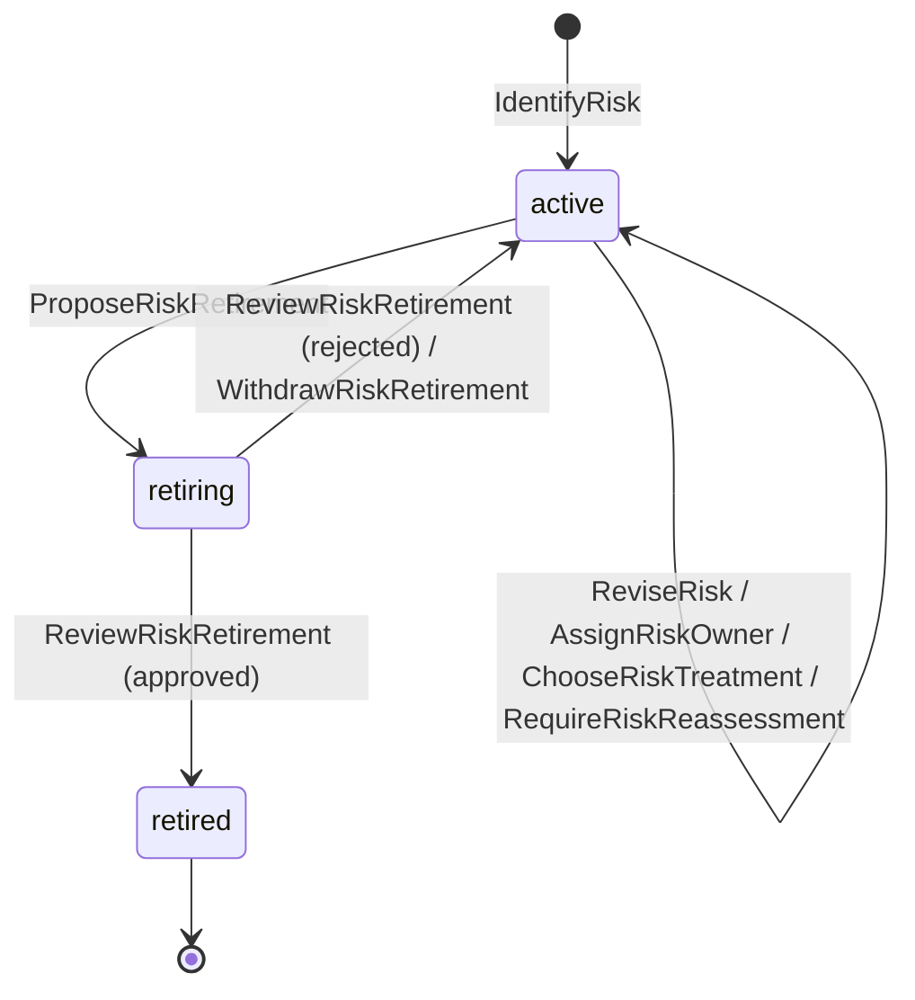
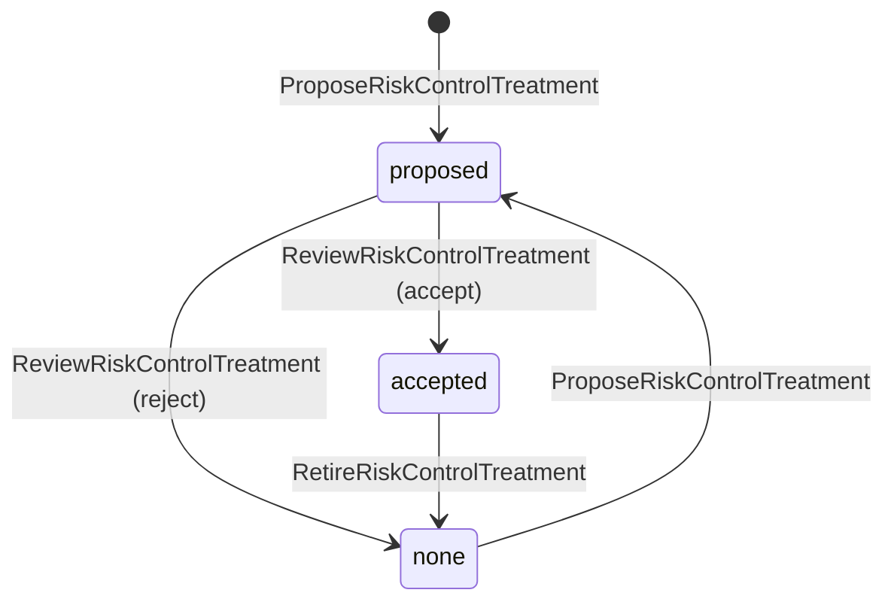
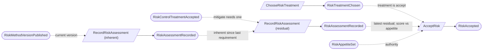
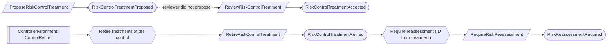
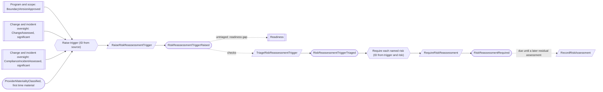
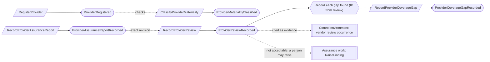
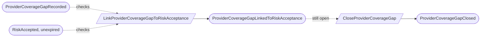

# Risk and provider oversight

Status: **locked**, 2026-11-03. Hand-authored source of truth for this context.
It follows the [context conventions](conventions.md).

## Purpose

Risk and provider oversight keeps the organization's risk register and the due
diligence on its providers (vendors). Risks are assessed on a 5×5 method, treated,
and accepted within a time limit by the right authority (M0-D10). Providers are
classified by materiality, reviewed on onboarding and every year, and their
assurance gaps are tracked (M0-D11).

**Owns:** risk methods, risks, risk assessments, risk-to-control treatments, risk
acceptances, risk treatment actions, reassessment triggers, providers, provider
assurance reports, provider reviews and provider coverage gaps.

**Does not own:**

| Concern | Owner |
| --- | --- |
| Controls and their retirement | [Control environment](control-environment.md) |
| The annual risk reassessment and vendor review as recurring work | Control environment: ordinary controls, the vendor one with occurrence subject `material_provider` (M0-D19, CE-11) |
| Findings raised from a provider review or a risk | [Assurance work](assurance-work.md) (`RaiseFinding`, source `provider_review`) |
| Separation-of-duties waivers | [Platform access](platform-access.md) |
| Boundary versions and scope decisions | [Program and scope](program-and-scope.md) |
| Significant changes and incidents | [Change and incident oversight](change-and-incident-oversight.md) (M0-D21) |
| Subservice CSOC commitments | [Commitments](commitments.md) (kind `subservice_responsibility`) |
| Report and questionnaire artifacts | [Evidence](evidence.md) |

## Language

| Term | Meaning |
| --- | --- |
| Risk method | The program's qualitative 5×5 method: five described likelihood levels, five described impact levels, an appetite threshold and a reassessment interval of one year. Each change is a new method version. |
| Appetite | The highest residual score (1–25) the Compliance Lead may accept alone. While it is unset, every risk is above appetite. |
| Risk | One named risk in a program's register, with an identifier unique in the program, an owner and a chosen treatment. |
| Assessment | One immutable scoring of a risk, `inherent` (before controls) or `residual` (after treatment), against one method version. Score is likelihood × impact, never entered. |
| Treatment | How a risk is handled: `mitigate`, `accept`, `transfer` or `avoid`, with a rationale. |
| Control treatment | A reviewed statement that one control treats one risk. |
| Acceptance | A time-bounded decision, by the right authority, to accept a risk at its current residual score. |
| Treatment action | One owned piece of work that reduces a risk, with a due date and completion evidence. |
| Reassessment trigger | An event that may change risks: a boundary change, significant change, incident or new material provider, triaged by a person into the risks it affects. |
| Due for reassessment | Computed: a reassessment was required after the latest residual assessment, the latest residual assessment is older than the method's interval, or the risk's acceptance expired. |
| Provider | An outside organization the tenant relies on, with a name unique among active providers, an owner, a materiality classification and, for a subservice organization, a boundary treatment. |
| Material | A provider that stores or processes customer data (`customer_data`) or is on the critical path of an in-scope service (`critical_path`). Spend never counts. |
| Boundary treatment | For a subservice organization: `carve_out` (the default) or `inclusive`, an explicit reasoned exception. |
| Assurance report | A provider's SOC 2 Type 1 or Type 2 report, ISO/IEC 27001 certificate or completed questionnaire, with its fields and artifact. |
| Provider review | One person's due-diligence conclusion on a provider from one exact assurance report revision, with the next review due date. |
| Coverage gap | A service or period the provider's assurance does not cover, open until a Compliance Lead closes it with a reason. |

## Aggregates

### RiskMethod

**Identity:** `TenantId` + `ProgramId`.

**Invariant:** one program has one line of method versions. Each version has
complete 5×5 scales, an appetite that is unset or 1–25, and an interval of `P1Y`.
A new version replaces the current one; earlier versions stay readable because
assessments name them.

- The Compliance Lead publishes the scales. Only an Org Admin sets the appetite,
  because it limits the Compliance Lead's own acceptance authority (RP-02).
- Each change carries the other part forward unchanged into the new version.

| Command | Who | Accepts when | Emits |
| --- | --- | --- | --- |
| PublishRiskMethodVersion | Compliance Lead | Program active; both scales have five described levels; interval `P1Y`; names the current version (none for the first) | RiskMethodVersionPublished |
| SetRiskAppetite | Org Admin | A version exists; threshold 1–25 or unset; differs from the current one; names the current version; rationale given | RiskAppetiteSet |

| Event | Carries |
| --- | --- |
| RiskMethodVersionPublished | tenant, program, method version, previous version, likelihood scale, impact scale, appetite (carried), interval, published by |
| RiskAppetiteSet | tenant, program, method version, previous version, previous appetite, appetite, rationale, set by |

### Risk

**Identity:** `TenantId` + `RiskId`, where `RiskId` is derived from the program and the normalized identifier (RP-13).

**Invariant:** one risk has one identifier for life, unique in the program
including retired risks because the identity enforces it (CV-11), one owner and one chosen treatment with its rationale (RP-01). It is active until
a retirement proposal is approved by a Compliance Lead who did not propose it
(RP-07).

- Each reassessment requirement is recorded on the risk with its reason. Whether
  the risk is due for reassessment is computed ([CV-09](conventions.md#reactors)).
- Choosing `mitigate` is allowed before any control treatment exists; the residual
  assessment is what needs one.

| Command | Who | Accepts when | Emits |
| --- | --- | --- | --- |
| IdentifyRisk | Compliance Lead or Contributor | `RiskId` (from program and identifier) is new; program active; owner given | RiskIdentified |
| ReviseRisk | Compliance Lead, Contributor or the owner | Active; names the current revision; the identifier is not changed | RiskRevised |
| AssignRiskOwner | Compliance Lead | Active; owner is a member or an active team | RiskOwnerAssigned |
| ChooseRiskTreatment | Compliance Lead or the owner | Active; kind and rationale given; differs from the current treatment | RiskTreatmentChosen |
| RequireRiskReassessment | Reactor | Active; a repeat for the same reason source is a no-op | RiskReassessmentRequired |
| ProposeRiskRetirement | Compliance Lead or the owner | Active; reason given | RiskRetirementProposed |
| WithdrawRiskRetirement | Its proposer | Retiring | RiskRetirementWithdrawn |
| ReviewRiskRetirement | Compliance Lead who did not propose it, or covered by a waiver | Retiring | RiskRetired or RiskRetirementRejected |

| Event | Carries |
| --- | --- |
| RiskIdentified | tenant, risk, program, identifier, title, description, category, owner, identified by |
| RiskRevised | tenant, risk, revision, title, description, category, revised by |
| RiskOwnerAssigned | tenant, risk, previous owner, new owner, assigned by |
| RiskTreatmentChosen | tenant, risk, previous treatment, treatment, rationale, chosen by |
| RiskReassessmentRequired | tenant, risk, reason (`trigger` with the trigger, or `control_retired` with the control), required at |
| RiskRetirementProposed | tenant, risk, reason, proposed by |
| RiskRetirementWithdrawn | tenant, risk, withdrawn by |
| RiskRetired | tenant, risk, reason, reviewer, waiver (if any) |
| RiskRetirementRejected | tenant, risk, comments, reviewer |

### RiskAssessment

**Identity:** `TenantId` + `AssessmentId`.

**Invariant:** one assessment scores one risk once, in one phase, against the
program's current method version, and never changes. Score is likelihood ×
impact (M0-D10).

- A residual assessment is refused unless an inherent assessment of the risk was
  recorded since its latest reassessment requirement, and, when the treatment is
  `mitigate`, at least one accepted control treatment exists for the risk
  (checked against current state).
- A residual assessment names the completed treatment actions and accepted
  control treatments it relies on (RP-06).
- A correction is a new assessment; nothing is overwritten.

| Command | Who | Accepts when | Emits |
| --- | --- | --- | --- |
| RecordRiskAssessment | Compliance Lead, Contributor or the risk owner | `AssessmentId` is new; risk active; names the current method version; likelihood and impact 1–5; rationale given; residual rules above hold | RiskAssessmentRecorded |

| Event | Carries |
| --- | --- |
| RiskAssessmentRecorded | tenant, assessment, risk, phase, method version, likelihood, impact, score, above appetite, rationale, treatment at the time, control treatments and actions relied on (residual), assessed by |

### RiskControlTreatment

**Identity:** `TenantId` + `RiskId` + `ControlId`.

**Invariant:** one control treats one risk only once a proposal with a rationale
is accepted by a reviewer who did not propose it
([CV-06](conventions.md#guards-and-reviews), RP-03). It ends when retired, and can
be proposed again after a rejection or retirement.

- A proposal is refused when the risk or the control is retired.
- When the control is retired, its treatments are retired and their risks are
  required for reassessment (RP-08).

| Command | Who | Accepts when | Emits |
| --- | --- | --- | --- |
| ProposeRiskControlTreatment | Compliance Lead, Contributor or the risk owner | None pending or accepted; risk and control active; rationale given | RiskControlTreatmentProposed |
| ReviewRiskControlTreatment | Compliance Lead who did not propose it, or covered by a waiver | Proposed | RiskControlTreatmentAccepted or RiskControlTreatmentRejected |
| RetireRiskControlTreatment | Compliance Lead, or reactor on ControlRetired | Accepted; reason given; a repeat by the reactor is a no-op | RiskControlTreatmentRetired |

| Event | Carries |
| --- | --- |
| RiskControlTreatmentProposed | tenant, risk, control, control version, rationale, proposed by |
| RiskControlTreatmentAccepted | tenant, risk, control, reviewer, waiver (if any) |
| RiskControlTreatmentRejected | tenant, risk, control, comments, reviewer |
| RiskControlTreatmentRetired | tenant, risk, control, reason (`control_retired` or a person's reason), retired by |

### RiskAcceptance

**Identity:** `TenantId` + `AcceptanceId`.

**Invariant:** one acceptance accepts one risk at one exact residual assessment
until its expiry, no more than 12 months after acceptance. It is valid only when
made by the right authority and by someone independent of the risk (M0-D10):

- The risk's treatment is `accept`, and the assessment is the risk's latest
  residual assessment.
- **Authority.** A Compliance Lead may accept when the current method has an
  appetite and the residual score is at or below it. Otherwise the approver must
  hold `risks.accept_above_appetite`.
- **Independence.** The approver is neither the risk's owner nor the residual
  assessor, unless a separation-of-duties waiver covers it (RP-04).
- Expiry is computed; an expired acceptance makes the risk due for reassessment.
  Revocation ends it early, with a reason.

| Command | Who | Accepts when | Emits |
| --- | --- | --- | --- |
| AcceptRisk | Compliance Lead, or holder of `risks.accept_above_appetite` | `AcceptanceId` is new; rules above hold; expiry after now and within 12 months; rationale given | RiskAccepted |
| RevokeRiskAcceptance | Compliance Lead, or holder of `risks.accept_above_appetite` | Accepted; unexpired; reason given | RiskAcceptanceRevoked |

| Event | Carries |
| --- | --- |
| RiskAccepted | tenant, acceptance, risk, residual assessment, score, appetite, authority (`compliance_lead` or `above_appetite`), expires at, rationale, approver, waiver (if any) |
| RiskAcceptanceRevoked | tenant, acceptance, reason, revoked by |

### RiskTreatmentAction

**Identity:** `TenantId` + `ActionId`, for one risk for life.

**Invariant:** one action has one owner, a description and a due date, and is
open, then completed with evidence or cancelled with a reason. Completion has no
separate review; the residual assessment that relies on it names it (RP-06).

- An action is added only while its risk is active. Past its due date and not
  completed, it is overdue: a computed gap.

| Command | Who | Accepts when | Emits |
| --- | --- | --- | --- |
| AddRiskTreatmentAction | Compliance Lead or the risk owner | `ActionId` is new; risk active | RiskTreatmentActionAdded |
| ChangeRiskTreatmentAction | Compliance Lead or the risk owner | Open | RiskTreatmentActionChanged |
| CompleteRiskTreatmentAction | The action's owner or Compliance Lead | Open; completion evidence given | RiskTreatmentActionCompleted |
| CancelRiskTreatmentAction | Compliance Lead | Open; reason given | RiskTreatmentActionCancelled |

| Event | Carries |
| --- | --- |
| RiskTreatmentActionAdded | tenant, action, risk, description, owner, due date, added by |
| RiskTreatmentActionChanged | tenant, action, changed fields (description, owner, due date), changed by |
| RiskTreatmentActionCompleted | tenant, action, evidence (artifact versions), note, completed by |
| RiskTreatmentActionCancelled | tenant, action, reason, cancelled by |

### RiskReassessmentTrigger

**Identity:** `TenantId` + `TriggerId`, derived from the source event
([CV-02](conventions.md#reactors)).

**Invariant:** one trigger records one event that may change risks in one
program, and is triaged once by a Compliance Lead, who names the affected risks or
records why none are affected (RP-05). Only the named risks are required for
reassessment. An untriaged trigger is a visible readiness gap.

- Kind is `boundary_change`, `significant_change`, `incident`,
  `new_material_provider` or `manual`, with the exact source record. An expired
  acceptance and the annual interval need no trigger; both are computed.
- A tenant-level source (a provider) raises one trigger per active program, with
  an ID derived from the source and the program.
- A triage is never reopened. A risk it missed is named by a `manual` trigger.

| Command | Who | Accepts when | Emits |
| --- | --- | --- | --- |
| RaiseRiskReassessmentTrigger | Reactor, or Compliance Lead (kind `manual`) | `TriggerId` is new; program active; a repeat is a no-op | RiskReassessmentTriggerRaised |
| TriageRiskReassessmentTrigger | Compliance Lead | Untriaged; named risks are active in the program, or none with a reason | RiskReassessmentTriggerTriaged |

| Event | Carries |
| --- | --- |
| RiskReassessmentTriggerRaised | tenant, trigger, program, kind, source record, summary, raised by |
| RiskReassessmentTriggerTriaged | tenant, trigger, affected risks, reason when none, triaged by |

### Provider

**Identity:** `TenantId` + `ProviderId`.

**Invariant:** one provider has one name, one owner, and at most
one current materiality classification and boundary treatment. It is active until
retired.

- `material` needs a basis of `customer_data`, `critical_path` or both, and a
  rationale; `not_material` needs only a rationale (M0-D11).
- Names should be unique among active providers: advice checked when a name is
  set, with the `duplicate_provider_name` gap and a rename to repair it (RP-09).
- A subservice organization is `carve_out` unless an `inclusive` treatment is set
  with a rationale.

| Command | Who | Accepts when | Emits |
| --- | --- | --- | --- |
| RegisterProvider | Compliance Lead or Contributor | `ProviderId` is new; name unused among active providers; owner given | ProviderRegistered |
| ReviseProvider | Compliance Lead, Contributor or the owner | Active; names the current revision; name still unused | ProviderRevised |
| AssignProviderOwner | Compliance Lead | Active | ProviderOwnerAssigned |
| ClassifyProviderMateriality | Compliance Lead | Active; basis rules hold; differs from the current classification | ProviderMaterialityClassified |
| SetProviderSubservice | Compliance Lead | Active; `inclusive` needs a rationale | ProviderSubserviceSet |
| RetireProvider | Compliance Lead | Active; reason given | ProviderRetired |

| Event | Carries |
| --- | --- |
| ProviderRegistered | tenant, provider, name, kind, services used, owner, registered by |
| ProviderRevised | tenant, provider, revision, name, kind, services used, revised by |
| ProviderOwnerAssigned | tenant, provider, previous owner, new owner, assigned by |
| ProviderMaterialityClassified | tenant, provider, previous materiality, materiality, basis, rationale, first time material, classified by |
| ProviderSubserviceSet | tenant, provider, subservice, boundary treatment, rationale, set by |
| ProviderRetired | tenant, provider, reason, retired by |

### ProviderAssuranceReport

**Identity:** `TenantId` + `ReportId`, for one provider for life.

**Invariant:** one report records one provider's assurance document with the
M0-D11 fields and its artifact version. Corrections make new revisions; a review
names the exact revision it read.

- Kind is `soc2_type1`, `soc2_type2`, `iso27001` or `questionnaire`. A SOC 2
  Type 2 report has a period; the others have a point-in-time date.
- A bridge letter (period and date) is added as a correction when the report
  period ends before the organization's need.

| Command | Who | Accepts when | Emits |
| --- | --- | --- | --- |
| RecordProviderAssuranceReport | Compliance Lead or Contributor | `ReportId` is new; provider active; fields complete for the kind; artifact version is accepted evidence | ProviderAssuranceReportRecorded |
| CorrectProviderAssuranceReport | Compliance Lead or Contributor | Names the current revision; reason given | ProviderAssuranceReportCorrected |

| Event | Carries |
| --- | --- |
| ProviderAssuranceReportRecorded | tenant, report, provider, revision, kind, period or as-of date, issuing firm, opinion, covered services, exceptions, CUECs, coverage gaps noted, bridge letter, artifact version, recorded by |
| ProviderAssuranceReportCorrected | tenant, report, revision, changed fields, reason, corrected by |

### ProviderReview

**Identity:** `TenantId` + `ReviewId`.

**Invariant:** one review records one person's due-diligence conclusion on one
provider from one exact report revision, and never changes (M0-D11):

- The evidence kind is the report's kind. A `questionnaire` review states that
  the provider has no SOC 2 report or ISO/IEC 27001 certificate (RP-10).
- The next review is due after the review date and, for a material provider,
  within 12 months of it. A material provider whose latest review's due date has
  passed is a computed readiness gap.
- Conclusion is `acceptable`, `acceptable_with_gaps` or `not_acceptable`. Coverage
  gaps found are listed in the review and become coverage gap records.
- The vendor-review control occurrence for the provider cites the review as
  evidence (M0-D19, RP-11).

| Command | Who | Accepts when | Emits |
| --- | --- | --- | --- |
| RecordProviderReview | Compliance Lead or Contributor | `ReviewId` is new; provider active; names the report's current revision; rules above hold; `acceptable_with_gaps` lists at least one gap | ProviderReviewRecorded |

| Event | Carries |
| --- | --- |
| ProviderReviewRecorded | tenant, review, provider, report, report revision, evidence kind, no SOC 2 or ISO statement (questionnaire), conclusion, gaps found, CUECs adopted, next review due, reviewed by |

### ProviderCoverageGap

**Identity:** `TenantId` + `GapId`; a gap from a review takes an ID derived from
the review and the gap's position in it (CV-02).

**Invariant:** one gap records one uncovered service or period of one provider,
open until a Compliance Lead closes it with a reason and evidence such as a later
report. Linking a risk acceptance never closes it (RP-12).

| Command | Who | Accepts when | Emits |
| --- | --- | --- | --- |
| RecordProviderCoverageGap | Reactor on ProviderReviewRecorded, or Compliance Lead | `GapId` is new; provider active; a repeat is a no-op | ProviderCoverageGapRecorded |
| LinkProviderCoverageGapToRiskAcceptance | Compliance Lead | Open; acceptance accepted and unexpired; not already linked | ProviderCoverageGapLinkedToRiskAcceptance |
| CloseProviderCoverageGap | Compliance Lead | Open; reason and evidence given | ProviderCoverageGapClosed |

| Event | Carries |
| --- | --- |
| ProviderCoverageGapRecorded | tenant, gap, provider, source review (if any), uncovered services or period, description, recorded by |
| ProviderCoverageGapLinkedToRiskAcceptance | tenant, gap, acceptance, linked by |
| ProviderCoverageGapClosed | tenant, gap, reason, evidence (report revision or artifact versions), closed by |

## Flows

Diagrams follow [CV-01](conventions.md#flow-diagrams).

### Assessing and accepting a risk

### Control treatment

### Reassessment triggers

### Provider due diligence

### Accepting a coverage gap

## Computed gaps

| Gap | Shown when |
| --- | --- |
| Risk due for reassessment | A requirement after the latest residual assessment, no residual assessment within the interval, or an expired acceptance |
| Untriaged trigger | A reassessment trigger has no triage |
| Overdue treatment action | Past its due date and open |
| Unclassified provider | An active provider has no materiality classification |
| Provider review due | A material provider has no review, or its latest review's due date has passed |
| Duplicate provider name | Two active providers share a normalized name (RP-09) |
| Carve-out without CSOC | A `carve_out` subservice organization has no active `subservice_responsibility` commitment (M0-D11) |
| Open coverage gap | Open, with or without a linked acceptance |

## Authorization contract

- `risks.accept_above_appetite` is a product-defined permission. The built-in Org
  Admin role includes it; an Org Admin can add it to a custom role for an
  executive.
- Setting appetite is an Org Admin action.

## Decisions

Jev answers are from `jev-1.14.0`, 2026-11-03. A yes is ≥ 0.8 and a no is ≤ 0.2.
Anything in between is settled by common sense, with the reasoning stated.

| ID | Decision | Evidence |
| --- | --- | --- |
| RP-01 | A risk's treatment and rationale are a named fact on the risk. | 0.85. M0-D10. |
| RP-02 | An Org Admin sets the appetite, not the Compliance Lead. | Compliance Lead setting their own limit is a conflict: 0.72. Executive-only: 0.45. Common sense: the appetite bounds the Compliance Lead's own authority, and the Org Admin is the organization's accountable role. |
| RP-03 | A control treatment needs a reviewer who did not propose it. | 0.55. Common sense: it is an audit-facing coverage claim, reviewed like a control mapping (CE) and under CV-06. |
| RP-04 | An acceptance's approver is neither the risk owner nor the residual assessor, unless a separation-of-duties waiver covers it. | 0.69. Common sense: M0-D10 already excludes the owner; the assessor set the score being accepted. |
| RP-05 | A reassessment trigger is triaged by a Compliance Lead into the affected risks, or none with a reason; an untriaged trigger is a readiness gap. | Flag every risk: 0.11 (no). Triage: 0.79. Untriaged gap: 0.77. Common sense: triage is the only option that is neither noise nor silent. |
| RP-06 | A treatment action completes on its owner's word with evidence, with no separate review; the residual assessment names the actions it relies on. | Completion review: 0.52. Harm without review: 0.76. Common sense: the residual assessment is the second look, and the acceptance approver is independent of the assessor (RP-04). |
| RP-07 | Retiring a risk needs a Compliance Lead who did not propose it. | 0.71. Common sense: removing a risk hides it from audit, as retiring a control does (CE). |
| RP-08 | When a control is retired, its treatments are retired and their risks are required for reassessment. | Common sense: CV-08 records the truth, and the risk's residual score may no longer hold. |
| RP-09 | Provider names should be unique among active providers: advice with a duplicate gap and a rename to repair it, with no reservation record. | 0.71. Display names owned: 0.61. Common sense: CV-05. |
| RP-10 | A questionnaire review states that no SOC 2 report or ISO/IEC 27001 certificate exists. | 0.73. M0-D11. |
| RP-11 | A provider review is its own record; the vendor-review control occurrence cites it as evidence. | 0.50. Common sense: M0-D11 needs the due-diligence fields and M0-D19 needs the occurrence; citing joins them without duplication. |
| RP-12 | Coverage gaps from a review are separate records, closed by a Compliance Lead with a reason; linking an acceptance never closes one. | 0.69. Common sense: matches AW-08. |
| RP-13 | A risk's ID is derived from its program and identifier, so the identifier is unique for life, including retired risks, and never changes. | Owned identifiers for audit-facing codes: 0.75 (CV-11). |

## Open questions

None at this time.

## Superseded owners

| Old owner | Becomes |
| --- | --- |
| RiskMethod | RiskMethod (appetite set separately, RP-02) |
| RiskDraft, RiskGovernance | Risk (ID derived from the identifier, as RiskDraft did; RP-13) |
| RiskEvaluation | RiskAssessment and RiskAcceptance |
| RiskTreatmentAssertion | RiskControlTreatment |
| RiskTreatmentAction | RiskTreatmentAction (no completion review, RP-06) |
| Provider | Provider |
| ProviderNameClaim | Current-state check on Provider (RP-09) |
| ProviderAssuranceReport | ProviderAssuranceReport |
| ProviderAssuranceReview | ProviderReview |
| ProviderAssuranceGap | ProviderCoverageGap |
| ProviderRiskAcceptance | `LinkProviderCoverageGapToRiskAcceptance` |
| BoundaryRiskReassessmentReactor, RequestRiskReassessmentWhenRiskChangesReactor, RiskMethodReassessmentReactor, RiskEvaluationReactor | Reassessment triggers and triage (RP-05); the annual interval is computed |
| RiskActionCompletionReviewReactor and process | Removed (RP-06) |
| KeepProviderNamesUniqueReactor, ProviderChangeAcceptedReactor, ProviderNameChangeProcess | Current-state check (RP-09) |
| ProviderReviewReactor, ProviderReviewProcess, RecordProviderAssuranceReportReviewReactor | `RecordProviderReview` |
| ProviderRiskAcceptanceLinkReactor, KeepRiskAcceptanceWithProviderGapReactor | `LinkProviderCoverageGapToRiskAcceptance` |
