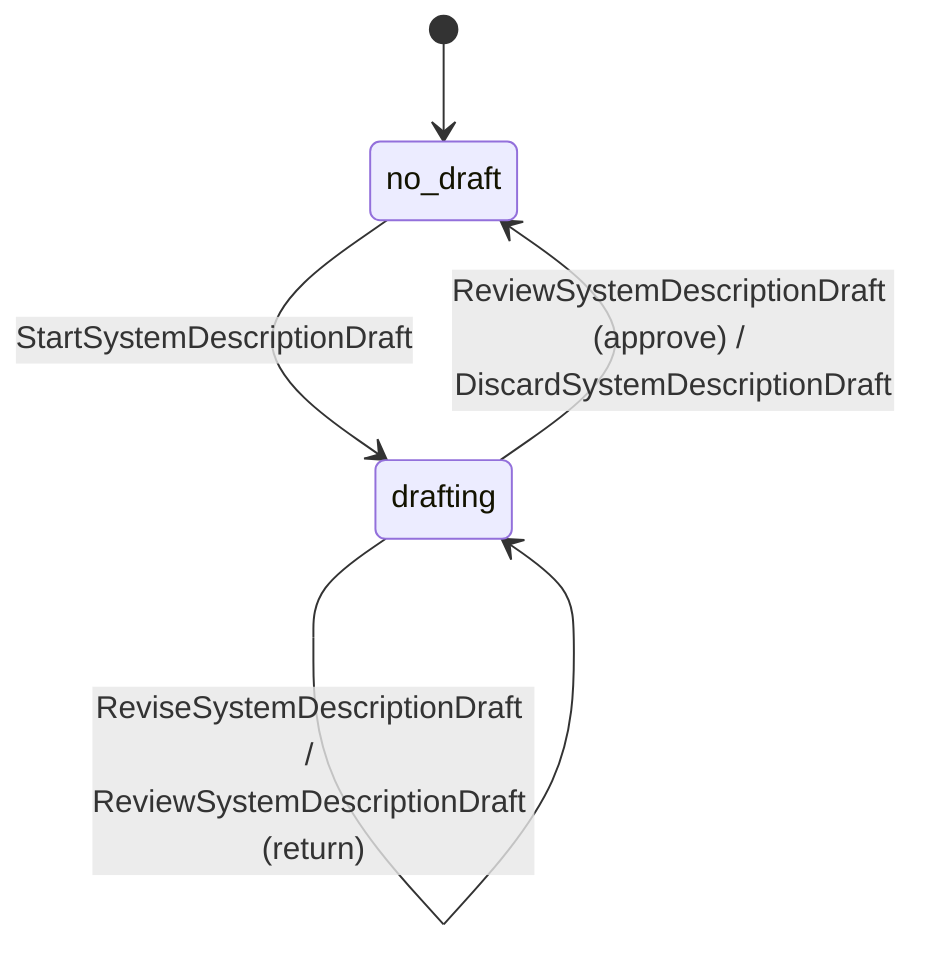
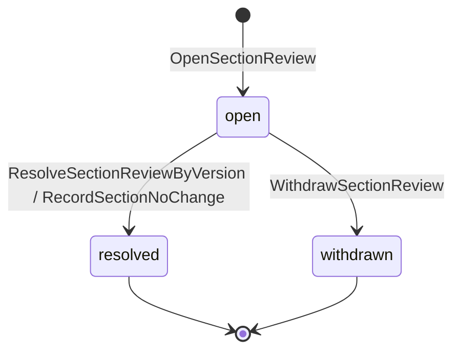
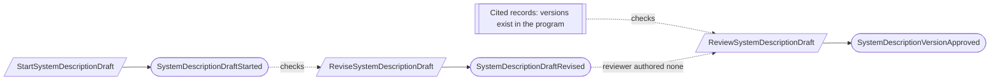
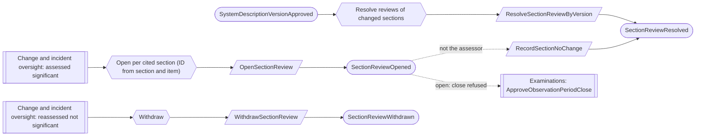

# System description

Status: **locked**, 2026-11-03. Hand-authored source of truth for this context.
It follows the [context conventions](conventions.md).

## Purpose

System description keeps management's description of the system for each
program, structured by the DC 200 headings, and makes sure it is reviewed when a
significant change or incident touches what it says (M0-D17, M0-D21).

**Owns:** system descriptions and their versions, and section reviews.

**Does not own:**

| Concern | Owner |
| --- | --- |
| The records a section cites (boundary, commitments, inventory, controls, providers) | Their contexts |
| Significance of changes and incidents | [Change and incident oversight](change-and-incident-oversight.md) |
| Period close | [Examinations](examinations.md); it refuses close while a section review is open |
| The management assertion | Examinations (`SignManagementAssertion`) |
| Building the exported document and section manifest | Auditor collaboration (package contents) and Exports |

## Language

| Term | Meaning |
| --- | --- |
| Section | One DC 200 heading: `services`, `commitments_and_requirements`, `components`, `incidents`, `criteria_and_controls`, `complementary_user_entity_controls`, `complementary_subservice_organization_controls`, `criteria_not_relevant` or `significant_changes`. |
| Citation | An exact source record and version a section relies on, such as a boundary version, commitment version, system instance or control version. |
| Description version | One approved description of all sections as of a date, with their citations. |
| Section review | An open requirement to look again at one section because of one significant change or incident. |
| No change needed | A recorded decision, with a rationale, that a flagged section stays correct. |

## Aggregates

### SystemDescription

**Identity:** `TenantId` + `ProgramId`.

**Invariant:** one program has one line of approved description versions and at
most one draft. A draft becomes a version only when every section has content,
every citation names an existing record version in the program, and a Compliance
Lead who authored no revision of the draft approves it
([CV-06](conventions.md#guards-and-reviews)). Versions never change.

| Command | Who | Accepts when | Emits |
| --- | --- | --- | --- |
| StartSystemDescriptionDraft | Compliance Lead or Contributor | Program active; no open draft; starts from the current version (or empty for the first) | SystemDescriptionDraftStarted |
| ReviseSystemDescriptionDraft | Compliance Lead or Contributor | Draft open; names the current draft revision | SystemDescriptionDraftRevised |
| ReviewSystemDescriptionDraft | Compliance Lead who authored no revision, or covered by a waiver | Draft open; reviews the current revision; approval rules above hold | SystemDescriptionVersionApproved or SystemDescriptionDraftReturned |
| DiscardSystemDescriptionDraft | Compliance Lead | Draft open; reason given | SystemDescriptionDraftDiscarded |

| Event | Carries |
| --- | --- |
| SystemDescriptionDraftStarted | tenant, program, draft, based on version, started by |
| SystemDescriptionDraftRevised | tenant, program, draft, revision, changed sections with content and citations, as-of date, revised by |
| SystemDescriptionVersionApproved | tenant, program, version, draft revision, as-of date, sections with content hash and citations, sections changed from the previous version, reviewer, waiver (if any) |
| SystemDescriptionDraftReturned | tenant, program, draft, revision, comments, reviewer |
| SystemDescriptionDraftDiscarded | tenant, program, draft, reason, discarded by |

### SectionReview

**Identity:** `TenantId` + `ProgramId` + `Section` + `ItemId` (the change or
incident) (CV-02).

**Invariant:** one section review is open from a significant item's assessment
until it is resolved by a description version whose content for that section
changed after it opened, or by a no-change decision from someone other than the
item's assessor (SD-01, SD-02). It is withdrawn when the item is no longer
significant.

- A significant item opens a review for each section of the current version
  that cites one of its affected records, and always for `significant_changes`
  (a change) or `incidents` (an incident).

| Command | Who | Accepts when | Emits |
| --- | --- | --- | --- |
| OpenSectionReview | Reactor on a significant assessment | New; a repeat is a no-op; a resolved or withdrawn review is opened again only by a later assessment | SectionReviewOpened |
| ResolveSectionReviewByVersion | Reactor on SystemDescriptionVersionApproved | Open; the version changed the section and was approved after the review opened; a repeat is a no-op | SectionReviewResolved |
| RecordSectionNoChange | Compliance Lead who is not the item's assessor, or covered by a waiver | Open; rationale given | SectionReviewResolved |
| WithdrawSectionReview | Reactor on a `not_significant` reassessment | Open | SectionReviewWithdrawn |

| Event | Carries |
| --- | --- |
| SectionReviewOpened | tenant, program, section, item (kind and ID), assessment revision, cited records affected, opened at |
| SectionReviewResolved | tenant, program, section, item, how (`version` with the version, or `no_change` with the rationale), resolved by |
| SectionReviewWithdrawn | tenant, program, section, item, reason |

## Flows

Diagrams follow [CV-01](conventions.md#flow-diagrams).

### Drafting and approving

### Section reviews

## Computed gaps

| Gap | Shown when |
| --- | --- |
| No approved description | An active program has no approved version |
| Open section review | Any section review is open |
| Stale citation | A section of the current version cites a record version that has since been superseded |

## Disagreement and replay

Cases required by [CV-12](conventions.md#guards-and-reviews).

| Case | Outcome |
| --- | --- |
| A version is approved before a section review opens | The review stays open; only a version approved after it opened, or a no-change rationale, resolves it |
| A section review opens while period close is being approved | Close relied on the reviews it saw; a review dated in the period that opens later is a late significant item in Examinations |
| `SystemDescriptionVersionApproved` delivered twice | Resolving an already resolved review is a no-op |

## Decisions

Jev answers are from `jev-1.14.0`, 2026-11-03. A yes is ≥ 0.8 and a no is ≤ 0.2.
Anything in between is settled by common sense, with the reasoning stated.

| ID | Decision | Evidence |
| --- | --- | --- |
| SD-01 | Approving a version resolves only the reviews of sections whose content changed; an unchanged flagged section needs an explicit no-change decision. | 0.55. Common sense: each flagged section then gets a deliberate look, which is what M0-D21 asks for. |
| SD-02 | A no-change decision is made by someone other than the item's assessor. | 0.70. Common sense: the assessor already judged the item; a second person judges the description. |
| SD-03 | Section reviews are their own small records, not part of the description. | One record for draft, versions and flags: 0.59. Common sense: small independent aggregates; a review is opened and resolved independently of drafting. |

## Open questions

None at this time.

## Superseded owners

| Old owner | Becomes |
| --- | --- |
| SystemDescription | SystemDescription and SectionReview |
| `BindSystemDescriptionSources` | Citations on each section of the draft |
| `BindSystemDescriptionToExamination` | Removed: the examination's package names the approved version (Auditor collaboration) |
| `ConfirmSystemDescriptionUnchanged`, SystemDescriptionDecisionReactor | `RecordSectionNoChange` |
| SystemDescriptionExportProcess | Removed: document building is technical (Exports) |
