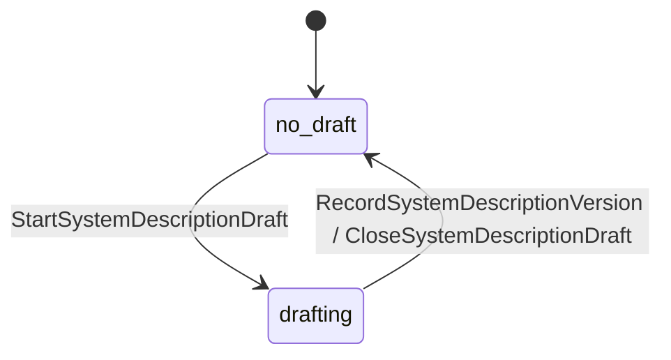
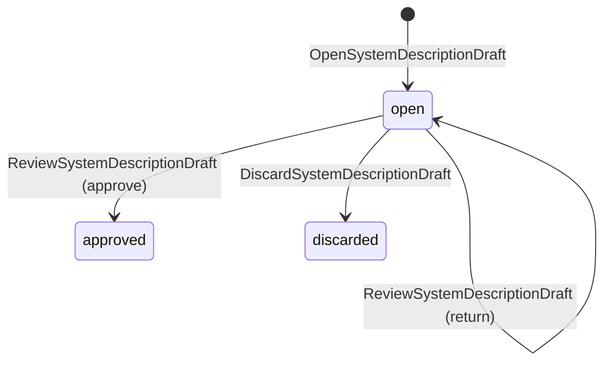
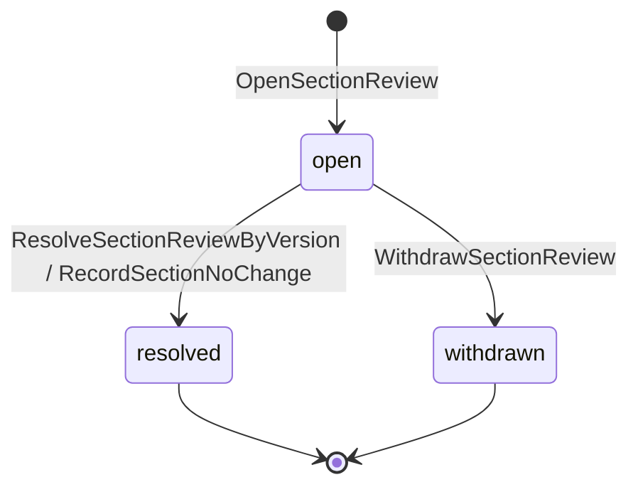
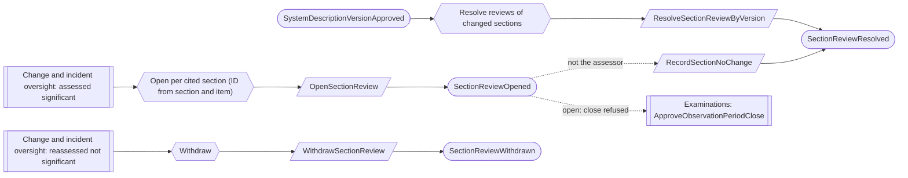

# System description

Status: **refinement in progress**. The prior whole-draft approval candidate
requires an all-citation/all-author write decision and is not an acceptable
boundary under [CV-13](conventions.md#stream-growth). Its product semantics
remain in force until explicitly revised; alternatives and source ordering are
not qualified for implementation.
It follows the [context conventions](conventions.md).

## Purpose

System description keeps management's description of the system for each
program, structured by the DC 200 headings, and makes sure it is reviewed when a
significant change or incident touches what it says (M0-D17, M0-D21).

**Owns:** system descriptions and their versions, and section reviews.

**Does not own:**

| Concern | Owner |
| --- | --- |
| The records a section cites (boundary, commitments, inventory, controls, providers) | Their contexts |
| Significance of changes and incidents | [Change and incident oversight](change-and-incident-oversight.md) |
| Period close | [Examinations](examinations.md); it refuses close while a section review is open |
| The management assertion | Examinations (`SignManagementAssertion`) |
| Building the exported document and its streamed section inventory | Auditor collaboration (package contents) and Exports |

## Language

| Term | Meaning |
| --- | --- |
| Section | One DC 200 heading: `services`, `commitments_and_requirements`, `components`, `incidents`, `criteria_and_controls`, `complementary_user_entity_controls`, `complementary_subservice_organization_controls`, `criteria_not_relevant` or `significant_changes`. |
| Citation | An exact source record and version a section relies on, such as a boundary version, commitment version, system instance or control version. |
| Description version | One approved description of all sections as of a date, with their citations. |
| Section review | An open requirement to look again at one section because of one significant change or incident. |
| No change needed | A recorded decision, with a rationale, that a flagged section stays correct. |

## Aggregates

### SystemDescription

**Identity:** `TenantId` + `ProgramId`.

**Invariant:** one program has one line of approved description versions and at
most one open draft. The line starts each draft, so a second draft can never
open, and it records a version only from its open draft's approval. Versions
never change.

- The line records one small version reference per drafting cycle. Section
  content, citations and independent reviews never appear as collections on it.
  The nine section names are a fixed domain vocabulary, not a child roster.

| Command | Who | Accepts when | Emits |
| --- | --- | --- | --- |
| StartSystemDescriptionDraft | Compliance Lead or Contributor | Program active; no open draft; starts from the current version (or empty for the first) | SystemDescriptionDraftStarted |
| RecordSystemDescriptionVersion | Reactor on SystemDescriptionDraftApproved | The draft is the open one; a repeat is a no-op | SystemDescriptionVersionApproved |
| CloseSystemDescriptionDraft | Reactor on SystemDescriptionDraftDiscarded | The draft is the open one; a repeat is a no-op | SystemDescriptionDraftClosed |

| Event | Carries |
| --- | --- |
| SystemDescriptionDraftStarted | tenant, program, draft, based on version, started by |
| SystemDescriptionVersionApproved | tenant, program, version, draft, immutable source-cut reference, as-of date, reviewer, waiver (if any) |
| SystemDescriptionDraftClosed | tenant, program, draft, reason |

### SystemDescriptionDraft

**Identity:** `TenantId` + `ProgramId` + `DraftId`, opened only by the line's
`SystemDescriptionDraftStarted`.

**Invariant:** one draft is approved only when all nine sections have content, every
citation names an existing record version in the program, and a Compliance Lead
who authored no revision of it approves the exact frozen draft cut
([CV-06](conventions.md#guards-and-reviews)). An approved or discarded draft
accepts nothing further.

| Command | Who | Accepts when | Emits |
| --- | --- | --- | --- |
| OpenSystemDescriptionDraft | Reactor on SystemDescriptionDraftStarted | New; a repeat is a no-op; references the based-on version, without copying its children into an event | SystemDescriptionDraftOpened |
| ReviewSystemDescriptionDraft | Compliance Lead who authored no revision, or covered by a waiver | **Unqualified product target:** open; exact whole-draft approval rules above hold; the prior all-child freeze-and-scan candidate is withdrawn | SystemDescriptionDraftApproved or SystemDescriptionDraftReturned |
| DiscardSystemDescriptionDraft | Compliance Lead | Open; reason given | SystemDescriptionDraftDiscarded |

| Event | Carries |
| --- | --- |
| SystemDescriptionDraftOpened | tenant, program, draft, based on version |
| SystemDescriptionDraftApproved | tenant, program, draft, immutable source-cut reference, as-of date, reviewer, waiver (if any); no content or citation collections |
| SystemDescriptionDraftReturned | tenant, program, draft, reviewed cut reference, bounded comments, reviewer |
| SystemDescriptionDraftDiscarded | tenant, program, draft, reason, discarded by |

### DescriptionSection

**Identity:** `TenantId` + `ProgramId` + `DraftId` + `Section`.

**Invariant:** one of the nine sections has one current bounded authored content
revision within a draft; its revisions are immutable and attributed. Revising it
uses an admitted operation and cannot alter an approved cut. Each
individual authored text has a practical size limit, to be specified with the
product contract; it is not a container for other sections or citations.

| Command | Who | Accepts when | Emits |
| --- | --- | --- | --- |
| ReviseDescriptionSection | Compliance Lead or Contributor | The admission authority accepted this exact operation before freeze; section and current revision match | DescriptionSectionRevised |

| Event | Carries |
| --- | --- |
| DescriptionSectionRevised | tenant, program, draft, section, revision, bounded content or immutable content reference and hash, author, admitted operation |

### DescriptionCitation

**Identity:** `TenantId` + `ProgramId` + `DraftId` + `Section` + `CitationId`.

**Invariant:** one citation independently names one exact source record version
in the same tenant and program. It is added or removed only through an operation
admitted by the draft, and an accepted cut cannot later change. Source versions
must be validated by their owning context, not by a stale projection. Citation
identity and operation identity make exact retries no-ops and changed intent a
conflict.

| Command | Who | Accepts when | Emits |
| --- | --- | --- | --- |
| AddDescriptionCitation | Compliance Lead or Contributor | The admission authority accepted this exact operation before freeze; source owner confirms exact version and scope; citation is new | DescriptionCitationAdded |
| RemoveDescriptionCitation | Compliance Lead or Contributor | The admission authority accepted this exact operation before freeze; citation is active | DescriptionCitationRemoved |

| Event | Carries |
| --- | --- |
| DescriptionCitationAdded | tenant, program, draft, section, citation, source kind, ID and version, author, admitted operation |
| DescriptionCitationRemoved | tenant, program, draft, section, citation, author, admitted operation |

#### Local decisions and the unresolved whole-description rule

The old candidate froze and settled every section edit and citation operation,
then scanned the complete cut and author history at approval. Even if streamed
in bounded memory, this is still a write decision over every child and is
**withdrawn as an implementation approach**. Neither an admission chain nor an
immutable cut or hash changes that. The existing product promise of one approved
description, exact citations and a reviewer independent of every draft author
remains unresolved, not silently weakened.

One product alternative is to approve each exact section revision independently.
Each section decision binds its own content and reviewer; each citation validates
one exact source version through its owner, rather than a section or draft
collecting citations. A read assembles the current approved sections and their
independent citations. A fixed nine-valued section vocabulary is bounded, but
approval of nine section references by itself does **not** prove that every
citation was included or accepted. Exact historical citation membership and the
effect of later citation additions must be specified. This alternative changes
the whole-description approval and exact-set semantics: an assembled view is not
the existing single approved version, and a lagging view cannot authorize a
period close or package signature. Product acceptance is required.

Another candidate designates one reviewer permanently when the draft opens.
Every independent section and citation authoring operation would require an
author distinct from that reviewer, or an exact applicable waiver. If every
writer, amendment and retry obeyed that admission rule, reviewer independence
would follow without scanning authors at approval. This moves reviewer choice
earlier: changing the reviewer, invalidating a waiver or correcting an old
revision needs a new draft or another explicitly designed lifecycle. A stale
authors projection is not an alternative. No protocol yet demonstrates how
each writer is ordered against the draft's review/freeze, including an empty
target, uncertain commit and abandoned or retried operation. Predesignating a
reviewer alone does not prove the approved description is complete or immutable.

An exact source position may identify a read-side view only if provider order,
retention, the operation's outcome and late writes are qualified. It is not an
all-citation approval mechanism. Source-bound inheritance and exact historical
versions likewise remain unqualified. A section review resolves by a later
approved version only when that exact section changed; no list of changed
sections is required on the description line. See the
[boundary review](../reviews/description-advisor-boundaries.md) for the product
tradeoffs and adversarial cases.

### SectionReview

**Identity:** `TenantId` + `ProgramId` + `Section` + `ItemId` (the change or
incident) (CV-02).

**Invariant:** one section review is open from a significant item's assessment
until it is resolved by a description version whose content for that section
changed after it opened, or by a no-change decision from someone other than the
item's assessor (SD-01, SD-02). It is withdrawn when the item is no longer
significant.

- A significant item opens a review for each section of the current version
  that cites one of its affected records, and always for `significant_changes`
  (a change) or `incidents` (an incident).

| Command | Who | Accepts when | Emits |
| --- | --- | --- | --- |
| OpenSectionReview | Reactor on a significant assessment | New; a repeat is a no-op; a resolved or withdrawn review is opened again only by a later assessment | SectionReviewOpened |
| ResolveSectionReviewByVersion | Reactor on SystemDescriptionVersionApproved | Open; the version changed the section and was approved after the review opened; a repeat is a no-op | SectionReviewResolved |
| RecordSectionNoChange | Compliance Lead who is not the item's assessor, or covered by a waiver | Open; rationale given | SectionReviewResolved |
| WithdrawSectionReview | Reactor on a `not_significant` reassessment | Open | SectionReviewWithdrawn |

| Event | Carries |
| --- | --- |
| SectionReviewOpened | tenant, program, section, item (kind and ID), exact assessment revision, source description cut, opened at; no collection of affected citations |
| SectionReviewResolved | tenant, program, section, item, how (`version` with the version, or `no_change` with the rationale), resolved by |
| SectionReviewWithdrawn | tenant, program, section, item, reason |

## Flows

Diagrams follow [CV-01](conventions.md#flow-diagrams).

### Drafting and approving

```mermaid
flowchart LR
    C1[/StartSystemDescriptionDraft/] --> E1([SystemDescriptionDraftStarted])
    E1 --> R1{{"Open the draft (ID from the start)"}} --> C5[/OpenSystemDescriptionDraft/] --> E5([SystemDescriptionDraftOpened])
    E5 -. checks .-> C2[/ReviseDescriptionSection/] --> E2([DescriptionSectionRevised])
    E5 -. checks .-> C8[/AddDescriptionCitation/] --> E8([DescriptionCitationAdded])
    X1[[Cited records: versions exist in the program]] -. checks .-> C3
    E2 -. "whole-draft approval target; authority unresolved" .-> C3[/ReviewSystemDescriptionDraft/] --> E4([SystemDescriptionDraftApproved])
    E4 --> R2{{Record the version}} --> C4[/RecordSystemDescriptionVersion/] --> E3([SystemDescriptionVersionApproved])
    C6[/DiscardSystemDescriptionDraft/] --> E6([SystemDescriptionDraftDiscarded]) --> R3{{Close the draft}} --> C7[/CloseSystemDescriptionDraft/] --> E7([SystemDescriptionDraftClosed])
```

### Section reviews

#### Section-review and close qualification

Review creation follows a committed significance assessment asynchronously. A
query of existing reviews alone can miss an assessment whose review has not yet
opened. M0-D21 requires period close to refuse while any required section review
is unresolved. The prior proposal to settle all assessment and review outcomes
through a close frontier still makes closure depend on every related item and is
not an acceptable write-model solution. An incremental view can expose known
open reviews but, especially while processing lags, cannot prove that none are
unresolved. A product alternative or a local invariant preserving the exact
M0-D21 guarantee remains to be designed; the rule is not waived here. Later
significant assessments still need the late-item path. Current-citation lookup,
reassessment races, independent review outcomes and close ordering are all
unqualified; see [Examinations](examinations.md).

## Computed gaps

| Gap | Shown when |
| --- | --- |
| No approved description | An active program has no approved version |
| Open section review | Any section review is open |
| Stale citation | A section of the current version cites a record version that has since been superseded |

## Disagreement and replay

Cases required by [CV-12](conventions.md#guards-and-reviews).

| Case | Outcome |
| --- | --- |
| A version is approved before a section review opens | The review stays open; only a version approved after it opened, or a no-change rationale, resolves it |
| A section review opens while period close is being approved | An already committed assessment inside the close frontier must be accounted for even if its review reactor has not run; a later assessment follows the late-item path. The frontier protocol remains unqualified |
| `SystemDescriptionVersionApproved` delivered twice | Resolving an already resolved review is a no-op |
| `SystemDescriptionDraftApproved` delivered twice | `RecordSystemDescriptionVersion` repeat is a no-op; one draft gives one version |

## Decisions

Jev answers are from `jev-1.14.0`, 2026-11-03. Historical 0.8/0.2 thresholds
were triage conventions, not proof or measured design-correctness confidence;
inconclusive or conflicting cases remain open for evidence.

| ID | Decision | Evidence |
| --- | --- | --- |
| SD-01 | Approving a version resolves only the reviews of sections whose content changed; an unchanged flagged section needs an explicit no-change decision. | 0.55. Common sense: each flagged section then gets a deliberate look, which is what M0-D21 asks for. |
| SD-02 | A no-change decision is made by someone other than the item's assessor. | 0.70. Common sense: the assessor already judged the item; a second person judges the description. |
| SD-03 | Section reviews are their own small records, not part of the description. | One record for draft, versions and flags: 0.59. Common sense: small independent aggregates; a review is opened and resolved independently of drafting. |
| SD-04 | The program line starts one draft and records a small immutable cut reference; independent sections, citations and section reviews keep their own facts. | The former per-draft collection design is superseded; see [boundary review](../reviews/description-advisor-boundaries.md). |

## Open questions

The whole-description approval semantics, per-section alternative, reviewer
designation timing and waiver lifecycle require product resolution. Exact
source-version/author admission, section freeze, citation membership and
period-close protocols require qualification before lock. The line itself
records an event for each draft/version; Portia's full-stream hydration means
its own lifecycle can still grow and needs an explicit replay strategy.

## Superseded owners

| Old owner | Becomes |
| --- | --- |
| SystemDescription | SystemDescription (version line), SystemDescriptionDraft (SD-04) and SectionReview |
| `BindSystemDescriptionSources` | Citations on each section of the draft |
| `BindSystemDescriptionToExamination` | Removed: the examination's package names the approved version (Auditor collaboration) |
| `ConfirmSystemDescriptionUnchanged`, SystemDescriptionDecisionReactor | `RecordSectionNoChange` |
| SystemDescriptionExportProcess | Removed: document building is technical (Exports) |
