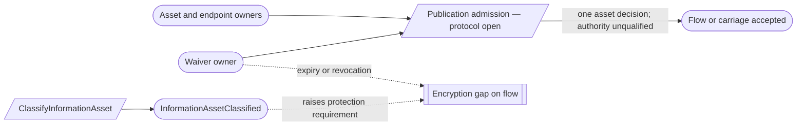

# Technology and information inventory

Status: **locked**, 2026-11-03, except the DataFlow boundary and publication
protocol below, which are **under qualification**. Hand-authored source of truth
for this context. Do not implement that protocol until its listed blockers are
resolved; the existing M0-D08 and TI-02 product rules remain in force.

**2026-11-05 boundary correction:** A publication command that enumerates every
carried-asset outcome remains an all-child write decision. The previously
described source-cut completion protocol is withdrawn, even if the asset links
are independently stored. The alternative lifecycles below change product
semantics and remain unapproved.

## Purpose

This context records the technology, information, data flows, locations and
operational processes the scoped system depends on, at the granularity a small
team manages: accounts and environments, not individual resources (M0-D08). The
inventory in the product is authoritative; cloud consoles, MDM and repository
hosts are only for discovering gaps.

**Owns:** technology components, information assets, data flows, locations and
operational processes.

**Does not own:**

| Concern | Owner |
| --- | --- |
| Cloud accounts | Application inventory: a cloud account is a `SystemInstance` of kind `cloud_account` (TI-01) |
| Owners | Workforce assurance (`Person`) |
| Approved exceptions to encryption rules | Assurance work (waivers) |
| Retention periods | Retention (M0-D16); assets hold a reference |
| Written procedures | Policies; a procedure is policy content, never an operational process |
| Connectors | Deferred: none is built now (M0-D08) |

## Language

| Term | Meaning |
| --- | --- |
| Technology component | One governed environment, network, data store, repository or endpoint class. |
| Endpoint class | A group of devices, such as "managed macOS laptops", recorded by count and management source. Individual devices are out of scope. |
| Information asset | A body of information with one classification (`public`, `internal`, `confidential`, `restricted`), a retention reference and an owner. |
| Data flow | Information moving from a service or system instance to a data store or an external party, with its purpose and encryption in transit and at rest. |
| Location | A place the system depends on, such as an office, data center or cloud region, with a kind. |
| Operational process | A governed business process, such as change management or onboarding. |

## Aggregates

The five inventory records follow the same lifecycle: active, then retired. Retirement
is final, keeps the identity for history, and needs a reason; something revived
later is a new record (TI-03). Changes are recorded as named facts, not one
generic revision (as WF-03).

### TechnologyComponent

**Identity:** `TenantId` + `ComponentId`.

**Invariant:** one component has one category for life (`environment`, `network`,
`data_store`, `repository`, `endpoint_class`), a governed name, an owner, an
environment reference, and a location reference.

- An endpoint class also has a count and a management source.
- A component that lives in a cloud account references that account's system
  instance (TI-01).

| Command | Who | Accepts when | Emits |
| --- | --- | --- | --- |
| RecordTechnologyComponent | Compliance Lead or Contributor | `ComponentId` is new; category fields complete | TechnologyComponentRecorded |
| ChangeTechnologyComponentDetails | Compliance Lead or Contributor | Active | TechnologyComponentDetailsChanged |
| ChangeTechnologyComponentOwner | Compliance Lead | Active | TechnologyComponentOwnerChanged |
| RetireTechnologyComponent | Compliance Lead | Active; reason given | TechnologyComponentRetired |

| Event | Carries |
| --- | --- |
| TechnologyComponentRecorded | tenant, component, category, name, owner, environment, location, system instance (if any), endpoint count and management source (endpoint class), recorded by |
| TechnologyComponentDetailsChanged | tenant, component, changed fields, changed by |
| TechnologyComponentOwnerChanged | tenant, component, previous owner, new owner, changed by |
| TechnologyComponentRetired | tenant, component, effective at, reason, retired by |

### InformationAsset

**Identity:** `TenantId` + `InformationAssetId`.

**Invariant:** one asset has exactly one classification, one retention reference
and one owner.

- Raising the classification is allowed even when flows that carry the asset no
  longer meet the encryption rule; those flows show as gaps (TI-02).

| Command | Who | Accepts when | Emits |
| --- | --- | --- | --- |
| RecordInformationAsset | Compliance Lead or Contributor | `InformationAssetId` is new; one classification | InformationAssetRecorded |
| ClassifyInformationAsset | Compliance Lead | Active; classification differs | InformationAssetClassified |
| ChangeInformationAssetDetails | Compliance Lead or Contributor | Active | InformationAssetDetailsChanged |
| ChangeInformationAssetOwner | Compliance Lead | Active | InformationAssetOwnerChanged |
| RetireInformationAsset | Compliance Lead | Active; reason given | InformationAssetRetired |

| Event | Carries |
| --- | --- |
| InformationAssetRecorded | tenant, asset, name, classification, retention reference, owner, recorded by |
| InformationAssetClassified | tenant, asset, previous classification, new classification, classified by |
| InformationAssetDetailsChanged | tenant, asset, changed fields, changed by |
| InformationAssetOwnerChanged | tenant, asset, previous owner, new owner, changed by |
| InformationAssetRetired | tenant, asset, effective at, reason, retired by |

Retiring an asset does not change its data flows.

### DataFlow and its carried assets — under qualification

**Identity:** `TenantId` + `DataFlowId`.

**Invariant:** each published flow version has an immutable source (a client
service or system instance), destination (a data store or an external party),
purpose, explicit `encrypted_in_transit` and `encrypted_at_rest` flags, and at
least one information asset (M0-D08); effective dates never move backward.
The flow owns its lifecycle and sequence of effective-dated versions. This is the
required invariant, not a claim that the candidate cross-owner publication and
admission protocol below has been qualified.

The former `DataFlowRecorded` and `DataFlowRevised` descriptions copied the
entire asset list into each event. A flow can carry arbitrarily many assets, so
that shape is withdrawn. **Candidate boundary:** each version records exactly
one designated carried asset ID as an anchor; additional carried assets are
independent, small `DataFlowAsset` records, identified by tenant, flow, version
and asset. The anchor is part of that version, not a roster; its identity is not
separately duplicated as an additional asset. A link owns only its own identity,
admission and outcome, never other links. These boundaries must not turn the flow,
a version, or a coordinator into an asset roster, a list of outcomes, or a
per-asset event stream. User interfaces and exports assemble assets from the
published version and its links using ordered, paged or streaming access, without
loading and sorting the entire population in memory. The anchor proves the
version names at least one asset; it does **not** prove that asset was active or
that the encryption rule was satisfied at publication.

The prior proposal described a published version as an immutable statement of
**all** its carried assets, approved at one instant. Its publication command had
to enumerate every link outcome. That is incompatible with the no-all-child-write
direction and is withdrawn as a mechanism, not silently redefined as equivalent.
M0-D08's versioned flow, 1..* carried assets and encryption rules remain in force
until their meaning is explicitly resolved.

**Two unapproved local alternatives** avoid a write decision over every asset:

1. **One asset per flow version.** Each version owns exactly one carried asset,
   its endpoints, purpose and protection settings. A read model groups related
   versions for display. Each write decides one asset; it neither approves a
   group nor asserts all grouped versions became effective together. This changes
   flow identity, and a multi-asset change is no longer atomic.
2. **One anchored flow plus independent carriage.** An immutable version names
   one accepted asset as its nonempty witness. Each additional `DataFlowAsset`
   owns one separately effective-dated association and exact acceptance or
   refusal. A read displays accepted associations with freshness and source
   coverage, rather than claiming that the anchor proves every association is
   present. This changes an immutable whole-asset-set publication into incremental
   membership. Define removal, historical cut, retries and exact version binding;
   do not call an eventually consistent listing a complete published snapshot.

For either direction a separate carriage can be pending, refused, or accepted;
the same operation and intent retries idempotently, while changed intent conflicts.
Neither alternative is approved as equivalent to M0-D08, and neither makes an
unqualified source frontier, marker or successful dispatch authoritative.

**Admission authority is also a blocker.** At record and revision, the source,
destination and carried assets must be active and the encryption rule must hold:
when an asset is `confidential` or `restricted`, both flags are true unless an
approved, unexpired, exact-scope `data_flow_encryption` waiver applies. A read of
an asset, endpoint or waiver can become stale before the flow commits. The
revised design must identify each participant's authoritative acceptance or
refusal for the exact version, the applicable generation/version and effective
time, and how its commitment is fenced against retirement, reclassification,
waiver revocation and expiry through publication. It must specify cancellation,
expiry and crash recovery, including a late message after cancellation, without
requiring those participants to keep unbounded child lists. An audit exception
is not a waiver, and a nonempty exception reference is not approval. Until that
protocol and time semantics are proved, the table below states the former
whole-version candidate, not a qualified implementation. Its all-outcome guard
must be redesigned after the product semantics are resolved.

A potential per-proposal ordering design places a carriage proposal, the exact
classification and waiver facts, and later classification changes into one
qualified, retained ordered source. An evaluator decides **one proposal** against
the earlier facts and acknowledges only its durable accepted or refused outcome.
This is only a candidate: all relevant writers must actually share the same
gapless scope; deployed ordering, retention, replay, recovery, retries, waiver
expiry, no-bypass and the business effective instant must be proven. Portia's
per-stream expected-position append alone does not establish a multi-stream
transaction. Later reclassification still produces the existing TI-02 gap.

Requiring both encryption flags for a limited initial flow capability avoids
the classification-dependent protection branch. It does not complete M0-D08,
which also permits qualifying public/internal or waiver-backed flows, and it
does not prove endpoint and asset activity at acceptance.

| Command | Who | Accepts when | Emits |
| --- | --- | --- | --- |
| RecordDataFlow | Compliance Lead or Contributor | New flow; the exact version and all participant outcomes satisfy the publication and admission rules above | DataFlowRecorded |
| ReviseDataFlow | Compliance Lead or Contributor | Active; a complete new version satisfies those rules; effective date not earlier | DataFlowRevised |
| RetireDataFlow | Compliance Lead | Active; reason given | DataFlowRetired |

| Event | Carries |
| --- | --- |
| DataFlowRecorded | tenant, flow, version, effective at, source, destination, designated asset, purpose, encryption flags, approved waiver reference and exact reliance (if any), recorded by |
| DataFlowRevised | tenant, flow, version, effective at, source, destination, designated asset, purpose, encryption flags, approved waiver reference and exact reliance (if any), revised by |
| DataFlowRetired | tenant, flow, effective at, reason, retired by |

Any independent `DataFlowAsset` admission and its exact outcome belongs to its
own record; event names and historical visibility are not yet approved. Such
events must not carry lists. Historical version reads must not substitute current
links or an eventually consistent list for a declared complete historical snapshot.

Later asset reclassification is still recorded as truth (TI-02). If that change,
or a waiver's expiry or revocation, leaves a published flow inadequately
protected, the flow shows an encryption gap until encryption or an applicable
waiver repairs it. The current classification and waiver are relevant for that
gap, not proof of what was true at the earlier publication.

### Location

**Identity:** `TenantId` + `LocationId`.

**Invariant:** one location has one kind for life and a name. Among active
locations of the same kind, names should be unique: advice checked when a name is
set, with the `duplicate_location_name` gap and a rename to repair it (TI-04).

| Command | Who | Accepts when | Emits |
| --- | --- | --- | --- |
| RecordLocation | Compliance Lead or Contributor | `LocationId` is new; name unused within kind | LocationRecorded |
| RenameLocation | Compliance Lead or Contributor | Active; name unused within kind | LocationRenamed |
| ChangeLocationDetails | Compliance Lead or Contributor | Active | LocationDetailsChanged |
| RetireLocation | Compliance Lead | Active; reason given | LocationRetired |

A retired location's name becomes available again.

| Event | Carries |
| --- | --- |
| LocationRecorded | tenant, location, kind, name, details, recorded by |
| LocationRenamed | tenant, location, previous name, new name, renamed by |
| LocationDetailsChanged | tenant, location, changed fields, changed by |
| LocationRetired | tenant, location, effective at, reason, retired by |

### OperationalProcess

**Identity:** `TenantId` + `OperationalProcessId`.

**Invariant:** one process has one type for life, a name, an owner and a
description. Names should be unique among active processes: advice checked when
a name is set, with the `duplicate_process_name` gap and a rename to repair it
(TI-04).

| Command | Who | Accepts when | Emits |
| --- | --- | --- | --- |
| RecordOperationalProcess | Compliance Lead or Contributor | `OperationalProcessId` is new; name unused | OperationalProcessRecorded |
| RenameOperationalProcess | Compliance Lead or Contributor | Active; name unused | OperationalProcessRenamed |
| ChangeOperationalProcessDetails | Compliance Lead or Contributor | Active | OperationalProcessDetailsChanged |
| ChangeOperationalProcessOwner | Compliance Lead | Active | OperationalProcessOwnerChanged |
| RetireOperationalProcess | Compliance Lead | Active; reason given | OperationalProcessRetired |

| Event | Carries |
| --- | --- |
| OperationalProcessRecorded | tenant, process, type, name, owner, description, recorded by |
| OperationalProcessRenamed | tenant, process, previous name, new name, renamed by |
| OperationalProcessDetailsChanged | tenant, process, changed fields, changed by |
| OperationalProcessOwnerChanged | tenant, process, previous owner, new owner, changed by |
| OperationalProcessRetired | tenant, process, effective at, reason, retired by |

## Flows

Other consumers, such as risk, the system description and controls, react to
inventory facts in their own contexts. Each candidate requires cross-owner
authority for its specific asset and waiver; participants, durable outcomes and
retry behavior remain blockers, not claims that current-state checks suffice.

### Data flow encryption

The gap is derived from current authoritative facts and visible until repaired;
publication requires its own qualified authority. The lag or failure of gap
projection must not be represented as evidence that a flow is compliant.

## Computed gaps

| Gap | Shown when |
| --- | --- |
| `data_flow_encryption` | A published flow carries a confidential or restricted asset without both encryption flags and without a currently applicable waiver |
| `duplicate_location_name` | Two active locations of the same kind share a name |
| `duplicate_process_name` | Two active operational processes share a name |

## Decisions

Jev answers are from `jev-1.14.0`, 2026-11-03. A yes is ≥ 0.8 and a no is ≤ 0.2.
Anything in between is settled by common sense, with the reasoning stated.

| ID | Decision | Evidence |
| --- | --- | --- |
| TI-01 | Cloud accounts are recorded only as system instances; no cloud-account component. | 0.75. M0-D08: cloud-account components correspond one-to-one with system instances and are not duplicated. |
| TI-02 | Raising a classification is allowed, and flows that no longer meet the encryption rule show as gaps. | 0.74. Same pattern as an overdue service-identity review: show the gap, don't block the truth. |
| TI-03 | Retirement is final for all inventory records; something revived is a new record. | Location restorable: 0.49; process retirement final: 0.46, both even. Common sense: the same rule as applications and work relationships keeps lifecycles simple. This replaces the earlier allowance to reactivate assets and locations. |
| TI-04 | Name uniqueness for locations and processes is advice with a duplicate gap and a rename to repair it; there are no name-claim aggregates or name-change processes. | Small independent aggregates (as AI-03, CV-05). |

## Open questions

- Resolve which asset/version lifecycle is the product rule. Qualify one-asset
  admission, historical visibility, replay, crashes and late messages without
  a command that enumerates every carried asset. No projection is a substitute
  for required authority.
- Qualify exact active-state, classification and waiver admission across owners,
  including expiry, revocation and competing changes. Specify whether the
  required authority can be delivered without unbounded holds or parent-owned
  lists; otherwise revisit the product rule with its decision owner.
- Prove store-backed ordered pagination and reconstruction of an exact version
  without an unbounded in-memory sort, and define how a read reports pending or
  incomplete indexing. Assess the existing full-array API and event migration
  before claiming wire or historical compatibility.

The [Jev boundary review](../reviews/inventory-technology-boundaries-review.md)
records the evidence and counterexamples. These questions are blockers, not
permission to relax M0-D08.

## Superseded owners

| Old owner | Becomes |
| --- | --- |
| TechnologyComponent | TechnologyComponent (no `cloud_account` category; TI-01) |
| InformationAsset | InformationAsset |
| DataFlow | DataFlow |
| Location | Location |
| OperationalProcess | OperationalProcess |
| LocationNameClaim, OperationalProcessNameClaim | Removed (TI-04) |
| LocationNameChangeProcess, OperationalProcessNameChangeProcess | Removed (TI-04) |
